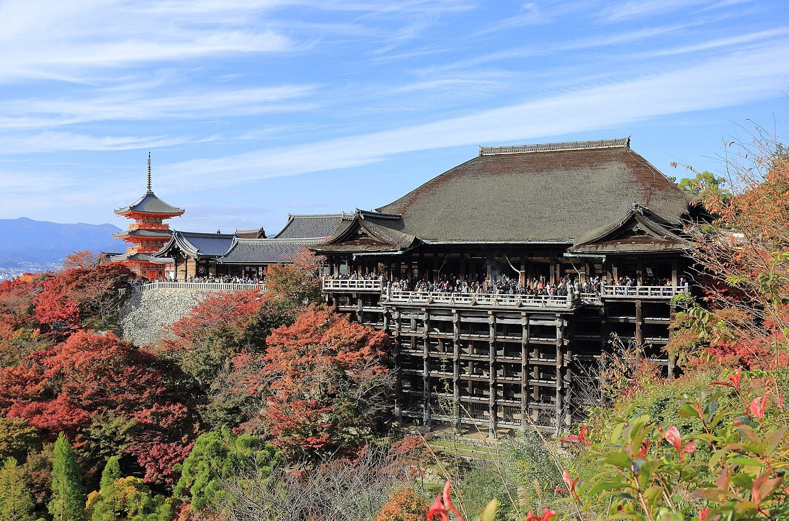
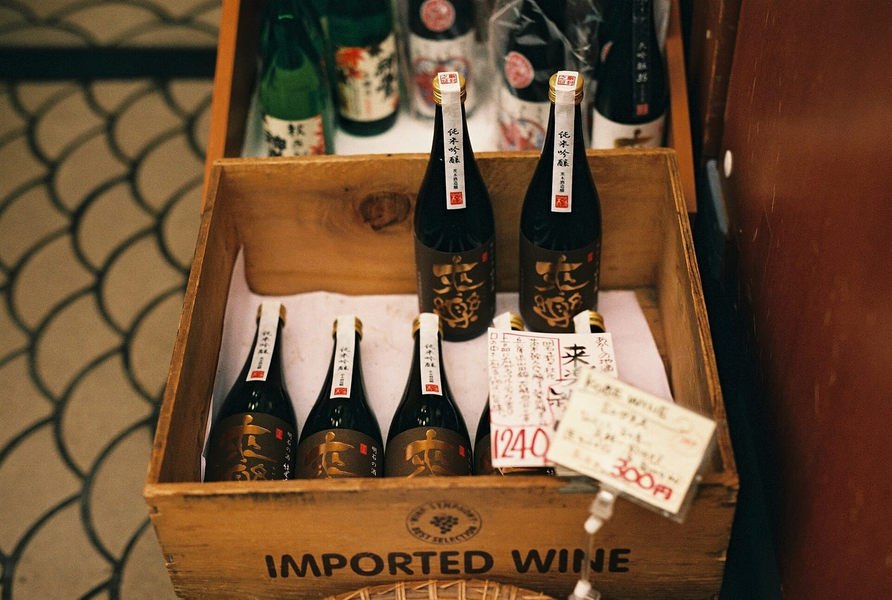
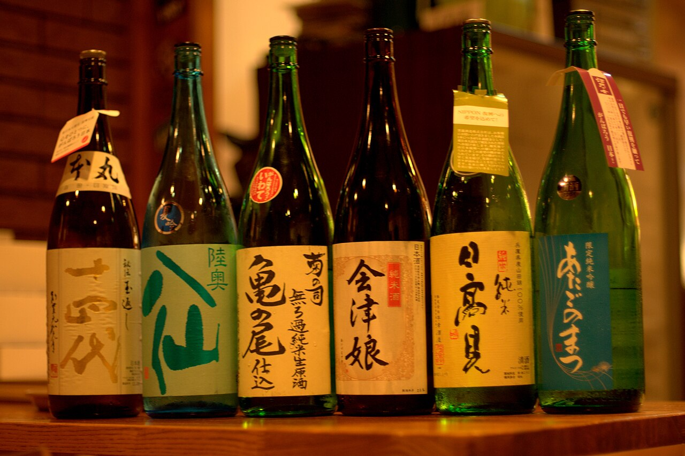

# Kyoto

Kyoto is first a [Japanese](ref:japan) city and also a prefecture. As a [sake](ref:sake) region, "Kyoto" can mean the breweries inside Kyoto City or the brewing tradition of the whole prefecture. This region treats the prefecture-level geography: it places Rakuchu, Fushimi, Kyoto Tanba, Miyazu, Fukuchiyama, and Kyotango-Mineyama on one map, without repeating Fushimi's canal and museum details.

Figure: Kyoto. Image: Martin Falbisoner, CC BY-SA 4.0, via Wikimedia Commons ([source page](https://commons.wikimedia.org/wiki/File:Kiyomizu-dera,_Kyoto,_November_2016_-02.jpg)).

> **Quick verdict**
> **In one line:** This region helps you judge Kyoto for flavour and travel, and plan accordingly.
>
> - **Best for:** Anyone comparing Kyoto with other regions before buying wine or planning a trip.
> - **Not for:** If you want want a “most expensive region” verdict and do not care about style or vintage.
> - **Check first:**
>   - Kyoto food culture centres on seasonality, restraint, and the taste of the ingredient.
>   - For Kyoto, begin with the appellation and its permitted varieties.

## Definition and scope

Kyoto Prefecture's breweries are coordinated by the Kyoto Prefecture Sake Brewers Association, which divides them into regional groups. According to the association's brewery list, the prefecture includes at least Kyotango-Mineyama, Miyazu, Fukuchiyama, Kyoto Tanba, Rakuchu, and Fushimi. The Miyazu group also covers breweries in Maizuru, and the Kyoto Tanba group covers Kameoka and Kyotanba. This structure shows that "Kyoto sake" is not one region but a combination of small urban breweries, the Fushimi cluster in the south, and local breweries in the northern hills and on the Sea of Japan side.

Treating Kyoto Prefecture and Kyoto City as the same thing misses the key geographic difference. Inside Kyoto City, Rakuchu and Fushimi are the main references: Rakuchu covers small breweries in Kamigyo, Sakyo, and Ukyo, while Fushimi is the riverside cluster in the south. Outside the city, Tanba, Tango, Miyazu, and Fukuchiyama brew with local rice and water. The prefecture page explains how these divisions differ and cooperate, rather than generalising one local style to the whole prefecture.

## Divisions: Rakuchu, Fushimi, Tanba and Tango

Rakuchu means the central wards of Kyoto. Breweries were once dense there; today only a few small producers remain. In the association list, the Rakuchu group includes Sasaki Shuzo in Kamigyo, Matsui Shuzo in Sakyo, and Haneda Shuzo in the Kyokita area of Ukyo. They are small, but their ranges are complete, with junmai, ginjo, honjozo, and seasonal releases. Rakuchu's advantage is not volume but proximity to Kyoto's consumers, temples, restaurants, and tourist routes.

Fushimi is the largest sake cluster in the prefecture and has its own association, spread along the Uji River and the Horikawa. It includes Gekkeikan, Kizakura, Kinshi Masamune, and Tamanohikari, as well as several small and mid-sized breweries. Fushimi's water, shipping, and museum system is a separate story; this region mentions it only at the level of division, without expanding on Fushui, the Jikkokubune boats, or the memorial museums, to avoid duplicating the Fushimi page.

Kyoto Tanba, Miyazu, Fukuchiyama, and Kyotango-Mineyama are the prefecture's rural sake areas. They lie in the Tanba highlands, on the Sea of Japan side around Miyazu and Maizuru, and in the Kyotango region. Their climate and water differ from central Kyoto, and their styles are closer to local drinking habits. The Kyoto Tanba group includes breweries in Kameoka and Kyotanba; the Miyazu group includes Miyazu, Maizuru, Yosano, and Ine; the Kyotango-Mineyama group is concentrated in Kyotango. Listing these names shows that Kyoto Prefecture is not built on a single Fushimi template.

## Small breweries in Rakuchu: Sasaki Shuzo

Sasaki Shuzo is the representative Rakuchu brewery. It was founded in 1893 and stands in Kitai seya-cho, Kamigyo ward, on the southern edge of Toyotomi Hideyoshi's former Jurakudai residence. The brewery uses Kinmeisui and Ginmeisui, spring waters linked to the tea master Sen no Rikyu, as brewing water, and its main labels include Jurakudai, Koto, and Nishinokiwami. The novelist Yasunari Kawabata reportedly called Koto's flavour the taste of Kyoto, a literary anecdote that ties the brewery to the city's memory.

The meaning of a small brewery is not only "old." A Rakuchu producer must keep brewing in limited central-city space, which pushes it toward handwork, small batches, and direct sales. Sasaki Shuzo offers brewery visits by reservation, connecting the Jurakudai site, the lanes of Kamigyo, and the brewhouse in a short route. For visitors, this kind of visit shows the relationship between the city and brewing more clearly than a large factory; for researchers, it is a sample of how central Kyoto breweries survive among homes, temples, and commercial districts.

Rakuchu is not a smaller copy of Fushimi. Fushimi is an industrial cluster formed along the river; Rakuchu is a set of dispersed breweries embedded in the city. Fushimi is known for large companies and museums; Rakuchu is known for small producers, limited releases, and local sales. Placing them in one prefecture page highlights this division of labour rather than flattening their styles into one.

## Water and rice: Kyoto's brewing conditions

Brewing conditions vary sharply from north to south in Kyoto Prefecture. Breweries in Kyoto City mostly use groundwater or wells, with water quality varying by site; Fushimi is known for medium-hard water; Tanba and Tango rely more on mountain springs and river systems. Hardness, iron content, and mineral composition affect saccharification, fermentation speed, and the structure of the sake, so "Kyoto water" cannot be treated as one category. For a specific brewery, its published brewing-water description is more reliable than the place name.

[Rice](ref:rice) selection is equally diverse. Kyoto breweries use Yamada Nishiki, Gohyakumangoku, Iwai, Omachi, and other sake rice, including contracted rice grown in the prefecture. [Polishing ratio](ref:polishing) is the key label indicator: [junmai](ref:junmai) uses only white rice, rice koji, and water; junmai ginjo requires 60% or less; junmai daiginjo requires 50% or less; honjozo allows a small amount of brewing alcohol, requires 70% or less, limits added alcohol to 10% of the white rice weight, and requires rice koji to reach at least 15% of the white rice weight. These thresholds come from the National Tax Agency's labelling standard and apply throughout Japan, including Kyoto.

The yeast starter also shapes style. Small breweries in Rakuchu and elsewhere use different [starter](ref:kimoto) routes such as kimoto, yamahai, and sokujo. Kimoto and yamahai rely on natural lactic acid bacteria, giving more complex acidity and umami but higher risk; sokujo adds lactic acid, fermenting more stably with a cleaner profile. Calling all Kyoto sake "soft" hides these process choices.

## Food pairing: the Kyoto table

Kyoto food culture centres on seasonality, restraint, and the taste of the ingredient. Sake pairing should not chase the most expensive bottle but match saltiness, fat, umami, and temperature. Tofu, wheat gluten, grilled fish, pickles, sushi, and temple vegetarian food suit junmai or ginjo; light dishes pair with light, moderately acidic sake, while richer dishes pair with fuller, more umami-driven junmai. Kyoto cuisine is often summarised as "delicate," but pickling, fermentation, and dashi add layers, and those layers belong in the pairing.

Temperature is part of pairing. [Ginjo](ref:ginjo) styles suit slightly cool or room temperature; junmai and fuller styles can be warmed. Warming amplifies rice aroma and umami, and can also amplify the sense of alcohol. Kyoto's cold winters make warm sake with tofu and hot pots feel more coherent; summer favours chilled sake or lightly sparkling styles. There is no single answer: the principle is to match intensity so that neither the sake nor the food overwhelms the other.

## Labels and buying

For Kyoto, begin with the appellation and its permitted varieties. Then look at the vintage and the producer, and finally ask how the wine is labelled. The answers point to different choices, not to a single score.

For shopping, Rakuchu small breweries suit limited and seasonal bottles, Fushimi suits museum collaborations and standard products, and Tanba, Tango, and Miyazu suit local rice and local-water specialities. Airport and station retailers usually cost more than brewery direct sales but offer a broader selection; brewery shops answer technical questions but are constrained by opening hours and stock. Wherever you buy, confirm transport and storage conditions, especially for unpasteurised and chilled sake.

## Common misconceptions

First, "Kyoto sake" is not another name for Fushimi. Fushimi is the largest cluster, but Rakuchu, Tanba, Tango, Miyazu, Fukuchiyama, and Kyotango-Mineyama each have their own breweries and styles.

Second, Rakuchu is not "empty of breweries." Sasaki Shuzo, Matsui Shuzo, Haneda Shuzo, and other small producers remain, though their scale and distribution differ from Fushimi.

Third, "Kyoto water" is not uniformly soft. Water varies from north to south: Fushimi is medium-hard, while Tanba and Tango rely more on mountain springs. Check the brewery's brewing-water description.

Fourth, a place name is not a quality grade. Kyoto, Rakuchu, and Fushimi describe origin and history, not polishing ratio, starter, or whether the sake is unpasteurised.

Fifth, sake pairing is not simply "light with light." Kyoto food has layers from salt pickling, fermentation, and dashi; pairing depends on intensity, umami, and temperature, not only on colour or delicacy.

## References

- Kyoto Prefecture Sake Brewers Association, "Kyoto Sake Breweries": https://kyoto-sake.sakura.ne.jp/ja/ichiran.html
- Sasaki Shuzo, "Sasaki Shuzo of Rakuchu, Kyoto": https://www.jurakudai.com/
- National Tax Agency, "Notice Establishing Labelling Standards for the Manufacturing Method and Quality of Sake": https://www.nta.go.jp/taxes/sake/hyoji/seishu/kokuji891122/03.htm
- Kyoto Travel (Kyoto City Official Travel Guide): https://kyoto.travel/

## Related images

Image: Related photograph of Ginjo sake. Credit: halfrain, CC BY-SA 2.0, via Wikimedia Commons ([source page](https://commons.wikimedia.org/wiki/File:%E7%B4%94%E7%B1%B3%E5%90%9F%E9%86%B8_(Junmai_Ginjo)_(15656231855).jpg)). Related image for Kyoto.

Image: Bottled sake; polishing ratio, alcohol content and sake meter value often drive the buying decision. Credit: koutalou, CC BY 2.0, via Wikimedia Commons ([source page](https://commons.wikimedia.org/wiki/File:Sake_bottles.jpg)). Related image for Kyoto.
