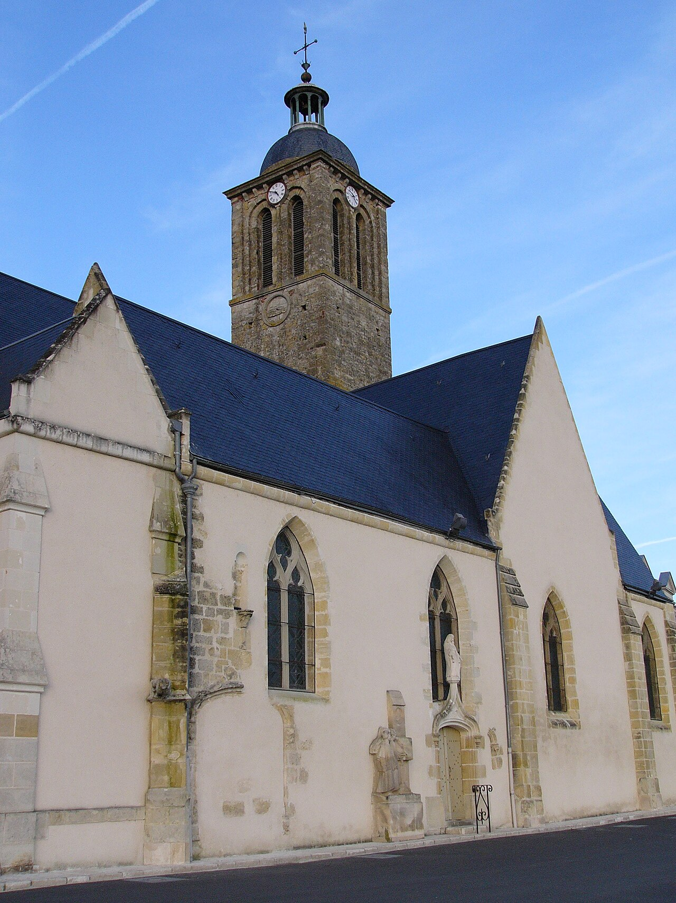

# Loire Valley

The Loire Valley is a band of wine regions along the Loire river in western France, running from Nantes on the Atlantic coast to the Centre-Loire inland. It is not a single region but a group of appellations with different climates, soils and varieties, covering dry whites, sweet wines, reds and sparkling wines.

Figure: Loire Valley. Image: Wikimedia Commons contributor, CC BY-SA 3.0, via Wikimedia Commons ([source page](https://commons.wikimedia.org/wiki/File:Azay_le_rideau.jpg)).

## Geography and climate

The Loire is the longest river in France, flowing from the Massif Central to the Atlantic. Vineyards lie along the river and its tributaries, forming a band from west to east. The west is coastal and oceanic, mild and humid; the eastern interior is more continental, with colder winters and a shorter growing season; Touraine and Anjou sit in between.

These differences shape varieties and styles. The cool west suits early-ripening varieties and sparkling wine; the cooler eastern Centre-Loire lets Sauvignon Blanc and Chenin Blanc keep high acidity; autumn conditions in Anjou and Touraine favour late harvest and noble rot in Chenin Blanc. Rain and temperature vary by year, so wines from the same region can differ markedly.

## Sub-regions

- Pays Nantais: near the Loire estuary, known for Muscadet white wine.
- Anjou-Saumur: based on Chenin Blanc and Cabernet Franc, covering dry whites, sweet wines and reds.
- Touraine: includes Vouvray, Chinon and Bourgueil, with Chenin Blanc and Cabernet Franc as core varieties.
- Centre-Loire: the inland area, including Sancerre, Pouilly-Fumé and Menetou-Salon, led by Sauvignon Blanc.
- Crémant de Loire: sparkling wine made by the traditional method, spanning several sub-regions.

A distinction is needed between the umbrella name Loire Valley and specific appellations. Sancerre and Vouvray are both part of the Loire, but their varieties, soils and rules are independent.

## Varieties and styles

The variety mix is closely tied to the sub-region. For [white wine](ref:white-wine), [Chenin Blanc](ref:chenin-blanc) is the core variety in Anjou, Saumur and Touraine, making dry, off-dry, sweet and sparkling wines on a base of high acidity; [Sauvignon Blanc](ref:sauvignon-blanc) stands out in the Centre-Loire with citrus, grass and flinty minerality; Muscadet forms a category of its own, light and saline.

For [red wine](ref:red-wine), [Cabernet Franc](ref:cabernet-franc) leads in Chinon, Bourgueil and Anjou, with raspberry, violet and green pepper notes; Gamay is also planted in Touraine, in a lighter style. Sparkling wines are mostly made by traditional-method second fermentation, with the variety mix varying by appellation.

## Classification and rules

Each Loire appellation belongs to the French AOC/AOP system, administered by INAO within the EU framework. Every appellation has its own permitted varieties, yield limits, pruning rules and labelling requirements, and a name may be further divided into villages or sites.

When reading a label, separate the appellation, village, estate and tier names. Sancerre and Vouvray are appellations, not quality rankings; estates and plots within one appellation can differ widely in style.

## Representative wines and producers

[Vouvray](ref:vouvray) is a Chenin Blanc appellation in Touraine, on the right bank of the Loire, where one appellation makes dry, off-dry, sweet and sparkling wines; [Sancerre](ref:sancerre) lies in the upper Loire, with white wines from Sauvignon Blanc and a small amount of red wine from Pinot Noir.

The Loire is dominated by family estates and cooperatives, varying greatly in size. The bottler information on the label is the key to telling estate wine from négociant wine; estates within one appellation differ markedly, so one wine cannot stand for the whole area.

## Market and drinking

Loire wines span a wide price range, from everyday wine to sweet whites with long ageing potential. Dry whites suit seafood, poultry and goat cheese; reds suit red meat and dishes with herbal seasoning; sweet whites suit blue cheese and dessert; sparkling wines suit the start of a meal.

When buying, look at the specific appellation, vintage, estate and bottling information rather than the word Loire alone. Chenin Blanc and Sauvignon Blanc are high in acidity, and serving them too cold can suppress the aroma.

## Common misconceptions

First, treating the Loire as a single-style region. It is made up of sub-regions with different climates and varieties.
Second, thinking the Loire makes only white wine. It also makes red and sparkling wines.
Third, equating Chenin Blanc with sweet wine. Dry Chenin Blanc is common, and sweetness depends on the designation and the vintage.
Fourth, assuming Sancerre whites are all intensely tropical. Sauvignon Blanc from the Centre-Loire is more restrained and mineral.
Fifth, treating an appellation name as a quality grade. AOC/AOP guarantees origin and rules, not the sensory level of every bottle.

The Loire is a long riverine wine region, not a single style. Muscadet in the Nantes area uses Melon de Bourgogne; Anjou and Saumur rely on Chenin Blanc and Cabernet Franc; Touraine and the Central vineyards cover Sauvignon, Gamay and many sweet or sparkling wines. Start with the subregion and the variety, then consider dryness, body and ageing.

## Scope note

This region describes the geography, varieties and rules of the Loire Valley and does not assess individual estates or vintages. The parent region is [France](ref:france).

Start with the appellation and its permitted varieties. From there, consider the vintage and the producer, then how the wine is labelled. That is how a practical judgment about Loire Valley is built.

The comparison with [France](ref:france) and [Red wine](ref:red-wine) runs through geographic boundary and climate and soil. Each answers a different question.

**Short definition:** A wine region band along the Loire river in western France, stretching from Nantes to the Centre-Loire across different climates and soils, with Chenin Blanc, Sauvignon Blanc, Cabernet Franc and Gamay as core varieties and a range of dry whites, sweet wines, reds and sparkling wines. 

The Loire runs from Nantes to the Centre-Loire, and its wines range from Muscadet and Chenin Blanc to Cabernet Franc and Gamay.

The region's sparkling wines are made mainly from Chenin Blanc and Cabernet Franc.

**Key facts.**

| Item | Detail |
| --- | --- |
| In one line | A wine region band along the Loire river in western France, stretching from Nantes to the Centre-Loire across different climates and soils, with Chenin Blanc, Sauvignon Blanc, Cabernet Franc and Gamay as core varieties a… |
| Level | other |
| Parent | France |
| Country code | FR |

**Sources and limits.** The key claims about Loire Valley are checked against the following sources: INAO (Used to check the French appellation system and its administering body), European Union (Used to check EU wine categories, geographical indications and labelling rules), Oxford University Press (Consulted for entries on the Loire sub-regions and varieties) and 6 sources in total. Prices, batches and status change; the body is project-written and does not reproduce source text.

For Loire Valley, this region was last checked in 2026; prices, batches and availability change, so confirm them against the sources below.

## Related images

Image: Cabernet Franc. Credit: Viala et Vermorel, Public domain, via Wikimedia Commons ([source page](https://commons.wikimedia.org/wiki/File:Cabernet-franc.jpg)). Related image for Loire Valley.

Image: Vouvray. Credit: Croquant, CC BY-SA 4.0, via Wikimedia Commons ([source page](https://commons.wikimedia.org/wiki/File:Vouvray_%C3%A9glise.jpg)). Related image for Loire Valley.
