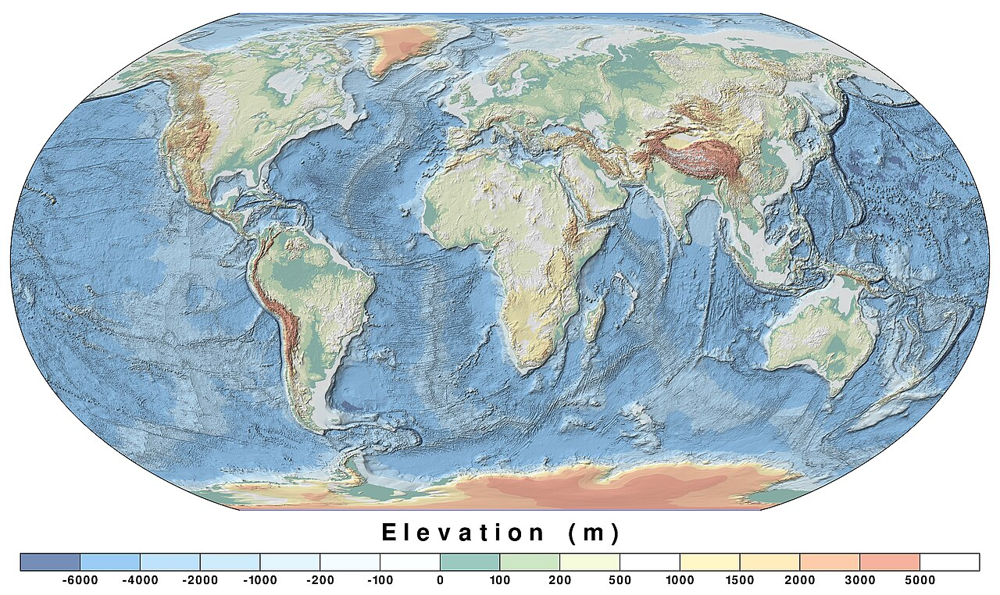

# Lowland

Lowland is one of the five protected regions of [Scottish](ref:scotland) whisky, covering the south and centre of the country, usually described as the land south of a line between Dundee and Greenock. It is often labelled grassy, citrusy and light, but that is a statistical impression: the region contains old distilleries committed to triple distillation as well as newcomers experimenting with their own farm barley, and the stylistic range is wider than the shorthand suggests.

Figure: Lowland. Image: Ian Macky, PAT Atlas, Public domain, via Wikimedia Commons ([source page](https://commons.wikimedia.org/wiki/File:PAT_-_World_topographic.jpg)).

## A legal boundary drawn with a broken line

The Scotch Whisky Regulations 2009 do not define Lowland by council area. They draw a line that begins at the North Channel, runs along the southern shore of the Firth of Clyde to Greenock, continues through Cardross to the summit of Earl's Seat, then to the Wallace Monument, follows the B998 and A91 to Milnathort, and finally runs north on the M90, along the River Earn and the Firth of Tay to the North Sea. South of that line is Lowland; north is Highland. Campbeltown and Islay are listed separately as protected localities.

This is a legal boundary, not a style boundary. The [regulations](ref:swr) allow the name "Lowland" only on Scotch distilled inside the area. A whisky matured in the Lowlands but distilled in the Highlands cannot use the name, and a Lowland-distilled spirit matured elsewhere fails the general Scotch conditions anyway.

## Geography and climate

Lowland covers a broad sweep of southern Scotland, including Edinburgh, Glasgow, Fife, the Borders and Galloway. The ground is gentler and the farmland more continuous than in the west, and the climate is drier than the coast, with the sea keeping winters from becoming extreme. Barley was once an important local crop; today most distilleries buy malt, though farm distilleries still grow their own to control raw material and flavour. The region is officially a protected locality for [single malt](ref:single-malt) Scotch, not a style name for every light whisky made in southern Scotland.

Compared with Speyside, Lowland has no dense cluster of distilleries; compared with Islay, it has neither strong sea wind nor abundant peat. This "nothing extreme" setting makes a light style possible, but it also pushes distilleries to build identity through raw-material handling, still shape and cask policy.

## Light does not mean thin

A typical Lowland nose shows grass, green apple, lemon peel, oat and cream, with a clean entry, a short finish and little alcohol heat. That description can suggest a watery style, yet body can run from feather-light to distinctly oily: still height, reflux, triple distillation and cask char all change the weight.

Lightness is not the same as a lack of layers. Lowland whisky is often used as an aperitif or a Highball base because its aroma does not compete with food and its delicacy survives carbonation. But sherry-cask and cask-strength releases from older sites can support a long tasting. Calling Lowland a "beginner's region" simplifies the range rather than describing it.

## The triple-distillation tradition

Lowland is where Scotland's triple-distillation tradition is most concentrated. A third distillation means longer contact with copper and more reflux, so the new make is cleaner, stronger and lower in sulphur, with a softer entry. The number of [distillations](ref:distillation) is a style tool rather than a quality grade: two distillations keep more oil and cereal weight, while three pull the line finer.

Auchentoshan is the clearest representative. Founded in 1823 near Clydebank, it states that it is the only Scottish single malt distillery to triple distil every drop. The extra distillation makes its new make lighter and lets cask influence show more clearly.

## Four distilleries, four routes

Auchentoshan represents the old site at the edge of the city: close to Glasgow, serving both blending and single malt markets, with a clean, citrus-led style. Bladnoch sits in Galloway, takes 1817 as its starting point, and is among the southernmost distilleries in Scotland; after closure and revival, its style moves between lightness and oil. Glenkinchie, in East Lothian near Edinburgh, has long been presented as "Edinburgh's malt", with grass, lemon and malt sweetness.

Daftmill is a different route altogether: a farm distillery in Fife using [barley](ref:barley) grown on its own land and water from its own artesian well, at very small scale. Its first distillation ran in 2005, and the first 12-year-old release did not appear until 2018. That "fill first, sell later" rhythm has little in common with the commercial model of a large distillery.

## Why the distillery count stayed low

Lowland has far fewer distilleries than Speyside. The reason is not terroir but history and industrial structure: twentieth-century blending demand concentrated production, many Lowland sites were closed or absorbed into larger groups, and land prices and environmental constraints near cities raised the bar for new builds. For a long time, most Lowland spirit went into blends, and independent single malt bottlings were scarce.

That has been changing. The Scotch Whisky Association notes significant growth in new distilleries across the Lowland region in recent years, with projects in Fife, the Borders and around Glasgow. They are small, flexible and often experiment with long fermentation, unusual yeast and different cask types. Rising demand for [whisky](ref:whisky) is the backdrop, but the total still cannot match Speyside.

## Six misreadings of the Lowland

First, that Lowland is only light. Body and cask range widely. Second, that Lowland means all whisky from southern Scotland, ignoring Campbeltown as a separate protected locality. Third, that Lowland must be triple distilled; the law has no such rule, and the practice belongs to some producers only. Fourth, that no Lowland whisky is peated; a few use peated malt, though it is not the mainstream. Fifth, that a regional name is a quality grade. Sixth, that Lowland has no serious whisky, which overlooks small experimental releases.

Read Lowland through the appellation and its permitted varieties, then the vintage and the producer, and finally how the wine is labelled. The sequence matters.

**Short definition:** One of the five protected Scotch whisky regions, lying south of a line between Dundee and Greenock; often summarised as grassy, citrusy and creamy, yet home both to old triple-distilling sites and to farm-scale newcomers, so lightness is a starting point rather than a rule.

**Key facts.**

| Item | Detail |
| --- | --- |
| In one line | One of the five protected Scotch whisky regions, lying south of a line between Dundee and Greenock; often summarised as grassy, citrusy and creamy, yet home both to old triple-distilling sites and to farm-scale newcomers… |
| Level | other |
| Parent | Scotland |
| Country code | GB |

**Sources and limits.** The key claims about Lowland are checked against the following sources: UK Government (legislation.gov.uk) (Used to check the legal boundary and labelling restrictions for Lowland as a protected region), Scotch Whisky Association, Auchentoshan Distillery (Used to check the distillery's 1823 foundation and its triple-distillation tradition) and 5 sources in total. Prices, batches and status change; the body is project-written and does not reproduce source text.

## Related images

Image: Single Malt Scotch Whisky. Credit: Sansvase, CC BY-SA 3.0, via Wikimedia Commons ([source page](https://commons.wikimedia.org/wiki/File:Bowmore_whisky_12_years.JPG)). Related image for Lowland.

Image: Whisky. Credit: Guinnog, CC BY-SA 3.0, via Wikimedia Commons ([source page](https://commons.wikimedia.org/wiki/File:Whiskyhogmanay2010.jpg)). Related image for Lowland.
