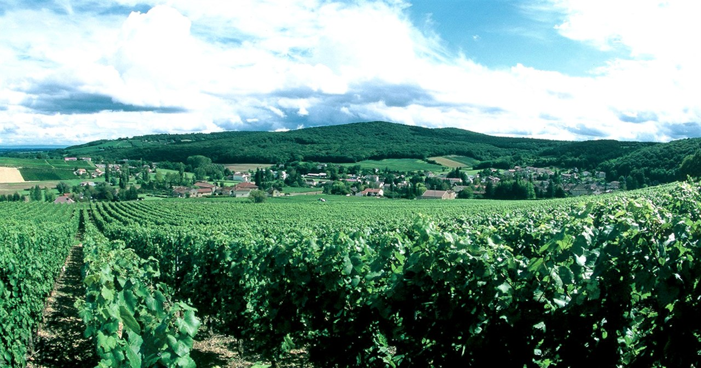

# Mâconnais

The Mâconnais is southern Burgundy’s white-wine region, spread over the hills west of the Saône. Chardonnay dominates across the Mâcon, Pouilly-Fuissé, Saint-Véran and Viré-Clessé appellations; limestone slopes, a cooperative tradition and relatively generous output make it one of the easiest entry points to Burgundy white.

Figure: Mâconnais: Paysage du Haut-Mâconnais (Lugny) (Wikimedia Commons). Image: Frikar, CC BY-SA 3.0, via Wikimedia Commons ([source page](https://commons.wikimedia.org/wiki/File:Paysage_du_Haut-M%C3%A2connais_(Lugny).jpg)).

## Definition and boundaries

The Mâconnais lies in southern Burgundy, west of the Saône in Saône-et-Loire, and takes its name from the town of Mâcon. It borders southern Beaujolais to the north and the Charolais edge to the south, with the Saône plain on one side and the Mâconnais hills on the other. Compared with the Côte d’Or, the climate is warmer and Chardonnay ripens more fully, giving a wide spread of style and price. The Saône alluvial plain lies to the east and the hills to the west; vines sit mainly on east- and south-facing slopes, with little planting on the flat riverbank.

The AOCs sit in layers. Basic Mâcon covers white, rosé and red; Mâcon-Villages is white only and may carry a village name; the village-level white appellations are Pouilly-Fuissé, Pouilly-Loché, Pouilly-Vinzelles, Saint-Véran and Viré-Clessé. They share one hill country, but altitude, aspect and limestone layer differ, and the village name on a label says more about style than the blanket word Mâcon.

## History and naming

Vine growing here rests on a monastic and estate tradition going back to the Middle Ages, and the Saône long served as the waterway for shipping wine. After the phylloxera and disease years of the nineteenth century, the district rebuilt in the twentieth century; cooperatives pooled small growers’ fruit and sustained affordable Burgundy white. Mâcon was an inland port from ancient times, and merchants bound for Lyon and Paris loaded wine here, carrying its reputation north by water.

The village appellations were created at different times. Pouilly-Fuissé was recognised in 1936, Saint-Véran in 1971, and Viré-Clessé was formed by the decree of 26 February 1999, merging the former Mâcon-Viré and Mâcon-Clessé. On 3 September 2020, 22 climats covering 194 hectares in Pouilly-Fuissé were approved by the INAO as Premiers Crus, about a quarter of the appellation’s area.

## Geography and terroir

Soils are mostly Jurassic limestone, marl and clay-limestone, with slopes between 200 and 450 metres and east-facing aspects that catch morning sun and escape the afternoon heat. Limestone slopes drain fast and hold little nutrient, giving Chardonnay with tight acidity and clear minerality; foot-of-slope clay and sandstone-pebble sites are rounder, riper and broader. These limestones date to Jurassic marine deposition, often capped by white gravel that drains fast while the subsoil holds moisture, a setting Chardonnay favours.

Microclimate differences show between the Saône plain and the hills: high, stony sites ripen later with higher acidity, while low, clayier ground ripens earlier with sweeter fruit. The limestone escarpments of Solutré and Vergisson are the district’s landmarks, listed as a Grand Site de France, and the slopes around them hold the densest concentration of Pouilly-Fuissé sites.

## Raw materials and styles

Village-level whites are almost entirely Chardonnay (ref:chardonnay); basic Mâcon red and rosé may use Gamay, with a little Pinot Noir (ref:pinot) in the blend, but volume and reputation are small. White styles range from citrus and white blossom to butter, hazelnut and oak spice, the differences coming from site, fermentation vessel and oak proportion.

Mâcon whites usually show bright acidity and direct fruit; good-vintage Pouilly-Fuissé has layers and several years of ageing ahead. Barrel fermentation and new oak vary widely between producers: some chase a fresh mineral style, others a rich, buttery one. The reds, led by Gamay, are fresh-fruited and light-tannined, best young. Gamay shares the Beaujolais tradition: pale colour, fine tannin and fresh red fruit with a lightly juicy character.

## Representative producers and wines

Pouilly-Fuissé references include Château de Fuissé and Domaine Barraud; on the Saint-Véran and Viré-Clessé side there are Joseph Burrier and Domaine des Deux Roches, among others, and Domaine Leflaive holds a Mâcon-Verzé site. Cooperatives still matter here, turning scattered growers’ fruit into steady entry-level Burgundy white.

These names are not an official classification but long-standing market references. Village AOC flagships cost clearly more than basic Mâcon, and estate cuvées split into village and single-site tiers. Reading AOC level, site and producer style first works better than buying on the phrase “Burgundy white”.

## How to drink and pair

Mâcon whites are served at about 10 to 12 °C, cool enough to keep acidity and citrus; young fresh wines need no decanting, and richer oaked bottles can be opened a little early. A medium-bowl white wine glass is enough.

Pair with freshwater fish, roast poultry, seafood in cream sauce, soft cheeses and light pasta. The acidity cuts the sauce fat, and the minerality lifts seafood flavour. Fuller whites such as Pouilly-Fuissé go with white-meat stews; the reds and rosés suit salads, cold cuts and light braises. Near the Charolais beef country, lightly seared steak or grilled sausages suit Mâcon red or rosé, fat balancing the fruit.

## Labels, buying and misreadings

Read the AOC level first: Mâcon is broadest, Mâcon-Villages and the village names more specific. The village areas of Pouilly-Fuissé, Saint-Véran and Viré-Clessé do not overlap, and a Premier Cru or climat name may appear below the village. Saint-Véran lies south of Pouilly-Fuissé around Saint-Vérand, once part of the Beaujolais Chardonnay belt, and joined the Mâconnais system after its AOC was created. Since 2020, the Pouilly-Fuissé Premiers Crus are site names, not a cross-village quality ranking.

A common mistake is treating “Burgundy white” as one flavour, or equating price directly with quality. Plainland versus slope and limestone versus clay differ clearly within the Mâconnais, and vintage rainfall and ripeness change the style. Basic wines are meant young and fresh; cellaring belongs to good village-level vintages.

## Around and routes

Mâcon town on the Saône is the gateway to the district; Beaune lies about forty minutes to the north, and the slopes concentrate around Solutré-Pouilly, Vergisson and Fuissé. Tastings are mostly by appointment; allow 60 to 90 minutes per visit, and two or three estates plus lunch makes a comfortable day.

Spring and autumn are the best seasons for the slopes and blossom; harvest, in September, is the busiest time and opening hours should be confirmed ahead. Public transport is limited, so driving or a local wine-country tour is easier. Escarpment paths, unpaved vineyard tracks and tasting-room thresholds are not always accessible.

- Related: [burgundy](ref:burgundy), [chardonnay](ref:chardonnay), [pinot-noir](ref:pinot), [white-wine](ref:white), [oak-ageing](ref:oak).
- The Mâconnais sits close to Beaujolais and the Charolais; check current opening hours and booking options on BIVB or estate websites before travelling.

**At a glance:** The southern Burgundy white-wine region, dominated by Chardonnay and covering Mâcon, Pouilly-Fuissé, Saint-Véran and Viré-Clessé; limestone and clay slopes, a cooperative tradition and higher volumes make it one of the most accessible entry points to Burgundy white.

## Related images

Image: Pinot Noir. Credit: Cjp24, Public domain, via Wikimedia Commons ([source page](https://commons.wikimedia.org/wiki/File:Grape_near_Sancerre.jpg)). Related image for Mâconnais.

Image: Editorial illustration of oak ageing: the toasted barrel staves, wine and a sampling tube; AI-assisted illustration, not a photograph.. Credit: Hejiu editorial team, AI-assisted with Doubao Seedream 5.5; project-generated editorial figure, not a photograph ([about](https://hejiu.org/about/)). Related image for Mâconnais.
