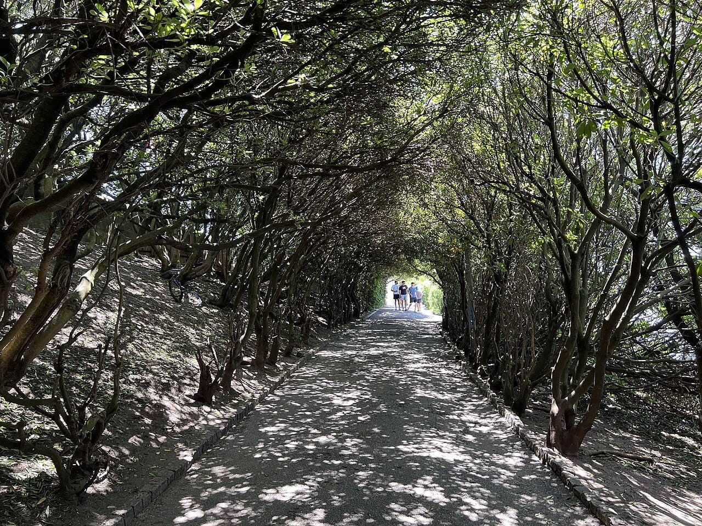

# Madeira

Madeira is a [fortified-wine](ref:fortified-wine) appellation from the Portuguese island of [Madeira](ref:portugal), known for high acidity, long ageing and a heated oxidative style. The noble varieties Sercial, Verdelho, Bual and Malvasia run from dry to sweet.

Figure: Madeira. Photograph: Quinta das Vinhas ^ Cottages, Estreito da Calheta, Madeira, Portugal, 27 June 2011 - Top vineyards - panoramio (1). Credit: anagh, CC BY-SA 3.0, via Wikimedia Commons ([source](https://commons.wikimedia.org/w/index.php?curid=53715566)).

## Definition and scope

Madeira is both an island name and a wine name. The appellation covers the island, and fortification and ageing are completed there; Madeira on a label means the appellation, not just any sweet wine.

Two variables matter: variety sets the base sweetness and acidity, and ageing method sets the degree of oxidation and caramelisation. Together they produce a full spectrum from very dry to very sweet.

## History

Madeira wine spread with Atlantic shipping in the 17th and 18th centuries, and long sea voyages and hot ship holds exposed it to oxygen and heat, creating a distinct style. Producers later simulated that process with heated tanks and loft ageing.

This history explains why Madeira keeps so well: high acidity, fortification and oxidation make the wine stable, and an opened bottle can also last a long time. It is both a historical result and a deliberate process choice.

## Geography and climate

Madeira is a volcanic island in the North Atlantic with steep terrain, and vineyards sit in small terraces on the slopes from the coast up to several hundred metres. The climate is subtropical maritime, with high humidity and uneven rainfall.

Volcanic soils and steep drainage limit yields, and the terraces and irrigation channels form a distinctive landscape. Altitude and aspect create differences in ripeness and also shape variety choice and sweetness targets.

## Varieties and styles

The noble varieties run from dry to sweet: Sercial is the driest, with high acidity, citrus and almond; Verdelho is medium dry, with honey and citrus; Bual is medium sweet, with caramel and dried fruit; Malvasia (Malmsey) is the sweetest, with candied fruit and coffee.

Tinta Negra is the most widely planted variety and can make styles from dry to sweet, but the label usually does not name it. Noble varieties are low in volume, so variety-labelled Madeira usually costs more.

## Winemaking

Grapes are [fermented](ref:fermentation), and grape spirit is added while residual sugar is still high, stopping fermentation and keeping sweetness. The wine then enters ageing, and the ageing method decides the style.

Estufagem places the wine in heated tanks at about 45–50 degrees Celsius for at least 3 months, speeding oxidation and caramelisation, and suits younger volume wines; canteiro places barrels in warm lofts for natural ageing over many years, giving finer and more complex wines.

## Age grades

Madeira is graded by ageing time: basic Madeira at least 3 years; Reserve at least 5 years; Special Reserve at least 10 years; Extra Reserve at least 15 years; Frasqueira (Vintage) as a single harvest with at least 20 years in cask.

Colheita is single-harvest Madeira with at least 5 years in cask. An age indication describes the target style and the minimum requirement, not an exact average age for every bottle.

## Soils and terrain

Soils are mainly weathered volcanic rock and basalt with some clay and scree. They drain well and hold little fertility, so roots must go deep for water and yields are limited.

The terrain is steep slopes and terraces, some parcels so steep that transport needs manual labour or cables. Altitude and aspect affect sunshine and ripeness, and also decide where different varieties are planted.

## Labels and vintage

Labels usually carry Madeira, the variety or "Tinta Negra", the sweetness, the age or vintage, volume and bottler. Variety name and age indication are the key information for judging style.

Single-harvest Madeira carries the harvest year, while blended Madeira carries an age (5, 10, 15, 20 years and so on). The bottle on hand governs.

## Market and drinking

Sercial and Verdelho are served chilled as an aperitif at about 10–12 degrees Celsius; Bual and Malvasia suit a slightly higher temperature of about 14–16 degrees Celsius and pair with nuts, dried fruit, chocolate and blue cheese.

Madeira is fairly stable after opening, but should still be kept away from light in a cool place at an ideal 12–15 degrees Celsius. Excessive drinking harms health and minors should not drink.

## Common misconceptions

First, treating Madeira as a cooking-only wine. Quality Madeira can be drunk on its own.
Second, thinking all Madeira is sweet. Sercial and Verdelho can be dry or medium dry.
Third, treating estufagem as an inferior process. It is a permitted ageing method with a different stylistic target.
Fourth, thinking Tinta Negra can only make cheap wine. It can also make high-quality wines in several styles.
Fifth, treating "Madeira" as a grape variety. It is a region and a wine name.

For Madeira, begin with the appellation and its permitted varieties, then the vintage and the producer, and finish with how the wine is labelled; that order keeps the account grounded.

**Short definition:** A fortified-wine appellation from the Portuguese island of Madeira, known for high acidity, long ageing and a heated oxidative style; the noble varieties Sercial, Verdelho, Bual and Malvasia run from dry to sweet, Tinta Negra makes most volume wines, and ageing follows either estufagem heated tanks or canteiro natural lofts, graded at 3, 5, 10, 15 and 20 years.

Madeira's styles range from dry to sweet and from young to long-aged, so the label's style, age indication and bottler are the practical checks before choosing a bottle.

Madeira's wines are fortified and heated, either in estufagem tanks or in warm cask attics, which gives them a long shelf life.

**Key facts.**

| Item | Detail |
| --- | --- |
| In one line | A fortified-wine appellation from the Portuguese island of Madeira, known for high acidity, long ageing and a heated oxidative style; the noble varieties Sercial, Verdelho, Bual and Malvasia run from dry to sweet, Tinta … |
| Level | other |
| Parent | Portugal |
| Country code | PT |

**Sources and limits.** The key claims about Madeira are checked against the following sources: IVBAM (the varieties, ageing methods and age grades of Madeira), European Union (EU fortified-wine categories, geographical indications and traditional terms), Oxford University Press (Consulted for entries on Madeira and the noble varieties; Migrated from the former reference list at the end of the article; access date not re-verified). Prices, batches and status change; the body is project-written and does not reproduce source text.

## Further reading

- [Portugal](ref:portugal): the national framework to which Madeira belongs.
- [Fortified wine](ref:fortified-wine): the category and its process framework.
- [Grape](ref:grape): the basic structure of wine grapes and ripeness measures.
- [Fermentation](ref:fermentation): the logic of fortifying mid-fermentation.
- [Oak ageing](ref:oak-ageing): the containers used in canteiro and long ageing.
- [Wine](ref:wine): an overview of wine categories, vintages and origin rules.
- [Alcohol by volume](ref:abv): what 18%–20% vol means on a label.

## Related images

Image: Category image for Portugal. Credit: John Hayes from San Antonio, Texas, USA, CC BY-SA 2.0, via Wikimedia Commons ([source page](https://commons.wikimedia.org/w/index.php?curid=151531010)). Related image for Madeira.

Image: Fortified wine. Credit: Jon Sullivan, Public domain, via Wikimedia Commons ([source page](https://commons.wikimedia.org/wiki/File:Port_wine.jpg)). Related image for Madeira.
