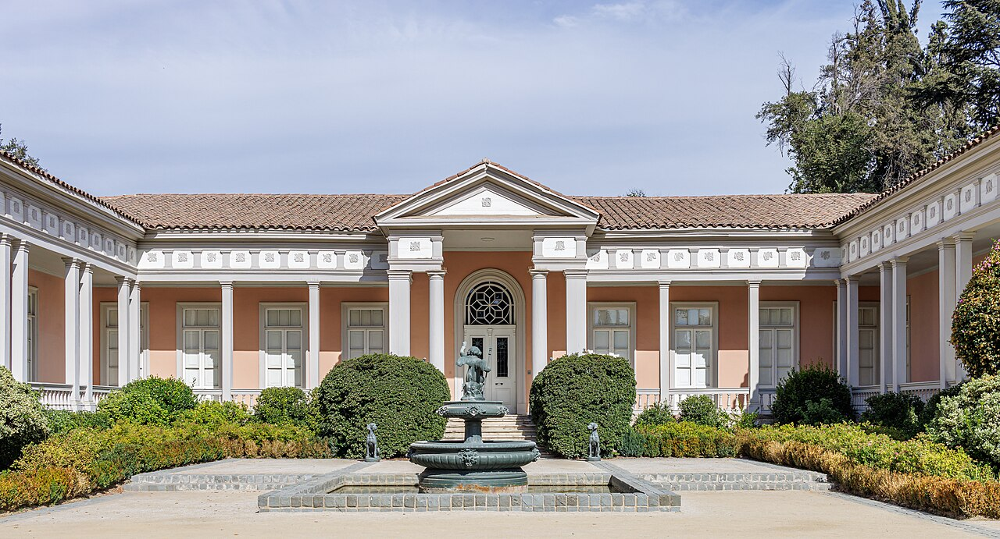
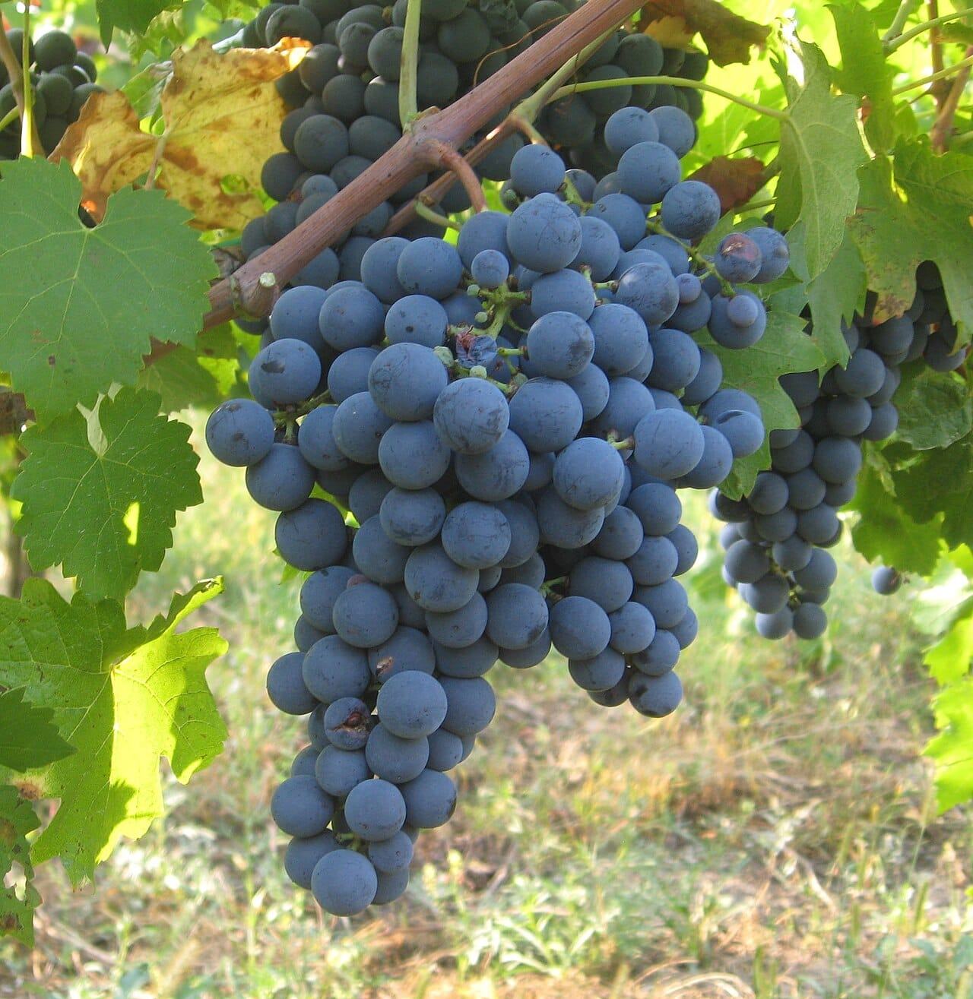
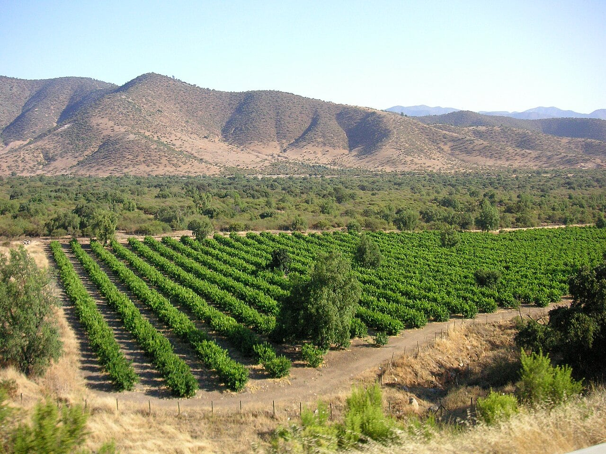

# Maipo

Maipo is a legal wine sub-region of Chile's Valle Central, wrapped around the capital, Santiago. It is the birthplace and industrial centre of modern Chilean wine, and it built its reputation on Cabernet Sauvignon.

Figure: Maipo. Photograph: File:Frente Casa Patronal Concha y Toro.jpg. Credit: Rjcastillo, CC BY-SA 4.0 ([source page](https://commons.wikimedia.org/wiki/File:Frente_Casa_Patronal_Concha_y_Toro.jpg)). Category image; not a claim that it shows the exact product, site or event.

## The geographic centre of Chilean wine

Maipo is a sub-region of the Valle Central denomination, named after the river that runs through Santiago. It stretches from the Andean foothills to the coastal hills, covering the Santiago metropolitan area and surrounding farmland, so town, winery and vineyard are closely interwoven.

This position gives it a double identity: it is both the country's oldest fine-wine district and the hub of wineries, trade and exports. The headquarters, cellars and flagship wines of many large Chilean producers are here, making Maipo the effective centre of the industry.

Maipo is also Chile's most developed wine-tourism area. Wineries are close to the city, visits are short, and historic buildings, vineyards and Andean views can be combined in a day. That accessibility makes Maipo the first stop for many international visitors and reinforces its role as an industry showcase.

## 1851 and the arrival of French varieties

In 1851 Silvestre Ochagavía brought Cabernet Sauvignon, Merlot and other French varieties from Bordeaux and established a winery near Santiago, an event treated as the start of modern Chilean wine. Over the following decades French varieties took root in Maipo and set a Bordeaux-style red agenda.

Concha y Toro was founded in 1883, with more wineries following. In the late nineteenth century Chile's geographic isolation spared it from European phylloxera and preserved ungrafted French material, a central element of the country's wine narrative.

In the twentieth century Maipo became an export-oriented industry: wineries expanded capacity, adopted temperature-controlled fermentation and stainless steel, and from the 1990s accelerated into European and North American markets. The shift turned a local farming district into a steady supplier within the global wine chain.

## A transverse valley from the Andes to the Pacific

Maipo is a river valley cutting across the Andes and the Pacific. To the east, alluvial fans and high terraces of the Andean foothills sit higher, with a wide day-night range and slower ripening; the central Santiago basin is warm and ripens fully; the western coastal hills are cooler under Pacific influence and morning fog.

Irrigation comes from Andean snowmelt and rivers, making production reliable in a dry summer. The Mediterranean climate brings a dry growing season and a concentrated harvest with low disease pressure. The east-west gradient of altitude and ocean influence is the basis of the region's [terroir](ref:terroir).

## Three familiar zones

The trade commonly splits Maipo into three zones. Alto Maipo lies on the eastern foothills, including Puente Alto and Pirque, higher and cooler, and is the core of premium Cabernet Sauvignon; Central Maipo occupies the warm basin and gives a broader style; Coastal Maipo lies in the western hills and is cooler under ocean influence.

These are industry and geographic terms, not legal sub-zones under Decree 464, and labels do not use them as official tiers. Buyers should separate a winery's own site names and the familiar zone names from the legal origin name.

Santiago's urban growth is also reshaping the region: some historic vineyards have given way to housing and commercial land, pushing wineries towards higher foothills and the western hills. Rising land prices and competition for water are Maipo's most concrete structural pressures.

## The dominance of Cabernet Sauvignon

Cabernet Sauvignon is Maipo's most important red and the core of Chile's international image. Alto Maipo wines typically show blackcurrant, black cherry, cedar, tobacco and graphite, with firm tannin and clear acidity, and they take well to [oak ageing](ref:oak-ageing) and long cellaring.

Carmenère is also planted in Maipo, often with green pepper, blackberry and spice; Syrah and Merlot play supporting roles. Reds are destemmed and [fermented](ref:fermentation) with temperature control, and maceration length and barrel choice set the style. Variety and origin claims must meet legal shares.

## Rules and labels

Chile's origin system was established by Decree 464, which divides the country into wine regions, sub-regions and zones. Maipo is a sub-region of Valle Central, and a label naming Valle del Maipo or Maipo must meet that sub-region's origin rules; variety and vintage claims must meet the minimum shares in wine law, with the exact figures set by SAG.

Labels must also state [alcohol](ref:abv), volume and producer. Chilean terms such as Reserva and Gran Reserva are not legal quality grades but producer and market positioning, and should not be read as an official classification.

Start with the appellation and its permitted varieties. From there, consider the vintage and the producer, then how the wine is labelled. That is how a practical judgment about Maipo is built.

## Drinking and misconceptions

Maipo reds are best at about 16 to 18 degrees Celsius, with grilled meat, steak, mushrooms and hard cheese. Premium Alto Maipo wines often need one to two hours of decanting; Central Maipo wines are fruitier and ready sooner. Food matching should follow the wine's acidity and tannin.

Four misconceptions recur. First, treating Maipo as the whole Central Valley: it is one sub-region. Second, assuming all Chilean wine is cheap: top Maipo Cabernet Sauvignon now sits in international fine-wine price brackets. Third, treating Reserva as a legal grade: it is producer positioning. Fourth, thinking Chile has no origin rules: Decree 464 and SAG set clear requirements for origin, variety and vintage.

**Short definition:** Legal sub-region of Chile's Valle Central around Santiago, and the traditional centre of the Chilean wine industry. In 1851 Silvestre Ochagavía introduced French varieties, the accepted starting point of modern Chilean wine; Concha y Toro was founded in 1883. Peñín records 12,216 hectares, with Cabernet Sauvignon the leading red. The land runs from Andean foothills to coastal hills, with cooler Alto Maipo and ocean-influenced coastal sites. Origin and variety claims follow Decree 464 and Chilean wine law.

**Key facts.**

| Item | Detail |
| --- | --- |
| In one line | Legal sub-region of Chile's Valle Central around Santiago, and the traditional centre of the Chilean wine industry. In 1851 Silvestre Ochagavía introduced French varieties, the accepted starting point of modern Chilean w… |
| Level | other |
| Parent | Chile |
| Country code | CL |

## References

- [Wine](ref:wine): the broad categories and origin rules.
- [Red wine](ref:red-wine): the framework for red winemaking and style.
- [Chile](ref:chile): the wider map of Chilean wine regions.
- [Cabernet Sauvignon](ref:cabernet): Maipo's flagship red.
- [Carmenère](ref:carmenere): Chile's signature red variety.
- [Syrah](ref:syrah): a supporting red in Maipo.
- [Fermentation](ref:fermentation): maceration and temperature-controlled fermentation.
- [Oak ageing](ref:oak-ageing): how barrel type and new-oak share shape style.
- [Terroir](ref:terroir): altitude, alluvial fans and ocean influence.
- [Acidity](ref:acidity): how altitude and the day-night range affect acidity.
- [Alcohol by volume](ref:abv): what % vol means on a label.

## Related images

Image: Carménère. Credit: Lebowskyclone, CC BY-SA 3.0, via Wikimedia Commons ([source page](https://commons.wikimedia.org/wiki/File:CarmenereW.jpg)). Related image for Maipo.

Image: A vineyard in the Andean foothills of Chile, with rows of vines running across the slope.. Credit: Beatrice Murch, CC BY-SA 2.0, via Wikimedia Commons ([source page](https://commons.wikimedia.org/wiki/File:Chilean_vineyard_in_Andes_foothills.jpg)). Related image for Maipo.
