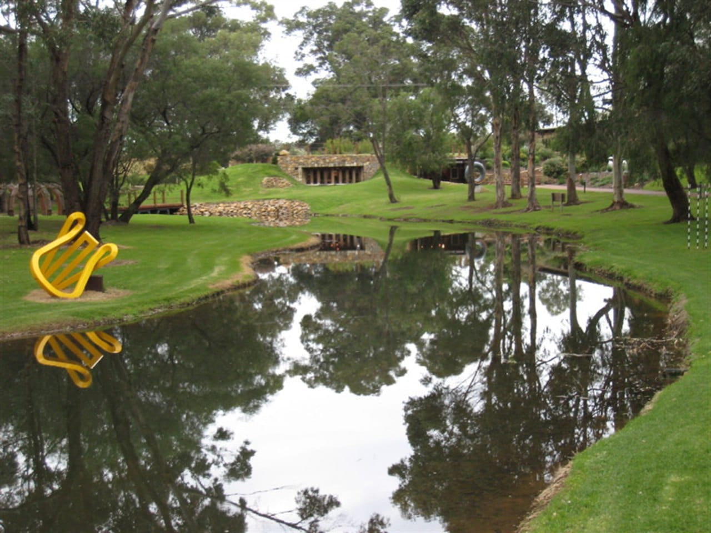

# Margaret River

Margaret River is the wine region at the south-west corner of Western Australia, known for Cabernet Sauvignon blends and Chardonnay. It is surrounded by ocean on three sides and highly isolated, and marine influence on its climate is stronger than in most Australian regions.

Figure: Margaret River. Photograph: File:Vasse Felix Winery.jpg. Credit: Mark Pegrum, CC BY-SA 2.0 ([source page](https://commons.wikimedia.org/wiki/File:Vasse_Felix_Winery.jpg)). Category image; not a claim that it shows the exact product, site or event.

## Definition and scope

Margaret River lies at the south-west corner of Western Australia, about three hours by road south of Perth, in the coastal belt roughly between Cape Naturaliste and Cape Leeuwin. The GI covers 2,137 square kilometres with 5,725 hectares of vineyard on Wine Australia's 2025–26 basis; the Margaret River Wine Association's 2024 report counts 5,840 hectares. The two figures use different bases, so the source should be stated when citing them.

The region has about 175 wineries or wine producers, and about 68% crush less than 100 tonnes. Margaret River accounts for about 2% of Australia's national grape crush, small in volume but prominent in the premium red and white market.

## History

Commercial grape growing in Margaret River began in 1967 and expanded through the 1970s and 1980s. The region's isolation and Mediterranean climate attracted early producers, and Cabernet Sauvignon and Chardonnay quickly became core varieties.

From the 1990s Margaret River built an international reputation, with Cabernet Sauvignon blends and Chardonnay as its signature styles. The region is small, mostly family-owned and low-volume, and market standing depends on the winery and vintage rather than an official classification.

## Geography and climate

Margaret River is one of Australia's most clearly maritime regions, especially in rainfall. Ocean influence reaches the region on three sides, rain falls mostly in winter, growing-season rainfall is about 202 mm and the January mean is about 20.9 degrees Celsius. Wine Australia compares its climate to Bordeaux in a dry year.

Compared with many Australian regions, Margaret River has a small day-night range, even heat accumulation and a steady ripening pace. That gives Cabernet Sauvignon finer tannin and Chardonnay clearer acidity; vintage variation comes more from rainfall and ripening temperatures than from sharp swings between hot and cold.

Elevation runs from sea level to 234 metres, so marine and aspect effects matter more directly than altitude. The ridge from Cape Naturaliste to Cape Leeuwin is granite and gneiss under gravelly loam, with generally low water-holding capacity. That limits yield and vigour and explains the region's emphasis on site selection and water management. These differences form the basis of [terroir](ref:terroir).

## Sites and differences

The Margaret River GI currently has no registered sub-regions, and names such as Wilyabrup on labels are site names in common use, not separate GIs. Differences come mainly from distance to the sea, aspect and soil depth rather than administrative boundaries.

- Northern sites near Cape Naturaliste have stronger marine moderation and steadier ripening.
- Central and inland sites accumulate slightly more heat, so Cabernet Sauvignon ripens more fully.
- Southern sites near Cape Leeuwin are windier and cooler, favouring Chardonnay and early-ripening varieties.

These differences are site-level and should not be reduced to a fixed rule that the north is warm and the south is cool. The specific wine still depends on the winery, vintage and viticulture.

## Varieties and raw material

Cabernet Sauvignon is Margaret River's signature red, often blended with Merlot, medium to full-bodied with ripe cassis, violet and gravel notes. Chardonnay is the core white, with citrus, white flower and nut flavours and clear acidity; Semillon and Sauvignon Blanc are often blended into crisp dry whites. Other varieties include Shiraz, Petit Verdot and Malbec.

The raw material is [grape](ref:grape). The variety structure is fairly concentrated, with Cabernet Sauvignon and Chardonnay holding most of the area, a result of long-term climate and market selection.

## Winemaking

Reds are destemmed and [fermented](ref:fermentation) with temperature control. Cabernet Sauvignon often sees longer maceration and pumpovers to extract colour and tannin, then ages in French [oak](ref:oak-ageing) with a winery-specific share of new barrels. The Cabernet-Merlot ratio, picking date and maceration strength are the main sources of style difference.

Whites ferment cool. Some Chardonnay sees barrel fermentation, lees stirring and malolactic fermentation, while other lots stay in stainless steel for freshness; Semillon and Sauvignon Blanc blends usually ferment in stainless steel to keep acidity and herbal aroma.

## GI and labelling

Australian wine regions are identified by GIs administered by Wine Australia. For a single region, variety or vintage claim, at least 85% of the wine must come from the named region, variety or vintage; blends must be declared on the label, with the dominant source listed first. Margaret River is a registered GI name, and its use on a label must meet the origin rules.

A GI is a geographic boundary, not a quality grade. Margaret River has no national winery classification, and winery reputation comes from history, wine performance and market assessment.

## Labels and serving

The label should be checked for the GI name, variety, [vintage](ref:vintage), [alcohol](ref:abv), volume and bottler. A wine labelled as a [single variety](ref:single-varietal) must meet the 85% variety share; blends must list their varieties under the rules. Cabernet Sauvignon is served at about 16–18 degrees Celsius, Chardonnay at about 10–12 and Semillon and Sauvignon Blanc at about 8–10.

Cabernet Sauvignon suits red meat, grilled dishes and hard cheese; Chardonnay suits seafood, poultry and creamy dishes; Semillon and Sauvignon Blanc suit seafood, salads and light food. Refrigerate after opening and finish soon. Excessive drinking harms health and minors should not drink.

## Common misconceptions

First, treating Margaret River as Western Australia's only region. The state also has Great Southern and Swan District GIs.
Second, thinking the region grows only Cabernet Sauvignon. Chardonnay, Semillon and Sauvignon Blanc matter just as much.
Third, treating a GI as a quality grade. A GI only sets a geographic range and does not judge wine quality.
Fourth, assuming a maritime climate means cool. Margaret River has ample growing-season heat and a small day-night range, closer to Bordeaux in a dry year.
Fifth, taking a site name on a label for a registered GI. The region currently has no registered sub-regions.

**In brief:** Wine region at the south-west corner of Western Australia, bounded by ocean and highly isolated. The GI covers 2,137 sq km with 5,725 hectares of vineyard (5,840 hectares on the 2024 association basis), from sea level to 234 metres, and 202 mm of growing-season rain. A maritime Mediterranean climate with a small day-night range and even heat accumulation, compared by Wine Australia to Bordeaux in a dry year. Gravelly loam over granite and gneiss has low water-holding capacity. Cabernet Sauvignon, Chardonnay, Semillon and Sauvignon Blanc lead; the region makes about 2% of the national crush.

## Further reading

- [Wine](ref:wine): an overview of wine categories, vintages and origin rules.
- [Red wine](ref:red-wine) and [white wine](ref:white-wine): the two main categories in Margaret River.
- [Cabernet Sauvignon](ref:cabernet): the region's core red variety.
- [Chardonnay](ref:chardonnay): the region's leading white variety.
- [Sauvignon Blanc](ref:sauvignon-blanc) and [Semillon](ref:semillon): the common dry-white blend.
- [Grape](ref:grape): the structure of wine grapes and ripeness measures.
- [Fermentation](ref:fermentation): red maceration and cool white fermentation.
- [Acidity](ref:acidity): how a maritime climate and even heat affect acidity.
- [Terroir](ref:terroir): how granite, gneiss and gravelly loam shape ripening.
- [Oak ageing](ref:oak-ageing): barrel choices for Cabernet Sauvignon and Chardonnay.
- [Dry](ref:dry): the dry positioning of Semillon and Sauvignon Blanc blends.
- [Vintage](ref:vintage): vintage variation and rainfall in Margaret River.
- [Single varietal](ref:single-varietal): the 85% variety labelling rule.
- [Alcohol by volume](ref:abv): what % vol means on a label.

## Related images

Image: Sémillon - Joseph Daurel. Credit: Imprimerie A. Bellier & Cie - Bordeaux, CC0, via Wikimedia Commons.. Credit: Imprimerie A. Bellier & Cie - Bordeaux, CC0, via Wikimedia Commons ([source page](https://commons.wikimedia.org/w/index.php?curid=94839238)). Related image for Margaret River.

Image: Acidity. Credit: Chemicalinterest, Public domain, via Wikimedia Commons ([source page](https://commons.wikimedia.org/wiki/File:Zn_reaction_with_HCl.JPG)). Related image for Margaret River.
