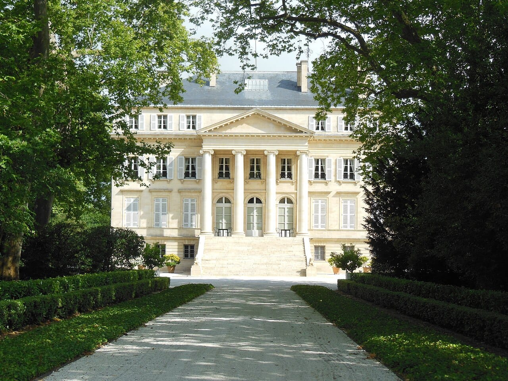

# Margaux

Margaux is a red-wine appellation on the left bank of the Gironde, in the southern Médoc of the Gironde department, recognised as an AOC on 10 August 1954. The appellation covers five communes — Margaux, Cantenac, Labarde, Arsac and Soussans — and is known for Cabernet Sauvignon blends with fine perfume and supple tannin grown on gravel rises; the 1855 classification gives it one first growth and five second growths.

Figure: Margaux: Château Margaux 2014 (Wikimedia Commons). Image: Jibi44, CC BY-SA 4.0, via Wikimedia Commons ([source page](https://commons.wikimedia.org/wiki/File:Ch%C3%A2teau_Margaux_2014.JPG)).

## Definition and scope

Margaux applies only to still [red wines](ref:red-wine) from demarcated parcels that are fermented and aged within the area. The geographical area covers five communes: Margaux, Cantenac, Labarde, Arsac and Soussans, while six neighbouring communes are allowed to carry out part of the fermentation and ageing. The key point is that Margaux is both a village name and an appellation name covering five communes, so vineyards in Cantenac or Labarde may also be labelled Margaux.

This arrangement follows the pattern of other Bordeaux communal appellations: administrative boundaries serve management, while appellation boundaries serve terroir identification. A buyer seeing Margaux should read it as the Margaux appellation, not as a specific plot inside the village.

The climate resembles Pauillac, temperate oceanic with the estuary buffering temperature extremes. The difference is that Margaux gravel is often thinner, with clay and limestone closer to the surface, so roots reach the water table earlier and the vines perform more steadily in dry years. At the southern end, Soussans is flatter and ripens slightly later, and its fruit often contributes acidity and structure to a blend.

## Five communes and their boundaries

The five communes run from north to south along the left bank of the Gironde. The village of Margaux sits at the core, Cantenac lies immediately to its west and south, Labarde and Arsac are inland, and Soussans is further south. Most vineyards occupy well-drained gravel rises, with clay and limestone filling the hollows between them.

This village-plus-neighbours combination means the appellation is not stylistically uniform: slopes near the estuary ripen earlier, inland gravel ridges later, and parts of Cantenac carry more clay. Several of the second growths on the 1855 list lie in Cantenac, which shows how far the name Margaux had already outgrown a single village by the mid-nineteenth century.

## Gravel, clay and aromatic style

Margaux [terroir](ref:terroir) is often summarised as gravel, clay and limestone, but the proportions vary greatly from parcel to parcel. Gravel rises drain quickly and store heat, suiting the late-ripening [Cabernet Sauvignon](ref:cabernet-sauvignon); parcels with more clay hold water, which helps in dry years and ripens Merlot more easily.

Compared with the firm structure of Pauillac, Margaux is typically described through violet, cassis, cedar and silky tannin, approachable earlier in youth yet capable of decades of ageing in good vintages. This aromatic emphasis comes from the combination of varieties and sites, not from one single soil component.

## Margaux in the 1855 classification

The Médoc classification drawn up for the 1855 Paris world fair placed Château Margaux among the first growths, the only first growth in this appellation. The same list named Rauzan-Ségla, Rauzan-Gassies, Durfort-Vivens, Lascombes and Brane-Cantenac as second growths, creating the one first plus five seconds structure.

The classification ranks estates, not parcels, so different parcels of one estate, and different vintages of one parcel, can perform quite differently. After 1855, splits, sales and vineyard transactions kept redrawing the real map while the list itself stayed essentially frozen; the term cru classé should be read as a historical marker, not as a current quality ranking.

## Varieties and blend

The permitted varieties are Cabernet Sauvignon, Merlot, Cabernet Franc, Petit Verdot, Malbec and Carmenère. Cabernet Sauvignon provides the frame, aroma and ageing potential, while Merlot softens the blend and ripens earlier; compared with Pauillac, some Margaux parcels carry a higher Merlot share, which helps explain the softer tannin.

The rules require a minimum sugar level at harvest of 189 g/L for Merlot and 180 g/L for the other varieties. The minimum natural alcohol is 11%, the yield is 57 hl/ha with a ceiling of 63 hl/ha, planting density is at least 7,000 vines per hectare, and the maximum field load is 9,500 kg/ha, or 8,000 kg/ha where irrigation is authorised. These parameters match Pauillac; style differences come mainly from site and blend.

Blends also shift with the vintage: late-ripening years push up the Cabernet Sauvignon share, early years the Merlot share. Estates usually ferment parcels separately and decide the final blend afterwards, which is the technical reason the same estate can change character from year to year.

## Winemaking and ageing

After fermentation the wine is aged in [oak](ref:oak-ageing), and the minimum ageing period runs to 1 June of the year after harvest; consumer release may not begin before 1 September of that year. Wine offered for sale must hold malic acid at or below 0.30 g/L and fermentable sugars at or below 2 g/L.

Margaux barrel regimes are often more restrained than those of Pauillac in order to preserve perfume, but the share of new oak still varies by estate. Softer vintages can be drunk earlier, firmer ones need longer, and neither can be reduced to a single village style.

## Labels and buying

The word Margaux on the label must match the appellation; check the vintage, alcohol, volume, bottler and estate name. A cru classé label reflects a historical position in the 1855 list and later individual adjustments. Buyers should also distinguish Margaux the appellation from a particular estate inside the village, since the two are not interchangeable.

In the same vintage and appellation, price differences between estates are often far larger than stylistic differences; treating the appellation name as a quality guarantee tends to obscure what the estate and parcel actually do.

Another frequent confusion surrounds the historical name Cantenac-Margaux: it refers to the Cantenac area, not to a separate AOC, and the label Margaux is what carries the appellation. Cantenac on its own does not create an appellation tier. Checking the estate, vintage and parcel information is more reliable than reading the village name alone.

**Short definition:** A red-wine AOC on the left bank of the Gironde in the southern Médoc, recognised on 10 August 1954 and covering five communes, Margaux, Cantenac, Labarde, Arsac and Soussans; the 1855 classification lists Château Margaux as a first growth and Rauzan-Ségla, Rauzan-Gassies, Durfort-Vivens, Lascombes and Brane-Cantenac as second growths, and the rules set a minimum natural alcohol of 11%, a yield of 57 hl/ha with a ceiling of 63 hl/ha.

For Margaux, begin with the appellation and its permitted varieties. Then look at the vintage and the producer, and finally ask how the wine is labelled. The answers point to different choices, not to a single score.

[France](ref:france) and [Cabernet Sauvignon](ref:cabernet-sauvignon) are the two useful reference points for Margaux. [France](ref:france) sets out geographic boundary; [Cabernet Sauvignon](ref:cabernet-sauvignon) brings in climate and soil. Read them together.

## References

- [France](ref:france): the AOC system and the national appellation framework.
- [Bordeaux](ref:bordeaux): the structure of left-bank communal appellations.
- [Cabernet Sauvignon](ref:cabernet-sauvignon): the structural variety in Margaux blends.
- [Red wine](ref:red-wine): an overview of still red wine and winemaking.
- [Terroir](ref:terroir): how soil, slope and microclimate combine into a site.
- [Oak ageing](ref:oak-ageing): how barrel ageing shapes aroma and tannin.

## Related images

Image: Terroir. Credit: Friedrich Petersdorff, CC BY-SA 2.0 de, via Wikimedia Commons ([source page](https://commons.wikimedia.org/wiki/File:080110_zell_mosel.JPG)). Related image for Margaux.

Image: Moët & Chandon vineyards in Verzenay, Champagne, France. Credit: Mustang Joe, CC0, via Flickr / Openverse.. Credit: Mustang Joe, CC0, via Wikimedia Commons ([source page](https://www.flickr.com/photos/63234672@N04/13180177073)). Related image for Margaux.
