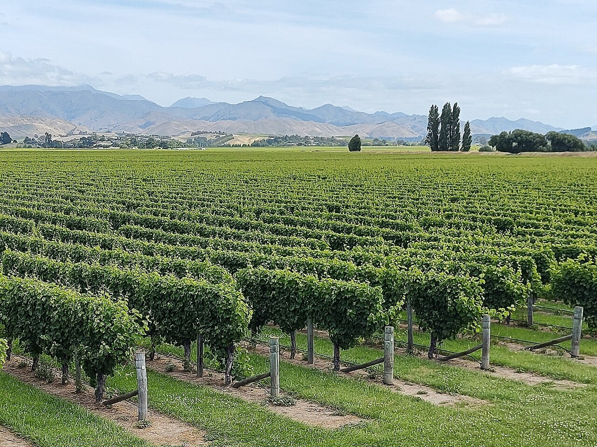

# Marlborough

Marlborough is New Zealand's largest wine region, at the north-east end of the South Island. It opened the international market with Sauvignon Blanc and also produces Pinot Noir, Chardonnay and aromatic whites. A cool but sunny climate, low rainfall and free-draining soils explain its style.

Figure: Vineyard rows in the Wairau Valley, Marlborough, stretching toward the hills. Image: Jonathan Harker, CC BY 4.0, via [source page](https://commons.wikimedia.org/wiki/File:Wairau_Valley_vineyards_in_the_Marlborough_wine_region,_New_Zealand.jpg).

## Definition and scope

Marlborough lies at the north-east end of New Zealand's South Island, in the Marlborough district, centred on Blenheim. On New Zealand Winegrowers' 2026 vineyard report, the region has 32,191 hectares planted, 73% of the national total, and 31,603 hectares producing, across 1,134 vineyards with an average of about 28 hectares.

The Marlborough GI was registered in 2018. A GI sets a geographic boundary, and label use must meet the origin share rules. The region contains three main sub-regions: Wairau Valley, Southern Valleys and Awatere Valley.

## History

Marlborough's modern wine industry began in the 1970s, at first with trial plantings. In the 1980s Sauvignon Blanc with intense aroma and clear acidity opened export markets and brought New Zealand wine to international attention.

The region then expanded rapidly to become the country's largest. From the 1990s Pinot Noir, Chardonnay and aromatic varieties gained area, and differences between sub-regions drew more attention. Expansion brought irrigation, mechanisation and export focus, but small-volume, carefully farmed wineries still matter.

## Geography and climate

Marlborough sits in the rain shadow at the north-east end of the South Island: cool but sunny, with low rainfall and cooling sea breezes during the growing season. Local Māori called the Wairau Valley "the place with the hole in the cloud", a reference to its sunshine.

The day-night range and sea breezes drive ripening. Daytime heat is enough to ripen fruit, while cool nights preserve acidity; Awatere Valley is further south, drier and windier, so it ripens more slowly; Wairau Valley's river gravels drain quickly and warm early; Southern Valleys soils are heavier with more clay and become cooler and drier further south.

Soils are mainly river gravels, sandy loams and clay, with moderate fertility and good drainage. Fast-draining sites need irrigation, while water-retentive sites need vigour control. These differences form the basis of [terroir](ref:terroir).

## Sub-regions

Marlborough's three sub-regions differ in emphasis:

- Wairau Valley: the largest, on old river gravels, with many mesoclimates from site and rainfall; coastal sites are moderated by sea breeze, inland sites drier and earlier.
- Southern Valleys: the Omaka, Fairhall, Brancott, Ben Morvan and Waihopai valleys, with heavier, clay-rich soils, cooler and drier to the south, strong for Pinot Noir and aromatics.
- Awatere Valley: the most southerly and geographically distinct, cooler, drier and windier, often with elevation and lower yields, giving vivid Sauvignon Blanc and aromatic Pinot Noir.

Sub-regions are geographic and climatic ideas, not quality grades. Wineries, vintages and sites within one region still differ widely.

## Varieties and raw material

Sauvignon Blanc dominates Marlborough, typically showing passionfruit, lime, cut grass and mineral notes with high acidity and open aroma. Pinot Noir shows dark cherry, plum and spice, medium-bodied with fine tannin; Chardonnay ranges from fresh to barrel-fermented; Riesling, Pinot Gris and Gewürztraminer cover dry to sweet styles.

The raw material is [grape](ref:grape). The variety structure is heavily concentrated in Sauvignon Blanc, a result of export demand, climate adaptation and planting tradition, but that does not make other varieties unimportant.

## Winemaking

Sauvignon Blanc is mostly [fermented](ref:fermentation) cool in stainless steel to keep aroma and acidity; some wineries use native yeast, old barrels or lees stirring for complexity. Pinot Noir often sees partial whole-cluster fermentation, shorter maceration and cool fermentation, then ages in French [oak](ref:oak-ageing) with a usually low share of new barrels.

Some Chardonnay sees barrel fermentation and lees stirring; aromatic varieties keep residual sugar or go fully dry according to winery style. Traditional-method sparkling wine is made in small volume but draws critical attention.

## GI and labelling

New Zealand wine GIs are governed by the Geographical Indications (Wine and Spirits) Registration Act, and the Marlborough GI was registered in 2018. A label naming a single variety, vintage or area must have at least 85% of the wine from that variety, vintage or area; blends must be listed in descending proportion.

A GI is a geographic boundary, not a quality grade. New Zealand has no national winery classification, and winery reputation comes from history, wine performance and market assessment. A more specific place name usually means a more concentrated source, but not necessarily higher quality.

## Labels and serving

The label should be checked for the GI name, variety, [vintage](ref:vintage), [alcohol](ref:abv), volume and bottler. A wine labelled as a [single variety](ref:single-varietal) must meet the 85% variety share; blends must list their varieties under the rules. Sauvignon Blanc is served at about 8–10 degrees Celsius, Chardonnay at about 10–12, Pinot Noir at about 14–16 and Riesling at about 8–12 depending on style.

Sauvignon Blanc suits seafood, salads, goat cheese and Asian dishes; Pinot Noir suits poultry, mushrooms and light red meat; Chardonnay suits creamy dishes. Refrigerate after opening and finish soon. Excessive drinking harms health and minors should not drink.

## Common misconceptions

First, thinking Marlborough Sauvignon Blanc all tastes the same. Sub-region, winery and vintage differ clearly.
Second, treating Marlborough as all of New Zealand wine. Hawke's Bay, Central Otago and Wairarapa matter just as much.
Third, treating a GI as a quality grade. A GI only sets geographic origin and does not judge quality.
Fourth, assuming a cool region means under-ripe fruit. Marlborough has ample sunshine, and ripening relies on daytime heat and a long growing season.
Fifth, taking sub-regions for registered GIs. Wairau Valley, Southern Valleys and Awatere Valley are common divisions, while label rules still rest on the GI and the 85% share.

Start with the appellation and its permitted varieties. From there, consider the vintage and the producer, then how the wine is labelled. That is how a practical judgment about Marlborough is built.

[Wine](ref:wine) and [Red wine](ref:red-wine) answer different questions about Marlborough: geographic boundary and climate and soil. Read them as a pair, not as alternatives.

## Further reading

- [Wine](ref:wine): an overview of wine categories, vintages and origin rules.
- [Red wine](ref:red-wine) and [white wine](ref:white-wine): the two main categories in Marlborough.
- [Sauvignon Blanc](ref:sauvignon-blanc): the region's most recognisable variety.
- [Pinot Noir](ref:pinot-noir): the core red variety in Marlborough.
- [Chardonnay](ref:chardonnay) and [Riesling](ref:riesling): the other main white line.
- [Grape](ref:grape): the structure of wine grapes and ripeness measures.
- [Fermentation](ref:fermentation): how Sauvignon Blanc and Pinot Noir ferment differently.
- [Acidity](ref:acidity): how cool nights and sea breezes affect acidity.
- [Terroir](ref:terroir): how gravels, clay and mesoclimates divide the sub-regions.
- [Oak ageing](ref:oak-ageing): barrel choices for Pinot Noir and Chardonnay.
- [Dry](ref:dry): aromatic styles from dry to sweet.
- [Vintage](ref:vintage): vintage variation and rainfall in Marlborough.
- [Single varietal](ref:single-varietal): the 85% variety labelling rule.
- [Alcohol by volume](ref:abv): what % vol means on a label.

## Related images

Image: Vintage. Credit: Chiusi Painter, Public domain, via Wikimedia Commons ([source page](https://commons.wikimedia.org/wiki/File:Cup_vintage_Cdm_Paris_320_n1.jpg)). Related image for Marlborough.

Image: Related photograph of Sauvignon Blanc. Credit: Geolina163 + 1971markus, CC BY-SA 4.0, via Wikimedia Commons ([source page](https://commons.wikimedia.org/wiki/File:HBLA_Klosterneuburg_Sauvignon_Blanc_2.jpg)). Related image for Marlborough.
