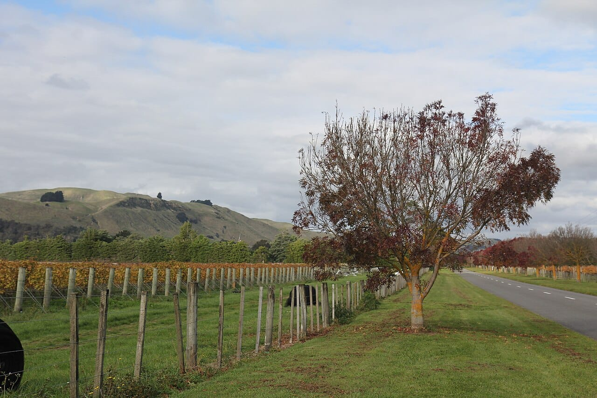
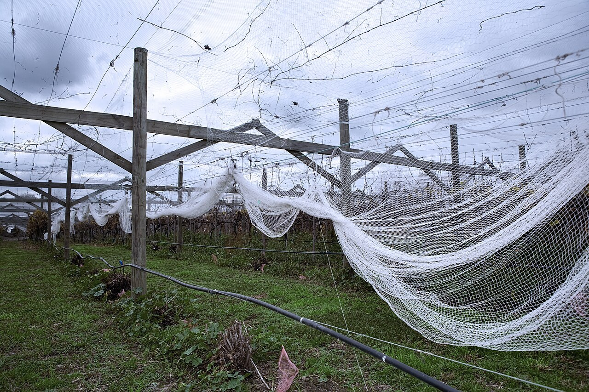

# Martinborough

Martinborough is a small, precise wine district at the southern end of the Wairarapa Valley on New Zealand’s North Island, and one of the starting points of the country’s modern Pinot Noir story. Its vineyards are concentrated on the Martinborough Terrace around a compact village, where cool nights, strong winds and free-draining gravels produce wines with a savoury, structural edge.

Figure: Martinborough: IMG9408 Martinborough vineyards, New Zealand (Wikimedia Commons). Image: jonathanischoice, CC BY 2.0, via Wikimedia Commons ([source page](https://commons.wikimedia.org/wiki/File:IMG9408_Martinborough_vineyards,_New_Zealand.jpg)).

> **Quick verdict**
> **In one line:** This region helps you judge Martinborough for flavour and travel, and plan accordingly.
>
> - **Best for:** Anyone comparing Martinborough with other regions before buying wine or planning a trip.
> - **Not for:** If you want want a “most expensive region” verdict and do not care about style or vintage.
> - **Check first:**
>   - Modern viticulture here has a clear origin point.
>   - Pinot Noir is best served slightly cool, around 14–16°C.

## Definition and boundaries

Martinborough lies about an hour’s drive northeast of Wellington, at the southern end of the Wairarapa Valley. It is not a large planting belt but a compact district around the village: the terrace, the surrounding blocks and the newer plantings east along Te Muna Road together make up today’s vineyard map. For a visitor, the defining feature is smallness; for a grower, it is the combination of exceptionally free-draining gravel, the rain shadow of the Tararua Range and a long, dry autumn.

On a label, “Martinborough” is a geographical indication, not the name of a winery. It says the fruit comes from the defined district; it does not guarantee that the fruit came from the best part of the terrace, nor does it explain vine age, yields or winemaking. The district contains both family estates working old blocks and larger companies buying fruit. Read the district, the producer, the single vineyard and the vintage as separate pieces of information, rather than treating “Martinborough” as a fixed flavour tag.

The Martinborough Terrace is often described as a crescent roughly five kilometres long and one kilometre wide, with a thin silt-loam topsoil over deep river gravels. East of the village, Te Muna Road has more clay in places; the southern and outer edges of the valley are more mixed still. These differences do not all appear on the front label, but they change the aroma, tannin and ripening rhythm of Pinot Noir.

## History and naming

Modern viticulture here has a clear origin point. In 1978, soil scientist Derek Milne produced a DSIR study comparing Martinborough’s soils, rainfall and growing season with Burgundy, and concluded that the district had real potential for high-quality Pinot Noir. This was not a romantic hunch but a climate-and-soil argument, and it persuaded a group of people to buy land and plant.

In 1979, Neil McCallum planted the first commercial vines at Dry River on the terrace. In 1980, Clive Paton founded Ata Rangi on a five-hectare stony sheep paddock at the northern edge of the village, while Derek Milne, Russell Schultz and partners established Martinborough Vineyard. Te Kairanga followed in 1984 and Palliser in 1989; in 1999, Larry McKenna, who had built much of Martinborough Vineyard’s early reputation, founded Escarpment on Te Muna Road and pushed the district’s eastern boundary outward.

This history is often compressed into “the 1980 pioneers”, but two later developments shaped the district just as much. First, Martinborough Pinot Noir gained international attention in the late 1980s and 1990s, putting a very small village into the global Pinot conversation. Second, from the 2000s onward, land prices, tourism and export markets rose together, and estates began to distinguish themselves more explicitly by single vineyard, clone and winemaking philosophy. The pioneer story supplies identity; land and market explain today’s prices and stylistic divisions.

## Geography and terroir

Martinborough’s climate is defined by rain shadow. Prevailing westerlies rise over the Tararua and Remutaka ranges, drop much of their moisture, and arrive dry over the valley. Annual rainfall around the village is roughly 700–800 mm, while the growing season often extends into a long, dry autumn. The district receives more than 2,000 sunshine hours, days are mild and nights turn distinctly cool; that diurnal range preserves acidity. Strong winds thicken skins and reduce disease pressure, though they also create stress at flowering and ripening.

The terrace soils are old river deposits: greywacke gravel, sand and a thin layer of silt loam. Drainage is fast and nutrient levels are low, so roots must go deep. Mild water stress keeps berries small and raises the skin-to-juice ratio, while ripening proceeds slowly. This helps explain how Martinborough Pinot Noir can combine dark fruit with a clear acid spine. Different terrace levels and gravel depths add nuance: higher, older terrace sites tend to be more concentrated, while lower sites with more silt can be more aromatic and earlier to ripen.

The main risks are not simply “cold”. Spring frost, wind during flowering, rain at harvest and drought in individual years all matter. The ocean moderates winter cold, but spring warming is uneven; a single frost can cut a crop. In recent years, warmer summers and earlier harvest windows have made the choice between preserving acidity and achieving ripe tannin harder, and some growers are looking at higher, more eastern or later-ripening sites.

## Varieties and style

Pinot Noir accounts for more than sixty percent of plantings and is the undisputed protagonist. Chardonnay, Sauvignon Blanc, Pinot Gris, Riesling and small amounts of Syrah, Cabernet Sauvignon and Merlot are also grown. Whites go mostly into sparkling wine, crisp dry whites and occasional late-harvest styles; reds are dominated by Pinot Noir with a little Bordeaux-style blending. The district holds only a small share of New Zealand’s vineyard area, yet it has long been treated as one of the country’s Pinot benchmarks.

The typical Martinborough Pinot Noir is not a jammy fruit bomb. It is savoury, lean and structured: black cherry, dark plum, dried herbs, tea leaf, Asian spice and damp earth, with clear acidity, fine but firm tannin and a dry finish. Good vintages and old vines can age for a decade or more, gaining mushroom, leather and bottle spice. This contrasts with the fuller, sweeter Pinot Noir of Central Otago; neither is superior, they simply point in different climatic directions.

Winemaking choices matter. Whole-cluster proportion, maceration length, oak size and stem inclusion can pull the same site in different directions. Many Martinborough estates favour relatively light intervention and a modest proportion of new oak, so texture and acidity stay visible; others use more new wood and longer ageing for a broader style. When buying, a producer’s winemaking philosophy often predicts the wine better than the word “Martinborough” alone.

## Producers and representative wines

Ata Rangi is one of the district’s signature names, with a flagship Pinot Noir from the original 1980 block, known for spice, red fruit, fine tannin and a long finish. Dry River built its reputation on low yields, concentration and ageworthy Pinot Noir alongside a small range of whites. Martinborough Vineyard is closely linked to Larry McKenna’s early winemaking and the international attention it brought. Escarpment continues to explore the more eastern, clay-influenced Te Muna site, while Palliser, Te Kairanga, Schubert, Margrain and Craggy Range all hold places in this small district.

These names are not an official classification; they are reference points formed by the market and the industry over decades. Flagship wines from Ata Rangi and Dry River are scarce and expensive; entry wines from Palliser or Te Kairanga are easier to find in restaurants and retail; Escarpment’s single-vineyard and Kupe wines are useful for comparing Te Muna with the terrace. Separating village-level, single-vineyard and flagship tiers is more useful than memorising a producer list.

## Drinking and pairing

Pinot Noir is best served slightly cool, around 14–16°C. Too warm and the alcohol and bitterness take over; too cold and the aroma shuts down. A medium-bowl Burgundy glass or a good universal glass is enough; there is no need for an extremely narrow specialist shape. After opening, pour a small glass and wait ten to twenty minutes before judging. Many Martinborough Pinot Noirs are tight at first, and too much air can strip the acidity and perfume.

Read Martinborough through the appellation and its permitted varieties, then the vintage and the producer, and finally how the wine is labelled. The sequence matters.

## Buying, labels and misconceptions

On a Martinborough label, first separate “Martinborough” from “Wairarapa”. The former is the smaller geographical indication; the latter covers the whole Wairarapa Valley, including Gladstone and Opaki. The next level down is a single vineyard or block name, such as Te Muna Road or a site on the Huangarua terrace. These are not official rankings, but they hint at soil and ripening rhythm. Vintage matters greatly here: frost, flowering wind and harvest rain can change both yield and style.

“New Zealand’s Burgundy” is a useful historical analogy, not a quality guarantee. Martinborough is small, low-yielding and expensive in land terms, so even entry wines are not cheap. Village and single-vineyard wines from the same producer may differ several times in price, but the cheaper wine is not necessarily “worse”; it simply comes from different fruit and oak. Check the importer, storage history and bottle condition. Martinborough Pinot Noir is sensitive to transport heat, and a bottle kept in an overheated warehouse can show muted fruit and abrupt acidity.

## Surroundings and routes

Martinborough village is small enough that many tasting rooms are a walk or a short drive apart. A good day is two or three booked tastings plus lunch, not a race through every pin on the map. Wellington supports a day trip, but a overnight stay is more comfortable if you want to attend the annual Toast Martinborough festival in November or compare Te Muna with the terrace. Harvest, in the southern autumn of March and April, is the busiest time; some tasting rooms shorten their hours, so confirm bookings and transport before setting out.

Driving is the main way around; public transport between the village and surrounding wineries is sparse. Not driving after tasting is a basic rule. Without a car, choose a walkable village route or join a small tour from Wellington. Vineyard tracks, stone steps and tasting-room thresholds are not always accessible; ask about step-free access and facilities before bringing older relatives or young children.

## Further reading and see also

- Related entries: [new-zealand](ref:new-zealand), [pinot-noir](ref:pinot), [chardonnay](ref:chardonnay), [red-wine](ref:red), [white-wine](ref:white).
- This region does not provide maps, live opening hours or prices; check the regional association and winery websites before travelling.
- To understand the difference between the terrace and Te Muna, the most efficient exercise is to visit one estate in each area on the same trip, taste the same variety from the same vintage, and record aroma, acidity and tannin side by side.

## Related images

Image: New Zealand - Vineyard - 9878. Credit: Jorge Royan, CC BY-SA 3.0, via Wikimedia Commons.. Credit: Jorge Royan, CC BY-SA 3.0, via Wikimedia Commons ([source page](https://commons.wikimedia.org/w/index.php?curid=15897982)). Related image for Martinborough.

Image: Pinot Noir. Credit: Cjp24, Public domain, via Wikimedia Commons ([source page](https://commons.wikimedia.org/wiki/File:Grape_near_Sancerre.jpg)). Related image for Martinborough.
