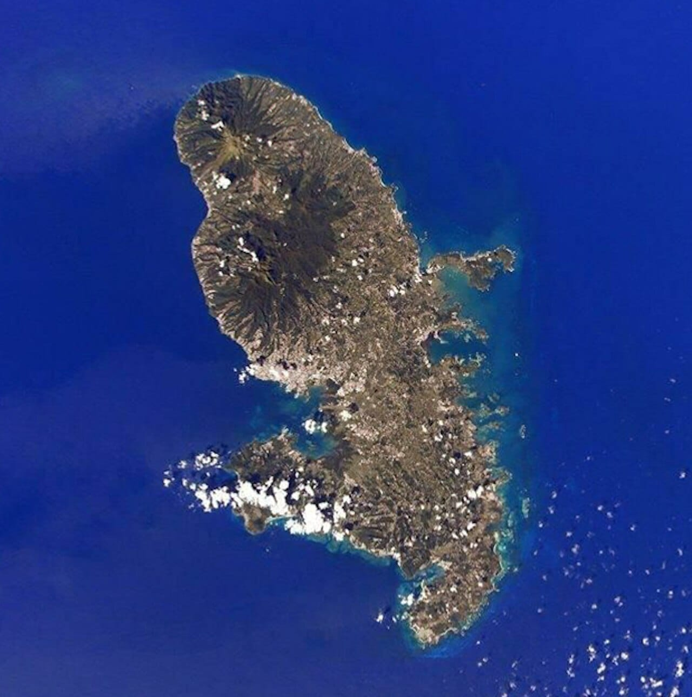

# Martinique

Martinique is a French island in the Lesser Antilles, between Dominica and Saint Lucia. Its distinctive feature is not the scenery but the rules: the French decree of 5 November 1996 created an appellation d'origine contrôlée (AOC) for "Rhum de la Martinique", the first AOC in the rum world to bind both origin and process. Understanding Martinique means reading the volcano, the cane belt, the fermentation time limit and the Creole column still as one system.

Figure: Martinique. Image: ESA/NASA, Public domain, via Wikimedia Commons ([source page](https://commons.wikimedia.org/wiki/File:Martinique-de-haut_(cropped).jpg)).

> **Quick verdict**
> **In one line:** This region helps you judge Martinique for flavour and travel, and plan accordingly.
>
> - **Best for:** Anyone comparing Martinique with other regions before buying wine or planning a trip.
> - **Not for:** If you want want a “most expensive region” verdict and do not care about style or vintage.
> - **Check first:**
>   - Cane arrived in Martinique around 1640, and the island long depended on sugar; distilling was first a way of using molasses and sugar-factory by-products.
>   - Martinique is an overseas department of France with the code MQ, treated here as a province-level region under France.

## Island and geography

Martinique is an overseas department of France with the code MQ, treated here as a province-level region under [France](ref:france). The north is dominated by Mount Pelée, whose 1902 eruption destroyed Saint-Pierre; the south is gentler, with more sedimentary and limestone terrain. The cane belt does not cover the whole island: the AOC delimits parcels suited to ripening cane, with good drainage and without the high-rain mountain zone or saline coastal marshes. Distilleries cluster in northern and central valleys, close to cane supply and water.

## Climate and the cane belt

Martinique has a tropical maritime climate influenced by trade winds and equatorial currents, with a wet, hot season from June to December and a drier season from January to May. Cane needs temperatures above 20℃, ample rain during growth and moderate water stress during ripening; this wet-then-dry rhythm favours sugar accumulation. The AOC harvest is therefore limited to the period from 1 January to 31 August, avoiding the wettest season and keeping cane fresh for pressing. Altitude and wind exposure create different microclimates, and distilleries schedule supply by parcel and ripening date.

## Soils and parcels

Volcanic ash soils in the north drain well and are rich in minerals, giving cane strong growth; clay and limestone parcels in the south hold water differently and ripen at another pace. The AOC explicitly excludes soils with strong hydromorphy in the first 50 centimetres, alluvial valley floors and coastal mangrove areas affected by salt water. Soil water reserve, rainfall and day-night temperature range together determine sugar, acidity and aroma precursors, and so shape [fermentation](ref:fermentation) and the distilled style. About fifteen cane varieties are grown, distributed according to the soil and climate of each parcel.

## History: from sugar by-product to agricultural rum

Cane arrived in Martinique around 1640, and the island long depended on sugar; distilling was first a way of using molasses and sugar-factory by-products. In 1854 the government of Napoleon III removed the relevant duties, and Martinique's rum output and exports to France expanded quickly; by the late nineteenth century the island was among the world's largest rum producers. The sugar overproduction crisis of 1884 to 1896 closed many sugar factories, and some estates turned to pressing cane, fermenting the juice and distilling it directly, which is how rhum agricole took shape. At the same time, continuous Creole columns gradually replaced pot stills, matching the need to process cane juice quickly before it spoils.

## Legal framework: the 1996 AOC

"Rhum de la Martinique" was established by the decree of 5 November 1996, is administered by INAO and is registered in the EU geographical indication system. The AOC governs not only origin but also cane varieties, cultivation, harvest, pressing, fermentation, distillation, ageing and bottling. The word agricole means the raw material is fresh cane juice, not molasses; a product carrying the AOC must be made in Martinique and meet the full set of rules. The AOC guarantees origin and process, not a quality ranking. The island also makes molasses-based rhum industriel, which belongs to the wider [rum](ref:rum) category but falls outside this AOC; both can be made at the same site, and labels and raw materials must be kept distinct.

## Geographic area and 34 communes

The AOC covers 34 communes of Martinique, including Fort-de-France, Le Lamentin, Saint-Pierre, Le Robert, La Trinité, Sainte-Marie, Le Marin and Sainte-Anne. Cane must be grown in parcels approved by INAO, and distillation, ageing and bottling must also take place within the area. The area looks island-wide, but parcel boundaries exclude mountain rainforest, salt marshes and unsuitable waterlogged soils, so "made on the island" is not the same as "AOC".

## Cane, harvest and yield

The AOC requires cane varieties belonging to Saccharum officinarum and Saccharum spontaneum or their hybrids, and transgenic varieties are prohibited; new material must be acclimatised, multiplied and selected in the area for at least 4 years before use in AOC production. Irrigation is allowed for at most 6 months after planting or harvest, and is prohibited between 1 December and the harvest date; ripening substances are banned. Harvest starts no earlier than 1 January and ends no later than 31 August. Juice must reach at least 14 Brix and a pH of at least 4.7 before pressing; parcel yield may not exceed 120 tonnes per hectare. These parameters turn "fresh, ripe and not excessive" into verifiable thresholds.

## Fermentation: a 120-hour limit

After mechanical pressing and imbibition with water or last-mill juice, cane juice is clarified by mechanical means without heating or liming. Fermentation must be discontinuous, in open vats of inert material with a maximum capacity of 500 hectolitres; continuous fermentation and closed vats are prohibited. Molasses, syrup or other sugar by-products may not be added to raise strength. From filling the vat to distillation, fermentation may last no more than 120 hours, and the fermented juice may not exceed 7.5% alcohol by volume. Short, cool fermentation preserves cane's grassy, citrus and floral notes and limits volatile acidity and spoilage risk.

## Distillation: the Creole column

Distillation must take place between 2 January and 5 September. The traditional AOC method is continuous multi-stage distillation with reflux, the Creole column (colonne créole): a depletion zone with at least 15 stainless-steel or copper plates, and an all-copper concentration zone with 5 to 9 plates, with column diameters of 0.7 to 2 metres in the depletion zone. The still is heated by direct steam or a tubular exchanger, and the distillate is kept between 65% and 75% alcohol by volume. Rectification on the liquid phase to change the partial concentration of the distillate is prohibited. Compared with a pot still, the Creole column is more efficient and can process cane juice before it spoils while retaining enough esters and aroma.

## Ageing and labels: blanc, EBS and vieux

White agricultural rum (blanc) must be colourless and rest in vats for at least 6 weeks after distillation; brief wood contact is possible but colouring is not. "Élevé sous bois" (EBS) rum must age in oak for at least 12 months; "vieux" rum must age for at least 3 years in oak containers smaller than 650 litres; if the distillation year is stated, it must age for at least 6 years. All AOC rum must be at least 40% alcohol by volume when sold; volatile substances other than methyl and ethyl alcohol must reach 225 grams per hectolitre of pure alcohol for standard rum, 250 grams for EBS and 325 grams for vieux. Ageing brings vanilla, coconut, dried fruit and wood, but the vegetal cane character remains the clue to the region.

## Style and producers

White agricultural rum commonly shows fresh cane juice, grass, lime peel, green banana and mineral notes, with a dry palate suited to local serves such as Ti' Punch; aged versions are rounder, with vanilla, cocoa, dried fruit and spice. Representative producers include Clément, HSE (Habitation Saint-Étienne), La Mauny, Depaz, Trois Rivières, Neisson, Saint-James, La Favorite and JM. Their differences come from cane source, still operation and ageing strategy, and one island name cannot sum them up.

## Vintage and market

Vintage works differently from wine: most agricultural rum is a multi-year blend, and only vieux labelled with a distillation year stresses a single year, with at least 6 years of ageing. Cane year, the length of the wet season and storms affect sugar and aroma, but producers more often blend to keep a house style stable. The market has long been led by mainland France; in recent years exports have grown to the United States, Japan and European cocktail markets, white agricole has become more visible in bars, and aged versions have entered specialist spirits shelves. Tourism and distillery visits are also important income.

## Common misconceptions

First, that agricultural rum means all Martinique rum; the island also makes molasses rum. Second, that the AOC is a quality grade; it sets origin and process only. Third, that agricultural rum must be white; aged versions exist too. Fourth, that cane-juice rum is sweeter; most finished spirits are not sweet. Fifth, that all Creole stills are the same; plate numbers, copper and operation still create differences. Sixth, that darker rum is always older; colour can also come from caramel, so the label and the ageing claim need reading.

## Further reading

- [France](ref:france): the French appellation system and regional hierarchy.
- [Rum](ref:rum): rum raw-material categories and basic production.
- [Distillation](ref:distillation): continuous and pot distillation.
- [Fermentation](ref:fermentation): cane-juice fermentation and flavour precursors.
- [Oak ageing](ref:oak-ageing): cask type and flavour in aged agricultural rum.
