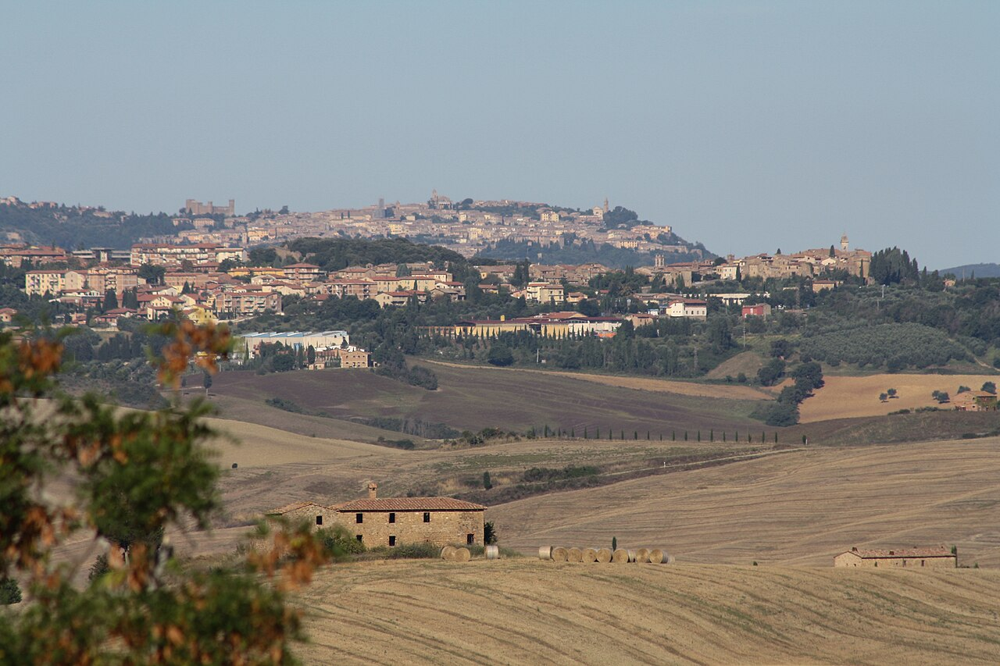

# Montalcino

Montalcino is the red-wine DOCG of the municipality of Montalcino in Siena province, Tuscany, known for Brunello, made from 100% Sangiovese. Its legal area is a single municipality, yet soil, altitude and aspect give a wide range of styles under one set of rules.

Figure: Montalcino. Image: Marco Usan, CC BY 3.0, via Wikimedia Commons ([source page](https://commons.wikimedia.org/wiki/File:Montalcino-_panoramio.jpg)).

## Definition and scope

The DOCG may only be used for red [wine](ref:red-wine) produced and bottled entirely within Montalcino. It lies in central [Italy](ref:italy), in [Tuscany](ref:tuscany), administratively in Siena province; Brunello di Montalcino, Rosso di Montalcino, Moscadello di Montalcino and Sant'Antimo are all limited to the same municipality.

Brunello is not another variety but the local name for Sangiovese, and the rules require 100% [Sangiovese](ref:sangiovese) with no other grape. Rosso uses the same grape but is positioned as an earlier-drinking red; the difference lies mainly in ageing and release, not in the source of the fruit.

Labels must match the zone, and Brunello may only be bottled in the area in the prescribed Bordeaux-shaped bottle.

## History

Viticulture and winemaking in Montalcino go back to the Middle Ages; the village lies south of Siena, between the Val d'Orcia and the Maremma. In the second half of the 19th century local growers began making a pure-Sangiovese red built for long ageing, and the name Brunello became tied to that style.

The presidential decree of 1 July 1980 granted Brunello di Montalcino DOCG status, among Italy's earliest guaranteed designations. Rosso di Montalcino obtained DOC status from the 1984 vintage, and Sant'Antimo DOC, covering white and red wines, completed the pyramid from 1996. The decree of 19 May 1998 set the rules then in force, and later amendments followed. The rules fix variety, yield, ageing, release date and bottling place, so Brunello is a legal identity rather than only a local wine name.

## Geography and climate

The municipality lies in the hills south of Siena, with vineyards on slopes around the village and at the edges of the valleys. Altitude and aspect create clear microclimates: south-facing slopes are warmer and ripen earlier, north-facing or higher sites are cooler and keep more acidity, and valley floors collect cold air and are usually not the best sites.

The climate is Mediterranean with Tyrrhenian influence, with warm dry summers and wide autumn day-night swings; cool nights help retain acidity. Surrounding hills and valleys give some shelter and air movement, but vintages still differ, and the timing of rain often matters more than average temperature.

Soils range from galestro marl and clay to sandy and marine deposits, with very different drainage and water-holding capacity. No single parcel represents the whole municipality, and different vineyards at one estate often give different structures; [terroir](ref:terroir) here is a combination of sites rather than one formula.

## Grape and viticulture

Brunello may only use [Sangiovese](ref:sangiovese), locally called Sangiovese grosso or Brunello. It has relatively thin skins, high acidity, moderate to firm tannin and late ripening, with aromas of sour cherry, violet, dried grass and earth; underripe fruit is sharp, while fully ripe fruit has more complete structure.

The yield ceiling is 80 quintals per hectare, with a 68% yield in wine, about 52 hl/ha, and a minimum natural alcohol of 12.5%. These limits keep production low in exchange for concentration and sufficient acidity. Rosso di Montalcino uses the same grape but may be released on 1 September of the year after harvest, making it suitable for earlier drinking.

Viticulture stresses slopes, ventilation and a balanced canopy to limit disease and slow ripening. Because the legal area is one municipality, estates are close together, yet altitude, aspect and soil still create clear differences in ripening and style.

## Winemaking and ageing

Brunello must spend at least 2 years in wood and at least 4 months in bottle; Riserva needs at least 6 months in bottle. Standard Brunello may not be released before 1 January of the fifth year after harvest, and Riserva one year later, on 1 January of the sixth.

At release the minimum alcohol is 12.5%, total acidity at least 5 g/L and net dry extract at least 26 g/L. The law fixes neither cask type nor the proportion of new oak, so large traditional casks and small French barrels are both legal; [oak ageing](ref:oak-ageing) is mainly used to integrate high acid and tannin rather than simply to add aroma.

Brunello's ageing potential is usually described as at least 10 years and up to about 30, depending on vintage and estate. That longevity rests on the acid and tannin frame of Sangiovese rather than on alcohol, so low yields, late picking and moderate extraction matter more than a long spell in cask.

## Classification and rules

The legal hierarchy has one level, DOCG, with no official vineyard classification. Brunello and Riserva differ by ageing and release date, not by site, and one vineyard can produce both. Rosso di Montalcino is a separate DOC, not a legal second wine of Brunello, although it uses the same grape.

Sant'Antimo DOC allows white and red wines and may name the variety on the label; Moscadello di Montalcino DOC is a sweet white from Moscato. Together they form the Montalcino range, but only Brunello and Riserva are DOCG.

Bottling must take place in the zone, and Brunello may only use the Bordeaux-shaped bottle. Labels must show DOCG, vintage and bottler; Riserva status must be requested after the mandatory ageing, so not every long-aged wine qualifies.

## Style and serving

Brunello is bright garnet-red, with an intense, persistent perfume of undergrowth, aromatic wood, berries, vanilla and jam; it is dry, warm, lightly tannic, robust and harmonious. With age the perfume moves from fruit to dried flowers, leather, tobacco and earth, while acidity remains the frame.

Serving temperature is usually 18–20°C; old bottles can be decanted to open the perfume but should not be exposed for long. Pair with red meat, game, mushrooms and truffles, and aged hard cheese such as pecorino; the acid and tannin cut fat and stand up to rich sauces.

Young Brunello often seems tight, with fruit and tannin not yet integrated; after 5 to 10 years the structure opens and the perfume becomes more complex. Check vintage and the estate's ageing approach before deciding whether to drink now or keep the bottle, since not every Brunello needs 20 years.

**Short definition:** A red-wine DOCG of the municipality of Montalcino in Siena province, Tuscany, raised to guaranteed designation of origin by presidential decree on 1 July 1980 and made only from 100% Sangiovese, locally called Brunello; the yield ceiling is 80 quintals per hectare (about 52 hl/ha), the yield in wine is 68%, minimum alcohol is 12.5%, total acidity 5 g/L and net dry extract 26 g/L, with at least 2 years in wood and 4 months in bottle, release on 1 January of the fifth year after harvest, and for Riserva at least 6 months in bottle and one year later on the market.

## References

- [Italy](ref:italy): the national appellation and DOCG framework.
- [Tuscany](ref:tuscany): the regional setting of Montalcino.
- [Sangiovese](ref:sangiovese): the only permitted variety.
- [Red wine](ref:red-wine): an overview of still red winemaking.
- [Oak ageing](ref:oak-ageing): cask type, age and micro-oxygenation.
- [Terroir](ref:terroir): a framework for altitude, aspect and soil.
