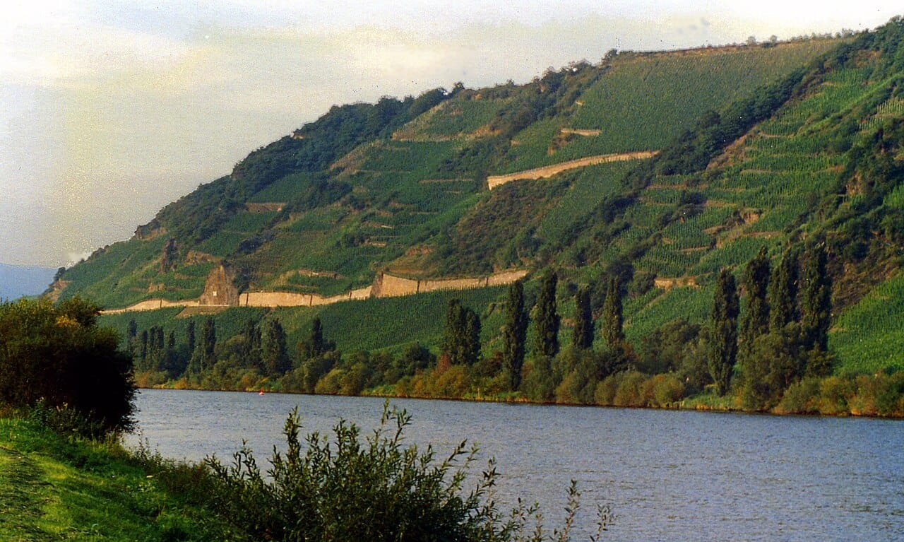

# Mosel

Mosel is the German appellation of the Mosel river and its Saar and Ruwer tributaries, known for Riesling on steep slate slopes. It is one of the northernmost of Germany's 13 appellations and a reference for low-alcohol, high-acid Riesling.

Figure: Mosel. Photograph: Mosel vineyard in Tittenheim. Credit: Phillip Capper, CC BY 2.0, via Wikimedia Commons ([source](https://commons.wikimedia.org/w/index.php?curid=4168277)).

## Definition and scope

Mosel is a protected appellation name, and Mosel on a label must come from the demarcated area and be made within it. The region was shortened from Mosel-Saar-Ruwer to Mosel in 2007, and the older name may still appear on earlier labels and in literature.

White wines dominate, with Riesling at about 60% of the planted area, alongside Elbling, Müller-Thurgau, Weißburgunder and Grauburgunder; reds are mainly Spätburgunder and account for a small share.

## History

Viticulture in the Mosel valley goes back to Roman times, and medieval monasteries drove the clearing of slopes and the winemaking tradition. In the 19th century Mosel wines fetched high prices in the British and Dutch markets, and the steep terraces and stone walls took shape in that period.

The 1971 German wine law established the Prädikat system based on ripeness at harvest, and Mosel is its most typical application. Steep-slope abandonment and consolidation increased in the late 20th century, followed by a revival over the past two decades driven by international demand for high-quality Riesling.

## Geography and climate

The Mosel flows from the German-Luxembourg border to Koblenz, forming many bends between Trier and Koblenz. South and south-west facing slopes get the longest sunshine, and light and heat reflected from the river, together with slate that absorbs heat by day and releases it at night, offset the cool northern latitude.

The climate is cool continental, with a long growing season and slow ripening, and large day-night swings in autumn. Rain falls mainly in winter, the growing season is relatively dry, and drought and slope erosion are the main pressures. Slate, specifically Devonian slate, is the main soil; it breaks down into free-draining, heat-retaining material, and differences in its direction and depth create site variation.

Slopes are commonly 30%–70% and some are steeper. Mechanisation is very limited, and pruning, picking and transport rely on manual labour and small machines, which structurally raises costs and lowers yields.

## Valleys and sub-zones

The appellation comprises four main valley sections with distinct styles.

- Mittelmosel: around Bernkastel, Wehlen and Zeltingen, with many bends and steep slopes, the core Riesling zone.
- Terrassenmosel, also called Untermosel: nearer Koblenz, with gentler slopes and more terraces, giving lighter wines.
- Saar: a tributary valley, higher and cooler, with sharp acidity and enough fruit only in ripe years.
- Ruwer: a smaller tributary valley, low in volume, lean and mineral in style.

These sections reflect geography and climate, not a quality hierarchy. The same variety can show completely different acidity, body and ripeness in the Saar and the Mittelmosel.

## Varieties and raw material

Riesling is the dominant variety, thin-skinned, late-ripening and cold-tolerant, able to keep high acidity and clear aroma at low alcohol. Elbling is more common in the upper Mosel and on the Luxembourg side, with high acidity and simple aroma, mostly for fresh styles.

Müller-Thurgau offers an earlier-ripening, softer option; Weißburgunder and Grauburgunder add body and fruit. The red Spätburgunder is used for light-bodied [red wines](ref:red-wine). The raw material is [grape](ref:grape).

## Winemaking

Riesling is usually whole-bunch pressed, settled and [fermented](ref:fermentation) slowly at low temperature to keep fruit and [acidity](ref:acidity). Traditionally it fermented and spent brief lees time in large old oak Fuder, while modern producers use temperature-controlled stainless steel.

Most wines avoid malolactic fermentation so that acidity is not reduced; some dry wines get brief lees contact for texture. Ageing takes place in inert containers or old large barrels, with little new oak, so that oak does not cover the variety. Here the [oak cask](ref:oak-ageing) is a container rather than a flavour source.

## Classification and rules

German wine is divided into Wein, Landwein, Qualitätswein and Prädikatswein. Qualitätswein may be enriched with sugar before fermentation to raise alcohol; Prädikatswein may not be enriched, and its alcohol comes entirely from the grapes' own sugar.

Prädikatswein is graded by must weight at harvest (°Oe) into six levels, and what rises from level to level is the ripeness requirement, not the sweetness of the finished wine.

- Kabinett: the lightest level, often 7%–9% vol, fresh and high in acidity.
- Spätlese: late harvest, riper fruit and more body, and it can be dry or sweet.
- Auslese: selected ripe bunches, often with botrytis, with more intense aroma and higher sugar.
- Beerenauslese (BA): individually picked botrytised berries, very low yields, usually sweet.
- Trockenbeerenauslese (TBA): shrivelled botrytised berries, with highly concentrated sugar and acidity, and very rare.
- Eiswein: grapes frozen on the vine and pressed with ice, concentrating sugar and acidity, with low alcohol and high sweetness.

For Mosel, begin with the appellation and its permitted varieties. Then look at the vintage and the producer, and finally ask how the wine is labelled. The answers point to different choices, not to a single score.

Dry and semi-dry are taste indications, not Prädikat levels. Trocken means residual sugar no higher than 9 g/L, halbtrocken means 9–18 g/L, and feinherb is a common but unregulated term broadly covering semi-dry to lightly sweet. Kabinett can be trocken and Auslese can be trocken, so a higher level does not mean more sweetness.

## Labels and serving

The label should be checked for Mosel, the Prädikat level, village and site names, vintage, alcohol, volume and bottler. The AP number (Amtliche Prüfungsnummer) on a German label traces the official quality-test batch.

Großes Gewächs and Erste Lage are private classifications of producer associations such as the VDP, not state grades, and should be read separately from the Prädikat level.

Young Riesling is best at 8–10 degrees Celsius, and dry wines can be served a little warmer. High acidity suits pork, poultry, fried food and Asian dishes; sweet wines suit blue cheese and fruit desserts. Once opened, keep chilled and finish within a few days. Excessive drinking is harmful to health and minors should not drink.

## Common misconceptions

First, treating the Prädikat level as sweetness. The level describes ripeness at harvest, and one level can be made dry, semi-dry or sweet.
Second, assuming Riesling means sweet wine. Mosel makes many trocken and feinherb wines, and sweet styles are only one part.
Third, assuming slate always gives a mineral taste. Minerality is a tasting descriptor and does not map directly onto a soil's chemistry.
Fourth, assuming low alcohol means dilution. The 7%–9% vol of Mosel Riesling comes from incomplete sugar conversion in a cool climate and is a regional feature.
Fifth, reading Mosel as a single style. The Mittelmosel, Terrassenmosel, Saar and Ruwer differ markedly in acidity and body.

**Short definition:** The German appellation of the Mosel river and its Saar and Ruwer tributaries, known for Riesling on steep slate slopes; Prädikatswein is graded by must weight at harvest into Kabinett, Spätlese, Auslese, Beerenauslese, Trockenbeerenauslese and Eiswein, with Mosel Riesling thresholds of about 73, 80, 88, 110, 128 and 120 °Oe; labels also carry trocken and halbtrocken to mark dry and semi-dry, and the Prädikat level itself does not determine sweetness.

## Further reading

- [Germany](ref:germany): the national appellation framework that contains Mosel.
- [Wine](ref:wine): an overview of wine categories, vintage and origin rules.
- [White wine](ref:white-wine): the category to which Riesling belongs.
- [Red wine](ref:red-wine): wines made from Spätburgunder and other red varieties.
- [Grape](ref:grape): the structure and ripeness markers of wine grapes.
- [Fermentation](ref:fermentation): the difference between cool fermentation and malolactic fermentation.
- [Acidity](ref:acidity): where the high acidity of Mosel Riesling comes from and what it does.
- [Alcohol by volume](ref:abv): what 7%–9% vol means on a label and in the style.
- [Oak ageing](ref:oak-ageing): the role of the large Fuder as a container rather than a flavour source.

## Related images

Image: Category image for Germany. Credit: Renardo la vulpo, CC0, via Wikimedia Commons ([source page](https://commons.wikimedia.org/wiki/File:M%C3%BCnchen,_Oktoberfest_2022,_Fischer-Vroni_v_S,_1.jpeg)). Related image for Mosel.

Image: Acidity. Credit: Chemicalinterest, Public domain, via Wikimedia Commons ([source page](https://commons.wikimedia.org/wiki/File:Zn_reaction_with_HCl.JPG)). Related image for Mosel.
