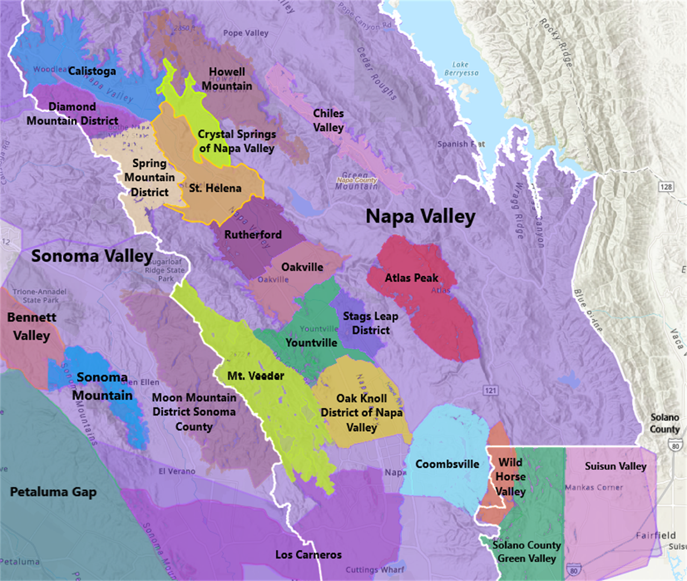

# Napa Valley

Napa Valley is California's best-known wine region, known for Cabernet Sauvignon and a dense system of small appellations.

Figure: Napa Valley. Image: Unknown author Unknown author, Public domain, via Wikimedia Commons ([source page](https://commons.wikimedia.org/wiki/File:TTB_Map_Napa_Valley_AVA.png)).

## Definition and scope

Napa Valley is a wine region in Napa County, California, and became the state's first federal American Viticultural Area (AVA) in 1981. The valley runs about 30 miles (48 km) north to south and is about 5 miles (8 km) wide at its widest point, with vineyards from sea level to about 2,600 feet (800 metres).

The Napa Valley AVA is small but internally diverse. About 9% of county land can grow grapes, and the region produces only 4% of California's grape harvest and 0.4% of world wine production. The county has 16 approved sub-appellations, each with its own boundary and climate.

## History

Viticulture began in Napa Valley in the mid-nineteenth century, when European immigrants brought vinifera varieties and winemaking techniques. The industry shrank during outbreaks of vine disease, Prohibition and economic swings in the early twentieth century.

In 1968 Napa County created the Agricultural Preserve, the first US programme of its kind to set agricultural land aside from urban development. Napa Valley became California's first AVA in 1981, and from the 1970s the number of wineries and the region's reputation rose quickly, with Cabernet Sauvignon becoming its signature.

## Geography and climate

Napa Valley has a Mediterranean climate with dry summers, mild wet winters and rain concentrated in winter. The southern end near San Pablo Bay receives cool marine air and morning fog, making Carneros clearly cooler; further north the ocean influence weakens and Calistoga and St. Helena are warmer and ripen earlier.

The mountains on both sides and the valley floor add a third layer. Hillside vineyards are higher, with a larger day-night range and better drainage; valley-floor soils are deeper and hold more water. The same variety shows different acidity, fruit and tannin in the south, the north and the hills.

Soil diversity is central to the region's identity. Napa has six of the world's twelve soil orders and 33 different soil series, including alluvial fans, volcanic soils, sedimentary rock and river gravel. Differences in drainage and water holding directly shape rooting depth and ripening, forming the basis of [terroir](ref:terroir).

## Sub-appellations

The Napa Valley AVA contains 16 approved sub-appellations, which fall roughly into three groups:

- Valley-floor sub-appellations: Oak Knoll District, Yountville, Stags Leap District, Oakville, Rutherford, St. Helena and Calistoga, warming from south to north.
- Mountain sub-appellations: Howell Mountain, Diamond Mountain District, Spring Mountain District, Mount Veeder and Atlas Peak, higher with a larger day-night range.
- Edge and shared sub-appellations: Carneros, shared with Sonoma and cooled by bay fog; Coombsville in the south-east; Chiles Valley and Pope Valley among the eastern mountains.

Oakville and Rutherford are known for valley-floor gravel and Cabernet Sauvignon; Stags Leap District has volcanic rock and cool night air that give softer tannin; Howell Mountain is high and late-ripening, with tighter structure.

## Varieties and raw material

About 80% of Napa Valley vineyards are planted to red varieties and 20% to whites, with more than 34 varieties. On Napa Valley Vintners' variety-area basis, Cabernet Sauvignon covers about 25,000 acres (10,117 hectares), 54% of the vineyard; Chardonnay about 5,628 acres (2,277 hectares, 12%); Merlot about 3,632 acres (1,469 hectares, 8%); Sauvignon Blanc about 2,553 acres (1,033 hectares, 6%); Pinot Noir about 2,409 acres (975 hectares, 5%); Zinfandel about 1,270 acres (514 hectares) and Cabernet Franc about 1,224 acres (495 hectares).

In the Napa County Agricultural Commissioner's 2025 report, the county had 42,937 acres (about 17,376 hectares) of bearing wine grapes and produced about 144,807 tons. Variety area and bearing area are different measures, and labels and statistics should not mix them. The raw material is [grape](ref:grape).

Cabernet Sauvignon in Napa usually shows blackcurrant, black cherry, cedar and graphite with firm tannin, and is suited to [oak ageing](ref:oak-ageing). Merlot is softer and often blended with Cabernet; Chardonnay in Carneros and the south is fresh, with some wines seeing oak and malolactic fermentation; Sauvignon Blanc is citrus- and herb-led; Pinot Noir is concentrated in the cool Carneros area.

## Winemaking

Red grapes are destemmed and [fermented](ref:fermentation) with temperature control, and maceration depends on variety and style. Cabernet Sauvignon often gets longer maceration and pumpovers to extract colour and tannin, then ages 18–24 months in French or American [oak](ref:oak-ageing), with the share of new barrels varying by winery. Some wines use whole-cluster or whole-berry fermentation for fuller aroma and gentler extraction.

Whites ferment cool. Some Chardonnay sees lees stirring and malolactic fermentation, while Sauvignon Blanc is mostly kept in stainless steel to preserve acidity. High-sugar vintages may be acid-adjusted, subject to federal and state rules.

## AVA and labelling

For Napa Valley, US appellations of origin are governed by 27 CFR 4.25. A wine labelled with an AVA must derive at least 85% of its volume from grapes grown inside that AVA; for a county or state appellation the figure falls to 75%. The wine must also be fully finished in the state where the labelled area lies, with limited exceptions.

An AVA sets a geographic boundary and an approved name, not varieties, yields or winemaking. The same AVA can produce different varieties and styles, and an AVA name is not a quality grade. Napa sub-appellation names must be approved by federal rule, and wineries cannot invent them.

## Labels and serving

The label should be checked for the AVA or sub-appellation, variety, [vintage](ref:vintage), [alcohol](ref:abv), volume and bottler. A wine labelled as a [single variety](ref:single-varietal) must meet the federal variety share; blends must list their varieties under the rules. Cabernet Sauvignon and Merlot are served at about 16–18 degrees Celsius; Chardonnay at about 10–12, Sauvignon Blanc at about 8–10 and Pinot Noir at about 14–16.

Cabernet Sauvignon suits red meat, grilled dishes and hard cheese; Chardonnay suits seafood, poultry and creamy dishes; Sauvignon Blanc suits salads and light seafood. Refrigerate after opening and finish soon. Excessive drinking harms health and minors should not drink.

## Common misconceptions

First, thinking Napa grows only Cabernet Sauvignon. Cabernet is about 54% of the vineyard, and Chardonnay, Merlot, Sauvignon Blanc and Pinot Noir also cover sizeable areas.
Second, treating an AVA as a quality grade. An AVA defines a geographic area and does not judge wine quality.
Third, confusing Napa Valley with Napa County. The AVA boundary is smaller than the county, and some county vineyards lie outside the AVA.
Fourth, assuming Napa produces large volumes. It grows only 4% of California's wine grapes and focuses on high value and low yield.
Fifth, treating sub-appellation names as winery brands. Sub-appellations must be approved by federal rule and their use is regulated.

For Napa Valley, begin with the appellation and its permitted varieties. Then look at the vintage and the producer, and finally ask how the wine is labelled. The answers point to different choices, not to a single score.

[Wine](ref:wine) and [Red wine](ref:red-wine) are the two useful reference points for Napa Valley. [Wine](ref:wine) sets out geographic boundary; [Red wine](ref:red-wine) brings in climate and soil. Read them together.

## Further reading

- [Wine](ref:wine): an overview of wine categories, vintages and origin rules.
- [Red wine](ref:red-wine) and [white wine](ref:white-wine): the two main categories of Napa Valley.
- [Grape](ref:grape): the structure of wine grapes and ripeness measures.
- [Fermentation](ref:fermentation): red maceration and cool white fermentation.
- [Acidity](ref:acidity): how bay fog and the day-night range affect acidity.
- [Terroir](ref:terroir): how valley floor, hillsides and alluvial fans create sub-appellation differences.
- [Oak ageing](ref:oak-ageing): container choices for Cabernet Sauvignon and Chardonnay.
- [Dry](ref:dry): the dry positioning of Napa whites.
- [Vintage](ref:vintage): vintage variation, drought and wildfire in Napa.
- [Single varietal](ref:single-varietal): the concept behind variety labelling.
- [Alcohol by volume](ref:abv): what % vol means on a label.
