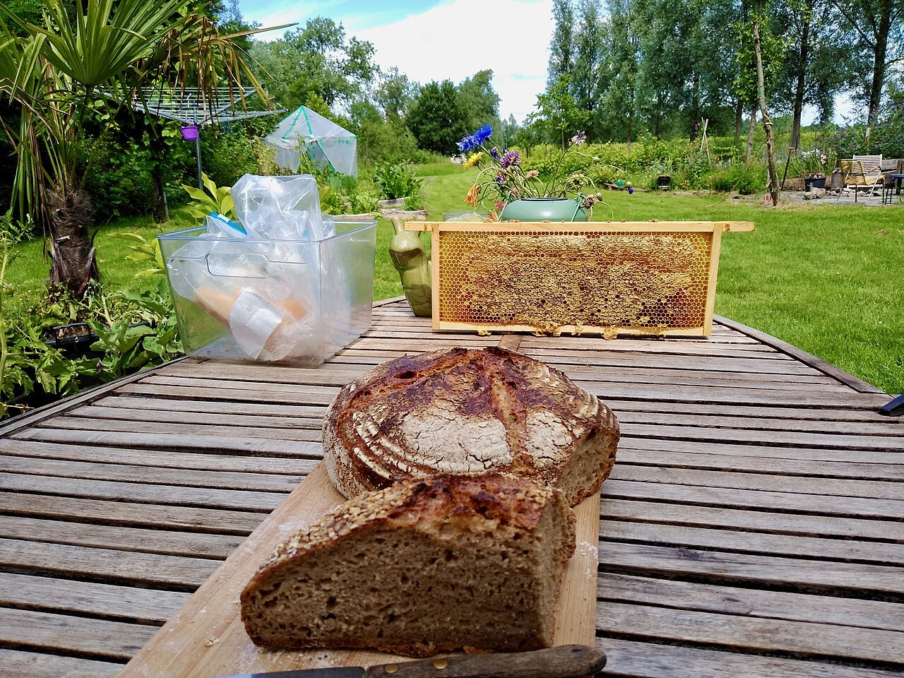

# Netherlands

The Netherlands is a low-lying country in north-west Europe where the Rhine, Meuse and Scheldt reach the sea. Dutch drinking is easily reduced to Heineken and pilsner, but the country also has jenever, a traditional spirit protected in the EU, a growing craft beer scene and a small but persistent wine industry. Only by putting these three lines together can the national alcohol map be understood.

Figure: Netherlands. Photograph: Vineyard Dassemus (Chaam, Netherlands, July 2020) - 2 (50522232027). Credit: Bruno Rijsman, CC BY-SA 2.0, via Wikimedia Commons ([source](https://commons.wikimedia.org/w/index.php?curid=101342530)).

## Geography and water in a low country

About 26% of the Netherlands lies below sea level, maintained by dikes, dunes and drainage. The climate is temperate maritime, mild in winter, cool in summer, with rain spread evenly through the year and fairly strong winds. The west and north are mostly clay and peat, while the east and south have sandy soils and loess. Water is generally soft and suits crisp lager, but its mineral content differs clearly between cities, so breweries usually treat water first and then adjust pH and minerals in the mash to suit the style.

## Beer: from town breweries to pilsner

In the medieval and early modern periods Dutch towns had many small breweries, with beer a daily drink tied to municipal taxation and guild rules. In the 19th century bottom-fermentation technology arrived from central Europe, and cool fermentation with long storage gradually replaced top fermentation, making lager dominant. Heineken was founded in Amsterdam in 1864 and grew into an international brand through exports and acquisitions; Grolsch traces its history to 1615 and Bavaria to 1719, and together with Heineken they form the backbone of large-scale Dutch brewing. Consolidation increased in the late 20th century, and the craft revival of the 21st century added hundreds of small breweries.

## Beer styles and breweries

The most common Dutch style is pilsner: pale gold, crisp, moderately bitter and suited to meals and everyday drinking. Beyond lager, the Netherlands also makes wheat beer, Belgian-style ale, abbey-style beer and seasonal products. La Trappe, at Koningshoeven near Tilburg, is the country's only Trappist brewery, with a range from pale ale to quadrupel. Brouwerij 't IJ in Amsterdam and De Molen in Bodegraven represent the craft route, the first built around local bar culture, the second known for big flavours and barrel experiments. Limburg and North Brabant also have regional breweries.

## Jenever: the overlooked spirit line

Jenever (often written genever in English) is the traditional Dutch and Belgian juniper spirit, made by blending malt wine (moutwijn) with neutral spirit and redistilling with juniper and other botanicals. It comes as jonge jenever and oude jenever: the first is lighter with less malt wine, the second sweeter and heavier, often aged in oak; Korenwijn is marked by a higher proportion of malt wine. The EU geographical indications system registers names such as Jonge jenever, Oude jenever and Korenwijn, which shows it is more than a colloquial "Dutch gin". The traditional serve is chilled in a small glass, or paired with beer as a kopstootje.

## Wine: a small industry on a climate margin

Dutch vineyards cover about 300 ha, concentrated in Limburg in the south, the Betuwe in the centre and Zeeland. The climate is cool and humid, making ripening and disease control difficult, so growers rely heavily on PIWI disease-resistant varieties such as Solaris, Johanniter, Souvignier Gris and Regent to reduce spraying. Production is mostly white, rosé and sparkling, with less red. The Netherlands is not a major EU wine producer and has nothing like the full appellation hierarchy of France or Germany; estates mostly use "Dutch wine" as an origin story, and quality varies widely.

## Regulation, taxation and market

Alcohol in the Netherlands falls under the Alcohol Act and food safety rules, with a minimum purchase and drinking age of 18. Beer, wine and spirits carry different excise rates, with spirits taxed highest, which shapes on-trade pricing. Beer consumption has fallen steadily over the last two decades, no-alcohol and low-alcohol products are growing clearly, and craft channels, brewery sales and restaurants are the main outlet for small producers. In exports, large brands such as Heineken hold global share, while jenever depends more on the home market and travel retail.

## Drinking and pairing

Pilsner is best served chilled; too warm brings out bitterness and alcohol, while wheat beer suits a slightly higher temperature to release fruit. Jenever is traditionally served chilled and neat, and also works in cocktails; its malt sweetness and juniper suit cheese, herring and fried food. Wine is most often a crisp white with seafood. Excessive drinking is harmful to health, and minors should not drink.

## Common misconceptions

First, assuming the Netherlands only produces Heineken. It has large breweries and hundreds of craft brands. Second, equating pilsner with Dutch beer as a whole. Pilsner is a style, and the country also makes ale, wheat beer and abbey-style beer. Third, thinking jenever is simply British gin. Jenever uses malt wine, tastes sweeter and heavier, and aged versions differ clearly. Fourth, treating Dutch wine as non-existent. It has about 300 ha of vines, merely small in scale and high in cost. Fifth, treating lager as a low-end process. Bottom fermentation is a style choice, unrelated to quality. Sixth, assuming pale colour means low alcohol. Colour has no direct link to alcohol content.

**At a glance:** A low-lying country in north-west Europe where the Rhine and Meuse reach the sea. Pilsner dominates the beer market, Heineken was founded in Amsterdam in 1864, jenever is a protected traditional spirit, and wine remains a small, marginal-climate industry. Dutch drinking has to be read across beer, spirits and wine at once. 

Netherlands is best read by starting with the appellation and its permitted varieties, moving to the vintage and the producer, and ending with how the wine is labelled.

**Key facts.**

| Item | Detail |
| --- | --- |
| In one line | A low-lying country in north-west Europe where the Rhine and Meuse reach the sea. Pilsner dominates the beer market, Heineken was founded in Amsterdam in 1864, jenever is a protected traditional spirit, and wine remains … |
| Level | country |
| Country code | NL |

**Sources and limits.** The key claims about Netherlands are checked against the following sources: Heineken (the founding year and Amsterdam origin of Heineken; no original text is reproduced), Nederlandse Bierbrouwers (the Dutch beer industry and style overview; no original text is reproduced), Oxford University Press (Consulted for entries on pilsner, lager and Dutch beer; no original text is reproduced; Migrated from the former reference list at the end of the article; access date not re-verified) and 5 sources in total. Prices, batches and status change; the body is project-written and does not reproduce source text.

For Netherlands, this region was last checked in 2026; prices, batches and availability change, so confirm them against the sources below.

## Further reading

- [Beer](ref:beer): the overall classification and process framework for beer.
- [Barley](ref:barley) and [water](ref:water): the base materials of Dutch beer.
- [Fermentation](ref:fermentation): bottom fermentation and cold maturation.
- [Craft beer](ref:craft-beer): the craft revival and small breweries.

## Related images

Image: Water poured into a glass. Brewing water is also tested for hardness, alkalinity, minerals and microbiology.. Credit: Jorge Barrios, Public domain, via Wikimedia Commons ([source page](https://commons.wikimedia.org/wiki/File:Glass_of_Water.JPG)). Related image for Netherlands.

Image: Craft beer. Credit: Bernt Rostad, CC BY 2.0, via Wikimedia Commons ([source page](https://commons.wikimedia.org/wiki/File:Zachariasbryggen_Microbrewery.jpg)). Related image for Netherlands.
