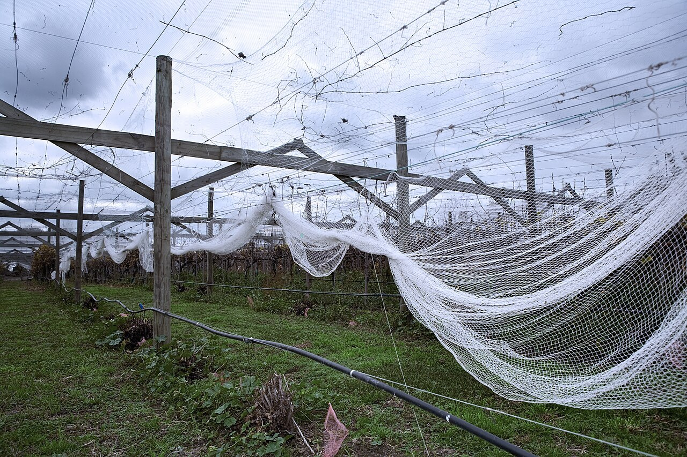

# New Zealand

New Zealand is an island country in the South Pacific. Its wine industry is small in scale but internationally recognised for clear varietal expression. Marlborough Sauvignon Blanc shows citrus, passion fruit and herbal notes, while Central Otago Pinot Noir brings red fruit, spice and fresh acidity. An oceanic climate, a long growing season and strong winds are key to understanding New Zealand wine.

Figure: New Zealand. Photograph: New Zealand - Vineyard - 9878. Credit: Jorge Royan, CC BY-SA 3.0, via Wikimedia Commons ([source](https://commons.wikimedia.org/w/index.php?curid=15897982)).

## Geography and climate

New Zealand consists of the North Island, the South Island and several smaller islands, with wine regions mostly along the eastern coast and river valleys. The ocean strongly moderates the climate, making temperatures milder than at similar latitudes and the growing season longer, with a wider diurnal range inland in the South Island. The westerly belt brings rain and wind, and some regions use shelter belts and slope selection to improve ripening conditions.

Central Otago in the South Island is one of the few areas approaching a continental climate, with warm summers, cool autumns and a wide diurnal range; Marlborough at the north-east of the South Island is sunny with relatively low rainfall; Hawke's Bay and Wairarapa in the North Island are milder under oceanic influence. Microclimate differences make the same variety show different ripeness and acidity across regions.

## History

The New Zealand wine industry only entered international markets in the later twentieth century. Early production focused on hybrid varieties and everyday wine; from the 1970s, producers shifted toward European grape varieties and more careful viticulture. Marlborough opened export markets with Sauvignon Blanc from the 1980s, and Central Otago and Hawke's Bay gradually gained recognition. The small scale makes quality and regional storytelling especially important.

## Wine regions

- Marlborough: the core Sauvignon Blanc region, also Chardonnay, Pinot Noir and sparkling wine.
- Central Otago: Pinot Noir and Riesling, cool with a wide diurnal range.
- Hawke's Bay: Merlot, Syrah and Chardonnay, an important North Island red region.
- Wairarapa: Pinot Noir and aromatic whites.
- Canterbury and Nelson: cooler regions for white wine and sparkling wine.
- Auckland and Northland: warmer northern regions with a broader variety range.

## Varieties and styles

[Sauvignon Blanc](ref:sauvignon-blanc) is New Zealand's most recognisable variety; Marlborough styles often show passion fruit, lime, cut grass and mineral notes, with high acidity and expressive aroma. [Pinot Noir](ref:pinot-noir) performs strongly in Central Otago and Wairarapa, combining red fruit, spice and earth with fresh acidity.

[Riesling](ref:riesling) and [Chardonnay](ref:chardonnay) have a place among whites, ranging from dry to sweet; [Merlot](ref:merlot) and [Syrah](ref:syrah) form red styles in the warmer North Island regions. The balance of [red wine](ref:red-wine) and [white wine](ref:white-wine) varies by region and vintage, and [sparkling wine](ref:sparkling) is also produced steadily.

## Representative wines and producers

New Zealand estates are generally small, and brands are often tied directly to producers. Marlborough Sauvignon Blanc, Central Otago Pinot Noir and Hawke's Bay reds are the types most often seen in export markets. For specific products, see the wine pages; region pages describe the geographic and regulatory framework and do not judge individual brands.

New Zealand labels usually state region, variety, vintage and alcohol content. A more specific region means stricter rules on the source of the grapes, but a specific wine still depends on the estate and vintage.

## Regulation and appellations

New Zealand wine geographical indications are governed by the Geographical Indications (Wine and Spirits) Registration Act. Region names must meet registration and usage rules. Compared with European AOP/PDO, the New Zealand system is younger and more concentrated in coverage. Region, variety and vintage names on labels are subject to corresponding usage requirements.

When reading a label, distinguish the country name, region name, estate name and brand name. "Marlborough" and "Central Otago" represent different climates and variety combinations, and the country name is not a guarantee of style.

## Climate and soil data

| Area | Climate | Main soils | Representative drinks |
| --- | --- | --- | --- |
| Marlborough | Oceanic, sunny with low rainfall | Gravel, alluvial soils | Sauvignon Blanc, Chardonnay |
| Central Otago | Continental, wide diurnal range | Schist, gravel | Pinot Noir, Riesling |
| Hawke's Bay | Oceanic, warmer | Gravel, volcanic soils | Merlot, Syrah |
| Wairarapa | Oceanic, windy | Gravel, alluvial soils | Pinot Noir |
| Canterbury | Cool oceanic | Sand, gravel | White wine, sparkling wine |

For New Zealand, this table is a macro comparison; soil, altitude and aspect at a specific site still need to be checked within a single region. Treating the national climate as a guarantee of style ignores differences within regions.

## Market and drinking

New Zealand wine is mainly export-oriented, with the United Kingdom, the United States, Australia and Asia as important markets. [Wine](ref:wine) ranges from everyday table wine to small-production estate wine. Sauvignon Blanc suits seafood, salads and lighter food; Pinot Noir suits poultry, mushrooms and medium-bodied meat; sparkling wine suits before-meal and celebration occasions.

Serving temperature and storage after opening affect the experience. For a specific wine, the region, vintage, variety and alcohol content on the label are the most direct information.

## Common misconceptions

First, that New Zealand only makes Sauvignon Blanc. Pinot Noir, Chardonnay, Riesling and red wines also matter.

Second, that all Marlborough Sauvignon Blanc tastes the same. Estates, sites and vintages bring clear differences.

Third, that New Zealand wine is always light. Some reds and sparkling wines have ample structure.

Fourth, that a region name equals quality. A region name sets origin, not sensory quality.

Fifth, that New Zealand wine has a very long history. The modern industry mainly formed in the later twentieth century.

Read New Zealand through the appellation and its permitted varieties, then the vintage and the producer, and finally how the wine is labelled. The sequence matters.

Read [Wine](ref:wine) for the geographic boundary side of New Zealand, and [White wine](ref:white-wine) for the climate and soil side. Together they locate it.

**Short definition:** An island country in the South Pacific whose wines are best known internationally for Marlborough Sauvignon Blanc and Central Otago Pinot Noir; an oceanic climate and a long growing season shape fresh, clear-edged styles.

**Key facts.**

| Item | Detail |
| --- | --- |
| In one line | An island country in the South Pacific whose wines are best known internationally for Marlborough Sauvignon Blanc and Central Otago Pinot Noir; an oceanic climate and a long growing season shape fresh, clear-edged styles… |
| Level | country |
| Country code | NZ |

**Sources and limits.** The key claims about New Zealand are checked against the following sources: New Zealand Winegrowers (public information on New Zealand wine regions, varieties and industry statistics), New Zealand Government — MPI (public information on wine-industry administration and geographical indications in New Zealand), Oxford University Press (Consulted for entries on New Zealand regions, varieties and wine history). Prices, batches and status change; the body is project-written and does not reproduce source text.

## Further reading

- [Wine](ref:wine): wine categories, winemaking and the regional framework.
- [Red wine](ref:red-wine) and [white wine](ref:white-wine): the two basic styles and their processes.
- [Sauvignon Blanc](ref:sauvignon-blanc): Marlborough's most recognisable variety.
- [Pinot Noir](ref:pinot-noir): the core variety of Central Otago and Wairarapa.
- [Riesling](ref:riesling) and [Chardonnay](ref:chardonnay): another main line of New Zealand whites.
- [Merlot](ref:merlot) and [Syrah](ref:syrah): common North Island red varieties.
- [Sparkling wine](ref:sparkling): styles and occasions for New Zealand sparkling wine.

## Related images

Image: Sparkling wine. Credit: bgvjpe, CC BY 2.0, via Wikimedia Commons ([source page](https://commons.wikimedia.org/wiki/File:Glass_of_champagne.jpg)). Related image for New Zealand.

Image: Riesling. Credit: No machine-readable author provided. T.o.m.~commonswiki assumed (based on copyright claims)., CC BY-SA 3.0, via Wikimedia Commons ([source page](https://commons.wikimedia.org/wiki/File:Riesling_grapes_leaves.jpg)). Related image for New Zealand.
