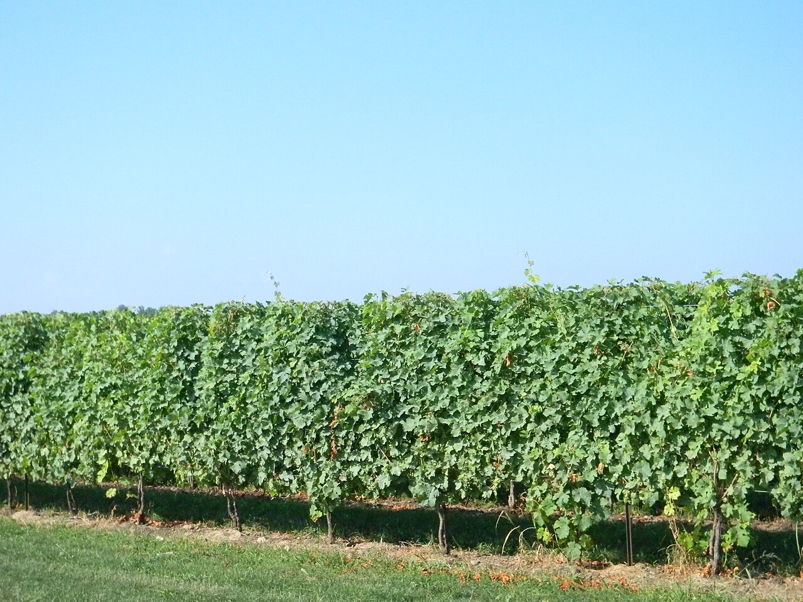
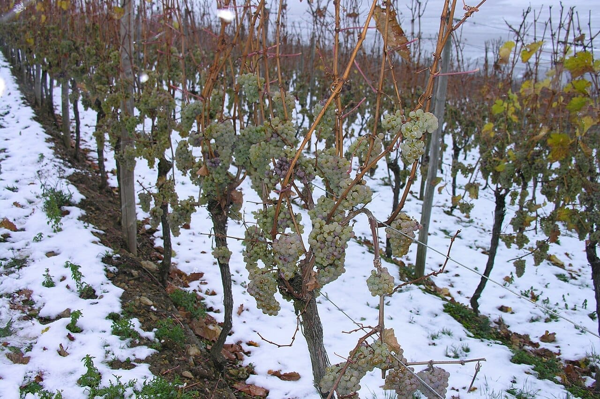

# Niagara Peninsula

A wine region in southern Ontario, Canada, between the Niagara Escarpment and Lake Ontario; known for Riesling, Chardonnay, Cabernet Franc and icewine, with a strict VQA system, it is the core of Canadian wine.

Figure: Niagara Peninsula: Wine Grapes in the Niagara Peninsula (Wikimedia Commons). Image: M Readey, CC BY-SA 3.0, via Wikimedia Commons ([source page](https://commons.wikimedia.org/wiki/File:Wine_Grapes_in_the_Niagara_Peninsula.jpg)).

## Definition and boundaries

Niagara Peninsula lies on the south shore of Lake Ontario; the Niagara Escarpment provides slope and drainage, the lake moderates temperature, and the growing season is longer than inland. Cold winters make icewine a specialty.

In an official geographical indication, the boundaries of Niagara Peninsula are not a decorative line but a legal and historical construction made of place names, parcels and maps. It may be a county, a group of villages, or a narrow strip along a river or mountain; the more specific the name, the less freely it can be used on a label.

Niagara Peninsula is the wine region; Niagara Falls is a tourist landmark, not an appellation. Niagara-on-the-Lake, Lincoln, Vineland and Twenty Valley have different lake exposure and escarpment influence. The sub-region and VQA designation on the label tell you more than the single word Niagara.

## History and naming

The Canadian VQA system requires 100% Ontario grapes, a named region and vintage, and a tasting panel; icewine must be picked at -8°C or below.

The name Niagara Peninsula usually appears first in local archives, church records or tax rolls, and only later in modern regulations. The name often stabilises later than the boundary, which is why the same place can carry different spellings across languages and periods.

Commercial wine began in the nineteenth century, but the modern industry took shape in the 1970s and 1980s. Inniskillin, Cave Spring and Henry of Pelham built the international reputation, and icewine awards in the 1980s and 1990s put Canada on the map. VQA arrived as Ontario’s origin and quality system.

## Geography and terroir

Riesling is the white core, high-acid with green apple, citrus and mineral; Chardonnay, Cabernet Franc and Pinot Noir also matter, with reds usually lighter.

The vineyards of Niagara Peninsula sit at particular elevations, aspects and soil parent materials. Distance to the sea, mountain direction, diurnal range and harvest rain all change ripening and acidity; these conditions explain more about style than the name alone.

The peninsula lies between Lake Ontario and the Niagara Escarpment, at about 100–200 m. The lake moderates winter cold and summer heat; the escarpment blocks cold air and creates different ripening bands. Clay, loam and sand dominate, with better drainage near the escarpment; frost fans and site selection protect the vines.

## Raw materials and styles

Soils are clay, loam, sand and limestone; escarpment slopes drain better, and sub-regions such as Niagara-on-the-Lake, Lincoln and Vineland differ.

The vines of Niagara Peninsula determine what can be made. The leading varieties or raw materials, permitted blends, minimum ripeness and maximum yields are usually written into rules; but rules are a floor, and the real style comes from picking dates, fermentation vessels and ageing.

Chardonnay and Riesling are picked in September and October; Cabernet Franc ripens later and is the most reliable red. Icewine grapes are left on the vine until a night below −8°C, then pressed frozen. The harvest can extend into winter, and rain or rot before the freeze can end the icewine year.

## Representative producers and wines

Representative producers include Inniskillin, Peller, Jackson-Triggs, Cave Spring, Henry of Pelham and Thirty Bench; icewine is Canada’s most internationally recognised wine.

The representative wineries of Niagara Peninsula usually show the two poles of a region: long-established families or cooperatives with concentrated holdings, and newer arrivals working parcel by parcel. Tasting both explains the region better than a list of famous names.

Family estates, cooperatives and larger companies coexist. Inniskillin, Cave Spring and Henry of Pelham own vineyards and make estate wines; some brands source fruit from neighbouring farms. VQA requires origin and varietal declarations, but it does not by itself prove quality, so vintage and site still matter.

## How to drink and pair

To drink Niagara Peninsula, start with alcohol, acidity and tannin or bitterness, then choose temperature and food. High acidity suits fat and salt, high tannin needs protein and fat, and high alcohol clashes with sweet or very spicy dishes; warmth pushes alcohol over aroma.

Serve Chardonnay and Riesling at 8–10°C, Cabernet Franc at 16–18°C and icewine at 6–8°C in a small glass. Seafood, salads and chicken suit the whites; roast meat and hard cheese suit the red; blue cheese, fruit tarts and foie gras suit icewine. A 50–70 ml icewine pour is enough.

## Labels, buying and misreadings

Start with the appellation and its permitted varieties. From there, consider the vintage and the producer, then how the wine is labelled. That is how a practical judgment about Niagara Peninsula is built.

Lake effect reduces winter kill but does not remove vintage variation: rain, humidity and rot pressure change the crop, and the icewine harvest depends on a hard freeze. Cool years give sharper Riesling and lighter Cabernet Franc; warm years give fuller fruit. Ask for the harvest year and VQA status.

### Key dates and figures

- 1970s: modern boutique wineries emerged in the 1970s–80s; Icewine won international awards in the 1980s–90s.

## Around and routes

Putting Niagara Peninsula into an itinerary means separating the regional centre from specific wineries: the first is for landscape, markets and food, the second needs bookings, tastings and travel time. Too many stops in one day exhaust both palate and attention.

Niagara is about 90 minutes from Toronto and 30–45 minutes from Niagara Falls. Wineries cluster along the lake shore and escarpment, but three tastings plus lunch still fill a day. Book ahead, check winter icewine-season hours, and do not assume every estate grows its own grapes.

- Related: [canada](ref:canada), [riesling](ref:riesling), [chardonnay](ref:chardonnay), [ice-wine](ref:icewine), [white-wine](ref:white).
- This region provides no map, prices or opening hours; confirm before travelling.

**Short definition:** A wine region in southern Ontario, Canada, between the Niagara Escarpment and Lake Ontario; known for Riesling, Chardonnay, Cabernet Franc and icewine, with a strict VQA system, it is the core of Canadian wine.

Start with [Canada](ref:canada) for geographic boundary, then read [Chardonnay](ref:chardonnay) for climate and soil. Seeing both keeps Niagara Peninsula from being confused with a neighbouring idea.

Niagara Peninsula is a Canadian region known for ice wine and cool-climate whites.

**Key facts.**

| Item | Detail |
| --- | --- |
| In one line | A wine region in southern Ontario, Canada, between the Niagara Escarpment and Lake Ontario; known for Riesling, Chardonnay, Cabernet Franc and icewine, with a strict VQA system, it is the core of Canadian wine. |
| Level | province or region |
| Parent | Canada |
| Country code | CA |

## Related images

Image: Whisky maturation barrels at the Forty Creek Distillery in Ontario. Credit: Gogerr, CC BY-SA 4.0, via Wikimedia Commons ([source page](https://commons.wikimedia.org/wiki/File:Whisky_maturation_in_barrels_at_the_Forty_Creek_Distillery.jpg)). Related image for Niagara Peninsula.

Image: Ice Wine. Credit: Mya, CC BY 2.0, via Wikimedia Commons ([source page](https://commons.wikimedia.org/wiki/File:Frozen_grapes_in_Luxembourg.jpg)). Related image for Niagara Peninsula.
