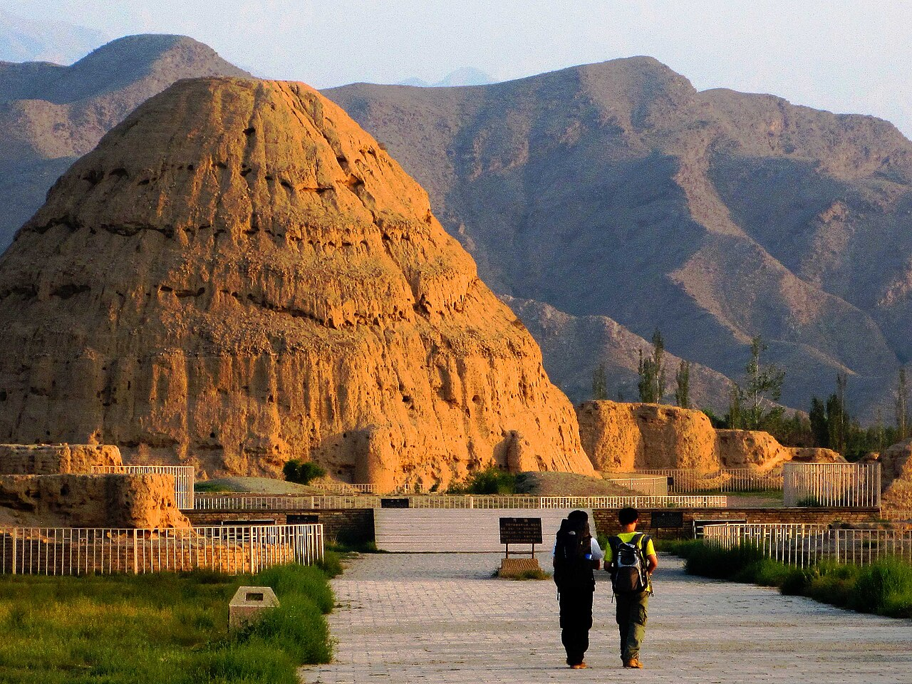

# Ningxia

Ningxia is a landlocked province in north-west China, and its wine industry is concentrated on the eastern foothills of the Helan Mountains. The corridor runs nearly 200 km from north to south, with most vineyards on alluvial fans, gravel slopes and irrigated land of the Yellow River at about 1100 m. Ningxia is one of the most concentrated regions for estate wine in China. To understand it, start with a mountain range, a river, a regional protection regulation and an estate system.

Figure: Ningxia. Image: zengsx, CC BY-SA 3.0, via Wikimedia Commons ([source page](https://commons.wikimedia.org/wiki/File:%E8%A5%BF%E5%A4%8F%E9%99%B5_-_panoramio.jpg)).

## The Helan foothills: a geographic boundary

The Helan Mountain Eastern Foothills wine production area is the geographical indication product protection area recognised by the state, a definition written into Article 3 of the regional protection regulation. The area covers the eastern foothills in northern Ningxia, running nearly 200 km north to south; local industry material records the contiguous planting belt as 195 km. Vineyards cluster at about 1100 m on alluvial fans, Yellow River flood plains and slopes at the mountain front, across counties and districts in Shizuishan, Yinchuan and Wuzhong.

This region is a province-level node under [China](ref:china). Ningxia wine belongs to the broader category of [wine](ref:wine), mainly [red wine](ref:red-wine) but also [white wine](ref:white-wine). The production area is not the same as an administrative boundary: “Helan Mountain Eastern Foothills” on a label must fall within the geographical indication protection area, and not every vineyard in Ningxia can use the name.

## A boundary drawn by regulation

The current regulation was adopted on 5 December 2012 by the 33rd session of the Standing Committee of the 10th Ningxia People's Congress and revised on 26 March 2024 by the 9th session of the 13th Standing Committee. It defines the production area as the geographical indication protection area and requires the planting protection zone to be demarcated, approved by the next higher government and publicly announced.

The rules are specific: discharge or dumping of waste water, waste gas and solid waste into the protection zone is prohibited; new or expanded chemical, building-material, pharmaceutical, mining and similar projects that may pollute soil or air are prohibited; vine planting material must be quarantined, and unquarantined or failed material is banned; planting and production records must be kept for at least two years, and falsification is prohibited; new, rebuilt or expanded wineries must be assessed by the production-area authority; wineries should use grapes from the production area. In 2021, the national pilot zone for the open development of the grape and wine industry was established in Ningxia, making the shift from scale expansion to quality, brand and integrated development more explicit.

The point of this framework is to turn “production area” from a marketing phrase into an enforceable boundary of space and quality. It protects not only vineyard area but also water, soil, planting material and production records, the elements that let a winery explain where a bottle comes from.

## Mountain, river and gravel

The Helan Mountains are the natural barrier. They block cold air and sand from the north-west, and the alluvial fans at their front mix gravel, sand and loess into soils that drain quickly, hold little water and warm and cool rapidly. The Yellow River flows along the eastern side, supplying irrigation water to dry vineyards and moderating local air movement and temperature in the valley.

Xinhua Daily Telegraph gives the terroir figures: 1100 m elevation, about 200 mm annual rainfall, more than 3000 hours of sunshine, about 3300 degrees Celsius effective heat accumulation and a large diurnal range; soils are mainly light grey calcareous soil, gravel soil and aeolian sandy soil. Dryness reduces disease pressure, strong sunshine helps sugar and phenolic development, and gravel encourages roots to seek water. None of this automatically makes great wine, because variety, trellising, irrigation and winemaking all change the result.

## Varieties and the estate system

Cabernet Sauvignon is the most representative variety, with thick skins and ample tannin that ripen well in a dry, sunny environment; Merlot, Cabernet Franc, Syrah, Chardonnay and Riesling are also planted. [Cabernet Sauvignon](ref:cabernet) and [Chardonnay](ref:chardonnay) support the red and white ranges respectively, and the raw material is [grape](ref:grape). Variety proportions, picking dates and fermentation temperatures differ widely between estates, so one variety can produce styles from fresh to concentrated.

On scale, Ningxia Daily records 60.6 mu in ten-thousand mu units of vineyard, 130 estates, 140 million bottles a year, sales to more than 40 countries and regions, and a brand value of RMB 35.086 billion for “Helan Mountain Eastern Foothills wine”; it also says about one in every two bottles of domestic estate wine comes from Ningxia. In 2013 the region was included in The World Atlas of Wine; in 2011 a special reserve from Helan Qingxue won the top award at the Decanter World Wine Awards. These moments brought Ningxia into the view of the international wine world.

## Differences along the corridor

The nearly 200 km planting corridor is not uniform land. The northern section near Shizuishan is slightly higher in latitude and elevation, with a shorter growing season and often tighter wines; the middle section around Yinchuan, Yongning and Helan has dense estates and a transition between alluvial fans and Yellow River irrigation; the southern section toward Qingtongxia and Hongsibao is drier and hotter, where ripeness comes easily and keeping acidity becomes the winemaker's task.

These differences are a continuous climate and soil gradient, not a simple quality ranking. Treating “elegant north, rich south” as a fixed formula ignores vintage, variety and winemaking. A more reliable approach is to look at the specific estate's parcels, irrigation, picking dates and fermentation control, together with the production-area information on the label.

## Winemaking and drinking

Ningxia reds are mostly based on Cabernet Sauvignon, with destemming and crushing, temperature-controlled [fermentation](ref:fermentation), pressing and ageing in oak or inert containers. The proportion of new oak, the length of ageing and lees contact change tannin and aroma; some estates use less new oak to keep fruit and the dry, herbal note of the region. Whites emphasise cool fermentation and fresh acidity, while Chardonnay may gain texture from oak and lees contact. [Oak ageing](ref:oak-ageing) is a style choice here, not a guarantee of quality.

For drinking, reds are best at about 16–18 degrees Celsius and whites at about 8–10 degrees Celsius; whether to decant depends on body and vintage. Cabernet-style reds suit beef, lamb and grilled food, while Chardonnay-style whites suit poultry, fish and light steamed Chinese dishes. Excessive drinking is harmful to health and minors should not drink.

## Five misunderstandings about Ningxia

First, treating Ningxia as all of Chinese wine. Estate wine is concentrated here, but Shandong, Xinjiang, Hebei and Yunnan also matter.

Second, assuming that 1100 m elevation must mean high scores. Elevation affects sunshine and temperature range, but variety, soil and vintage are equally important.

Third, presenting gravel soil as the direct source of “minerality”. Minerality is a tasting descriptor and does not map simply onto soil chemistry.

Fourth, assuming a dry region needs no irrigation. Ningxia vineyards depend on Yellow River water and limited irrigation, and water management directly affects ripeness and acidity.

Fifth, reading many estates as uniform quality. Equipment, parcels and management vary greatly, so judge the specific wine and vintage.

## References

- [China](ref:china): the national-level region node that contains Ningxia.
- [Wine](ref:wine): wine categories, vintage and origin rules.
- [Red wine](ref:red-wine): wines made from Cabernet Sauvignon and other red varieties.
- [White wine](ref:white-wine): wines made from Chardonnay and other white varieties.
- [Cabernet Sauvignon](ref:cabernet): the most representative red variety in Ningxia.
- [Chardonnay](ref:chardonnay): one of the main white varieties in Ningxia.
- [Grape](ref:grape): the structure and ripeness markers of wine grapes.
- [Fermentation](ref:fermentation): the difference between temperature-controlled and malolactic fermentation.
- [Oak ageing](ref:oak-ageing): how new and old oak affect style.

## Related images

Image: Category image for China. Credit: Gary Todd, CC0, via Wikimedia Commons ([source page](https://commons.wikimedia.org/wiki/File:Shang_Bronze_Gu,_Jue,_%26_Jia_Wine_Vessels.jpg)). Related image for Ningxia.

Image: Thematic illustration for Red wine. Project-made bilingual editorial figure, not an on-site photograph. Related image for Ningxia.
