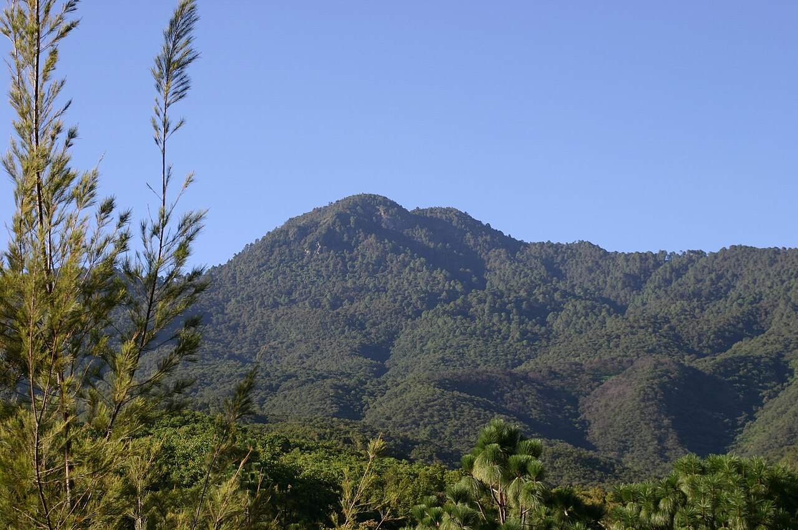

# Oaxaca

Oaxaca lies in southern Mexico, bordered by Puebla and Veracruz to the north, Guerrero to the west, Chiapas to the east and the Pacific to the south. It is both the country's largest mezcal-producing state and the best-known image of the spirit. Two things must be separated first: mezcal is a national designation covering several states, and Oaxaca is its leading production belt rather than a synonym for mezcal.

Figure: Oaxaca. Image: Prsjl, CC BY-SA 4.0, via Wikimedia Commons ([source page](https://commons.wikimedia.org/wiki/File:Oaxaqa_(41).jpg)).

## Administrative setting and terrain

The state capital, Oaxaca de Juárez, sits in the Central Valleys at about 1550 m. The state is cut by the Sierra Madre del Sur into a series of enclosed valleys; the Central Valleys themselves divide into the small basins of Etla, Tlacolula, Ocotlán, Zimatlán and Ejutla, with the lowlands of the Isthmus of Tehuantepec to the east and a narrow coastal strip to the south. This valley-within-valley geography makes rainfall, frost and agave ripening differ sharply within one state. Distilleries cluster where water, firewood and a road to town are all available, so transport has directly shaped the map of production.

## Climate, altitude and microclimate

The Central Valleys have a semi-arid highland climate, with rain concentrated from June to September, a long dry season and wide day-night temperature swings. Every few hundred metres of altitude lowers night temperatures, slows agave growth and stretches the sugar-accumulation period; lower sites such as Tlacolula and Ejutla are hotter, ripen faster and often give more direct aromas. The Pacific side is more humid with a longer rainy season and heavier disease pressure. When producers talk about a "vintage" they usually mean how the length of the rains, the severity of the dry season and wildfire affected sugar content and ripening rhythm, not a single harvest date as in wine.

## Soils and agave

Valley floors are alluvial and calcareous, while slopes carry thin stony soils that drain quickly and hold little water. Agave survives on water stored in its thick leaves and a shallow, wide root system, but grows very slowly. The most planted species is espadín (Agave angustifolia), which matures about 6 to 8 years after planting with reliable sugar and yield; tobalá (A. potatorum) grows on shaded slopes and in rock crevices and needs more than 10 years; wild or semi-cultivated types such as madrecuíz, tepeztate, mexicano, arroqueño and coyote (A. karwinskii) often take 10 to 15 years, giving more complex flavour but highly unstable supply. Over-harvesting of wild species and the spread of espadín monoculture are the region's most concrete ecological problems.

## Legal frame: the DO and NOM-070

The mezcal designation of origin (Denominación de Origen, DO) was published in 1994 and initially covered Oaxaca, Guerrero, Durango, Zacatecas and San Luis Potosí, later adding Guanajuato, Michoacán, Puebla and Tamaulipas, with individual municipalities listed in the official declaration. A municipality outside the list cannot label its spirit "mezcal" even if it has a distilling tradition. The current product standard NOM-070-SCFI-2016 sets raw materials, process categories and labelling, and divides production into Mezcal, Mezcal Artesanal and Mezcal Ancestral; the last two impose stricter rules on earthen-pit roasting, stone or mechanical crushing, spontaneous fermentation and still material, with Ancestral especially tied to clay stills. The Consejo Regulador del Mezcal enforces certification and export bottles carry an official label. The DO defines an origin and process range, not a quality grade.

## The actual production belt

Oaxacan production is not uniform. Santiago Matatlán in the Central Valleys calls itself the "mezcal capital", with distilleries packed along the highway, high volumes and a commercial orientation; Santa Catarina Minas is known for clay pot stills (olla de barro), giving heavier, more mineral spirits; San Luis del Río and Sola de Vega lie in deeper valleys where access is harder and small family batches survive; Miahuatlán and San Baltazar Guelavila attract attention for wild agave and high-acid styles. Calling all of these "Oaxacan style" hides the enormous differences made by still, water and fermentation vessel.

## From piña to spirit

Ripe agave is stripped of its leaves and the heart (piña) is laid in an underground pit, heated with wood and stone, then covered with earth and fibre and roasted for 3 to 5 days. Smoke and caramelisation happen here, and this is the clearest divide between mezcal and tequila: the latter mostly uses steam autoclaves and shows little smoke. After cooling, the hearts are crushed with a tahona stone mill or machinery, mixed with water in wooden vats or skins, and fermented spontaneously on ambient yeasts and bacteria; temperature follows the weather and fermentation runs from a few days to two weeks. The wash is distilled twice in copper pot stills with the middle cut kept, while the Ancestral category uses clay stills. Some products are matured in oak, and other bottlings contain an agave worm, which is in fact a moth larva and not a required part of the process.

## Age grades and labels

Under the current standard, Joven is unaged or only briefly rested; Reposado spends 2 months to 1 year in oak; Añejo ages 1 to 3 years; Extra Añejo exceeds 3 years. Barrel ageing brings vanilla, caramel and wood tannin but can mask the vegetal agave character, so many producers prefer to keep the spirit Joven. The words "100% agave" on a label mean all sugar comes from agave, but the claim still has to be read together with species, village and process category; the same espadín can be lean or heavy.

## Styles and representative villages

Young mezcal commonly shows smoke, roasted agave, green pepper, citrus peel and wet stone, with a dry entry and a finish of ash and vegetal bitterness. Espadín is more direct and sweeter; tobalá is often more floral and delicate; tepeztate brings green pepper and herbs; coyote shows clearer citrus and spice. Matatlán's larger volumes suit beginners, Minas clay-still spirits reward slow drinking, and small batches from Sola de Vega and Miahuatlán often reach specialist shops. The same species can differ greatly with roasting time, fermentation temperature and still.

## Market, vintage and challenges

The cocktail and craft-spirits boom of the 21st century pushed mezcal into export markets, and the number of Oaxacan distilleries grew quickly over about a decade, bringing price swings, contract bottling and tension between brand stories and origin. Vintage variation comes mainly from the rainy and dry seasons rather than a single picking date, and bottles from the same village differ in acidity and smoke intensity from year to year. The longer-term pressure is ecological: wild agave grows slowly, pollinators such as the long-nosed bat depend on its nectar, and over-harvesting weakens populations; at the same time, espadín monoculture leaves smallholders more exposed when prices fall.

## Common misconceptions

First, that mezcal equals Oaxaca; other states produce within the DO. Second, that mezcal equals tequila; they are separate categories with different materials, regions and standards. Third, that mezcal must contain a worm; worm infusion is a minority style. Fourth, that more smoke means more authentic; roasting and fermentation have several traditions. Fifth, that handmade means high quality; equipment, raw material and hygiene still matter. Sixth, that older is always better; barrel ageing can mask the vegetal agave character. Seventh, that all Oaxacan mezcal is distilled in clay; clay is only one tradition, associated above all with Minas.

## Further reading

- [Mezcal](ref:mezcal): the category definition and basic production.
- [Tequila](ref:tequila): the neighbouring but separate category.
- [Fermentation](ref:fermentation): spontaneous fermentation and flavour precursors.
- [Distillation](ref:distillation): pot distillation and cuts.
- [Oak ageing](ref:oak-ageing): barrel ageing in reposado and añejo.
