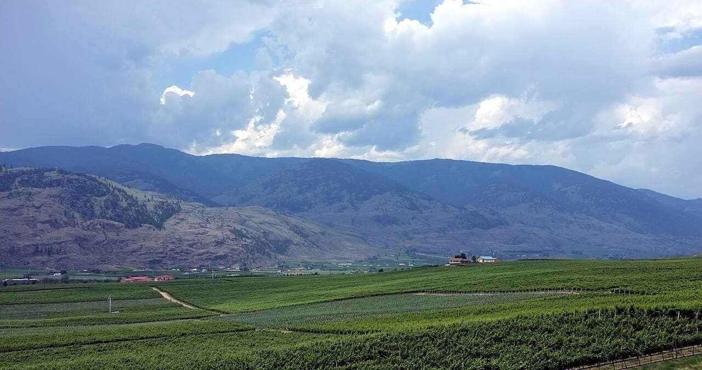
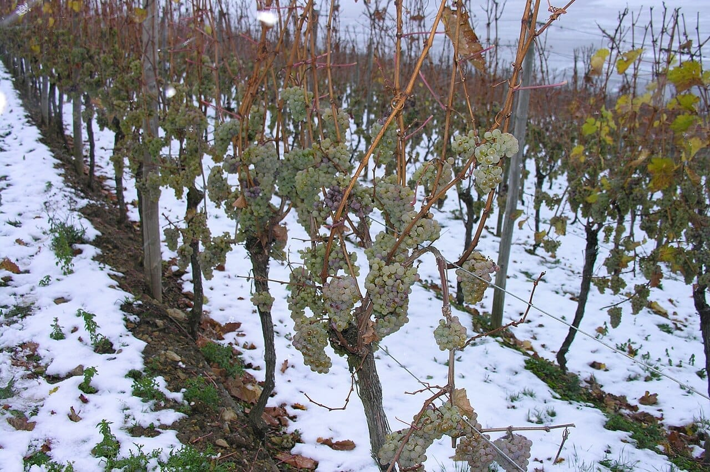

# Okanagan Valley

The Okanagan Valley is a long lake valley in southern British Columbia, Canada, running from semi-desert country in the north to the US border in the south. The lake moderates temperature and summer sun is long; the valley is known for Pinot Gris, Merlot, Cabernet Sauvignon, Pinot Noir and icewine, and is Canada’s second-largest wine region after Niagara.

Figure: Okanagan Valley: Okanagan Valley (7631693050) (Wikimedia Commons). Image: xlibber, CC BY 2.0, via Wikimedia Commons ([source page](https://commons.wikimedia.org/wiki/File:Okanagan_Valley_(7631693050).jpg)).

## Definition and boundaries

The Okanagan lies in southern BC, stretching about 250 km north-south along Okanagan Lake and its tributary lake basins. The north borders desert-like country, the southern Osoyoos end is the warmest, and Kelowna and Penticton sit in the middle. The BC wine institute lists seven Okanagan viticultural areas: Lake Country/North Okanagan, Central Kelowna, West Kelowna–Mount Boucherie, Summerland–Peachland, Naramata, Penticton and the South Okanagan (Oliver, Osoyoos). Okanagan Lake itself is more than a hundred kilometres long, and the tributary lakes and shoreline slopes create the microclimates; the valley backs onto hills to the west and catches lake breezes from the east, so aspect sets sun exposure and drainage.

“Okanagan Valley” on a label is the VQA geographical indication covering the whole valley. There is no statutory sub-appellation inside it, but the Golden Mile Bench became BC’s first official sub-GI in 2015, south of Oliver. Within the valley, cool northern sites and warm southern sites suit different varieties, and a town or bench name says more about style than the broad valley name.

## History and naming

Modern planting dates from 1927, when J.W. Hughes planted vines in the Kelowna area, a site that later became Tantalus Vineyards. In 1932 Calona opened as the valley’s first commercial winery. Early vineyards were mixed with orchards, and fruit growing gradually gave way to fine wine in the second half of the twentieth century. Orchards have a long history in BC, and early wineries mixed grapes with apples and pears, also processing juice and jam; vine blocks separated only after the fine-wine market grew.

From the 1980s onward, family estates were established around West Kelowna, Naramata and Oliver. The Quails’ Gate family bought the Allison Ranch in 1956 and abandoned the orchard to focus on wine in 1989. The VQA system fixed provincial district, variety and winemaking rules, and icewine became a signature product in years with reliable winter cold.

## Geography and terroir

The valley is semi-arid, with low rainfall and humidity, warm days and cool nights; the lakes delay cooling and extend the ripening season. Soils are glacial deposits, sandy gravel and volcanic glacial till, freely draining; benches reach up to 600 m in altitude, with good air drainage that lowers spring and autumn frost risk. The Golden Mile Bench carries 1,340 to 1,630 growing degree days on gravelly sandy loam over glacial fans. The valley sits in an inland rain shadow with low rainfall, irrigated from the lake and groundwater; dry air reduces mould pressure, strong sun ripens skin colour and phenolics, and night cooling preserves acidity.

The north-south temperature split drives variety placement. The cooler north around Kelowna and Lake Country suits Pinot Noir, Chardonnay, Riesling and Pinot Gris; the warmest south around Oliver and Osoyoos suits Merlot, Cabernet Sauvignon, Cabernet Franc and Syrah. Extreme winter cold is the main risk, and late-ripening reds may not reach ideal ripeness in cool vintages.

## Raw materials and styles

Whites are led by Pinot Gris (ref:pinot-gris), Chardonnay, Riesling and Gewürztraminer; reds by Merlot (ref:merlot), Pinot Noir, Cabernet Sauvignon, Cabernet Franc, Syrah and Gamay. Across BC as a whole, Merlot is the most planted red at about 1,861 acres, Pinot Noir about 1,655 acres and Cabernet Sauvignon about 972 acres; the valley’s own proportions shift by north-south site. Beyond the mainstream varieties, Gewürztraminer, Viognier and a few Pinot Noir clones are tried on cool sites, with small Sauvignon Blanc plantings in the north and on higher slopes.

Okanagan reds usually show direct fruit and clear tannin structure: Merlot is round, Cabernet Sauvignon firmer. Whites are fresh-acid and pure-fruited, with Pinot Gris often showing pear and citrus. Icewine is pressed from naturally frozen grapes; regulations require harvest at no warmer than -8°C and fruit at 35 Brix. Picking can run from November into February, and years without enough cold usually produce late-harvest sweet wine instead.

## Representative producers and wines

Representative estates include Mission Hill, Quails’ Gate in West Kelowna, relaunched by the family in 1989, Burrowing Owl in Oliver, Inniskillin Okanagan in Oliver, an icewine reference, Blue Mountain at Okanagan Falls and CedarCreek; Tantalus sits on Kelowna’s earliest planted site. Mission Hill sits on the West Kelowna slopes, known for its view tasting room and broad variety range; Blue Mountain is family-run in a cool, elegant style.

These names are market reference points, not an official classification. Family estates and outside capital coexist, with cooperatives and large négociants carrying part of the mass-market volume. Flagship single-vineyard wines and icewine are scarce and expensive, while entry wines are easier to find in restaurants and retail. Comparing the same variety on a cool northern site and a warm southern site is the clearest way into the valley’s styles.

## How to drink and pair

Reds are served at 15 to 17 °C, whites and Pinot Gris at 8 to 11 °C, and icewine at 6 to 8 °C. Young fruity wines need no decanting; structured Merlot or Cabernet can be opened half an hour ahead. A medium universal glass works by variety; aged Merlot and Bordeaux-style blends can rest a quarter of an hour after opening before judging.

Pair with local grilled meat, smoked meats, salmon and cheese: Merlot with steak and braises, Pinot Noir with duck and mushrooms, Pinot Gris with seafood and Asian-spiced dishes. Icewine goes with blue cheese, nuts and dried fruit, or as a dessert wine, acidity balancing the sweetness.

## Labels, buying and misreadings

Read the VQA mark and the valley-level geography first; bench or town names such as Naramata, Oliver, Osoyoos and West Kelowna hint at warmth and variety direction. Harvest temperature and Brix on an icewine label are regulatory figures, and an ordinary late-harvest sweet wine is not icewine.

A common mistake is treating Canadian icewine as one uniform style, or assuming high sugar means icewine. Reliable winter cold is not present every year in the Okanagan, so icewine volume is small and price high. Still reds and whites depend more on north-south site and vintage; check producer, storage history and vintage weather when buying. The VQA mark requires provincial fruit and compliance with district and variety rules, but it is not an in-estate ranking; check the sub-region and vintage on icewine labels.

## Around and routes

The valley is long and narrow: Kelowna is the central gateway, with Penticton and Oliver spreading south. Distances between estates are mostly 20 to 50 minutes by car; tastings are by appointment, and 60 to 90 minutes should be allowed per visit. Two or three estates plus lunch makes a comfortable day, and harvest, from September to October, is the busiest season.

In summer, combine tastings with lake cruises, cycling and orchard visits; winter icewine harvest runs from December into February, and some estates offer frozen-grape pressing experiences. Public transport is limited, so driving or a local wine-country tour is easier. Bench tracks and tasting-room thresholds need advance checking for accessibility. Tasting rooms are busiest on summer weekends, so weekdays are more relaxed; some estates accept only booked walk-in or group visits.

- Related: [canada](ref:canada), [pinot-gris](ref:pinot-gris), [merlot](ref:merlot), [red-wine](ref:red), [ice-wine](ref:icewine).
- Winter cold varies year to year; check icewine volumes, opening hours and tasting bookings on the BC Wine Institute or estate websites before travelling.

**Short definition:** A long lake valley in southern British Columbia, Canada, running from desert-like country near the north to the US border in the south; the lake moderates temperature and sunlight is long, and the valley is known for Pinot Gris, Merlot, Cabernet and icewine, Canada’s second-largest wine region.

## Related images

Image: Whisky maturation barrels at the Forty Creek Distillery in Ontario. Credit: Gogerr, CC BY-SA 4.0, via Wikimedia Commons ([source page](https://commons.wikimedia.org/wiki/File:Whisky_maturation_in_barrels_at_the_Forty_Creek_Distillery.jpg)). Related image for Okanagan Valley.

Image: Ice Wine. Credit: Mya, CC BY 2.0, via Wikimedia Commons ([source page](https://commons.wikimedia.org/wiki/File:Frozen_grapes_in_Luxembourg.jpg)). Related image for Okanagan Valley.
