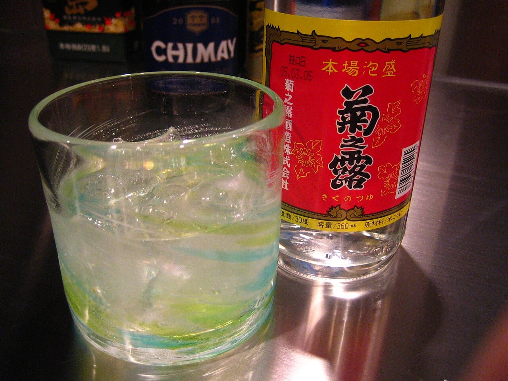

# Okinawa

The awamori region of Okinawa, Japan, made from rice and black koji through single distillation and long ageing; awamori is one of Japan’s oldest distilled drinks, with Naha, Shuri and Ishigaki as main centres.

Figure: Kikunotsuyu awamori, a rice spirit from Okinawa. Image: ayustety (Flickr), CC BY-SA 2.0, via Wikimedia Commons ([source page](https://commons.wikimedia.org/wiki/File:Kikunotsuyu_Awamori.jpg)).

## Definition and boundaries

Okinawan awamori is a distilled drink from Okinawa, Japan, made from rice and black koji (Aspergillus awamori), fermented and run through a pot still, usually 25–60% alcohol; new spirit is clear, and ageing over three years makes kusu.

Here the “region” is an island and a craft tradition, not a wine-style parcel. Check whether the bottle is awamori, kusu or an awamori-based drink; type, ABV and age set the serving.

## History and naming

Awamori’s origins are tied to the Ryukyu Kingdom and Southeast Asian trade, with distillation records from the fifteenth to sixteenth centuries; Naha and Shuri are historic centres, and Ishigaki also has important distilleries.

Ryukyuan tax, diplomacy and trade made awamori part of the island economy; modern Okinawa passed through war and return, and distilleries rebuilt after 1945. The name awamori stabilised earlier than any parcel boundary.

## Geography and terroir

Black koji is the key, with saccharification and fermentation together; unlike sake’s yellow koji, black koji brings more acidity and aroma.

Okinawa is hot and humid, so fermentation runs warm and distilleries must control the koji room and tanks; island groundwater and rice are the material base. Terroir here is climate, water and koji, not a vineyard slope.

## Raw materials and styles

Awamori uses rice and black koji, and pot distillation keeps more raw-material aroma; styles range from clean and light to rich with herbs and nuts. Aged kusu darkens and gains honey, spice and wood.

Style turns on koji share, fermentation temperature, distillation batch and ageing vessel. New spirit suits ice or mixing, kusu suits sipping; “awamori” alone does not tell you the age.

## Representative producers and bottlings

Representative distilleries include Kumesen, Chuko, Sato no Yume, Kikuya and Higa Shuzo; Naha’s awamori museum and distillery visits are main tourist stops.

Read whether it is awamori or kusu, the age, ABV and koji type; large and small workshops differ widely. Naha and Ishigaki styles also differ, so compare at the same age or the same batch.

## How to drink and pair

Awamori can be sipped neat, over ice or with water; new spirit is strong, and a little water opens the aroma. Kusu suits a small glass near room temperature. Do not hide the spirit in a sweet mixer.

Pair with Okinawan food: bitter melon, seaweed, pork, seafood and island tofu can carry the body. High alcohol plus heavy chilli amplifies heat; start with salt and fat, then sip.

## Labels, buying and misreadings

Read awamori versus kusu, age, ABV, distillery and materials. A bottle that says only “awamori” may be new spirit; kusu should carry a clear age statement.

Common misreadings: taking awamori as sake or shochu, or taking high ABV as proof of age. Store upright, dark and at room temperature; kusu can be drunk slowly, new spirit should be finished sooner.

## Around and routes

An Okinawa route can follow Naha, Shuri and Ishigaki: the Naha awamori museum is a good start, distillery visits need booking, and outer islands need ferry or flight checks.

On the main island, monorail and buses serve the city, while distilleries sit outside it; Ishigaki needs a flight or ferry. One distillery plus the museum explains more than a rushed list; never drink and drive.

**At a glance:** The awamori region of Okinawa, Japan, made from rice and black koji through single distillation and long ageing; awamori is one of Japan’s oldest distilled drinks, with Naha, Shuri and Ishigaki as main centres. 

Start with the appellation and its permitted varieties. From there, consider the vintage and the producer, then how the wine is labelled. That is how a practical judgment about Okinawa is built.

A common mistake is to treat Okinawa as an administrative place name. Start with where its boundary lies, then check which climate and legal category it has. If they conflict, trust the more specific source.

Okinawa's awamori is made from rice and black koji, distilled once and aged in clay jars.

**Key facts.**

| Item | Detail |
| --- | --- |
| In one line | The awamori region of Okinawa, Japan, made from rice and black koji through single distillation and long ageing; awamori is one of Japan’s oldest distilled drinks, with Naha, Shuri and Ishigaki as main centres. |
| Level | province or region |
| Parent | Japan |
| Country code | JP |

**Sources and limits.** The key claims about Okinawa are checked against the following sources: Okinawa Distillers Association (awamori's rice and black-koji ingredients, single-pot distillation and kusu ageing, and its production region), Visit Okinawa Japan (awamori history, black koji, Thai rice and kusu aged three years or more), National Tax Agency, Okinawa Regional Taxation Bureau (the awamori definition, black koji, distillation and alcohol strength) and 4 sources in total. Prices, batches and status change; the body is project-written and does not reproduce source text.

For Okinawa, this region was last checked in 2026; prices, batches and availability change, so confirm them against the sources below.

## Further reading

Further reading: awamori is often misread as sake or shochu, but it follows three lines—black koji, pot distillation and ageing. Separate new spirit from kusu first: new spirit is light and strong, suited to ice or mixing; kusu has aged over three years, darkens, and gains honey, spice and wood, so it suits a small glass. Then separate koji and distillery: black koji brings acidity and aroma, while koji room, fermentation temperature and distillation batch change style. Finally read price and age: kusu costs more not only because of time, but because of warehouse loss and small volumes. The Naha museum builds the frame, Ishigaki shows another island expression; do not take two distilleries as the whole of Okinawa.

Kusu is not simply “older is more expensive”: age brings roundness and aroma, but also warehouse loss, cask handling and tied-up capital; the number is only part of the price. When buying kusu, read distillery, cask, age and ABV, and try a small glass first; for new spirit, read koji aroma and distillation cleanliness. Naha and Ishigaki differ through water, koji and warehouse, not through the word Okinawa. With half a day, the museum plus one distillery is enough; for outer islands, leave margin for boats and weather. Awamori pairing is about salt and fat in Okinawan food, not sweetness. Buy a small kusu sample and compare it with new spirit; colour, aroma and texture move together.

- Related: [japan](ref:japan), [awamori](ref:awamori), [sake](ref:sake), [rice](ref:rice), [distillation](ref:distillation).
- This region provides no map, prices or opening hours; confirm before travelling.

## Related images

Image: Category image for Japan. Credit: OS6, CC BY-SA 3.0, via Wikimedia Commons ([source page](https://commons.wikimedia.org/wiki/File:Kamotsuru_Sake_Brewing.jpg)). Related image for Okinawa.

Image: Thematic illustration for Awamori. Project-made bilingual editorial figure, not an on-site photograph. Related image for Okinawa.
