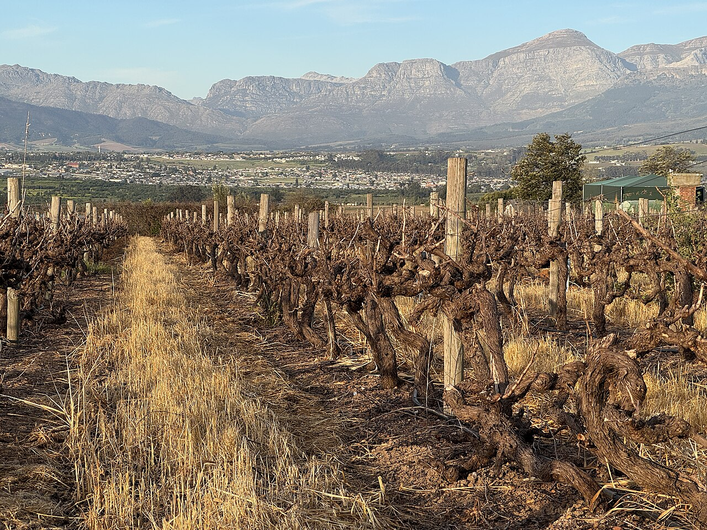
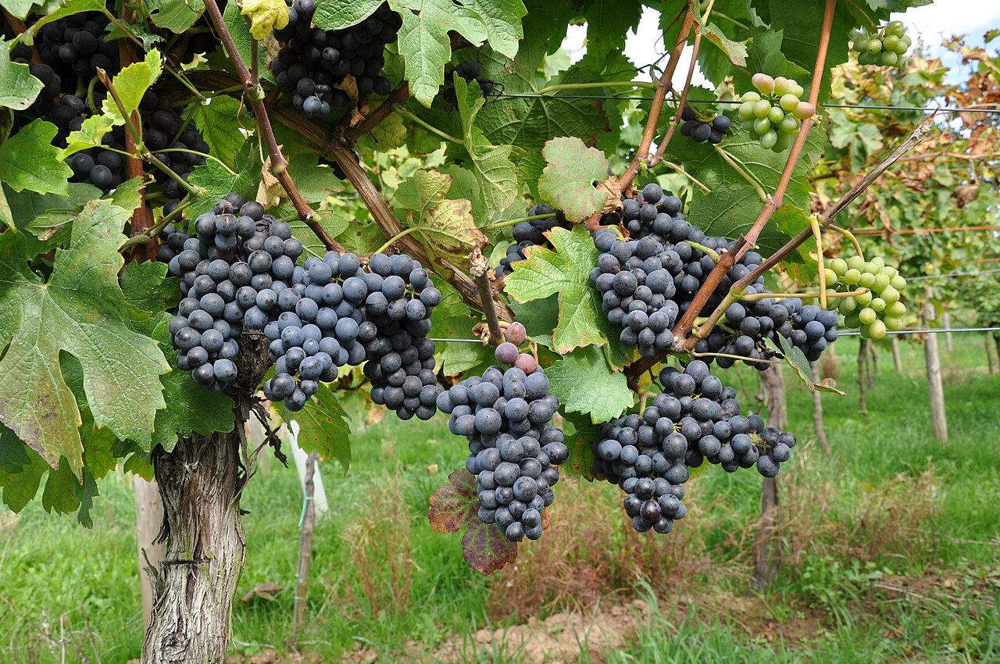

# Paarl

Paarl is a wine district in the Western Cape, about 60 kilometres northeast of Cape Town, with the Berg River running through a valley framed by the Drakenstein and Paarl granite mountains. It is known for Pinotage, Chenin Blanc, Cabernet Sauvignon, Shiraz and Chardonnay, and holds historic estates including KWV, Nederburg and Fairview, making it one of the Winelands’ most historically dense and concentrated districts.

Figure: Paarl: Nantes Vineyard Old Vine Sauvignon Blanc, Paarl, South Africa (Wikimedia Commons). Image: Treephoto, CC BY-SA 4.0, via Wikimedia Commons ([source page](https://commons.wikimedia.org/wiki/File:Nantes_Vineyard_Old_Vine_Sauvignon_Blanc,_Paarl,_South_Africa.jpg)).

> **Quick verdict**
> **In one line:** This region helps you judge Paarl for flavour and travel, and plan accordingly.
>
> - **Best for:** Anyone comparing Paarl with other regions before buying wine or planning a trip.
> - **Not for:** If you want want a “most expensive region” verdict and do not care about style or vintage.
> - **Check first:**
>   - “Paarl” means “pearl” in Dutch, named after three granite boulders on Paarl Mountain that glisten like pearls after rain.
>   - Paarl reds are served around 16–18°C; young Cabernet and Pinotage can be decanted briefly, in a medium to large red glass, while Shiraz and blends sit around 15–17°C.

## Definition and boundaries

Paarl lies north of Stellenbosch, bordered by Wellington to the northeast and the Groot Drakenstein, Klein Drakenstein and Franschhoek ranges to the southeast. The Berg River flows between the Groot Drakenstein and Wemmershoek mountains and is the district’s irrigation artery. Under South Africa’s Wine of Origin scheme, Paarl is a district containing the wards of Simonsberg-Paarl, Agter-Paarl and Voor Paardeberg; a Paarl label means the fruit comes from the defined district, while a ward name points to a more specific slope or valley.

Elevation runs from the valley floor to foothill terraces, roughly 50–400 metres. Valley land needs supplementary irrigation in the hot growing season, while east-facing slopes hold water well enough that many blocks need none. Neighbouring Franschhoek and Wellington are separate districts with their own terroirs; when reading a label, separate district, ward and producer name before treating the fruit as interchangeable.

## History and naming

“Paarl” means “pearl” in Dutch, named after three granite boulders on Paarl Mountain that glisten like pearls after rain. French Huguenots reached the Cape and planted vines in the valley in the late 17th century. The Fairview property was granted to its first settler in 1693, under the old name Bloemkoolfontein, and the first wine was made on the farm in 1699. Nederburg dates to 1791 and is among South Africa’s oldest surviving estates.

The cooperative and modern-industry phase began in the 20th century. In 1918 KWV, the Co-operative Wine Growers’ Association, was founded in Paarl; it long stabilised the industry, regulated winemaking and produced brandy, before privatisation in the 1990s ended its administrative role. Pinotage is a Pinot Noir × Cinsault cross bred by Perold, and early commercial vines were planted around Paarl estates in the 1940s, helping make the district a spiritual home of this uniquely South African variety.

Family independence gathered pace after the 1970s. The Lithuanian immigrant Charles Back I arrived in South Africa in 1902 and bought the Fairview estate in 1937; when Cyril Back took over in 1955, he replanted the vineyards and introduced Cabernet Sauvignon, Shiraz and Pinotage. In 1974 the estate bottled its own wine for the first time and held the Cape’s first public wine auction. Charles Back II returned to farm with his father in 1978 after completing oenological training, and took full responsibility in 1995. The dairy goat herd arrived in 1980 to start cheesemaking, and the iconic goat tower was built in 1981.

## Geography and terroir

Paarl has a Mediterranean climate with hot, dry summers and mild, wet winters; annual rainfall is about 770 millimetres, concentrated in winter. The January mean is around 21–22°C, 2–3°C warmer than coastal Stellenbosch, and midsummer days often climb above 35°C. The sheltered valley sees less maritime influence than the coastal districts, but nights cool noticeably, and the diurnal range preserves acidity and aromatic complexity. The valley floor relies on Berg River and groundwater irrigation through the growing season, while slopes depend on soil water retention.

Soils layer with the terrain: mountain slopes are mainly decomposed granite, free-draining and heat-retaining; clay-rich hillsides suit structured red varieties; the Berg River alluvium is fertile and higher-yielding; sandstone appears in parts of the valley. Granite sites are low in nutrients and force roots deep, concentrating white grapes and early-ripening reds; rich alluvial flats grow vigorously and need pruning and yield control to build concentration. Within one district, aspect, elevation and distance from the river often matter more than surface differences between varieties.

## Raw materials and styles

By planted area, Cabernet Sauvignon accounts for roughly 16%, [Pinotage](ref:pinotage) 14%, Shiraz 12%, [Chenin Blanc](ref:chenin) 10% and Chardonnay 8%; Merlot, Sauvignon Blanc, Viognier, Mourvèdre and Cinsault fill the remainder. Red varieties dominate the district, and the overall style is ripe and generous: Cabernet shows dark sweet fruit and firm tannin, with the better slope sites balancing power and elegance. Pinotage offers ripe plum, chocolate, coffee and smoky notes, and some 1940s vineyards still produce wine; Shiraz is full-bodied with spice and blackberry fruit.

Among whites, Chenin Blanc, locally long called Steen, runs from crisp dry whites through oak-aged old-vine and botrytized styles, with honey, quince and stone fruit on a lively acid spine. Chardonnay goes into full-bodied whites and Méthode Cap Classique sparkling wine; Sauvignon Blanc and Viognier round out the aromatic range. Historically the district also made fortified and pale dry sherry-style wines from Muscadel, Muscat of Alexandria. Rhône blends of Shiraz, Mourvèdre and Grenache sit alongside Bordeaux-style blends, and whole-cluster proportion, wild yeast, oak ageing and maceration time all shape the texture.

## Representative producers and wines

KWV is one of the district’s largest names, founded as a cooperative in 1918; its Paarl premises hold large cellars and a historic brandy tradition, with the Cathedral Cellar range and a ten-year-old brandy among its representatives. Nederburg, established in 1791, covers several varieties through its Winemasters and Private Bin ranges, and its annual auction is one of South Africa’s most prestigious wine sales. Fairview, run by three generations of the Back family, lists the Cyril Back Shiraz and The Beacon Shiraz as its flagships, and the estate also runs an artisanal cheese dairy and goat-tower tourism site.

Other producers worth noting include Backsberg, Avondale (organic and biodynamic), Rhebokskloof, Laborie (a historic estate, now a hospitality and tasting flagship), Rupert & Rothschild Vignerons (Baron Edmond and Baroness Nadine Bordeaux blends), Glen Carlou, Eikendal, Rickety Bridge, Babylonstoren, Anthonij Rupert and Boekenhoutskloof. These names are not a legal classification but long-standing market reference points. Large merchants, family estates and boutique cellars coexist, and the share of estate-grown fruit varies widely between them.

## How to drink and pair

Paarl reds are served around 16–18°C; young Cabernet and Pinotage can be decanted briefly, in a medium to large red glass, while Shiraz and blends sit around 15–17°C. Dry Chenin Blanc is around 10–12°C, old-vine oak-aged Chenin slightly cooler; Chardonnay and sparkling at 6–10°C. Youthful wines carry fresh acidity, while aged Pinotage and Cabernet develop leather, tobacco and dried-fruit notes that open with air after opening.

For food, the district’s reds match grilled meat, lamb, beef stew, game and hard cheese, where tannin balances the fat. Pinotage pairs with smoked and chargrilled meats, braises and spice-led dishes, its smoky notes echoing the fire. Chenin Blanc suits pork, poultry, salads and savoury starters, with old-vine versions taking creamy white-meat dishes; Sauvignon Blanc and Viognier go with seafood and light fare. Local cooking centres on grilled meat, estate vegetables and cheese boards, complementing the district’s ripe, generous red and white styles.

## Labels, buying and misreadings

Reading a Paarl label, first confirm the WO district (Paarl or one of its wards), then the producer, variety and vintage. Under the Wine of Origin scheme, a district-label wine must use fruit from the defined area; a ward name is more specific, but the soil and aspect differences between Simonsberg-Paarl, Agter-Paarl and Voor Paardeberg still need producer-level parcel detail to judge. Vintage matters in this continental valley: spring frost, summer heatwaves and harvest rain all alter ripeness, so alcohol and fruit can differ notably between years from the same producer.

One misconception is treating the place name as a quality grade: Paarl contains both large cooperative and commercial wines and small-batch boutique estates, and the name itself does not rank either. Another is reading “old vines”, “handmade” or “traditional” as legal terms; South African rules limit such wording in places, and the claim should be checked against producer records. High alcohol is not proof of better ripeness either: a warm year can give high alcohol with thin acidity. Reds should be stored cool and away from light; flagship wines can age for years, while entry-level releases are best drunk young.

## Around and routes

Paarl town is about an hour from Cape Town and sits at the Winelands’ hub toward Wellington and Franschhoek. Estates line the R44 and the Berg River, most within a fifteen-minute drive of one another. The Paarl Mountain Nature Reserve trail climbs to the Paarl Rocks for views over the vineyards and Drakenstein range, and the Afrikaans Language Monument and Language Museum on the mountain slopes mark the district’s linguistic history.

Most estates run tasting rooms; popular sites such as Fairview fill up on weekends and at harvest, so booking ahead is advisable. Harvest falls in the Southern Hemisphere February to March, when some estates hold vintage events. A tasting takes about an hour, so two or three stops plus lunch in a day is comfortable. Without a car, join a wine tour departing Cape Town or Paarl town. Stay out of working vineyards and fermentation rooms, and do not drive after tasting.

- Related: [south-africa](ref:south-africa), [pinotage](ref:pinotage), [chenin-blanc](ref:chenin), [red-wine](ref:red), [white-wine](ref:white).

## Related images

Image: Pinotage. Credit: Please note: This photo can be reproduced. Please quote the source as indicated below: Doris Schneider, Julius Kühn-Institut (JKI), Federal Research Centre for , CC BY-SA 4.0, via Wikimedia Commons ([source page](https://commons.wikimedia.org/wiki/File:VIVC9286_PINOTAGE_Full_plant_3638.jpg)). Related image for Paarl.

Image: Vineyards in the Cederberg - South Africa. Credit: Ltz Raptor, CC BY-SA 3.0, via Wikimedia Commons.. Credit: Ltz Raptor, CC BY-SA 3.0, via Wikimedia Commons ([source page](https://commons.wikimedia.org/w/index.php?curid=4647540)). Related image for Paarl.
