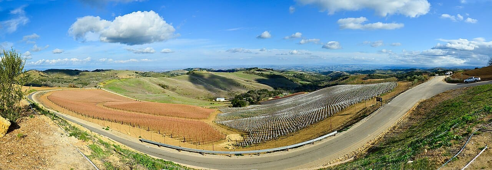

# Paso Robles

An AVA in the northern Central Coast of California with hot days and cool nights, known for Zinfandel, Cabernet Sauvignon and Syrah; established in 1983, it has been divided into 11 sub-AVAs since the 2010s, and limestone and alluvial soils give a tighter profile than much of California.

Figure: Paso Robles: Daou Vineyards - Paso Robles, California, USA - Feb. 2012 (Wikimedia Commons). Image: SD Dirk from San Diego, USA, CC BY 2.0, via Wikimedia Commons ([source page](https://commons.wikimedia.org/wiki/File:Daou_Vineyards_-_Paso_Robles,_California,_USA_-_Feb._2012.jpg)).

## Definition and boundaries

Paso Robles lies in northern San Luis Obispo County, inland on the Central Coast; days can exceed 35°C, while Pacific influence cools nights and preserves acidity.

In an official geographical indication, the boundaries of Paso Robles are not a decorative line but a legal and historical construction made of place names, parcels and maps. It may be a county, a group of villages, or a narrow strip along a river or mountain; the more specific the name, the less freely it can be used on a label.

Paso Robles is a large AVA with eleven sub-AVAs, not one uniform style. The western hills near Santa Lucia are cooler and more calcareous; the eastern plains are warmer and more clay-rich; Templeton Gap channels Pacific air into the middle. The sub-AVA and alcohol level are better guides than the city name.

## History and naming

It became an AVA in 1983 and has since been divided into 11 sub-AVAs such as Adelaida, Willow Creek and Paso Robles Westside; limestone in the west, alluvium in the east, gives clear style differences.

The name Paso Robles usually appears first in local archives, church records or tax rolls, and only later in modern regulations. The name often stabilises later than the boundary, which is why the same place can carry different spellings across languages and periods.

The AVA was granted in 1983, but modern fame came in the 1980s and 1990s with the Rhône Rangers. Tablas Creek, working with the Beaucastel family, brought Syrah, Grenache, Mourvèdre, Roussanne and Viognier; Justin built an international reputation with Cabernet-based blends. The region then expanded rapidly in the 2000s.

## Geography and terroir

Zinfandel is the signature, high in alcohol and fruit; Cabernet Sauvignon and Syrah have grown fastest in the last two decades, from jammy to tighter European-leaning styles.

The vineyards of Paso Robles sit at particular elevations, aspects and soil parent materials. Distance to the sea, mountain direction, diurnal range and harvest rain all change ripening and acidity; these conditions explain more about style than the name alone.

The AVA lies between the Santa Lucia Range and the coastal ranges, roughly 200–500 m, with hot days and cold nights. Calcareous soils drain well and raise pH; the western hills are cooler, the eastern plains warmer, and the Templeton Gap brings a strong evening cooldown. Diurnal range can exceed 20°C.

## Raw materials and styles

Soils are limestone, shale, alluvium and sand; western hills drain well and crop low, eastern plains are richer and higher-yielding.

The vines of Paso Robles determine what can be made. The leading varieties or raw materials, permitted blends, minimum ripeness and maximum yields are usually written into rules; but rules are a floor, and the real style comes from picking dates, fermentation vessels and ageing.

Zinfandel and Syrah are picked from late August into October; Cabernet Sauvignon later still. Heat spikes can push sugar quickly, so growers pick in several passes and preserve acidity with early morning harvests. The choice between jammy fruit and fresh structure is made in the vineyard, not only in the cellar.

## Representative producers and wines

Representative producers include Tablas Creek, Justin, Daou, Turley, Adelaida and Halter Ranch; Tablas Creek’s Rhône varieties and organic/biodynamic work are benchmarks.

The representative wineries of Paso Robles usually show the two poles of a region: long-established families or cooperatives with concentrated holdings, and newer arrivals working parcel by parcel. Tasting both explains the region better than a list of famous names.

Family estates, large brands and grape-sourcing arrangements coexist. Tablas Creek, Justin, Halter Ranch and Adelaida own substantial vineyards; other labels buy fruit across the AVA. The back label’s sub-AVA, vineyard and alcohol tell you more about style than the front label’s brand image.

## How to drink and pair

To drink Paso Robles, start with alcohol, acidity and tannin or bitterness, then choose temperature and food. High acidity suits fat and salt, high tannin needs protein and fat, and high alcohol clashes with sweet or very spicy dishes; warmth pushes alcohol over aroma.

Serve reds at 16–18°C in a large glass; Zinfandel and Syrah can take 30–60 minutes of air. Barbecue, roast meat, game, Mexican food and hard cheese suit the ripe fruit and alcohol; delicate seafood does not. Roussanne and Viognier whites are best at 10–12°C with roast chicken or cream sauces.

## Labels, buying and misreadings

For Paso Robles, begin with the appellation and its permitted varieties, then the vintage and the producer, and finish with how the wine is labelled; that order keeps the account grounded.

Heat spikes, drought, frost and harvest rain all change the vintage. Warm years push alcohol and jammy fruit; cooler years keep acidity and pepper. Zinfandel is especially vintage-sensitive, and old vines behave differently from young high-yield plantings. Ask for alcohol and picking date, not only the year.

### Key dates and figures

- 1980s: modern boutique wineries emerged in the 1980s–90s, led by Rhône varieties and limestone soils.
- 2000s: the region became one of California’s fastest-growing appellations.
- Alcohol: often 14% or more; below 14% tends to be fresher, above 15% fuller.

## Around and routes

Putting Paso Robles into an itinerary means separating the regional centre from specific wineries: the first is for landscape, markets and food, the second needs bookings, tastings and travel time. Too many stops in one day exhaust both palate and attention.

Paso Robles is about 3.5 hours from Los Angeles and 2.5 hours from San Francisco, with San Luis Obispo 30–40 minutes south. The AVA is large, and west-side estates can be 30–45 minutes from the east side. Three wineries plus lunch is a full day; book and group stops by geography.

- Related: [usa](ref:usa), [zinfandel](ref:zinfandel), [cabernet-sauvignon](ref:cabernet), [red-wine](ref:red), [oak-ageing](ref:oak).
- This region provides no map, prices or opening hours; confirm before travelling.

Compare Paso Robles with Santa Barbara and Monterey rather than with Napa: the first two show the coastal cooling and limestone influence, while Napa shows a warmer, more sheltered inland model. 

**In brief:** An AVA in the northern Central Coast of California with hot days and cool nights, known for Zinfandel, Cabernet Sauvignon and Syrah; established in 1983, it has been divided into 11 sub-AVAs since the 2010s, and limestone and alluvial soils give a tighter profile than much of California.
