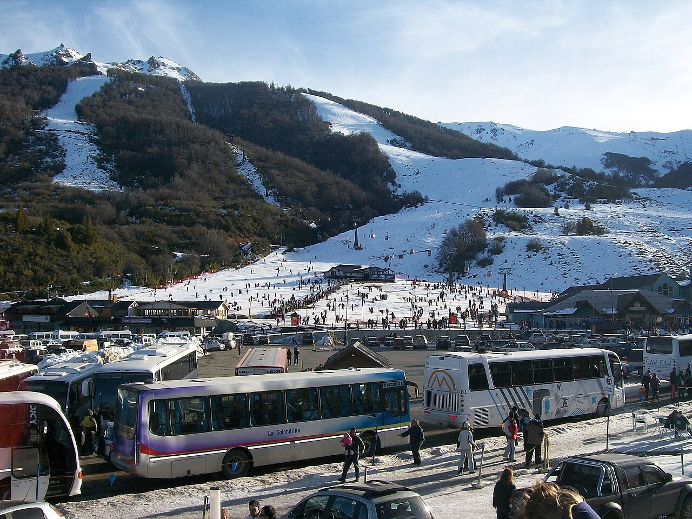

# Patagonia

A cool-climate wine region in southern Argentina, centred on the Río Negro and Neuquén valleys; at 39–42° south with long sun, strong wind and cool temperatures, it is known for Pinot Noir, Malbec, Chardonnay and sparkling wine.

Figure: Patagonia. Photograph: Base del Cerro Catedral en Bariloche. (Patagonia Argentina) 01. Credit: Diego Gabriel, CC BY-SA 3.0, via Wikimedia Commons ([source](https://commons.wikimedia.org/w/index.php?curid=23263151)).

## Definition and boundaries

Patagonia lies in southern Argentina, with vineyards along the Río Negro and Neuquén valleys; at 39–42° south, it is cooler than Mendoza, with a longer but less accumulated growing season.

In an official geographical indication, the boundaries of Patagonia are not a decorative line but a legal and historical construction made of place names, parcels and maps. It may be a county, a group of villages, or a narrow strip along a river or mountain; the more specific the name, the less freely it can be used on a label.

Patagonian wine is concentrated in the Río Negro and Neuquén river valleys, with small plantings in Chubut; it is not one continuous region. Río Negro’s alluvial terraces are lower and windier; Neuquén’s sites are higher and later-ripening. The valley name and latitude matter more than the broad Patagonia label.

## History and naming

Strong wind, low humidity and long sunlight define the region; wind lowers temperature and increases transpiration, so irrigation and windbreaks matter.

The name Patagonia usually appears first in local archives, church records or tax rolls, and only later in modern regulations. The name often stabilises later than the boundary, which is why the same place can carry different spellings across languages and periods.

Humberto Canale founded a modern winery in Río Negro in 1909, using irrigation and poplar windbreaks to turn desert into vineyards. The 2000s brought Chacra and other boutique projects, while Bodega del Fin del Mundo and Familia Schroeder developed larger commercial and tourism operations. The name Patagonia comes from Magellan’s “land of giants”, not from a wine tradition.

## Geography and terroir

Pinot Noir is the cool-climate flagship, high-acid and fine; Malbec is lighter and more floral than in Mendoza; Chardonnay and sparkling wine also perform well.

The vineyards of Patagonia sit at particular elevations, aspects and soil parent materials. Distance to the sea, mountain direction, diurnal range and harvest rain all change ripening and acidity; these conditions explain more about style than the name alone.

The valleys lie at 39–45° south, in the rain shadow of the Andes, with persistent westerly winds of 30–50 km/h. Alluvial sand, gravel and volcanic ash drain quickly and hold little fertility; rivers provide irrigation. Long daylight and cold nights slow sugar accumulation and preserve acidity.

## Raw materials and styles

Soils are alluvial, sand, gravel and volcanic, well drained; valley forms provide different slopes and aspects.

The vines of Patagonia determine what can be made. The leading varieties or raw materials, permitted blends, minimum ripeness and maximum yields are usually written into rules; but rules are a floor, and the real style comes from picking dates, fermentation vessels and ageing.

Pinot Noir and Chardonnay are picked in February and March in the southern hemisphere, Malbec later; the season is short and frost or hail can close it abruptly. Growers use windbreaks, low trellising and drip irrigation. Picking date is a balance between red-fruit freshness and enough tannin.

## Representative producers and wines

Representative producers include Humberto Canale, Bodega Noemía, Chacra, Bodega del Fin del Mundo and Familia Schroeder; Neuquén and Río Negro are the two main sub-regions.

The representative wineries of Patagonia usually show the two poles of a region: long-established families or cooperatives with concentrated holdings, and newer arrivals working parcel by parcel. Tasting both explains the region better than a list of famous names.

Family estates and small boutique wineries dominate the image, with a few larger tourism-oriented operations. Chacra, Humberto Canale, Bodega del Fin del Mundo and Familia Schroeder own or control vineyards; some labels source fruit from valley farms. The valley and vineyard designation is more informative than “Patagonia” alone.

## How to drink and pair

To drink Patagonia, start with alcohol, acidity and tannin or bitterness, then choose temperature and food. High acidity suits fat and salt, high tannin needs protein and fat, and high alcohol clashes with sweet or very spicy dishes; warmth pushes alcohol over aroma.

Serve Pinot Noir at 14–16°C, Malbec at 16–18°C and whites at 8–10°C. Roast chicken, mushrooms, duck and light cheese suit Pinot; roast meat, game and hard cheese suit Malbec; seafood, salads and freshwater fish suit the whites. Do not over-chill Pinot or expect dense Cabernet structure.

## Labels, buying and misreadings

Patagonia is best approached through the appellation and its permitted varieties, then the vintage and the producer, and then how the wine is labelled. One check alone will not settle it.

Frost, hail, wind and drought drive vintage variation, and the short season makes every week count. Cool years give sharper Pinot and higher acidity; warm years give riper Malbec and earlier drinkability. Yields are small, so vintage and producer matter more than a national brand.

### Key dates and figures

- 1909: Humberto Canale founded a winery in the Rio Negro valley.
- 2000s: from the 2000s, Chacra and other estates put Patagonian Pinot Noir and Malbec on the international map.
- Alcohol: Pinot Noir around 13–14%, Malbec around 14–15%.

## Around and routes

Putting Patagonia into an itinerary means separating the regional centre from specific wineries: the first is for landscape, markets and food, the second needs bookings, tastings and travel time. Too many stops in one day exhaust both palate and attention.

Neuquén airport is the main gateway; Río Negro is further east and the valleys are spread out. A day trip can cover two or three wineries at most, and travel between Neuquén and Río Negro can take two hours. Book visits, check seasonal closures and allow for wind and gravel-road delays.

- Related: [argentina](ref:argentina), [pinot-noir](ref:pinot), [malbec](ref:malbec), [white-wine](ref:white), [sparkling-wine](ref:sparkling).
- This region provides no map, prices or opening hours; confirm before travelling.

[Argentina](ref:argentina) and [Malbec](ref:malbec) answer different questions about Patagonia: geographic boundary and climate and soil. Read them as a pair, not as alternatives.

Patagonia's vineyards lie in Rio Negro and Neuquén, where cool winds and long days give fresh fruit and high acidity; Malbec and Pinot Noir are important.

The region's high latitude gives long daylight and cool nights, and irrigation comes from Andean rivers.

Its wines are often labelled by valley rather than by a single estate, so the origin line is the first check.
