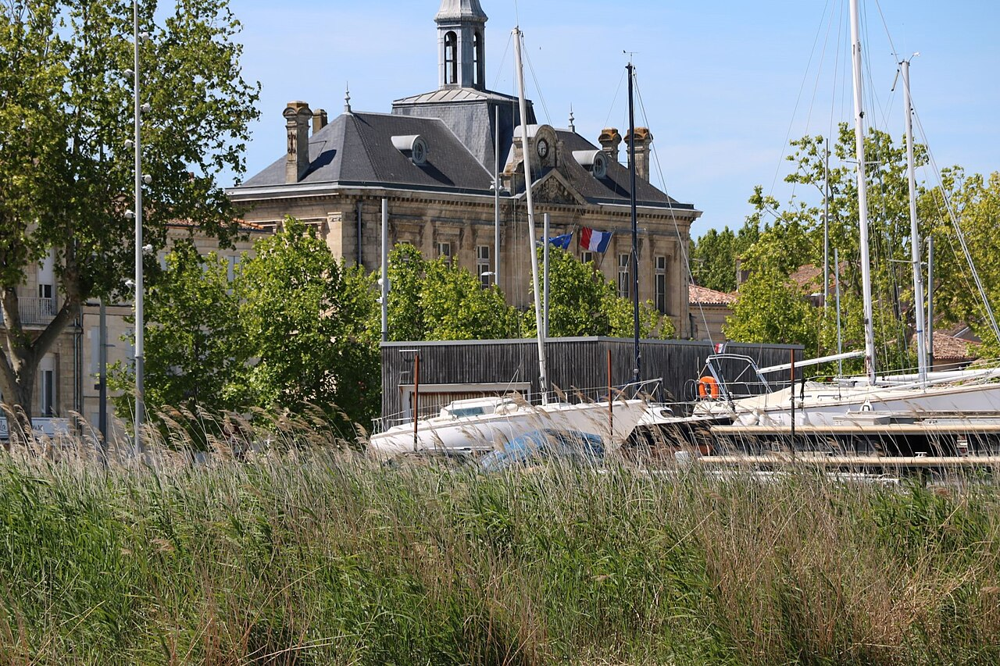

# Pauillac

Pauillac is a red-wine appellation on the left bank of the Gironde estuary, in the middle of the Médoc peninsula in the Gironde department of France, recognised as an AOC on 14 November 1936. Its vineyards lie on gravel terraces cut by small streams, and three of the 1855 first growths — Lafite Rothschild, Latour and Mouton Rothschild — are located here, a concentration unmatched among Médoc communes.

Figure: Pauillac. Image: Anthony Baratier, CC BY-SA 4.0, via Wikimedia Commons ([source page](https://commons.wikimedia.org/wiki/File:La_mairie_de_Pauillac_vue_depuis_le_port_de_plaisance.jpg)).

## Definition and scope

Pauillac may be used only for still [red wines](ref:red-wine) from demarcated parcels that are also fermented and aged within the area. The geographical area is mainly the commune of Pauillac, plus approved parcels in four neighbouring communes: Cissac-Médoc, Saint-Estèphe, Saint-Julien-Beychevelle and Saint-Sauveur. The cahier des charges describes close to 1,250 hectares of vines; large estates farm about 90% of the vineyard, while some sixty small holdings and one cooperative make up the rest.

This structure of a village name plus selected parcels in neighbouring communes shows that a communal AOC does not always follow administrative boundaries. Buyers should rely on the appellation and bottling information on the label, not on the mere fact that an estate sits in Pauillac.

Inside the commune the rises can be read at a finer scale: slopes near the estuary are warmer and ripen earlier, while inland hollows are cooler and keep more acidity. These small differences never appear on a label, yet they explain why the same wine behaves differently from one vintage to the next.

## How the gravel terraces shape the style

The land lies between 3 and 30 metres above sea level, and Quaternary gravel terraces about ten metres thick cover Eocene and Oligocene marl and limestone. The est-eys and jalles, small streams perpendicular to the estuary, dissect the terraces into three main groups of rises: the southern group around Saint-Lambert and Bages, the central group around Artigues, and the northern group around Pouyalet.

Gravel drains quickly, absorbs heat by day and releases it at night, allowing the late-ripening [Cabernet Sauvignon](ref:cabernet-sauvignon) to ripen in an oceanic climate; sandy soils and palus alluvium in hollows drain less well and are generally not the best sites. Within one commune, the ripening rhythm differs markedly between the top of a rise, the slope and the valley floor, which is why parcels on the same estate are often picked separately.

The climate is temperate oceanic, moderated by the Gironde estuary and the Atlantic. The growing season is warm, but autumn rain can disrupt ripening, so vintage variation is pronounced. Gravel rises perform better in wet years because they drain fast and allow deep roots, so the fruit is less likely to be diluted.

## The 1855 classification and three first growths

The Médoc classification drawn up for the 1855 Paris world fair placed Lafite Rothschild, Latour and Mouton Rothschild in Pauillac among the first growths. Mouton was not a first growth from the start: it was promoted from second growth in 1973, the only promotion in that historical list.

The three estates represent different gravel positions and parcel structures, but they share a high Cabernet Sauvignon share, firm structure and long ageing potential. The cru classé status is a historical legacy, not a contemporary quality certificate; after 1855, splits, sales and vineyard changes mean that a name and its actual parcels must be checked separately.

## Varieties and raw material

The permitted varieties are Cabernet Sauvignon, Merlot, Cabernet Franc, Petit Verdot, Malbec and Carmenère. Plantings are dominated by Cabernet Sauvignon, often 60% to 80%, while [Merlot](ref:merlot) softens the blend and brings earlier ripening, and Cabernet Franc and Petit Verdot add aroma and structure.

The rules require a minimum sugar level at harvest of 189 g/L for Merlot and 180 g/L for the other varieties. The minimum natural alcohol is 11%, the yield is 57 hl/ha with a ceiling of 63 hl/ha, planting density is at least 7,000 vines per hectare, and the maximum field load is 9,500 kg/ha, or 8,000 kg/ha where irrigation is authorised. These floors and ceilings frame the wine, but site and winemaking still decide the style.

## Winemaking and ageing

After fermentation the wine is aged in [oak](ref:oak-ageing), and the minimum ageing period runs to 1 June of the year after harvest; consumer release may not begin before 1 September of that year. Wine offered for sale must hold malic acid at or below 0.30 g/L and fermentable sugars at or below 2 g/L, and total alcohol after enrichment may not exceed 13.5%.

The proportion of new barrels, barrel age and total time in wood are decided by each estate and are a major source of stylistic difference within one commune. The high tannin and acidity of Cabernet Sauvignon need time to integrate; young wines often feel firm and only open into cedar, tobacco and cassis with age.

From youth to maturity, Pauillac reds generally pass through three phases: a firm, fruit-led stage, a middle period of tannin integration, and a maturity that brings cedar and leather. Barrel strategies change the length of each phase but not the basic direction of the Cabernet Sauvignon frame.

## Labels and rules to check

The word Pauillac on the label must match the appellation; check the vintage, alcohol, volume, bottler and any estate name as well. The term cru classé indicates a historical position in the 1855 list and later individual adjustments, not current quality. The AOC rules also cover pruning, minimum foliage height and a maximum share of missing vines, details that determine whether a parcel keeps its right to the appellation.

## Common misconceptions

First, the idea that gravel always creates a “mineral” taste. Gravel mainly drains and stores heat; minerality is a tasting descriptor and does not map onto soil chemistry.
Second, treating the 1855 classification as a current ranking. The list is essentially frozen in history, while estates and parcel boundaries have changed.
Third, assuming Pauillac grows only Cabernet Sauvignon. Merlot, Cabernet Franc and Petit Verdot are all permitted and proportions vary by estate.
Fourth, confusing a first growth with a premier cru vineyard. The first is a Bordeaux estate ranking, the second a Burgundian site classification, and the two systems are not interchangeable.

The comparison with [France](ref:france) and [Cabernet Sauvignon](ref:cabernet-sauvignon) runs through geographic boundary and climate and soil. Each answers a different question.

**At a glance:** A red-wine AOC on the left bank of the Gironde in the middle Médoc, recognised on 14 November 1936, with about 1,250 hectares of vines on Quaternary gravel terraces roughly ten metres thick; the 1855 classification lists Lafite Rothschild, Latour and Mouton Rothschild as first growths here, and the rules set a minimum natural alcohol of 11%, a yield of 57 hl/ha with a ceiling of 63 hl/ha, and a minimum planting density of 7,000 vines per hectare.

## References

- [France](ref:france): the national appellation framework and the AOC system.
- [Bordeaux](ref:bordeaux): the overall structure of left bank, right bank and communal appellations.
- [Cabernet Sauvignon](ref:cabernet-sauvignon): ripening and tannin in Pauillac's leading variety.
- [Merlot](ref:merlot): the role of softening the blend and adding earlier fruit.
- [Red wine](ref:red-wine): an overview of still red wine and winemaking.
- [Oak ageing](ref:oak-ageing): barrel type, barrel age and micro-oxygenation.
