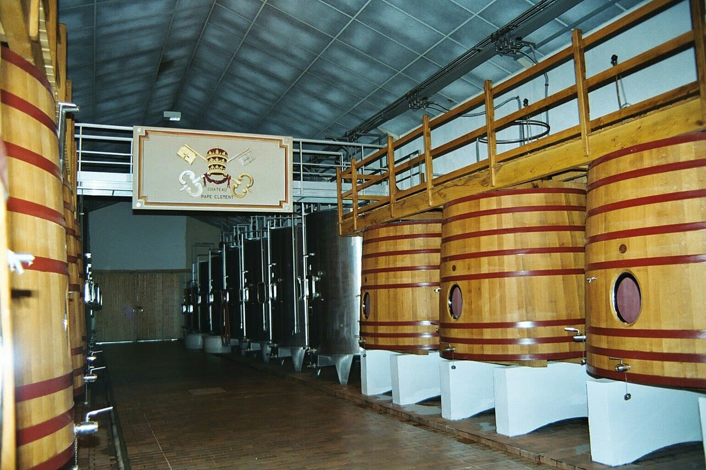

# Pessac-Léognan

Pessac-Léognan lies south of Bordeaux city, the northern section of the Graves district that became an independent AOC in 1987. On gravel ridges it makes both red and white wines: reds are Bordeaux blends led by Cabernet Sauvignon, whites blend Sauvignon Blanc and Sémillon, and the district ranks among the most respected sources of dry white wine in Bordeaux.

Figure: Pessac-Léognan: PapeClement05 (Wikimedia Commons). Image: Kassander der Minoer at German Wikipedia, CC BY-SA 3.0, via Wikimedia Commons ([source page](https://commons.wikimedia.org/wiki/File:PapeClement05.jpg)).

## Definition and boundaries

The appellation sits in the Gironde, on the hill country spreading south from the Bordeaux metropolitan area, covering communes such as Pessac, Léognan, Talence, Gradignan, Villenave-d'Ornon, Martillac, Cadaujac, Saint-Médard-d'Eyrans, Canéjan and Cestas; it is about 10–15 km from central Bordeaux.

A decree of 9 September 1987 formally recognized the Pessac-Léognan AOC, applying back to the 1986 vintage; before that the land belonged to the Graves AOC, recognized in 1937. Both red and white wines may carry this AOC name, and the decree still allows labels to retain historic wording such as "vin de Graves".

It is the northernmost, city-nearest section of Graves; the more rural Graves land farther south cannot use this AOC name. In 2023 the planted area was about 1,860 hectares across roughly 56 estates, with production of about 75,199 hectolitres; reds make up about 82% and whites about 18%. The average yield that year was about 39 hl/ha for reds and 52 hl/ha for whites, with a higher permitted ceiling for white grapes.

## History and naming

In the early 14th century, the family of the future Pope Clement V founded Château Pape Clément, the first Bordeaux château to carry a proper name; the district's winemaking history predates most Médoc vineyards.

In the 17th and 18th centuries, Haut-Brion appears as early as 1663 in Samuel Pepys' account of French red wine drunk in London. The gravel plateau of Smith Haut Lafitte was developed in the 17th century by the Du Boscq family, and in 1720 Georges Smith bought it and added his surname to the place name. Domaine de Chevalier was known since the early 16th century as "Chivaley", Gascon for "knight", and appears on the Belleyme map of 1783.

In the official 1855 classification prepared for the Paris Exposition, Haut-Brion was the only Graves estate among the First Growths, standing alongside Lafite, Margaux and Latour. The Graves classification published reds in 1953 and added whites in 1959; its listed estates almost all lie in today's Pessac-Léognan. The AOC name combines the northern town of Pessac and the southern town of Léognan.

## Geography and terroir

The climate is oceanic, moderated by the Atlantic, with even rainfall and mild conditions; Bordeaux records about 2,069 hours of sunshine a year. To the north the urban heat island, to the east the Garonne river that softens frost, and to the west the Landes forest that blocks wind and holds humidity together buffer the extremes.

The classic graves gravel consists of rolled pebbles, flint and small stones carried by Quaternary alluvium, mixed with clay, sand, alios hardpan and falun sandy limestone. It lies on hilltops and drains naturally; the stones absorb heat by day and release it at night, helping the grapes ripen. The Peugue, Eau Bourde, Eau Blanche, Breyra and Saucats streams are Garonne tributaries, and the vineyards are not at risk of flooding.

Within this setting, gravel depth, clay subsoil and aspect decide plot style: thicker gravel drains fast and ripens early, while plots with more clay show a thicker structure and retain more acidity.

## Raw materials and styles

Reds are led by Cabernet Sauvignon, supported by Merlot and Cabernet Franc, with small amounts of Petit Verdot and Malbec; the blend uses Cabernet Sauvignon for frame and tannin and Merlot for round, ripe fruit.

Whites are mainly Sauvignon Blanc and Sémillon, with a little Muscadelle; Sauvignon supplies structure, freshness and fruit, Sémillon supplies body, waxy texture and ageing potential, and a common ratio is 70% Sauvignon to 30% Sémillon.

Reds show black fruit, cedar, smoke and mineral notes, with fine tannin and balanced structure for long ageing. Whites are often barrel-fermented and aged on lees; some estates keep the wine on lees for about 15 months, including about 10 months in French oak barrels, with new-oak share varying by house policy. Citrus, white flowers, mineral and honeyed wax carry together, placing these whites among the benchmarks of Bordeaux dry white. After harvest, fruit is hand-selected plot by plot, and fermentation and ageing vessels differ from estate to estate.

## Representative producers and wines

Haut-Brion is a 1855 First Growth and the district's best-known estate, planted to about 53.56 hectares (50.63 ha red, 2.93 ha white), making flagship wines in both colours; the adjacent La Mission Haut-Brion belongs to the same top tier.

Domaine de Chevalier sits in Léognan on 67 hectares (60 ha red, 7 ha white); bought by the Bernard family in 1983 and run by Olivier Bernard, it follows organic and biodynamic practices, and its white wine is regarded as one of the world's greatest dry whites.

Smith Haut Lafitte sits in Martillac on 56 hectares; the red blend is 55% Cabernet Sauvignon, 35% Merlot and 10% Cabernet Franc, and the white is about 90% Sauvignon Blanc. Other estates include Pape Clément, Haut-Bailly, Carbonnieux and La Garde.

These estates belong to the Graves classification or to long-standing market reference points, with a wide price band: flagship reds and whites from top châteaux are expensive and scarce, while second wines and entry-level whites are easier to find. Compare first by colour, gravel proportion of the plot and vintage, rather than ranking by château name alone.

## How to drink and pair

Serve by style: reds at 16–18°C, whites at 10–12°C; young whites can be a little cooler, and aged whites open up more as they warm.

Reds pair with red meat, grilled lamb, beef, game and hard cheese; whites match oysters, scallops, white fish, roast chicken, cream sauces and soft cheese, and also work with asparagus, onion and other lightly sweet vegetables.

Bordeaux cooking centres on slow beef stews, wine-braised dishes, foie gras, river and sea seafood, and cheese. For top estate wines, choose a relatively restrained main course so the wine's layers stay the focus; before opening an aged red, assess vintage and condition, and decant in advance if needed.

## Labels, buying and misreadings

The AOC name on the label indicates origin and variety combination; château name, classification, vintage and plot predict quality better than the broad "Bordeaux" label. The Graves classification (reds 1953, whites 1959) is a separate system from the 1855 Médoc classification.

Three common misreadings: thinking the district makes only reds — whites are one of its signatures; assuming Bordeaux reds are always heavy — these reds are known for finesse and balance; and treating a high vintage price as a sign to drink now — flagship reds usually need ten years or more before reaching their drinking window.

Both flagship reds and whites keep well long term; store away from light, at steady temperature and humidity, on the side. For imported bottles, check transport and storage conditions, and inspect cork condition and fill level before buying to cellar.

## Around and routes

Heading south from central Bordeaux, the D10 and country roads connect Pessac, Léognan and Martillac; estates are spread among towns and woodland, so self-drive is most practical.

A half-day fits two or three booked tastings to see gravel vineyards and cellars; a full day can split the northern line (Pessac, Talence) from the southern line (Léognan, Martillac). Most top châteaux take appointments only; confirm opening hours and tasting fees on estate websites first.

Arrive on time for appointments and keep out of working cellars. During harvest (around September), the vineyards are busy; do not enter plots unless invited. Restaurants and accommodation lie around the estates, and book ahead in peak season. Tasting capacity at individual estates is limited, so book well ahead in busy periods; some châteaux have small restaurants or guest accommodation listed on their websites, and confirm that tastings are open on the day you plan to visit.

- Related: [bordeaux](ref:bordeaux), [cabernet-sauvignon](ref:cabernet), [sauvignon-blanc](ref:sauvignon), [red-wine](ref:red), [white-wine](ref:white).

**At a glance:** A Bordeaux left-bank AOC split from Graves in 1987, covering ten communes south of the city; known for gravel mounds, both red and white wines and estates such as Haut-Brion and La Mission Haut-Brion, it is Bordeaux’s most urban and accessible fine-wine district.

Start with the appellation and its permitted varieties. From there, consider the vintage and the producer, then how the wine is labelled. That is how a practical judgment about Pessac-Léognan is built.

## Related images

Image: Related photograph of Sauvignon Blanc. Credit: Geolina163 + 1971markus, CC BY-SA 4.0, via Wikimedia Commons ([source page](https://commons.wikimedia.org/wiki/File:HBLA_Klosterneuburg_Sauvignon_Blanc_2.jpg)). Related image for Pessac-Léognan.

Image: Cabernet Sauvignon grapes from Château Cos D'Estournel. Credit: Megan Mallen, CC BY 2.0, via Wikimedia Commons.. Credit: Megan Mallen, CC BY 2.0, via Wikimedia Commons ([source page](https://commons.wikimedia.org/w/index.php?curid=13318021)). Related image for Pessac-Léognan.
