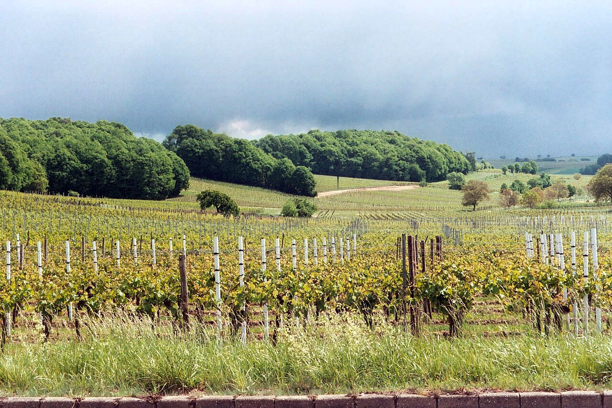

# Pfalz

Pfalz is the German appellation that runs along the German Wine Route from Bockenheim to Schweigen on the Alsace border, 85 kilometres in length and linking about 130 villages. With about 23,700 hectares in 2025, it is the second largest wine region in Germany.

Figure: Pfalz. Photograph: Gleiszellen (Pfalz), vineyards. Credit: Dguendel, CC BY 3.0, via Wikimedia Commons ([source](https://commons.wikimedia.org/w/index.php?curid=29822009)).

## Definition and scope

Pfalz is a protected appellation name, and its grapes must come from the demarcated area and be made within it. The region is split into two parts, Mittelhaardt-Deutsche Weinstraße in the north and Südliche Weinstraße in the south.

White wines dominate, with whites making up about 60%; Riesling covers about 5,950 hectares, the largest Riesling area of any German region; reds are led by Dornfelder and Spätburgunder. Pfalz is not a synonym for the state of Rhineland-Palatinate, which contains several wine regions.

## History

Viticulture in the Pfalz goes back to Roman times, and medieval monasteries and local lords drove the clearing of slopes along the edge of the Rhine plain. Wine from the Pfalz was traded down the Rhine to Dutch and British markets well before modern times.

The German Wine Route, created in 1935, linked the region's villages and estates into a tourism and marketing route that became one of Germany's best-known wine destinations after the war. In the late 20th century the promotion of new red varieties such as Dornfelder changed the region's variety mix.

## Geography and climate

Pfalz lies on the western edge of the upper Rhine plain, with the Haardt hills and the Palatinate Forest to the west. The hills block moisture from the Atlantic, making the region one of the warmest and driest in Germany, with ample sunshine and reliable ripening.

The climate resembles Alsace, with hot summers and dry autumns, and almonds, chestnuts and figs grow on the slopes. Drought is the main pressure, with irrigation needed in some years, and hail and early frost are also risks.

Soils are highly varied, including sandstone, limestone, volcanic rock, loess and clay. Differences in drainage, heat retention and pH create style differences for the same variety between villages.

## Two sub-zones

Pfalz has two sub-zones with different climates and variety emphases.

- Mittelhaardt-Deutsche Weinstraße: the northern core around Forst, Deidesheim, Ruppertsberg, Wachenheim and Bad Dürkheim, with steep slopes and varied soils, strong for Riesling and Spätburgunder.
- Südliche Weinstraße: the south from Edenkoben to Schweigen, warmer and drier, with more loess and sandstone and larger volumes of Dornfelder and whites.

For Pfalz, the sub-zones describe geography and style, not a ranking, and variation within a sub-zone is just as marked.

## Varieties and raw material

Riesling covers about 5,950 hectares, the largest share, with fuller body than in the Mosel while keeping clear acidity. Dornfelder covers about 2,450 hectares and is one of the region's most important local reds, deep in colour and rich in fruit, often made dry or semi-dry.

Spätburgunder covers about 1,740 hectares for structured reds; Grauburgunder covers about 2,240 hectares with fuller body; Weißburgunder, Müller-Thurgau, Kerner and Portugieser are also grown. The raw material is [grape](ref:grape).

## Winemaking

Whites [ferment](ref:fermentation) cool to keep aroma and [acidity](ref:acidity); Riesling may ferment in stainless steel or large barrels, and some wines gain texture from lees contact. Reds ferment with the skins, with Dornfelder often given a shorter maceration to keep fruit, and Spätburgunder a longer one followed by old oak.

Dry wines dominate in the Pfalz, with sweet styles concentrated in the higher Prädikat levels and Eiswein. Here the [oak cask](ref:oak-ageing) is used for red structure and some white texture, and new oak is usually lower than in international-style reds.

## Classification and rules

For Pfalz, German wine is divided into Wein, Landwein, Qualitätswein and Prädikatswein. Prädikatswein is graded by ripeness at harvest into Kabinett, Spätlese, Auslese, Beerenauslese, Trockenbeerenauslese and Eiswein; the level describes must weight and does not determine the sweetness of the finished wine.

Trocken on the label means residual sugar no higher than 9 g/L, halbtrocken means 9–18 g/L, and feinherb is a common but unregulated term. Everyday Pfalz wines are mostly dry.

Großes Gewächs and Erste Lage are private classifications of producer associations such as the VDP, not state grades. Weißherbst is a legally defined German rosé pressed from a single red variety, and the label names that variety.

## Labels and serving

The label should be checked for Pfalz, the sub-zone (Bereich), village and site, variety, vintage, alcohol, volume and bottler. The AP number traces the official quality-test batch.

Dry Riesling is best at 10–12 degrees Celsius, and Dornfelder and Spätburgunder at 14–16 degrees Celsius. Riesling suits poultry, river fish and Asian dishes; Dornfelder suits grilled meat, sausages and medium-strength cheese. Once opened, keep chilled and finish soon. Excessive drinking is harmful to health and minors should not drink.

## Common misconceptions

First, equating Pfalz with the state of Rhineland-Palatinate. The state also contains Rheinhessen, Mosel, Nahe and Ahr.
Second, assuming Pfalz is only Riesling. Dornfelder, Spätburgunder and Grauburgunder all hold important areas.
Third, treating Dornfelder as a lowly variety. It can make deep-coloured, structured reds and also Weißherbst.
Fourth, assuming a warm region must be sweet. Dry wines are a high share in the Pfalz, and sweetness depends on fermentation and labelling.
Fifth, treating the German Wine Route as a legal grade. It is a tourism and marketing route, not a quality classification.

**In brief:** The German appellation running 85 kilometres along the German Wine Route from Bockenheim south to Schweigen on the Alsace border and linking about 130 villages, with about 23,700 hectares in 2025, the second largest region in Germany; it is split into Mittelhaardt-Deutsche Weinstraße and Südliche Weinstraße, with about 5,950 hectares of Riesling and about 2,450 hectares of Dornfelder, and whites make up about 60%.

Start with the appellation and its permitted varieties. From there, consider the vintage and the producer, then how the wine is labelled. That is how a practical judgment about Pfalz is built.

**Key facts.**

| Item | Detail |
| --- | --- |
| In one line | The German appellation running 85 kilometres along the German Wine Route from Bockenheim south to Schweigen on the Alsace border and linking about 130 villages, with about 23,700 hectares in 2025, the second largest regi… |
| Level | other |
| Parent | Germany |
| Country code | DE |

**Sources and limits.** The key claims about Pfalz are checked against the following sources: Wines of Germany / Deutsches Weininstitut (the region's climate, white and red shares and the scale of Riesling planting), Pfalz Wein e.V. (2025 variety areas, including 5,954 hectares of Riesling and 2,454 hectares of Dornfelder; Migrated from the former reference list at the end of the article; access date not re-verified), European Union (Prädikatswein categories and the minimum residual sugar and alcohol rules). Prices, batches and status change; the body is project-written and does not reproduce source text.

## Further reading

- [Germany](ref:germany): the national appellation framework that contains Pfalz.
- [Wine](ref:wine): an overview of wine categories, vintage and origin rules.
- [White wine](ref:white-wine): the category to which Riesling and Grauburgunder belong.
- [Red wine](ref:red-wine): the category to which Dornfelder and Spätburgunder belong.
- [Grape](ref:grape): the structure and ripeness markers of wine grapes.
- [Fermentation](ref:fermentation): the difference between cool fermentation and skin-contact fermentation.
- [Acidity](ref:acidity): how Pfalz Riesling balances acidity and body.
- [Alcohol by volume](ref:abv): how alcohol in a warm region relates to the label.
- [Oak ageing](ref:oak-ageing): the different oak treatment of Spätburgunder and Dornfelder.

## Related images

Image: Category image for Germany. Credit: Renardo la vulpo, CC0, via Wikimedia Commons ([source page](https://commons.wikimedia.org/wiki/File:M%C3%BCnchen,_Oktoberfest_2022,_Fischer-Vroni_v_S,_1.jpeg)). Related image for Pfalz.

Image: Grape. Credit: Vyacheslav Argenberg, CC BY 4.0, via Wikimedia Commons ([source page](https://commons.wikimedia.org/wiki/File:Grapes,_Rostov-on-Don,_Russia.jpg)). Related image for Pfalz.
