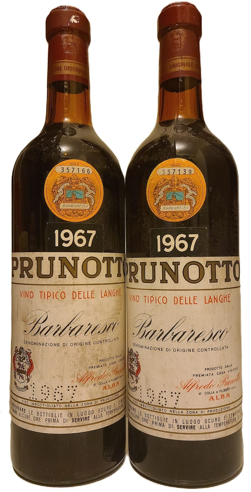

# Piedmont

Piedmont (Italian Piemonte) lies in north-west [Italy](ref:italy), bounded by the Alps to the north and west, Liguria to the south and Lombardy to the east. It is one of Italy's leading fine red-wine regions, centred on [Nebbiolo](ref:nebbiolo), while Barbera, Dolcetto and Moscato complete a varied range of varieties.

Figure: Piedmont. Photograph: Piedmont vineyard in autumn. Credit: Giorgio Montersino, CC BY-SA 2.0, via Wikimedia Commons ([source](https://commons.wikimedia.org/w/index.php?curid=5816942)).

## Geography and climate

Vineyards are mainly on the Langhe and Monferrato hills on both sides of the Tanaro river, with Canavese to the north and Gavi to the south-east. Slopes mostly sit at 200–500 metres, and aspect and gradient determine sunlight and ripening.

The climate is continental. The Alps block part of the cold northern air, summers are warm and autumns are long; thick fog often appears at harvest, and the Italian word nebbia is one source of the name Nebbiolo. Day-night swings and autumn rain make Nebbiolo late-ripening and high in acidity, and also divide styles between different aspects.

Soils are mainly calcareous marl, sandstone and clay. The Sant'Agata marl of the Langhe and the calcareous sandstone of Barolo are often cited; Monferrato has a higher clay share, where Barbera tends to be fuller.

## History and classification

Piedmont built a modern wine industry in the 19th century. Cooperation between Count Camillo Benso di Cavour and the French winemaker Louis Oudart, among others, helped move Barolo towards a dry, commercial style. In the later 20th century Barolo and Barbaresco gained DOCG status, and rules gradually fixed varieties, yields and minimum ageing.

In the Italian hierarchy, DOCG sits above DOC. Barolo requires a total ageing of at least 38 months, including at least 18 months in wood; Barbaresco requires at least 26 months, including at least 9 months in wood. The rules also set minimum bottle ageing after the harvest year and where bottling may take place. The current product specification should be consulted for exact figures.

## Sub-zones

- Langhe: the core of Barolo and Barbaresco, containing several village-level areas such as Barolo, La Morra, Serralunga d'Alba and Barbaresco.
- Monferrato: important for Barbera and Moscato, including Barbera d'Asti and Moscato d'Asti.
- Canavese: known for Nebbiolo in Carema and for Erbaluce white wine.
- Gavi: represented by Gavi white wine made from Cortese.
- Alba and the area around Turin: home to local varieties such as Dolcetto and Freisa.

Differences between villages usually come from soil, altitude and aspect rather than from administrative boundaries.

## Varieties and styles

[Nebbiolo](ref:nebbiolo) takes its name from fog. It is thick-skinned and late-ripening, pale in colour yet high in both acidity and tannin, and is often described with rose, tar, red cherry and spice. It needs long ageing to open up, which is the reason behind the Barolo and Barbaresco rules.

Barbera is high in acidity and lower in tannin, suits earlier drinking and is Piedmont's everyday red mainstay. Dolcetto is deeper in colour with softer tannin; Freisa and Grignolino are more niche.

White wines are led by Moscato, Arneis and Cortese. Moscato d'Asti is low in alcohol, smells of muscat grape and orange blossom and is often lightly sparkling; Gavi is fresh and clearly citrus-led. See [red wine](ref:red-wine), [white wine](ref:white-wine) and [sparkling wine](ref:sparkling-wine) for the related styles.

Start with the appellation and its permitted varieties. From there, consider the vintage and the producer, then how the wine is labelled. That is how a practical judgment about Piedmont is built.

## Representative wines and producers

- [Barolo](ref:barolo): Nebbiolo alone, firm in structure, with long mandatory ageing.
- [Barbaresco](ref:barbaresco): also Nebbiolo alone, usually approachable earlier than Barolo.
- Barbera d'Asti and Moscato d'Asti: representative of the red and the sweet lightly sparkling white lines respectively.
- Traditional producers such as Giacomo Conterno, Bruno Giacosa, Gaja and Produttori del Barbaresco are often used to discuss the split between traditionalist and modernist approaches.

Producer style changes with vintage, site and winemaking choices and cannot be reduced to the labels "traditional" or "modern".

## Common misconceptions

First, thinking pale Nebbiolo means a light body. Its tannin and acidity are usually high.
Second, reducing Barolo to a fixed "tar and roses" aroma. Aromas change with vintage and ageing.
Third, seeing Barbaresco as a lesser Barolo. The two have different rules and emphasis.
Fourth, treating Moscato d'Asti as an ordinary sweet wine. It is low in alcohol, often lightly sparkling and focused on fresh aroma.
Fifth, assuming Piedmont makes only red wine. White wine and sparkling wine matter too.

Piedmont sits between the Alps and the Langhe and Monferrato hills. Nebbiolo makes Barolo and Barbaresco, while Barbera and Moscato d’Asti cover more everyday styles. Autumn fog, slope soils and DOCG ageing rules shape the region’s identity. “Piedmont” is not a quality grade; the commune, the appellation and the producer are more specific entry points. Barolo and Barbaresco change with commune, slope and ageing rules, while Barbera and Moscato d’Asti belong to very different everyday categories. DOCG defines a production zone, not a bottle score. Start with the subzone and the wine.

Read [Italy](ref:italy) for the geographic boundary side of Piedmont, and [Red wine](ref:red-wine) for the climate and soil side. Together they locate it.

**At a glance:** A wine region in north-west Italy framed by the Alps and the Langhe and Monferrato hills; represented by Barolo and Barbaresco from Nebbiolo, Barbera and Moscato d'Asti, with autumn fog (nebbia), hillside soils and strict DOCG ageing rules defining its style.

Piedmont's appellations differ sharply in variety, site and ageing rules, so the appellation, the village and the label's ageing terms are the practical checks before choosing a bottle.

Piedmont is in north-west Italy, with Barolo and Barbaresco based on Nebbiolo, and Asti sparkling wine based on Moscato.

**Key facts.**

| Item | Detail |
| --- | --- |
| In one line | A wine region in north-west Italy framed by the Alps and the Langhe and Monferrato hills; represented by Barolo and Barbaresco from Nebbiolo, Barbera and Moscato d'Asti, with autumn fog (nebbia), hillside soils and stric… |
| Level | province or region |
| Parent | Italy |
| Country code | IT |

**Sources and limits.** The key claims about Piedmont are checked against the following sources: Italian Ministry of Agriculture (Piedmont's legal appellations and the DOCG list), European Commission (the registration status and product specifications of Barolo, Barbaresco and other origin names), Federdoc (the Piedmont consortia and the outline of DOCG rules) and 5 sources in total. Prices, batches and status change; the body is project-written and does not reproduce source text.

## Further reading

- [Italy](ref:italy): the national framework to which Piedmont belongs.
- [Nebbiolo](ref:nebbiolo): the core red variety of Piedmont.
- [Barolo](ref:barolo) and [Barbaresco](ref:barbaresco): two Nebbiolo-based red wines.
- [Red wine](ref:red-wine), [white wine](ref:white-wine) and [sparkling wine](ref:sparkling-wine): three basic categories.
- [Oak ageing](ref:oak-ageing) and [fermentation](ref:fermentation): key processes behind style.
- [Wine](ref:wine): an overview of wine categories and origin rules.

## Related images

Image: Barolo. Credit: Biskuit, CC BY-SA 2.0, via Wikimedia Commons ([source page](https://commons.wikimedia.org/wiki/File:Cascin_Adelaide_Barolo_%26_decanter.jpg)). Related image for Piedmont.

Image: Barbaresco. Credit: Geographer, CC BY-SA 4.0, via Wikimedia Commons ([source page](https://commons.wikimedia.org/wiki/File:Prunotto_Barbaresco_1967.jpg)). Related image for Piedmont.
