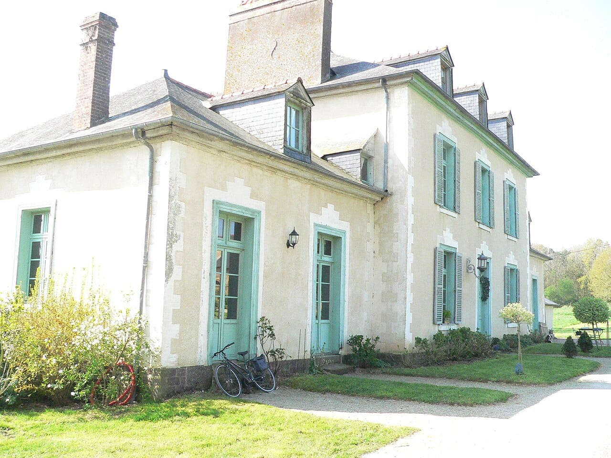

# Pomerol

Pomerol is a red-wine appellation on the right bank of the Dordogne, east of Libourne, recognised as an AOC on 8 December 1936. Its core plateau measures only about 4 km by 3 km, yet it contains one of the most expensive estates on the right bank; unlike the left bank, Pomerol has never created an official classification, so reputation rests entirely on particular estates and parcels.

Figure: Pomerol. Image: Flomacon35, CC BY-SA 3.0, via Wikimedia Commons ([source page](https://commons.wikimedia.org/wiki/File:Chateau_Le_Pin.JPG)).

## Definition and scope

Pomerol applies only to still [red wines](ref:red-wine) from demarcated parcels in the commune of Pomerol that are fermented and aged within the area. The appellation lies on the [Bordeaux](ref:bordeaux) right bank next to Saint-Émilion but is administratively separate; it relies on no cru classé list, and labels usually carry only Pomerol and the estate name.

This no-classification structure means there is no official hierarchy inside the appellation. Buyers must judge quality through estate history, parcel position and vintage performance, which makes market information here more dependent on reputation and word of mouth than on the left bank.

Estates here are generally small, and average holdings are far below those of left-bank classified growths; this fragmentation means neighbouring owners of the same soil can make entirely different wines. The appellation name comes from the commune, not from a single vineyard, which is the opposite of Burgundian site naming.

## A right-bank commune without a classification

Pomerol never established a classification like the Médoc list of 1855, nor did it build and periodically revise one as Saint-Émilion did in 1955. Its trade organisation was founded in 1900, one of the earliest winegrowers' associations in the Gironde; the equivalent Saint-Émilion body dates from 1884.

No classification does not mean no order. Pomerol's ranking is made by the market: Petrus, Lafleur, Trotanoy, Vieux Château Certan, La Conseillante, L'Évangile and Clinet, among others, have built price tiers over time through parcel position, history and scarcity. That hierarchy is implicit, and it moves more easily with vintage and ownership changes.

Without a classification there is also no official promotion or demotion mechanism, so estates build standing slowly through vintage performance and market judgment. Buyers have to check estate background rather than rely on a list.

## Clay-iron soil and gravel

The topsoil of the Pomerol plateau is gravel, with the density of gravel and the proportions of clay and sand varying from place to place; beneath it lies an iron-oxide-rich clay known locally as crasse de fer. This iron layer is nearly impermeable, creating a perched water table in wet weather and releasing water slowly in summer, so [Merlot](ref:merlot) ripens steadily even in dry years.

Parcels at the plateau edge and on the eastern side are sandier and drain faster, giving usually lighter wines; the clay-iron soil in the centre holds water better and gives fuller body. This centre-heavy, edge-light pattern is the geological basis for stylistic variation within one appellation.

The thickness and depth of the crasse de fer also vary across the plateau: on some parcels the iron layer lies close to the surface, on others it is covered by thicker gravel. This creates subtle differences in drainage and water retention, and explains why neighbouring parcels can give clearly different bodies.

## Merlot and Petrus

Merlot accounts for about 80% of Pomerol plantings and is clearly dominant; Cabernet Franc, Cabernet Sauvignon, Malbec and Petit Verdot make up smaller shares. Merlot brings plum, black cherry, violet and truffle notes with supple tannin, drinkable young yet capable of decades in good vintages.

Petrus sits on the central plateau's clay-iron soil and is Merlot-based, the best-known estate in Pomerol. Its existence is often used to explain how a place without a classification can still produce top-tier prices: in the absence of an official list, parcel, history and market consensus together perform the role of a classification.

Petrus covers a very small area and produces limited quantities, and scarcity pushes prices further; this also reminds readers that top-tier Pomerol is often tied directly to area and output rather than to a rank.

## Rules and figures

The permitted varieties are Merlot, Cabernet Franc, Cabernet Sauvignon, Malbec and Petit Verdot. The minimum natural alcohol is 11%, the yield is 49 hl/ha with a ceiling of 60 hl/ha, planting density is at least 5,500 vines per hectare, and the maximum field load is 8,000 kg/ha. At harvest the minimum sugar level is 194 g/L for Merlot and 180 g/L for the other varieties.

Compared with Pauillac, Pomerol has a lower yield ceiling and a lower planting density, which reflects the right bank's clay soils, the Merlot variety and a higher share of old vines. The figures describe the legal frame only; the wine itself still depends on parcel, vine age and winemaking.

## Winemaking and ageing

After fermentation the wine is aged in [oak](ref:oak-ageing), and most estates use a relatively high proportion of new barrels, with barrel time usually between one and two years. New oak adds vanilla, toast and spice and increases the sense of tannin polymerisation; older barrels emphasise fruit and texture.

Pomerol Merlot tannin is suppler and drinkable earlier, but good vintages develop truffle, iron-like mineral notes and leather in bottle. Compared with Cabernet-dominated left-bank wines, the drinking window usually opens sooner, and the wines suit poultry, mushrooms and braised dishes.

Pomerol winemaking rarely seeks forceful extraction; it emphasises texture and aroma, and fermentation temperature, maceration time and punch-down frequency all affect the final suppleness. Excessive extraction would bury Merlot's fruit, so estates tend toward gentle handling.

## Labels and buying

The word Pomerol on the label must match the appellation; check the vintage, alcohol, volume, bottler and estate name. Because there is no official classification, any “classed growth” or “first growth” wording is not a legal Pomerol tier and should be treated with caution.

Begin with the appellation and its permitted varieties, move on to the vintage and the producer, and finish with how the wine is labelled. That order keeps the reading of Pomerol practical.

With no classification, critics and auction records become important references; price movements between vintages of one estate are often more informative than differences between estates.

**At a glance:** A red-wine AOC on the right bank of the Dordogne, east of Libourne, recognised on 8 December 1936, with a core plateau of roughly 4 km by 3 km; gravel and sandy clay overlie an iron-oxide-rich clay subsoil known as crasse de fer, Merlot accounts for about 80% of plantings, the rules set a minimum natural alcohol of 11%, a yield of 49 hl/ha with a ceiling of 60 hl/ha, and a minimum planting density of 5,500 vines per hectare, and Pomerol has never created an official classification. 

## References

- [France](ref:france): the AOC system and the national appellation framework.
- [Bordeaux](ref:bordeaux): the structural differences between right bank and left bank.
- [Merlot](ref:merlot): the dominant variety in Pomerol and its ripening profile.
- [Cabernet Franc](ref:cabernet-franc): adding aroma and structure to right-bank blends.
- [Red wine](ref:red-wine): an overview of still red wine and winemaking.
- [Oak ageing](ref:oak-ageing): how new-barrel proportions shape aroma and tannin.

## Related images

Image: Cabernet Franc. Credit: Viala et Vermorel, Public domain, via Wikimedia Commons ([source page](https://commons.wikimedia.org/wiki/File:Cabernet-franc.jpg)). Related image for Pomerol.

Image: Merlot. Credit: Felloni claire, CC BY-SA 4.0, via Wikimedia Commons ([source page](https://commons.wikimedia.org/wiki/File:Merlot.jpg)). Related image for Pomerol.
