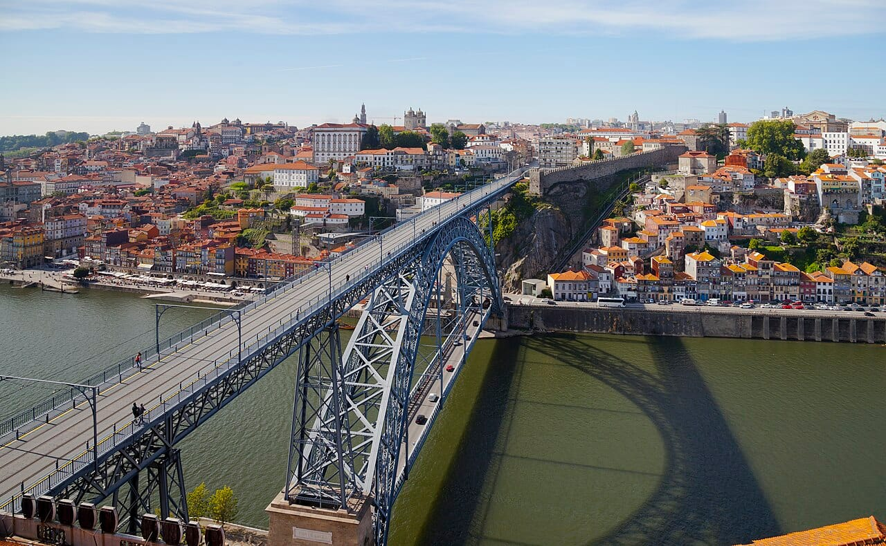

# Porto

Porto is a sweet [fortified-wine](ref:fortified-wine) appellation produced in the Douro valley of [Portugal](ref:portugal) and aged in Vila Nova de Gaia or the Douro. It is made from Touriga Nacional and other varieties and classified along two axes, single harvest or blend and oxidative cask or reductive bottle ageing.

Figure: Porto. Image: Diego Delso, CC BY-SA 3.0, via Wikimedia Commons ([source page](https://commons.wikimedia.org/wiki/File:Puente_Don_Luis_I,_Oporto,_Portugal,_2012-05-09,_DD_13.JPG)).

## Definition and scope

Porto is a fortified wine, not an ordinary dry red: grape spirit is added mid-fermentation to stop fermentation and retain residual sugar, so alcohol is high and the wine is sweet. Its area overlaps the vineyard zone of the [Douro](ref:douro) valley, and ageing may take place in the cellars of Vila Nova de Gaia or in the Douro.

Porto is the Portuguese name and Port the English short form. The category name on the label (Ruby, Tawny, Vintage, LBV and others) is the key to style, and colour alone is not enough.

## History

The Douro valley was demarcated in 1756, one of the world's earliest wine-region boundaries. Eighteenth-century Anglo-Portuguese trade drove Porto's popularity in the British market and shaped the cellar system of Vila Nova de Gaia.

That history produced two forms: one emphasising bottle ageing and the expression of a single harvest, the other emphasising oxidative cask ageing and stable blends. Understanding these two routes matters more than memorising a vintage or a brand.

## Geography and climate

Vineyards lie on the steep slopes of the Douro and its tributaries, often on stone-walled terraces, from near river level up to more than 700 metres. The climate is continental, with hot summers and cold winters, and schist soils drain well and hold little fertility.

From west to east the region divides into Baixo Corgo, Cima Corgo and Douro Superior, drier and more remote towards the east, with clear differences in ripeness and yield. Aspect, altitude and the river moderate temperature and form the base for Porto base wines.

## Varieties and ingredients

Red grapes are mainly Touriga Nacional, Touriga Franca, Tinta Roriz, Tinta Barroca and Tinto Cão; white Port uses Malvasia Fina, Viosinho and other white grapes. The raw material is [grape](ref:grape).

Touriga Nacional brings floral notes, black fruit and structure, Touriga Franca adds aroma and suppleness, and Tinta Roriz contributes ripe fruit. Blending aims to fill in structure, aroma and acidity rather than to make one uniform taste.

## Winemaking

Grapes are crushed, macerated and [fermented](ref:fermentation); grape spirit is added while residual sugar is still high, stopping fermentation and keeping sweetness. Fortification level, timing and base-wine style decide the final sugar and body.

Some traditional houses still use foot treading and granite lagares, while modern houses use temperature-controlled stainless steel and mechanical pressing. The base wine then enters the ageing system, using [oak](ref:oak-ageing) or inert containers.

## Ageing system and categories

Porto categories can be read on two axes: the first is single harvest versus multi-vintage blend, the second is oxidative cask ageing versus reductive bottle ageing.

- Ruby: multi-vintage blend, short ageing in cask or large tanks, deep colour and direct red fruit, young in body.
- Tawny: multi-vintage blend, long oxidative ageing in cask, turning tawny in colour with nut, caramel and dried-fruit notes; the 10, 20, 30 and 40 year labels indicate the target age of the style.
- Vintage: single harvest, approved by IVDP and aged in bottle, deep in colour and firmly structured, needing decanting before drinking.
- LBV: single harvest, aged 4–6 years in cask before bottling; some are filtered and ready to drink, others unfiltered and able to age further in bottle.
- Colheita: single-harvest Tawny, aged long in cask under oxidative conditions, labelled with the harvest year.
- Crusted: multi-vintage blend, aged briefly in cask and bottled, forming a deposit in bottle, close in style to young Vintage.
- White Port: made from white grapes, from dry to sweet, often served as an aperitif.

The key is not colour depth but the two variables of vintage and container. Vintage and LBV are both single harvest, differing in whether the main ageing happens in bottle or cask; Tawny and Colheita both follow the oxidative route, differing in whether they are blends or single harvests.

## Specification and label

The common volume is 750 mL, with [alcohol by volume](ref:abv) at about 19%–20% vol, varying by category and estate. The label should be checked for the category name, vintage or age indication, bottler and origin.

Vintage carries the harvest year, LBV carries the vintage and bottling year, Tawny carries an age, and Colheita carries the harvest year. The bottle on hand governs.

## Market and drinking

Ruby, LBV and Vintage suit chocolate, blue cheese and nuts; Tawny suits caramel desserts, nuts and dried fruit; White Port can be served chilled as an aperitif.

Vintage is served at about 16–18 degrees Celsius and decanted before drinking; Tawny at about 12–14 degrees Celsius; Ruby and LBV at about 14–16 degrees Celsius. Refrigerate after opening and finish within a few weeks. Excessive drinking harms health and minors should not drink.

## Common misconceptions

First, thinking all Porto is sweet red wine. White Port exists, and sweetness spans a wide range.
Second, judging category by colour. Colour reflects the ageing route, not the category directly.
Third, treating LBV as a cheap substitute for Vintage. Both are single harvest, but their ageing container and drinking window differ.
Fourth, thinking older Tawny is sweeter. The age indication describes the target style, and sweetness depends on residual sugar and process.
Fifth, conflating Crusted with Vintage. Crusted is a multi-vintage blend.

**In brief:** A sweet fortified-wine appellation produced in the Douro valley of Portugal and aged in Vila Nova de Gaia or the Douro; made from Touriga Nacional and other varieties, it is classified along two axes, single harvest or blend and oxidative cask or reductive bottle ageing, into Ruby, Tawny, Vintage, LBV, Colheita and Crusted, commonly 750 mL at about 19%–20% vol.

Start with the appellation and its permitted varieties. From there, consider the vintage and the producer, then how the wine is labelled. That is how a practical judgment about Porto is built.

Setting [Portugal](ref:portugal)'s geographic boundary beside [Grape](ref:grape)'s climate and soil makes the boundary between them visible.

**Key facts.**

| Item | Detail |
| --- | --- |
| In one line | A sweet fortified-wine appellation produced in the Douro valley of Portugal and aged in Vila Nova de Gaia or the Douro; made from Touriga Nacional and other varieties, it is classified along two axes, single harvest or b… |
| Level | other |
| Parent | Portugal |
| Country code | PT |

**Sources and limits.** The key claims about Porto are checked against the following sources: IVDP (the categories, ageing requirements and labelling rules of Porto), European Union (EU fortified-wine categories, geographical indications and traditional terms), Oxford University Press (Consulted for entries on Port, Vintage Port and Tawny; Migrated from the former reference list at the end of the article; access date not re-verified). Prices, batches and status change; the body is project-written and does not reproduce source text.

## Further reading

- [Portugal](ref:portugal): the national framework to which Porto belongs.
- [Douro](ref:douro): the source region of Porto grapes.
- [Fortified wine](ref:fortified-wine): the category and its process framework.
- [Grape](ref:grape): the basic structure of wine grapes and ripeness measures.
- [Fermentation](ref:fermentation): the logic of fortifying mid-fermentation.
- [Oak ageing](ref:oak-ageing): the oxidative route of Tawny and Colheita.
- [Wine](ref:wine): an overview of wine categories, vintages and origin rules.
- [Alcohol by volume](ref:abv): what 19%–20% vol means on a label.

## Related images

Image: Douro. Credit: Vitor Oliveira from Torres Vedras, PORTUGAL, CC BY-SA 2.0, via Wikimedia Commons ([source page](https://commons.wikimedia.org/wiki/File:Rio_Douro_-_Portugal_(32615481975)_(cropped).jpg)). Related image for Porto.

Image: Category image for Portugal. Credit: John Hayes from San Antonio, Texas, USA, CC BY-SA 2.0, via Wikimedia Commons ([source page](https://commons.wikimedia.org/w/index.php?curid=151531010)). Related image for Porto.
