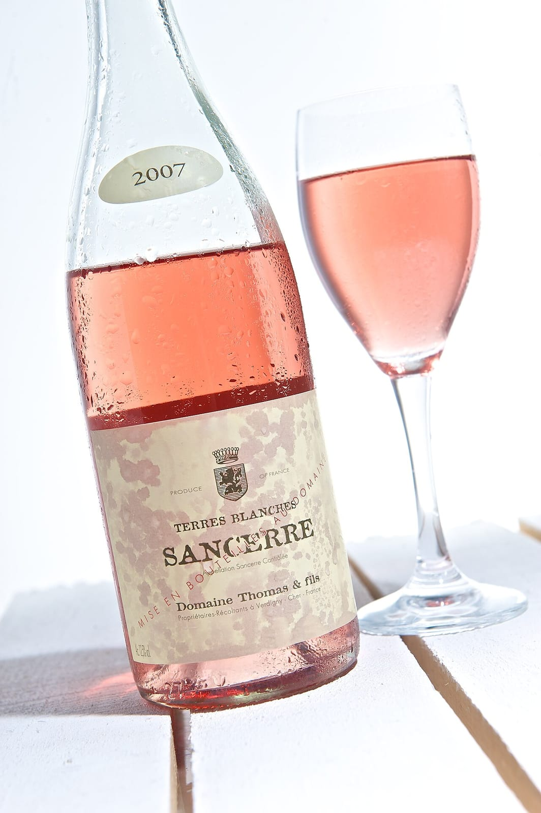

# Portugal

Portugal lies in the west of the Iberian Peninsula and has a deep wine tradition. Its international image is often tied to fortified wines such as Port and Madeira, but Portugal also makes Douro reds, warm Alentejo styles, fresh Vinho Verde whites and crisp rosés. Native varieties are abundant and are the key to understanding Portuguese wine.

Figure: Portugal. Photograph: Porto-Matosinhos, , June 2 (53870205083). Credit: John Hayes from San Antonio, Texas, USA, CC BY-SA 2.0 ([source page](https://commons.wikimedia.org/w/index.php?curid=151531010)). Category image; not a claim that it shows the exact product, site or event.

## Geography and climate

Portugal faces the Atlantic to the west and borders Spain to the north and east. The terrain moves from mountains and river valleys in the north through central ranges to the Alentejo plain in the south. The north and north-west are Atlantic-influenced, wetter and mild; the north-east and the Douro Valley are more continental, with hot summers and cold winters; the southern Alentejo is hot and dry with a wide diurnal range; Madeira and the Azores are island regions strongly moderated by the ocean.

The uneven distribution of water and heat is the main variable for Portuguese viticulture. The north must manage disease and under-ripeness; the south must cope with drought and heat; the schist slopes and river moderation of the Douro allow late-ripening varieties to retain structure under warmer conditions. Varieties and viticulture therefore differ greatly between regions.

## History

Viticulture in Portugal goes back to antiquity, with Roman-era winemaking traditions. Monasteries and local lords helped shape appellations in the Middle Ages. From the eighteenth century, the Port trade with the British market drove large-scale planting and classification in the Douro, and Portugal was among the earlier countries to establish demarcated regions. Co-operatives and modern investment raised quality and export capacity in the later twentieth century.

## Wine regions

- Douro: steep schist slopes, the core region for Port and red wine.
- Alentejo: hot, dry plains with substantial red and white production.
- Vinho Verde: fresh whites and rosés in the north-west.
- Dão: red and white wines from central hills.
- Setúbal: Muscat and sweet wines on the southern peninsula.
- Madeira and the Azores: island regions, with Madeira known for fortified wine.

## Varieties and styles

Portugal has many native varieties. The Douro is dominated by red varieties such as Touriga Nacional, Touriga Franca and Tinta Roriz, giving deep colour and concentrated tannin and aroma; Alentejo often uses native reds and blends; Vinho Verde is known for white varieties such as Alvarinho and Arinto. The styles of [red wine](ref:red-wine) and [white wine](ref:white-wine) come from regional heat, varieties and winemaking rather than a single national style.

[Rosé](ref:rose-wine) is also produced steadily in Portugal, from crisp dry styles to more fruity versions. Grapes become wine through [fermentation](ref:fermentation), and fermentation temperature, maceration time and yeast choice affect aroma and structure.

## Fortified wine and Madeira

[Fortified wine](ref:fortified) is Portugal's most internationally recognised category. Port has grape spirit added during fermentation, stopping fermentation and retaining residual sugar, followed by oak ageing; styles range from Ruby and Tawny to Vintage. The grape spirit from [distillation](ref:distillation) is central to fortification, while [oak ageing](ref:oak-ageing) affects colour, aroma and texture.

Madeira is fortified after fermentation and then aged through heat and oxidation to develop its distinctive flavour. Sweetness and ageing time determine style, from fresh young wines to long-oxidised complex aromas. Fortified wine is not simply "sweet wine"; its process and ageing system need to be understood separately.

## Regulation and classification

Portuguese wine is linked to the EU PDO/PGI system, with protected region names and rules for varieties, yields and labelling. Regions such as the Douro and Alentejo have finer place names and tiers. Port and Madeira have their own fortified-wine rules and ageing terms.

When reading a label, distinguish the country name, region name, estate name and type name. Names such as "Porto" and "Madeira" are protected and cannot be used freely. Classification guarantees rules and origin, not the sensory quality of every bottle.

## Climate and soil data

| Area | Climate | Main soils | Representative drinks |
| --- | --- | --- | --- |
| North-west (Vinho Verde, Dão) | Atlantic, wet and mild | Granite, schist | White wine, rosé |
| North-east (Douro) | Continental, hot summers | Schist, terraced slopes | Port, red wine |
| Centre and south (Alentejo) | Mediterranean, hot and dry | Limestone, sand, clay | Red wine, white wine |
| Islands (Madeira, Azores) | Oceanic, mild and wet | Volcanic, basalt | Madeira |

For Portugal, this table is a macro comparison; soil, altitude and aspect at a specific site still need to be checked within a single region. Treating the national climate as a guarantee of style ignores differences within regions.

## Representative wines and producers

Port, Madeira and Douro reds all have representative producers; for specific wines, see the wine pages. Region pages describe geography, varieties and the regulatory framework and do not judge individual brands. In everyday consumption, Vinho Verde whites and Alentejo reds also have a steady market.

## Market and drinking

Portugal is a major wine producer and exporter, with domestic consumption centred on restaurants and everyday drinking. [Wine](ref:wine) spans a wide price range, from everyday table wine to long-aged fine wine. Port suits after-meal and dessert occasions, Madeira suits after-meal and cooking, Douro reds suit meat and cheese, and Vinho Verde whites suit seafood and lighter food.

Drinking should be moderate, and storage after opening and temperature affect the experience. For a specific wine, the region, vintage, type and alcohol content on the label are the most direct information.

## Common misconceptions

First, that Portugal only makes Port. It also makes a great deal of dry red, white and rosé wine.

Second, that Port is always a sweet red. Port includes white Port, Tawny and Vintage among other types.

Third, that Madeira is only a cooking wine. Madeira is also drunk at different sweetness and ageing levels.

Fourth, that Portuguese varieties do not matter. Native varieties are central to Portuguese style.

Fifth, that sweeter fortified wine is always better. Sweetness needs balance with acidity, ageing and aroma.

Start with the appellation and its permitted varieties. From there, consider the vintage and the producer, then how the wine is labelled. That is how a practical judgment about Portugal is built.

**Key facts.**

| Item | Detail |
| --- | --- |
| In one line | A wine-producing country in the west of the Iberian Peninsula, known for fortified wines such as Port and Madeira and for Douro reds; native varieties are abundant and the appellation system is aligned with the EU framew… |
| Level | country |
| Country code | PT |

## Further reading

- [Wine](ref:wine): wine categories, winemaking and the regional framework.
- [Red wine](ref:red-wine) and [white wine](ref:white-wine): the two main lines of dry Portuguese wine.
- [Rosé](ref:rose-wine): Portuguese rosé styles and occasions.
- [Fortified wine](ref:fortified): the Port and Madeira systems.
- [Distillation](ref:distillation): grape spirit and fortification.
- [Oak ageing](ref:oak-ageing): ageing in Port and Madeira.
- [Fermentation](ref:fermentation): the base process of wine and fortified wine.

## Related images

Image: Rosé Wine. Credit: THOR, CC BY 2.0, via Wikimedia Commons ([source page](https://commons.wikimedia.org/wiki/File:Sancerre_rose_Wine.jpg)). Related image for Portugal.

Image: Fortified wine. Credit: Jon Sullivan, Public domain, via Wikimedia Commons ([source page](https://commons.wikimedia.org/wiki/File:Port_wine.jpg)). Related image for Portugal.
