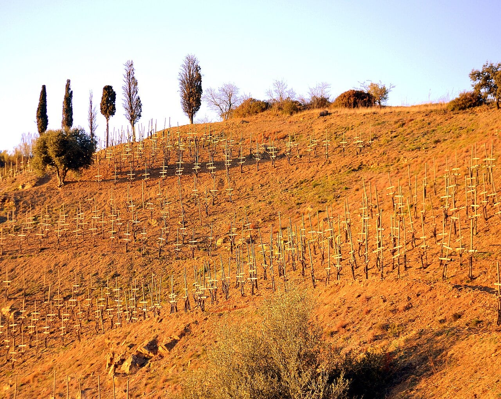

# Priorat

Priorat (Spanish Priorato) is a mountain wine region inland in Tarragona province, Catalonia, in north-eastern Spain, enclosed by ranges of hills. It was granted DOQ (Denominació d'Origen Qualificada) status in 2009, making it one of only two top-tier origin names in Spain alongside Rioja. The region is dominated by [red wine](ref:red-wine) with a small amount of [white wine](ref:white-wine), and is one of the symbols of Spain's modern fine-wine revival.

Figure: The l'Ermita vineyard at Gratallops in Priorat, low old vines on a slate slope. Image: Angela Llop, CC BY-SA 2.0, via [source page](https://commons.wikimedia.org/wiki/File:Vinyes_del_Priorat,_l%27Ermita,_Gratallops.jpg).

## Geography and climate

The region runs through valleys and steep slopes between the Serra de les Güixeres and neighbouring ranges, administratively within the Priorat comarca, covering villages such as Gratallops, Porrera, Poboleda, Torroja del Priorat, Bellmunt del Priorat, El Lloar, La Vilella Alta and La Vilella Baixa; Falset is the administrative centre. Vineyards mostly sit on steep slopes at 100–700 metres, with terraces held up by dry-stone walls.

Soil is the region's signature: llicorella, a weathered layer of slate mixed with quartz fragments, which holds little water and drains extremely fast, forcing roots deep in search of moisture and giving naturally low yields. It is often mistaken for volcanic rock, but it is actually metamorphic.

The climate is transitional between Mediterranean and continental: hot summers, fairly cold winters and low rainfall, with water stress a normal part of the growing season. Altitude brings marked day-night temperature swings that lengthen ripening and keep acidity. Wind through gaps in the hills facing the mistral helps suppress humidity and disease.

## History

In the twelfth century Carthusian monks from Catalonia founded the monastery of Scala Dei (Escaladei) and planted vineyards, and the region's name comes from "Priorato", the monastery's district. Phylloxera destroyed almost all the vineyards at the end of the nineteenth century, after which population left and the industry declined; in the mid-twentieth century production depended mainly on cooperatives.

In the late 1980s a group of outside winemakers and local growers worked together around Gratallops, rebuilding the region's image with low yields, separately vinified small plots and plantings of international varieties; these estates are often grouped as the "Gratallops group". Recognition and prices rose quickly, and the region gained DOQ status in 2009.

## Varieties and styles

The traditional varieties are [Grenache](ref:grenache) (locally Garnatxa) and Carignan (locally Samsó), the first giving ripe fruit and alcohol, the second acidity, tannin and ageing potential. Modern plantings also include [Syrah](ref:syrah) and [Cabernet Sauvignon](ref:cabernet-sauvignon) for colour and structure, though DOQ rules set clear limits on variety proportions.

[Red wines](ref:red-wine) are usually deep in colour and full-bodied with relatively high alcohol, showing blackberry, black cherry, liquorice, spice and a distinct mineral note, with firm tannin that often needs several years in bottle to reach its drinking window. [Oak](ref:oak-ageing) is widely used, but the recent trend is to reduce the share of new barrels so as not to mask fruit and minerality.

White wines are made from Garnatxa Blanca, Macabeu and other varieties in small volumes, generally medium-bodied with saline and herbal notes. [Fermentation](ref:fermentation) mostly takes place in temperature-controlled stainless steel or concrete, and some estates retain whole-cluster fermentation.

## Classification and labelling

DOQ is the highest tier in the Spanish origin hierarchy and imposes stricter rules than DO: a defined area, variety and yield limits, vinification and bottling inside the region, and inspection and tasting by the regulatory council. Priorat labels normally carry DOQ Priorat; "Priorat" alone refers to the same region.

There is no official village-level classification below DOQ, but estates often name a village or a single vineyard (vi de finca) on the label. These are producer statements, not legal grades.

## Representative wines and producers

- Clos Mogador: one of the early revival estates in Gratallops, often treated as the starting point of the region's modern style.
- Clos Erasmus: known for low-yielding old-vine Grenache in very small volumes.
- L'Ermita (Álvaro Palacios): a single-vineyard old-vine Grenache and one of the benchmarks of price and reputation in the region.
- Clos Dofí and Clos Martinet: also part of the Gratallops group, representing different blending directions.
- Traditional cooperatives: such as those around Falset, preserving the region's production pattern from before large-scale fine-wine development.

## Common misconceptions

First, taking llicorella for volcanic rock. It is a metamorphic mix of slate and quartz.
Second, assuming Priorat makes only red wine. The DOQ permits and in practice produces white wine.
Third, treating DOQ as a guarantee of "better" wine. It is a stricter origin and process constraint, not a quality ranking.
Fourth, thinking the region has always been expensive. Its high-price image formed after the 1990s; before that it was a long-declining rural region.
Fifth, reducing every wine to "heavy oak and high alcohol". Styles have clearly diversified, with more lightly extracted and less oaky wines appearing.

**In brief:** An inland mountain region in Tarragona province, Catalonia, Spain, awarded DOQ status in 2009; steep terraces of llicorella slate and quartz, low-yielding old vines and a transitional Mediterranean-continental climate produce Grenache- and Carignan-led reds with full body and a mineral edge.

Start with the appellation and its permitted varieties. From there, consider the vintage and the producer, then how the wine is labelled. That is how a practical judgment about Priorat is built.

An administrative place name is not a safe shorthand for Priorat. Check where its boundary lies, then which climate and legal category it has; where they diverge, prefer the specific source.

Priorat is a Catalan DOQ known for llicorella slate soils and Garnacha-led reds.

**Key facts.**

| Item | Detail |
| --- | --- |
| In one line | An inland mountain region in Tarragona province, Catalonia, Spain, awarded DOQ status in 2009; steep terraces of llicorella slate and quartz, low-yielding old vines and a transitional Mediterranean-continental climate pr… |
| Level | province or region |
| Parent | Spain |
| Country code | ES |

**Sources and limits.** The key claims about Priorat are checked against the following sources: Consell Regulador de la DOQ Priorat (Used to check the area, varieties and production rules of DOQ Priorat), Generalitat de Catalunya (Used to check Catalan wine regions and the DOQ system), European Commission (Used to check the registration status and product specification of the Priorat origin name) and 4 sources in total. Prices, batches and status change; the body is project-written and does not reproduce source text.

## Further reading

- [Spain](ref:spain): the national framework to which Priorat belongs.
- [Grenache](ref:grenache): the core variety of the region.
- [Syrah](ref:syrah) and [Cabernet Sauvignon](ref:cabernet-sauvignon): the international varieties used in blends.
- [Red wine](ref:red-wine) and [white wine](ref:white-wine): the two product types of the region.
- [Wine](ref:wine): an overview of wine categories and origin rules.
- [Fermentation](ref:fermentation) and [oak ageing](ref:oak-ageing): key processes behind style.
