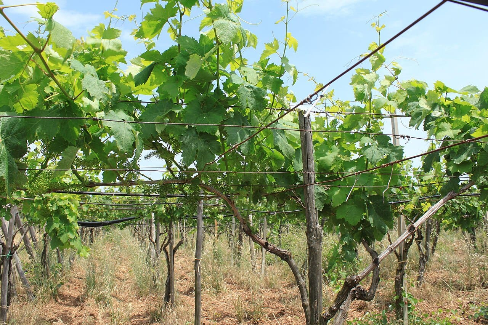
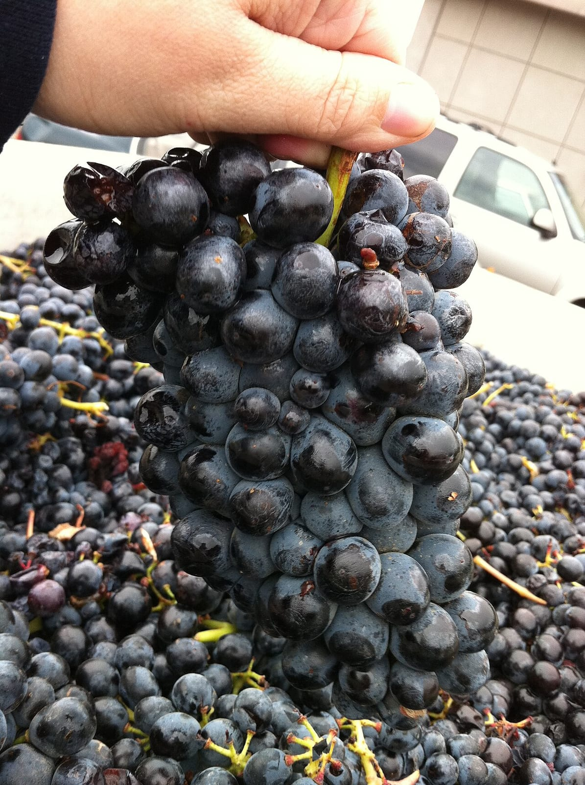

# Puglia

Puglia, known in English as Apulia, forms the heel of the Italian peninsula, with coasts on both seas. Mediterranean sun, limestone and red soils, old bush vines and masseria farm estates shape its image; Negroamaro, Primitivo and Bombino Nero lead the reds, with the Salento peninsula and Manduria at the core.

Figure: Puglia: Italia 2010 - Perrini vineyards in Puglia (Wikimedia Commons). Image: drdcuddy, CC BY-SA 2.0, via Wikimedia Commons ([source page](https://commons.wikimedia.org/wiki/File:Italia_2010_-_Perrini_vineyards_in_Puglia.jpg)).

## Definition and boundaries

Puglia sits in the southeastern corner of Italy, running along the coast through three provinces: Foggia in the north, Bari and Taranto in the middle, and Brindisi and Lecce in the south. The traditional wine districts lie south of the Brindisi–Taranto line, on the Salento peninsula. The northern Murgia hills around Castel del Monte focus on Nero di Troia, a variety closer to those of central and northern Italy. The peninsula faces the Adriatic on one side and the Ionian on the other, with straight coasts alternating sandy beaches and limestone cliffs; inland lie dry limestone plateaus and olive groves, vines following slopes and bench edges.

The rules layer from broad to specific. Salento IGT is the widest title, allowing about 50 varieties and red, white, rosé, sparkling and passito styles; varietal wines need at least 85% of the named variety. Above it sit a series of DOCs, with DOCG at the top. Primitivo around Manduria and Negroamaro in the Salento are the two main threads. IGT labels carry the regional name and variety, common for everyday and export wines; DOC/DOCG rules fix variety shares, yields and winemaking in finer detail.

## History and naming

Vine growing here reaches back to Greek and Roman times; coastal masseria estates and old alberello bush vines are the markers of traditional farming. Through most of the twentieth century, local wine was bulk and table wine, produced largely by cooperatives. In 1962 nineteen growers founded a cooperative at San Marzano, whose later Sessantanni Primitivo helped reshape Puglian red wine on the international market. The masseria was the farm estate's centre, storing oil and crops and making wine; the low bush vine keeps moisture in wind and drought, and old vines yield little but concentrated fruit.

The quality shift gathered pace after the 1970s. Primitivo di Manduria DOC was established in 1974, and the Salice Salentino DOC specification followed in 1976. In 2010 Primitivo di Manduria Dolce Naturale became Puglia’s first DOCG, recognised officially in 2011. Over the last two decades, boutique estates and outside capital have brought old-vine sites and native varieties back into focus. Puglia long supplied Italy's bulk wine; in the later twentieth century cooperatives bottled fruit for export, and the recent native-variety revival has drawn attention to the northern hills beyond the Salento.

## Geography and terroir

The peninsula is hot and dry; sea breezes and inland altitude bring local cooling. Soils are mostly limestone, iron-rich red earth and sand, freely draining. Bush vines root deep and hold up yields in drought, and coastal benches and limestone heights gain a little diurnal range that preserves acidity. The red earth comes from iron-rich weathered rock, ochre in the sun; weathered limestone forms gravel and clay seams that drain fast while holding subsoil moisture, and coastal humidity is higher than inland.

The Salento is low-lying, sun-drenched and ripe; the northern Murgia hills around Castel del Monte are slightly higher on limestone soils, suiting structured reds such as Nero di Troia. Main risks are summer drought, heat, isolated harvest rain and, on coastal vines, salt wind. Olive groves, almond trees and wheat fields break up the vineyard landscape; summers are dry and hot, with occasional rain after the sea warms in autumn.

## Raw materials and styles

Negroamaro is the Salento’s backbone red: deep colour, medium-high tannin, blackberry, dried fruit and spice. Primitivo is genetically identical to California Zinfandel and to Croatia’s Crljenak Kaštelanski, ripening early with high alcohol and concentrated fruit. Bombino Nero goes into rosé and light reds; whites include Vermentino, Fiano, Verdeca and Bianco d’Alessano, with Locorotondo the representative white DOC. Verdeca is the traditional white of the Itria Valley, and Bianco d'Alessano goes into local white blends; Locorotondo shows fresh blossom and a slight fizz.

Dry Primitivo usually sits around 14% alcohol, with rich fruit and soft tannin. The Dolce Naturale sweet red is made from overripe grapes, with at least 50 g/L residual sugar and about 16% natural alcohol, no fortification. Negroamaro reds and rosés lead Salice Salentino and other DOCs, often with herbal and earthy notes. Susumaniello and Nero di Troia are native varieties gaining recent attention. Susumaniello comes from around Brindisi, with fine tannin and fresh fruit; Nero di Troia is structured and ageworthy, the mainstay of Castel del Monte.

## Representative producers and wines

Representative estates include Tormaresca, the Antinori estate, Masseria Li Veli, Vallone, Cantine San Marzano, the cooperative behind the Sessantanni old-vine Primitivo, Varvaglione 1921, Le Vigne di Sammarco and Due Palme. Cooperatives produce large volumes, and fine-wine estates have multiplied over the last two decades. Due Palme and several cooperatives cover the Salento mass-market; Varvaglione is a fourth-generation family estate growing native varieties near Taranto since 1921.

These names are market references, not an official classification. Cooperatives and family estates coexist; flagship old-vine wines are scarce and expensive, while entry wines cover everyday table use. Comparing the same variety on Salento coastland and in the northern hills works better than memorising a producer list.

## How to drink and pair

Dry reds are served at 16 to 18 °C, rosés and light reds at 12 to 14 °C, whites at 10 to 12 °C. High-alcohol Primitivo should not be served too cold, and softer young wines can be opened a little early. Rosé is the local summer staple, chilled with seafood and vegetables; high-alcohol reds soften with a little air after opening.

Pair with Mediterranean cooking: roast lamb, sausages, braised beef, mushroom pasta and aged cheese with Negroamaro or Primitivo; rosé with seafood, salads and cold cuts; whites with shellfish, grilled fish and vegetable antipasti. Dolce Naturale goes with blue cheese, nuts and dried fruit, or as a dessert wine.

## Labels, buying and misreadings

Read the DOCG/DOC/IGT level and variety share first. Primitivo di Manduria DOC requires at least 85% Primitivo and a minimum 13.5% alcohol; Riserva needs at least 24 months ageing, with at least 9 months in oak. Salice Salentino is led by Negroamaro and covers about 1,950 hectares.

A common mistake is treating every Puglian red as high-alcohol and sweet, or thinking Primitivo and Zinfandel are two varieties. Most dry reds are dry and direct-fruited; old vines, site and drought level all change concentration and acidity. Check producer, village of origin and storage history when buying. Puglian prices span a wide range; cooperative entry wines and boutique old-vine bottlings are not comparable, and packaging slogans cannot replace site, variety and vintage judgment.

## Around and routes

Taranto lies about thirty kilometres from Manduria, and Lecce and Brindisi are the main Salento gateways. Distances between estates are mostly 20 to 50 minutes by car; tastings are by appointment, with 60 to 90 minutes allowed per visit. Harvest, from August to September, is the busiest season. Lecce has a Baroque old town of limestone streets, and Brindisi is a port toward Greece and the eastern Mediterranean; old bush vines scatter around Manduria.

The Salento coast offers old towns, olive groves and beaches, and visits can combine masseria estate stops, olive-oil tasting and coastal drives. In the north, arrange a Castel del Monte and Nero di Troia trip. Public transport is limited, so driving or a local small tour is easier. Olive mills, cheese dairies and bakeries often offer small tastings; midday summer heat makes morning or evening outdoor visits more comfortable.

- Related: [italy](ref:italy), [barbera](ref:barbera), [red-wine](ref:red), [rose-wine](ref:rose), [oak-ageing](ref:oak).
- Puglia is hot and dry in summer; check opening hours, tasting bookings and road conditions on the regional wine body or estate websites before travelling.

## Related images

Image: Barbera. Credit: Agne27, CC BY-SA 3.0, via Wikimedia Commons ([source page](https://commons.wikimedia.org/wiki/File:Barbera_cluster.JPG)). Related image for Puglia.

Image: ' 09 - ITALY - Vineyard and signs Emilia Romagna wine - Mollino. Credit: Topural 1, CC BY-SA 2.0, via Wikimedia Commons.. Credit: Topural 1, CC BY-SA 2.0, via Wikimedia Commons ([source page](https://commons.wikimedia.org/w/index.php?curid=35825496)). Related image for Puglia.
