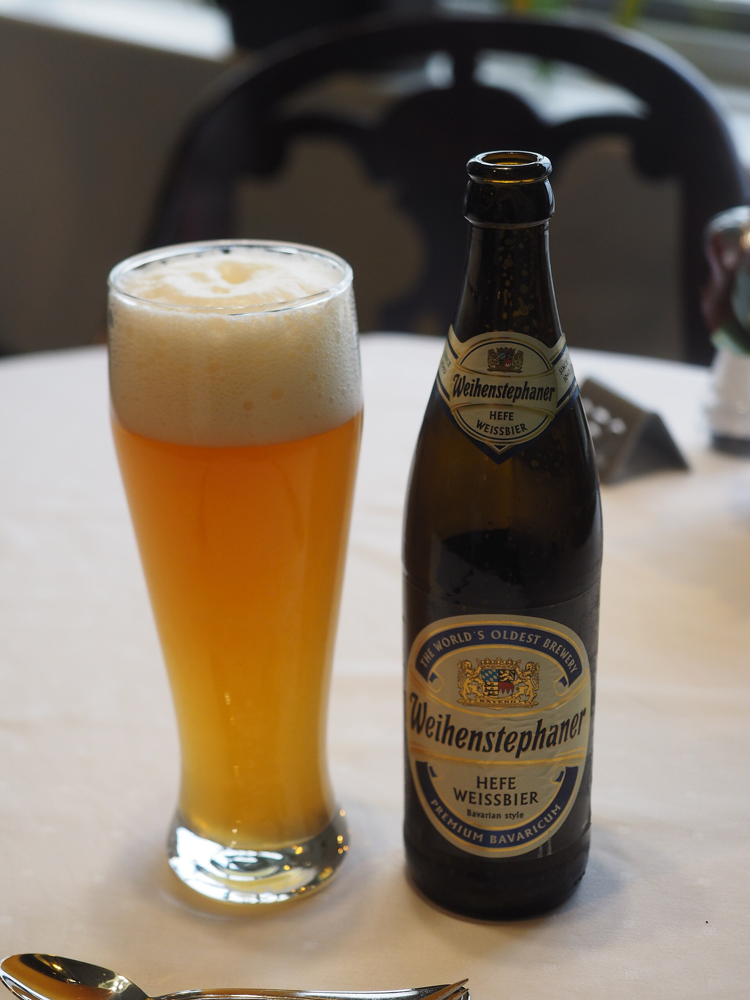

# Rheingau

Rheingau is the German appellation on the right bank of the Rhine below the Taunus hills, known for Riesling on south-facing slopes and for Spätburgunder in Assmannshausen. It is small in area but one of the German regions where the dry Riesling tradition is most concentrated.

Figure: Rheingau. Photograph: File:Weihenstephaner Hefe Weissbier aboard Viking Mariella.jpg. Credit: JIP, CC BY-SA 4.0 ([source page](https://commons.wikimedia.org/wiki/File:Weihenstephaner_Hefe_Weissbier_aboard_Viking_Mariella.jpg)). Category image; not a claim that it shows the exact product, site or event.

## Definition and scope

Rheingau is a protected appellation name, and its grapes must come from the demarcated strip on the right bank of the Rhine and be made within it. The region runs west from Hochheim on the Main to Lorch, with its main body between Wiesbaden and Rüdesheim.

White wine dominates, with Riesling at about three quarters of the planted area; reds are mainly Spätburgunder, with Assmannshausen as the traditional core.

## History

Rheingau's winemaking history is inseparable from its monasteries. Kloster Eberbach, founded in 1136, once held large slopes, and its cellars and buildings survive as the region's central historic landmark.

Schloss Johannisberg has grown Riesling since 1720 and is treated as an early example of single-variety Riesling planting. The story that the 1775 harvest was delayed by a late courier, and that the overripe grapes made a new style later called Spätlese, is closer to an origin narrative than to strict documentary fact.

In the 19th century the Geisenheim institute for viticulture and pomology was founded and became a major centre of German wine science.

## Geography and climate

Rheingau lies on the right bank of the Rhine, with slopes facing south or south-west, the Taunus hills blocking cold northerly winds and the river reflecting light and heat. This combination of a sunny slope and a sheltered position gives the region a longer heat sum than its latitude would suggest.

The climate is temperate continental, with warm summers and dry autumns, and ripening is more reliable than in the Mosel. Soils are varied, including Taunus quartzite, schist, loess and river gravel, and differences in drainage and heat retention create site variation.

Slopes are steep, and some sites need stone terraces and manual transport. Mechanisation is limited, labour costs are high, and yields are usually lower than in flat regions.

## Sub-zones and sites

Rheingau does not use river-section sub-zones in the Mosel manner, and labels distinguish styles mainly by village and site names.

- East: Hochheim and Wicker near the Main, warmer, with fuller wines.
- Centre: Eltville, Kiedrich, Hattenheim, Oestrich and Winkel, the core Riesling zone.
- West: Geisenheim, Johannisberg, Rüdesheim and Assmannshausen, with steeper slopes and both Riesling and reds.
- Far west: Lorch, close to the Middle Rhine, with a cooler style.

Village and site names are geographical descriptions, not a quality ranking, and variation within a village is often greater than between villages.

## Varieties and raw material

Riesling is the leading variety, thin-skinned and late-ripening, able to keep high acidity and clear fruit in a dry style. Spätburgunder stands out in Assmannshausen, with fuller body than most German reds.

Other varieties include Weißburgunder, Grauburgunder, Chardonnay and a little Müller-Thurgau, mostly to add body or for blending. The raw material is [grape](ref:grape).

## Winemaking

Riesling is usually whole-bunch pressed, settled and [fermented](ref:fermentation) cool, in stainless steel or large old oak. Dry wines emphasise [acidity](ref:acidity) and structure, often gaining texture from lees contact, but new oak is rare.

Spätburgunder usually ferments with the skins, sometimes in open vats with manual punching down, then ages in old oak. Here the [oak cask](ref:oak-ageing) serves structure rather than covering the fruit.

Sweet wines keep sugar by stopping fermentation or by adding unfermented grape juice; Prädikatswein may not be enriched with sugar before fermentation to raise alcohol.

## Classification and rules

German wine is divided into Wein, Landwein, Qualitätswein and Prädikatswein. Prädikatswein is graded by ripeness at harvest into Kabinett, Spätlese, Auslese, Beerenauslese, Trockenbeerenauslese and Eiswein; the level describes must weight at harvest and does not determine the sweetness of the finished wine.

Rheingau's hallmark is a strong dry tradition. Trocken on the label means residual sugar no higher than 9 g/L, halbtrocken means 9–18 g/L, and feinherb is a common but unregulated term broadly covering semi-dry to lightly sweet. Kabinett and Spätlese can both be made trocken, so a higher level does not mean sweeter.

Erstes Gewächs and Großes Gewächs are private classifications of Rheingau producer associations and the VDP, used for top dry wines, not state grades. They should be read separately from the Prädikat level and from village and site names.

## Labels and serving

The label should be checked for Rheingau, village and site, vintage, Prädikat level or trocken indication, alcohol, volume and bottler. The AP number traces the official quality-test batch.

Dry Riesling is best at 10–12 degrees Celsius, and sweet styles cooler. High acidity suits pork, poultry, river fish and Asian dishes; Spätburgunder suits poultry, mushrooms and medium-weight red meat. Once opened, keep chilled and finish soon. Excessive drinking is harmful to health and minors should not drink.

## Common misconceptions

First, assuming Rheingau Riesling is always sweet. The region is known for a dry tradition, and trocken wines are a large share.
Second, treating the Prädikat level as a sweetness scale. The level is ripeness at harvest, and sweetness depends on fermentation and how it is stopped.
Third, treating Erstes Gewächs as a state grade. It is a private mark of producer associations.
Fourth, thinking the reds of Assmannshausen are another variety. The local core is still Spätburgunder.
Fifth, lumping Rheingau with the Mosel. Climate, soils and the share of dry wines differ clearly.

**Short definition:** The German appellation on the right bank of the Rhine below the Taunus hills, known for Riesling on south-facing slopes and for Spätburgunder in Assmannshausen; the 1775 late-harvest story at Johannisberg is often treated as the origin of Spätlese; the region centres on a dry Riesling tradition while retaining the Prädikat ladder from Kabinett to Trockenbeerenauslese, and trocken and halbtrocken are taste indications on the label rather than grades.

## Further reading

- [Germany](ref:germany): the national appellation framework that contains Rheingau.
- [Wine](ref:wine): an overview of wine categories, vintage and origin rules.
- [White wine](ref:white-wine): the category to which Riesling belongs.
- [Red wine](ref:red-wine): the category to which Spätburgunder belongs.
- [Grape](ref:grape): the structure and ripeness markers of wine grapes.
- [Fermentation](ref:fermentation): the difference between cool fermentation, stopped fermentation and enrichment.
- [Acidity](ref:acidity): the role of high acidity in dry Riesling.
- [Alcohol by volume](ref:abv): how Prädikat levels relate to alcohol.
- [Oak ageing](ref:oak-ageing): the role of old oak for Riesling and Spätburgunder.
