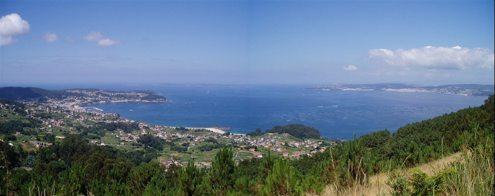

# Rías Baixas

Rías Baixas is a wine denomination in Galicia, north-west Spain, based mainly in Pontevedra province and known for its Atlantic climate, granite soils and Albariño. It is not a single estate but a DO built from five sub-zones, and it only took its present legal name in 1988.

Figure: Rías Baixas. Image: No machine-readable author provided. Triart3d assumed (based on copyright claims)., Public domain, via Wikimedia Commons ([source page](https://commons.wikimedia.org/wiki/File:Panoramica_bueu_1.jpg)).

## Definition and boundaries

The name means "lower estuaries", referring to the river mouths and valleys that open onto the Atlantic in south-west Galicia. The area covers most of Pontevedra province, with part of Ribeira do Ulla extending into A Coruña. Under the EU single document, vineyards in the legal area lie below 300 metres, on valley floors, footslopes and granite hills.

According to the denomination's promotional body, the vineyard covers about 10,677 acres, roughly 4,320 hectares, worked by some 6,500 growers across more than 22,800 plots, with about 180 registered wineries. This fragmentation shapes both the landscape and the cost structure, and explains why many wines are built from small-plot blends.

## From varietal denomination to DO

The modern starting point was the 1980 Denominación Específica Albariño, a denomination created specifically for the Albariño grape. In 1988, after Spain joined the European Community, the name became Denominación de Origen Rías Baixas, because Community wine law did not allow a region to be named after a single variety. A regulation approved that year set the sub-zone boundaries and production rules.

This history explains a common oddity: the region's international reputation is tied to one variety, yet its legal name must be a place name. The change was not a clerical detail. It turned a variety brand into a geographic brand and gave the other permitted varieties a legal place.

## Atlantic climate and granite

The climate is Atlantic: mild, wet winters, summers that never become truly hot, high year-round humidity, and sea breezes tempered by the estuaries. Compared with inland Spain, ripening is slower and the day-night range is smaller, so acidity is retained. Rain and humidity also bring disease pressure, which pushes growers towards taller trellising and open canopies.

Bedrock is mostly granite, with coarse sand, gravel and some alluvium on top. Weathered granite gives fast-draining, low-fertility sandy soils; roots must search deeper for water and nutrients, which is held to concentrate flavour. Soil and sea air together form the [terroir](ref:terroir) of the region.

## The five sub-zones

The legal area is made up of five sub-zones with different climates and varieties:

- Val do Salnés: the historic heart, the largest and most Atlantic sub-zone, cool and humid, on granite and sand, overwhelmingly Albariño.
- Condado do Tea: in the south, further inland on the upper Miño, warmer, with a stronger presence of Treixadura.
- O Rosal: south-facing slopes above the lower Miño, influenced by river breezes, where Albariño may be blended with Loureira and Caíño Blanco for a more open aroma.
- Soutomaior: the smallest sub-zone, centred on a single valley, with limited volume.
- Ribeira do Ulla: the northernmost, partly in A Coruña, and the most recently formed sub-zone.

These sub-zones are legal geographic units, not quality ranks. Whether a sub-zone appears on a label depends on the producer and the rules; its absence does not mean a lesser blend.

## Albariño and other varieties

Albariño dominates, with thicker skins, high acidity and aromas of apple, citrus, white flowers and stone fruit, often with a faint saline note. Its performance here resembles Alvarinho in northern Portugal, though ripeness and style differ.

Other permitted whites include Loureira, Treixadura, Caíño Blanco, Torrontés and Godello. Red varieties such as Caíño Tinto, Espadeiro, Sousón and Mencía occupy very little ground and have only recently been revisited. The raw material is [grape](ref:grape), and variety shares decide what a label may claim.

## Winemaking and labelling

Whites are usually [fermented](ref:fermentation) cool, mostly in stainless steel, to preserve aroma and [acidity](ref:acidity). Some wines spend extended time on [lees](ref:lees-ageing) for texture, and some see a short period in oak, which allows the mention Rías Baixas Barrica. Avoiding excessive oxidation is the central technical concern.

Maximum yields are 12,500 kilograms of grapes per hectare or 90 hectolitres of wine per hectare. A wine labelled Rías Baixas Albariño must be made entirely from Albariño; a wine naming a sub-zone must meet that sub-zone's origin and variety rules. Labels should also be checked for [alcohol](ref:abv), volume and bottler. Most wines are [dry](ref:dry), though a few keep some residual sugar.

## Serving and misconceptions

Rías Baixas whites are best at about 8 to 10 degrees Celsius, with shellfish, fish, rice dishes and light poultry. Their acidity handles lemon and vinegar but not heavy red-meat sauces. Refrigerate after opening and finish soon.

There are four common misconceptions. First, that the region has only one variety: Albariño leads, but several whites and a little red are permitted. Second, that Rías Baixas is a brand: it is a geographic indication, separate from winery and brand names. Third, that a northern sub-zone is automatically better: sub-zones are geographic units, and stylistic difference is not a quality ranking. Fourth, that every wine must be drunk immediately: some lees- or oak-treated wines can age briefly.

**At a glance:** Wine DO in Galicia, north-west Spain, based mainly in Pontevedra. It began in 1980 as the Denominación Específica Albariño and became Rías Baixas in 1988; it has five sub-zones, Val do Salnés, Condado do Tea, O Rosal, Soutomaior and Ribeira do Ulla. The legal area lies below 300 metres, with about 4,320 hectares (10,677 acres), around 6,500 growers, more than 22,800 plots and some 180 registered wineries; maximum yields are 12,500 kg per hectare (90 hectolitres per hectare), and Albariño dominates.

**Key facts.**

| Item | Detail |
| --- | --- |
| In one line | Wine DO in Galicia, north-west Spain, based mainly in Pontevedra. It began in 1980 as the Denominación Específica Albariño and became Rías Baixas in 1988; it has five sub-zones, Val do Salnés, Condado do Tea, O Rosal, So… |
| Level | other |
| Parent | Spain |
| Country code | ES |

## References

- [Wine](ref:wine): the broad categories and origin rules.
- [White wine](ref:white-wine): the framework for white winemaking and style.
- [Spain](ref:spain): the wider map of Spanish wine regions.
- [Albariño](ref:albarino): the region's leading variety.
- [Fermentation](ref:fermentation): cool fermentation and aroma retention.
- [Acidity](ref:acidity): how an Atlantic climate preserves acidity.
- [Terroir](ref:terroir): granite, sea air and sub-zone differences.
- [Grape](ref:grape): ripeness measures for wine grapes.
- [Dry](ref:dry): dry styles versus residual sugar.
- [Lees ageing](ref:lees-ageing): how extended lees contact changes texture.
- [Alcohol by volume](ref:abv): what % vol means on a label.
