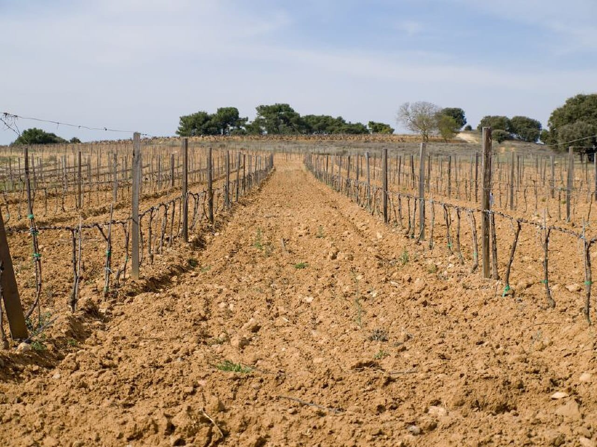
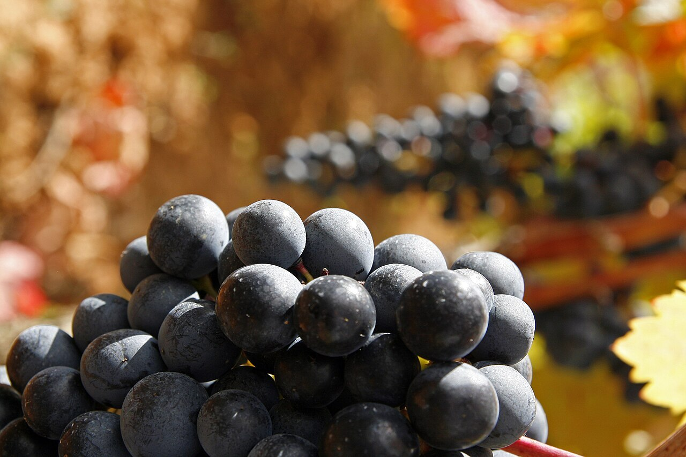

# Ribera del Duero

Ribera del Duero is a wine appellation along the Duero river in Castilla y León, [Spain](ref:spain), based on [Tempranillo](ref:tempranillo), known locally as Tinto Fino. Vineyards sit on a high plateau at about 700–1000 metres, and the [red wines](ref:red-wine) are known for structure, ripe fruit and oak ageing.

Figure: Ribera del Duero. Photograph: Clear cultivation in Viñedos en la Ribera del Duero. Credit: Raúl Hernández González, CC BY 2.0, via Wikimedia Commons ([source](https://commons.wikimedia.org/w/index.php?curid=16192222)).

## Geography and climate

Ribera del Duero lies on the northern plateau of Spain, with the Duero running east to west and vineyards on terraces and slopes on both sides at about 700–1000 metres. The climate is extreme continental: hot summers, cold winters, large day-night swings and a short growing season.

High altitude and cool nights let the grapes accumulate sugar while keeping acidity; spring frost and early autumn frost are the main risks. Vintages differ clearly, and the same parcel can vary greatly in ripeness and yield from year to year.

## History

The modern reputation of Ribera del Duero is linked to long practice at estates such as Vega Sicilia from the late 19th century onwards. The region gained appellation status in 1982 and then expanded quickly in international markets, becoming one of Spain's most important red-wine regions.

History and the market together shaped its style: Tempranillo as the core, with an emphasis on ripe fruit, structure and oak ageing. Compared with Rioja, the overall style is more concentrated and fuller in body.

## Area and sub-zones

The appellation covers parts of Valladolid, Burgos, Soria and Segovia, along the Duero and its tributaries. Altitude, soil and aspect differ from one section to another, producing differences in ripeness.

Unlike Rioja, Ribera del Duero has no fixed three sub-zones; it can be roughly divided by position along the river: the west and centre are higher and cooler, while some eastern parcels are warmer. Village and estate information on the label is more useful than a "sub-zone" claim.

## Varieties and styles

[Red wine](ref:red-wine) is mainly [Tempranillo](ref:tempranillo), called Tinto Fino locally, often blended with [Garnacha](ref:grenache), [Cabernet Sauvignon](ref:cabernet-sauvignon) and [Merlot](ref:merlot). Tempranillo brings black cherry, plum and tobacco; Cabernet Sauvignon and Merlot add structure and aromatic layers.

White wine is very small in volume, mainly from local white grapes such as Albillo. The region centres on red wine, and whites are mostly fresh in style rather than a market focus.

## Ageing tiers

Common red tiers are: Crianza with a minimum of 24 months, at least 12 of them in oak; Reserva with a minimum of 36 months, at least 12 in oak; Gran Reserva with a minimum of 60 months, at least 24 in oak.

Ageing uses [oak barrels](ref:oak-ageing), with French oak and mixed oak common. The proportion of new wood, the toast level and the length of ageing decide vanilla, spice and tannin feel; some estates deliberately reduce new oak to preserve fruit. See [fermentation](ref:fermentation) for the basic process.

## Soils and terrain

Soils are mainly limestone, chalk and alluvial soil, with some parcels containing gravel and clay. Drainage and water retention differ clearly, affecting root depth and the pace of ripening; higher parcels usually keep better acidity, while lower parcels ripen more.

The terrain is a plateau and river valley, with aspect and the river moderating temperature. South-facing slopes are warmer, and parcels near the river have higher humidity and different frost risk. Soil and terrain together form the region's stylistic base.

## Labels and vintage

Labels usually carry D.O. Ribera del Duero, vintage, alcohol, volume and bottler. Crianza, Reserva and Gran Reserva are ageing terms, not quality grades; the same term can perform very differently between estates.

Vintage reflects the weather of that year. Spring frost, summer heat and autumn rain all affect ripeness and yield, so vintage should be read together with estate and parcel rather than with the term alone.

## Market and drinking

Ribera del Duero is a major source of expensive Spanish reds, with prices from everyday wines to top estates. The market has long swung between "rich barrel-aged" and "fruit and acidity preserved" styles.

Reds commonly have about 13.5%–15% [alcohol by volume](ref:abv) and suit grilled meat, braised meat, game, mushrooms and hard cheese at about 16–18 degrees Celsius. Decanting for 30–60 minutes can help, depending on vintage and wine. Excessive drinking harms health and minors should not drink.

## Common misconceptions

First, equating Ribera del Duero with Rioja. They share varieties, but climate, altitude and stylistic focus differ.
Second, assuming all Ribera del Duero reds are heavy. Vintage, parcel and estate make a clear difference.
Third, treating Tinto Fino as a separate variety. It is the local name for Tempranillo.
Fourth, treating Gran Reserva as a quality guarantee. The term describes ageing, not a guarantee for every bottle.
Fifth, confusing "Ribera" with "Ribera del Guadiana". The latter is a different Spanish region.

For Ribera del Duero, begin with the appellation and its permitted varieties. Then look at the vintage and the producer, and finally ask how the wine is labelled. The answers point to different choices, not to a single score.

**In brief:** A wine appellation along the Duero river in Castilla y León, Spain, based on Tempranillo, known locally as Tinto Fino; vineyards sit on a high plateau at about 700–1000 metres in an extreme continental climate, and the reds are known for structure, ripe fruit and oak ageing, classified as Crianza, Reserva and Gran Reserva. 

The usual confusion is to treat Ribera del Duero as an administrative place name. Check what it is first, then where it belongs; the two need not agree.

**Key facts.**

| Item | Detail |
| --- | --- |
| In one line | A wine appellation along the Duero river in Castilla y León, Spain, based on Tempranillo, known locally as Tinto Fino; vineyards sit on a high plateau at about 700–1000 metres in an extreme continental climate, and the r… |
| Level | other |
| Parent | Spain |
| Country code | ES |

**Sources and limits.** The key claims about Ribera del Duero are checked against the following sources: Consejo Regulador de la D.O. Ribera del Duero (the area, varieties and ageing tiers of Ribera del Duero), European Union (EU wine categories, geographical indications and traditional terms), Oxford University Press (Consulted for entries on Ribera del Duero, Tempranillo and Vega Sicilia; Migrated from the former reference list at the end of the article; access date not re-verified). Prices, batches and status change; the body is project-written and does not reproduce source text.

## Further reading

- [Spain](ref:spain): the national framework to which Ribera del Duero belongs.
- [Tempranillo](ref:tempranillo): the core variety of Ribera del Duero, called Tinto Fino locally.
- [Garnacha](ref:grenache), [Cabernet Sauvignon](ref:cabernet-sauvignon) and [Merlot](ref:merlot): common companion varieties.
- [Red wine](ref:red-wine): the region's most representative category.
- [Oak ageing](ref:oak-ageing): the key process behind Crianza and Reserva tiers.
- [Fermentation](ref:fermentation): the basic step of winemaking.
- [Wine](ref:wine): an overview of wine categories, vintages and origin rules.
- [Alcohol by volume](ref:abv): what 13.5%–15% vol means on a label.

## Related images

Image: Tempranillo grapes from Rioja Alavesa. Credit: María Jesús Tomé, CC BY 2.0, via Wikimedia Commons.. Credit: María Jesús Tomé, CC BY 2.0, via Wikimedia Commons ([source page](https://commons.wikimedia.org/w/index.php?curid=16191821)). Related image for Ribera del Duero.

Image: Grenache. Credit: Jules Troncy, Public domain, via Wikimedia Commons ([source page](https://commons.wikimedia.org/wiki/File:Grenache_N.jpg)). Related image for Ribera del Duero.
