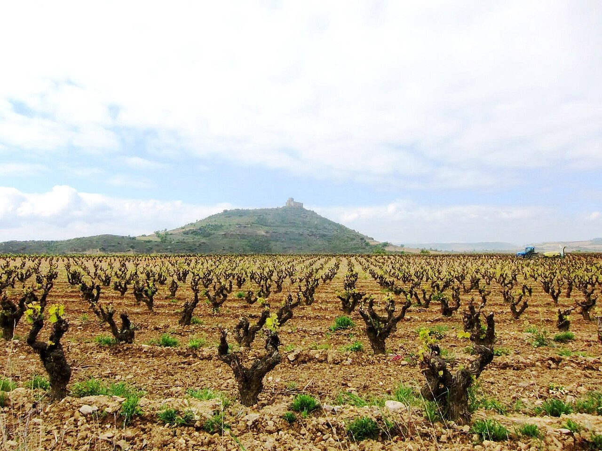

# Rioja

Rioja is a wine appellation in the upper Ebro valley of [Spain](ref:spain), based on [Tempranillo](ref:tempranillo). It is divided into Rioja Alta, Rioja Alavesa and Rioja Oriental, and [red wines](ref:red-wine) are classified by Crianza, Reserva and Gran Reserva ageing.

Figure: Rioja. Photograph: A Rioja Vineyard - panoramio. Credit: Art Anderson, CC BY-SA 3.0, via Wikimedia Commons ([source](https://commons.wikimedia.org/w/index.php?curid=56546384)).

## Geography and climate

Rioja lies in the Ebro valley and its tributaries in northern Spain, with vineyards on hills and terraces at about 400–700 metres. The climate is influenced by both the Atlantic and the Mediterranean: the west is cooler and wetter, the east warmer and drier.

Day-night temperature swings and autumn rain set the pace of ripening. The Cantabrian mountains block some Atlantic moisture, creating clear differences within the region; the same variety can show different acidity and fruit ripeness in the west and the east.

## History

Rioja's modern wine industry grew quickly in the late 19th century, partly because French vineyards hit by phylloxera left a gap in the market. Early in the 20th century the region began to codify its rules, gained appellation status in 1925, and in 1991 became Spain's first DOCa.

The ageing tradition built up over that history made terms such as Crianza, Reserva and Gran Reserva central to Rioja labels. Understanding these terms matters more than memorising any one estate's history.

## Sub-zones

- Rioja Alta: the western part, higher and cooler, where Tempranillo is tighter with clearer acidity.
- Rioja Alavesa: north of the Ebro, with many limestone soils, usually lighter in body and finer in aroma.
- Rioja Oriental: the warmer, drier eastern part, with a higher share of Garnacha and riper fruit.

The three sub-zones are stylistic differences, not a quality ranking. One estate may buy grapes across sub-zones, and the sub-zone on the label should be read against the rules and the actual source.

## Varieties and styles

[Red wine](ref:red-wine) is mainly [Tempranillo](ref:tempranillo), often blended with [Garnacha](ref:grenache), Graciano and Mazuelo. Tempranillo brings red cherry, plum and tobacco; Garnacha adds ripe fruit and alcohol; Graciano lifts acidity and aroma.

[White wine](ref:white-wine) is mainly Viura, with Malvasía and white Garnacha also used. Whites range from fresh citrus to barrel-aged nut and cream notes, and their volume is far smaller than that of the reds.

## Ageing tiers

Common red tiers are: Crianza with a minimum of 24 months, at least 12 of them in oak; Reserva with a minimum of 36 months, at least 12 in oak; Gran Reserva with a minimum of 60 months, at least 24 in oak. Reserva rosé and white wines have a minimum of 24 months, at least 6 in oak.

Ageing uses [oak barrels](ref:oak-ageing); American oak was historically common, and modern estates also use French oak or a mix. The proportion of new wood, the toast level and the length of ageing decide vanilla, spice and tannin feel. See [fermentation](ref:fermentation) for the basic process.

## Soils and terrain

Rioja's soils vary: the west and Alavesa have much limestone and clay, while the east has more alluvial soil and gravel. Drainage and water retention differ clearly between parcels, affecting root depth and the pace of ripening.

The terrain centres on the Ebro valley, with vineyards on slopes and terraces on both sides. Aspect, altitude and distance from the river together decide temperature and humidity, which is the physical basis of the sub-zone differences.

## Labels and vintage

Labels usually carry DOCa Rioja, the sub-zone, vintage, alcohol, volume and bottler. Crianza, Reserva and Gran Reserva are ageing terms, not quality grades; the same term can perform very differently between estates.

Vintage reflects the weather of that year. Rioja vintage differences mainly show in ripeness, acidity and yield, so vintage should be read together with sub-zone and estate rather than with the term alone.

## Market and drinking

Rioja is one of Spain's largest wine-exporting regions, with prices from everyday wine to expensive Gran Reserva. The market has long swung between "traditional long barrel ageing" and "modern fruit-first" styles.

Reds commonly have about 13%–14.5% [alcohol by volume](ref:abv) and suit grilled meat, braised meat, mushrooms and hard cheese at about 16–18 degrees Celsius. Whites suit seafood and soft cheese at about 8–10 degrees Celsius. Excessive drinking harms health and minors should not drink.

## Common misconceptions

First, equating Rioja with red wine. The region also makes white wine and rosé.
Second, treating Crianza as a young wine. It requires at least 24 months of ageing.
Third, assuming Gran Reserva is always better than Reserva. The term describes ageing, not a guarantee for every bottle.
Fourth, thinking Rioja uses only Tempranillo. Garnacha, Graciano and Mazuelo also take part in blends.
Fifth, thinking longer barrel ageing is always better. Too long can mask fruit, and style depends on the target.

**In brief:** A wine appellation in the upper Ebro valley of northern Spain, based on Tempranillo and divided into Rioja Alta, Rioja Alavesa and Rioja Oriental; reds are classified by Crianza, Reserva and Gran Reserva ageing, and styles range from fresh red fruit to spice and leather from long barrel ageing.

For Rioja, begin with the appellation and its permitted varieties. Then look at the vintage and the producer, and finally ask how the wine is labelled. The answers point to different choices, not to a single score.

The comparison with [Spain](ref:spain) and [Grenache](ref:grenache) runs through geographic boundary and climate and soil. Each answers a different question.

Treating Rioja as an administrative place name mixes two different questions: identity and use. Separate them before comparing.

Sources for Rioja include Consejo Regulador de la DOCa Rioja, European Union, Oxford University Press.

Rioja is divided into Alta, Alavesa and Oriental, and its reds are classified by Crianza, Reserva and Gran Reserva.

**Key facts.**

| Item | Detail |
| --- | --- |
| In one line | A wine appellation in the upper Ebro valley of northern Spain, based on Tempranillo and divided into Rioja Alta, Rioja Alavesa and Rioja Oriental; reds are classified by Crianza, Reserva and Gran Reserva ageing, and styl… |
| Level | other |
| Parent | Spain |
| Country code | ES |

**Sources and limits.** The key claims about Rioja are checked against the following sources: Consejo Regulador de la DOCa Rioja (the sub-zones, varieties and ageing tiers of Rioja), European Union (EU wine categories, geographical indications and traditional terms; the minimum ageing and oak periods for Reserva and Gran Reserva), Oxford University Press (Consulted for entries on Rioja, Tempranillo and Garnacha; Migrated from the former reference list at the end of the article; access date not re-verified). Prices, batches and status change; the body is project-written and does not reproduce source text.

## Further reading

- [Spain](ref:spain): the national framework to which Rioja belongs.
- [Tempranillo](ref:tempranillo): the core red variety of Rioja.
- [Garnacha](ref:grenache): an important companion variety in Rioja reds.
- [Red wine](ref:red-wine) and [white wine](ref:white-wine): the two basic categories of Rioja.
- [Oak ageing](ref:oak-ageing): the key process behind Crianza and Reserva tiers.
- [Fermentation](ref:fermentation): the basic step of winemaking.
- [Wine](ref:wine): an overview of wine categories, vintages and origin rules.
- [Alcohol by volume](ref:abv): what 13%–14.5% vol means on a label.
