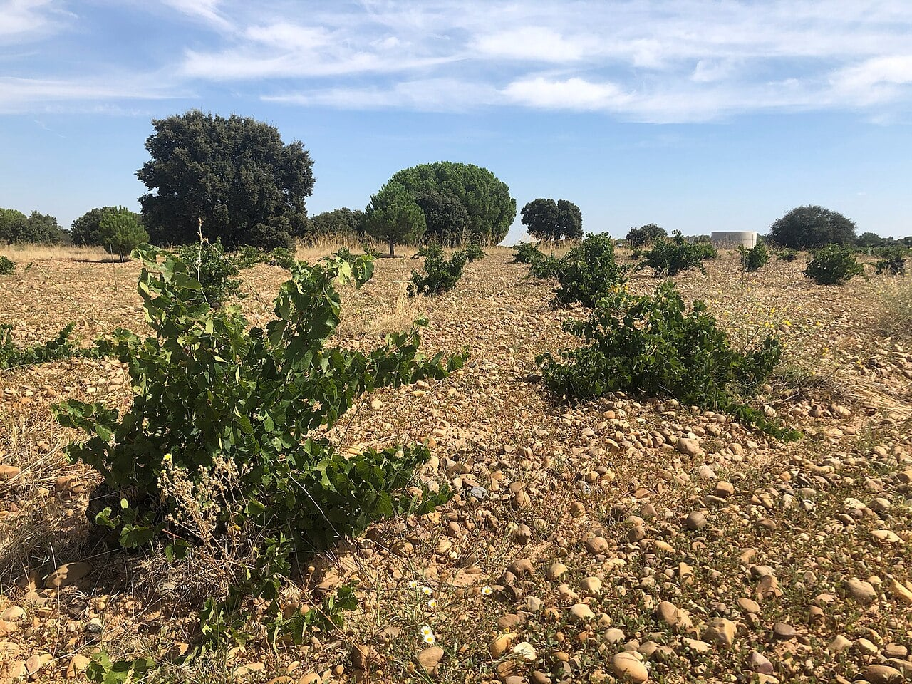

# Rueda

Rueda is a white-wine denomination in Castilla y León, Spain, on the high plains of the upper Duero. It built its international reputation on Verdejo and became the autonomous community's first DO in 1980, making it central to any account of modern Spanish white wine.

Figure: Old vines on stony ground at the Martinsancho vineyard in Rueda. Image: Carlosmartinmm34, CC BY-SA 4.0, via [source page](https://commons.wikimedia.org/wiki/File:Martinsancho_Vineyard.jpg).

## A white-wine region on a plateau

Rueda lies in the middle of Castilla y León, with vineyards spread across 74 municipalities where the provinces of Valladolid, Segovia and Ávila meet. Whites dominate, with a little red and rosé. The region is tied to the Rueda river to the north and to terraces of the Duero and its tributaries, the Trabancos, Zapardiel and Adaja.

Average altitude is far above most Spanish DOs: vineyards sit between 700 and 870 metres. That height pulls Rueda away from a classic lowland Mediterranean climate and gives it a continental character, which is why it stands out as a cool spot on the Spanish white-wine map.

The Duero is still a young river here, its valley not yet deeply cut and its plateaus open. That shape lets cold air settle low at night and creates clear temperature layers, so producers prefer slopes and well-drained gravel highs to frost-prone valley floors.

## 1980 and a first for Castilla y León

Rueda's modern institutional history can be dated precisely: on 12 January 1980 the Spanish Ministry of Agriculture granted DO status, making it the first official wine appellation in Castilla y León. Producers had campaigned for recognition and protection for years before that, and a provisional regulatory board had been formed in 1977.

Being first brought institutional advantages: Rueda established variety and yield rules early and moved Verdejo from a blending component to the foreground. The regulatory council still handles back labels, vintage ratings and legal categories, including Gran Vino de Rueda, introduced in 2021.

## Altitude and a continental climate

Winters are cold and very long, springs are short and late frosts are frequent, and summers are hot and dry with occasional thunderstorms. Annual rainfall is only 300 to 500 litres per square metre, so roots must go deep for water. Sunshine can reach 2,600 hours a year; without the cool nights that altitude brings, that much sun would be excessive.

The day-night range is the region's central mechanism: daytime heat drives sugar accumulation while cold nights retain acidity, so the grapes ripen with a clear structure. Late frost is the main risk. Late budding, with pruning often running into March or early April, is the response to it.

Beyond frost, summer thunderstorms and hail can damage canopy and fruit in a short time, and dry years cut yields further. Growers spread risk by choosing well-drained sites, keeping cover crops and harvesting in passes, which is one reason vintages here differ noticeably.

## Ten centuries of Verdejo

Verdejo has been grown in Rueda for more than ten centuries. It has thicker skins and high acidity, with aromas of wild herbs, fennel, citrus and stone fruit, and a palate marked by extract and a slight bitter finish. That bitterness is not a defect; it is part of what makes many Rueda whites recognisable.

In the 2025 harvest, Verdejo accounted for 88.82% of the crop and white varieties for 99.77% in total. Such concentration on one variety is rare among European DOs. Sauvignon Blanc is also permitted and is often used to add aromatic tension; red varieties such as Tempranillo occupy only a small share, mostly for rosé or lighter reds.

## Gravel terraces, old vines and viticulture

Soils are mainly alluvial and diluvial terraces of the Duero and its tributaries: brown soils rich in calcium and magnesium, sandy loam to loam in texture, well drained, with limestone outcrops on the tops of the rolling hills. The best vineyards often sit on the typical gravel plots, where stones absorb heat by day and release it at night while keeping water moving.

Vines are mostly trained low, as bushes or short trellises, and rely on rainfall. Old vines are not a legal grade, but low-yielding old plots do offer more concentration. Drip irrigation and cover crops are being adopted against drought, although irrigation is limited by DO rules and water management.

## Rules and labels

Yields, variety shares and ageing are set in the regulatory council's rules. Labels may read Rueda, Rueda Verdejo or Rueda Sauvignon Blanc, each with different variety requirements; a wine labelled Rueda Verdejo must be based on Verdejo, with the exact share set by the official specification. Gran Vino de Rueda is a fine-dining category with stricter rules on yields and origin.

Buyers should check the region, variety, vintage and [alcohol](ref:abv), and should distinguish "Rueda" from "Rueda Verdejo". Not every Rueda white is Verdejo-led, and blends and single-variety wines follow different rules.

## At the table and common misconceptions

Rueda whites are best at about 8 to 10 degrees Celsius, with seafood, white meat, salads, soft cheese and herb-scented dishes. Too cold and the aroma shuts down; too warm and the acidity feels loose, so avoid leaving the bottle at room temperature. Wines given [lees](ref:lees-ageing) contact or oak suit grilled fish and cream sauces and age better. Most are [dry](ref:dry), and acidity is the core of food matching.

Three misconceptions recur. First, that Rueda means Verdejo only: Sauvignon Blanc and a few red varieties are also legal. Second, that high altitude means a cold region: Rueda summers are still hot, and the day-night range matters more than absolute temperature. Third, that every Rueda must be drunk young: some lees- or oak-treated wines keep for several years.

The comparison with [Wine](ref:wine) and [Spain](ref:spain) runs through geographic boundary and climate and soil. Each answers a different question.

**Short definition:** White-wine DO in Castilla y León, Spain, granted official status on 12 January 1980 and the autonomous community's first DO. Its area covers 74 municipalities in Valladolid, Segovia and Ávila. Vineyards sit at 700–870 metres, annual rainfall is only 300–500 litres per square metre and sunshine reaches 2,600 hours a year. Verdejo dominates, at 88.82% of the 2025 harvest; gravel terraces and a wide day-night range shape the high-acid, herbal and citrus style.

## References

- [Wine](ref:wine): the broad categories and origin rules.
- [White wine](ref:white-wine): the framework for white winemaking and style.
- [Spain](ref:spain): the wider map of Spanish wine regions.
- [Tempranillo](ref:tempranillo): the red variety behind Rueda's small red production.
- [Sauvignon Blanc](ref:sauvignon-blanc): a white variety used to add aromatic tension.
- [Fermentation](ref:fermentation): cool fermentation and aroma retention.
- [Acidity](ref:acidity): how the day-night range preserves acidity.
- [Terroir](ref:terroir): altitude, gravel and a continental climate.
- [Lees ageing](ref:lees-ageing): how extended lees contact changes texture.
- [Dry](ref:dry): dry styles versus residual sugar.
- [Alcohol by volume](ref:abv): what % vol means on a label.
