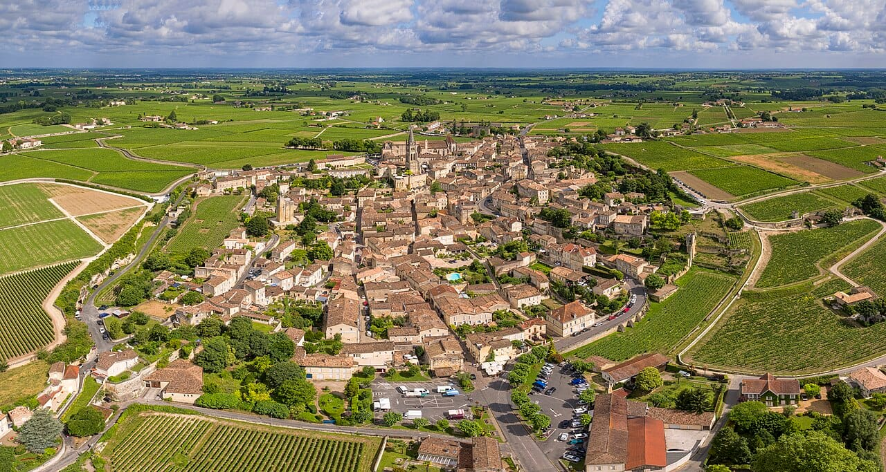

# Saint-Émilion

Saint-Émilion is the Bordeaux Right Bank region most easily hidden by its classification. People remember the list that began in 1955 and overlook two more basic appellation rules: the Saint-Émilion AOC and the Saint-Émilion Grand Cru AOC. The first caps yield at 46 hectolitres per hectare; the second tightens it to 40 and requires at least 12 months' ageing and bottling at the estate. The classified list is a further layer on top of those rules. Read in the opposite order, "Grand Cru" looks like the top tier, which it is not.

Figure: Saint-Émilion. Image: Chensiyuan, CC BY-SA 4.0, via Wikimedia Commons ([source page](https://commons.wikimedia.org/wiki/File:1_Saint-%C3%89milion_aerial_pano_2016.jpg)).

## Geography and scope

Saint-Émilion lies in the Gironde, north-east of Libourne, with vineyards on the plateau, slopes and valley floors around the medieval town. The legal area covers 9 communes: Saint-Émilion, Saint-Christophe-des-Bardes, Saint-Étienne-de-Lisse, Saint-Hippolyte, Saint-Laurent-des-Combes, Saint-Pey-d'Armens, Saint-Sulpice-de-Faleyrens and Vignonet, plus a small southern part of Libourne. The two AOCs together cover about 5400 hectares and more than 800 estates, averaging about 8 hectares each; fragmented holdings are a basic fact of the region.

## Climate

The climate is maritime, but the Dordogne and Isle rivers help the area warm earlier in summer than the Left Bank, while autumn rain remains the main risk. The plateau drains quickly and warms early, suiting Merlot; valley floors are humid with poor air flow and carry more frost and mildew risk. Heat and drought have become more frequent, and estates respond by adjusting picking dates, keeping cover crops and managing the canopy. Vintage variation therefore shows not only in sugar but in acidity, tannin ripeness and the balance of alcohol.

## Soils and slope: four basic units

[Terroir](ref:terroir) here is usually described through four units: the limestone plateau, clay-limestone slopes, iron-rich sands and alluvial valley floors. The plateau is covered with starfish limestone (calcaire à astéries), with thin, free-draining soil that gives structure and a mineral edge; slopes mix Fronsadais clay (molasses du Fronsadais) with limestone debris, holding water and suiting Merlot's fuller fruit; local "iron dross" (crasse de fer) is sandy and iron-rich, drains extremely fast and is often linked to the floral, linear side of Cabernet Franc; valley alluvium is fertile and wet, usually used for younger vines or higher-yield wines. Relief is modest, but small changes in altitude, aspect and soil depth are enough to shift ripening.

## Varieties and blending

[Red wine](ref:red-wine) is based on [Merlot](ref:merlot), about 60% of plantings, with [Cabernet Franc](ref:cabernet-franc) at about 30% and Cabernet Sauvignon at about 10%, plus small amounts of Malbec and Petit Verdot. Merlot brings plum, black cherry, chocolate and supple tannin; Cabernet Franc adds flowers, pencil lead, pepper and structure; Cabernet Sauvignon fills in backbone and black fruit in warm years. Blends vary by estate, parcel and vintage; limestone plateau parcels often carry more Cabernet Franc, while clay slopes lean on Merlot. These wines do not aim for Left Bank Cabernet firmness but for texture, fruit density and layers of spice.

## Legal rules: two AOCs

The Saint-Émilion AOC and the Saint-Émilion Grand Cru AOC are two separate appellations, not a quality tier within one. Saint-Émilion caps yield at 46 hectolitres per hectare; Saint-Émilion Grand Cru tightens it to 40 and requires at least 12 months' ageing, bottling at the estate and two tasting checks. Both sets of rules cover varieties, minimum alcohol, pruning and harvest conditions. Calling Grand Cru a "great growth" is not wrong, but it is first an AOC name, not a seat on the 2022 classified list; the list covers only some estates inside the Grand Cru AOC.

## Classification: from 1955 to 2022

The Saint-Émilion classification was first drawn up in 1955 and has since been revised roughly every ten years, the only Bordeaux list that is regularly reordered. The 2022 edition was the 7th and was published on 8 September, listing 85 estates: 2 Premiers Grands Crus Classés A, 12 Premiers Grands Crus Classés and 71 Grands Crus Classés. The two A estates are Pavie and Figeac; Figeac was promoted from B in 2022. The review weighs track record, site, winemaking and market promotion, among other criteria, and is conducted by an independent panel; the whole list is re-examined each decade rather than held for life.

## Withdrawals and controversy

The most discussed feature of the 2022 list is who left. Ausone and Cheval Blanc announced in 2021 that they would not apply for review; Angélus withdrew on 5 January 2022, and La Gaffelière followed in June of the same year. All four still sell under the Saint-Émilion Grand Cru AOC; they simply no longer appear on the classified list. Their stated objections centred on the weight given to marketing, visitor facilities and "reputation", and on the difficulty of accommodating different approaches such as biodynamics and low intervention. The episode shows that the classification is both a quality signal and a commercial and institutional negotiation; the list needs to be read alongside the rules and the choices of individual estates.

## Satellite appellations

Four satellite AOCs surround Saint-Émilion: Montagne, Lussac, Puisseguin and Saint-Georges, all followed by "-Saint-Émilion". They share similar varieties and climate but differ in legal area, yield caps and market position, and usually sell below the core Saint-Émilion. They are not "lesser Saint-Émilion" but separately named origins; some parcels adjoin the core and the soils are continuous, so style differences often come more from the estate than from the boundary.

## Styles and vintages

Saint-Émilion usually drinks earlier than the Left Bank, with red cherry, plum, liquorice and cocoa when young, developing cedar, leather, truffle and earth with age. Good vintages and sites can still age for decades, depending on acidity, tannin quality and restrained extraction. 2018, 2019 and 2020 are generally seen as ripe, generous years; 2021 was cooler, with lighter bodies and higher acidity; 2022 was hot and dry, with higher alcohol and concentration, and estates preserved balance through early picking and gentle extraction. Vintage descriptions are tendencies, not uniform verdicts, and site and estate differences can outweigh the average.

## Producers

Beyond the 2022 list names such as Pavie, Figeac, Canon, Bélair-Monange, Beau-Séjour Bécot and Troplong Mondot, Saint-Émilion has Valandraud, Tertre Roteboeuf and La Mondotte, which drove the "garage wine" and low-yield approach, along with many small family estates. Ausone, Cheval Blanc, Angélus and La Gaffelière remain among the region's most important names even after leaving the classification. When judging a wine, classification, vintage, site, winemaking and bottling should be read together; looking only at rank turns an institutional label into a flavour judgement.

## Market and tourism

Saint-Émilion is the tourism centre of the Right Bank. The medieval town and its underground quarries were inscribed in 1999 as the "Jurisdiction of Saint-Emilion" on the UNESCO World Heritage list; the Jurade, dating from the 12th century, still acts as an ambassador for the region and runs a spring tasting. Sales run through the en primeur system, the négociant network and exports, with China, the United States, Japan and Europe as important buyers; satellite appellations and small estates rely more on direct sales, restaurants and wine tourism. Classification changes can move prices in the short term, but vintage, supply and demand and the wine itself decide over time.

## Common misconceptions

First, taking "Grand Cru" as the top tier of the classification. It is first an appellation name, not the same thing as the classified list.
Second, assuming the classification never changes. It is reviewed every ten years, and estates can rise, fall or withdraw.
Third, thinking the Right Bank uses only Merlot. Cabernet Franc is about 30% and leads on some parcels.
Fourth, treating Saint-Émilion as a lesser part of Bordeaux. The Right Bank has its own soils, varieties and market logic.
Fifth, believing Right Bank wines do not age. Well-structured examples can last a long time, depending on vintage and condition.
Sixth, looking only at rank and not at vintage or the estate's choices. The list reflects one review; vintage and winemaking decide how a bottle performs now.

## Further reading

- [Bordeaux](ref:bordeaux): the parent region to which Saint-Émilion belongs.
- [Merlot](ref:merlot): the leading variety of the Right Bank.
- [Cabernet Franc](ref:cabernet-franc): the blending variety that adds flowers and structure.
- [Red wine](ref:red-wine): the main drink style of Saint-Émilion.
- [Terroir](ref:terroir): how plateau, slope and soil shape style.

## Related images

Image: Cabernet Franc. Credit: Viala et Vermorel, Public domain, via Wikimedia Commons ([source page](https://commons.wikimedia.org/wiki/File:Cabernet-franc.jpg)). Related image for Saint-Émilion.

Image: Merlot. Credit: Felloni claire, CC BY-SA 4.0, via Wikimedia Commons ([source page](https://commons.wikimedia.org/wiki/File:Merlot.jpg)). Related image for Saint-Émilion.
