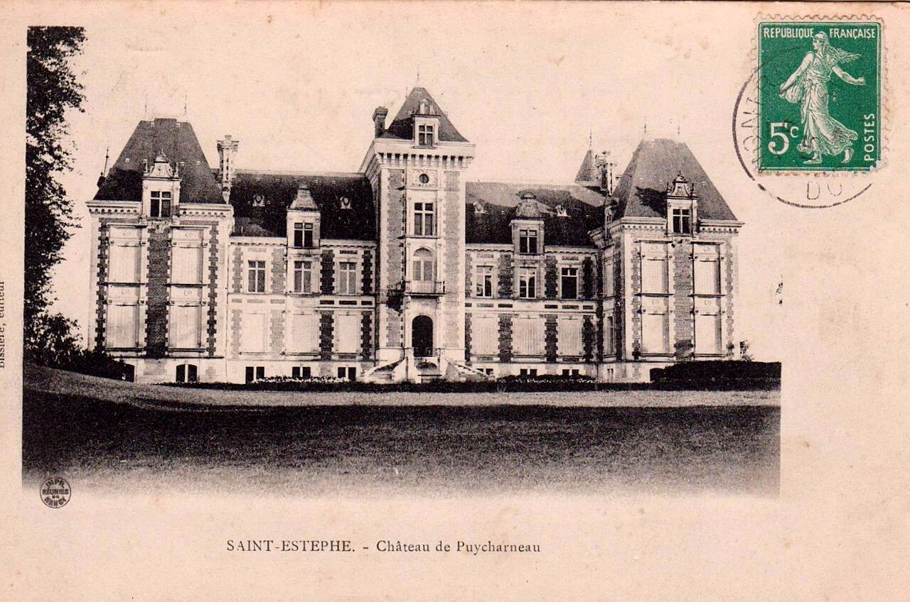

# Saint-Estèphe

The northernmost communal AOC in the Médoc, known for clay-and-gravel soils, a higher share of Merlot and firmer tannin; the 1855 second growths Cos d’Estournel and Montrose and the third growth Calon-Ségur are its landmarks.

Figure: Saint-Estèphe: Saint-Estèphe - château du Puycharneau 1 (Wikimedia Commons). Image: Unknown Unknown circa 1900-1920, Public domain, via Wikimedia Commons ([source page](https://commons.wikimedia.org/wiki/File:Saint-Est%C3%A8phe_-_ch%C3%A2teau_du_Puycharneau_1.jpg)).

## Definition and boundaries

Saint-Estèphe sits at the northern tip of the Médoc near the Gironde estuary; compared with Pauillac it has more clay, slightly later ripening and firmer, more angular tannin.

In an official geographical indication, the boundaries of Saint-Estèphe are not a decorative line but a legal and historical construction made of place names, parcels and maps. It may be a county, a group of villages, or a narrow strip along a river or mountain; the more specific the name, the less freely it can be used on a label.

Saint-Estèphe is a village AOC at the northern end of the Médoc, not an extension of Pauillac. Its clay-rich soils and cooler northern position slow Cabernet Sauvignon; the southern gravel croupes ripen earlier. The commune and soil, not the broad Médoc label, explain the wine’s firmness.

## History and naming

In 1855, Cos d’Estournel and Montrose were second growths and Calon-Ségur a third; their styles differ, but all are known for Cabernet structure and long ageing.

The name Saint-Estèphe usually appears first in local archives, church records or tax rolls, and only later in modern regulations. The name often stabilises later than the boundary, which is why the same place can carry different spellings across languages and periods.

The church of Saint-Estèphe gave the village its name, and eighteenth-century estates were already exporting to Britain and the Netherlands. The 1855 classification placed Cos d’Estournel and Montrose as second growths and Calon-Ségur as a third. Those rankings still shape prices, but the estates’ recent farming and cellar work matter more.

## Geography and terroir

Soils mix gravel, clay and limestone, draining less freely than Pauillac’s thick gravel ridges; this usually raises the Merlot share and makes the wines more closed when young.

The vineyards of Saint-Estèphe sit at particular elevations, aspects and soil parent materials. Distance to the sea, mountain direction, diurnal range and harvest rain all change ripening and acidity; these conditions explain more about style than the name alone.

Clay holds water and nutrients, helping Cabernet in dry years but slowing ripening and tightening tannin; gravel croupes drain and store heat. The Gironde estuary moderates the climate; the northern sites are cooler and later, the southern gravel warmer. Spring frost, hail and harvest rain are the main risks.

## Raw materials and styles

Cabernet Sauvignon leads, with Merlot, Cabernet Franc and Petit Verdot; traditionalists stress long ageing, while modernists pick earlier and extract more gently, so the style is splitting.

The vines of Saint-Estèphe determine what can be made. The leading varieties or raw materials, permitted blends, minimum ripeness and maximum yields are usually written into rules; but rules are a floor, and the real style comes from picking dates, fermentation vessels and ageing.

Cabernet Sauvignon is picked from late September into October, Merlot earlier on the clay. The window is narrow because autumn rain can dilute the crop. Growers choose between full phenolic ripeness and freshness; the high clay content makes that choice especially consequential.

## Representative producers and wines

Beyond the three landmarks, Phélan Ségur, Lafon-Rochet and Ormes de Pez are common comparisons; the appellation generally costs less than Pauillac or Margaux.

The representative wineries of Saint-Estèphe usually show the two poles of a region: long-established families or cooperatives with concentrated holdings, and newer arrivals working parcel by parcel. Tasting both explains the region better than a list of famous names.

Châteaux, family estates and négociants dominate. Cos d’Estournel, Montrose, Calon-Ségur, Lafon-Rochet and Phélan Ségur own large vineyards; other estates buy fruit or sell through négociants. Ranking is a historical signal, not a guarantee of current quality.

## How to drink and pair

To drink Saint-Estèphe, start with alcohol, acidity and tannin or bitterness, then choose temperature and food. High acidity suits fat and salt, high tannin needs protein and fat, and high alcohol clashes with sweet or very spicy dishes; warmth pushes alcohol over aroma.

Serve at 16–18°C in a large glass; young wines need two hours or more of air, older bottles only decanting for sediment. Steak, lamb, game, mushrooms and hard cheese suit the tannin; delicate seafood and spicy food do not. The firm structure can make young bottles seem austere, so food and oxygen matter.

## Labels, buying and misreadings

Start with the appellation and its permitted varieties. From there, consider the vintage and the producer, then how the wine is labelled. That is how a practical judgment about Saint-Estèphe is built.

Cool years produce tighter tannin and higher acidity, needing longer ageing; warm years give fuller fruit and earlier approachability. Hail, frost and harvest rain can cut the crop. For older bottles, storage and bottling history are more important than the vintage chart alone.

### Key dates and figures

- Typical blend: 60–70% Cabernet Sauvignon, 20–30% Merlot, with small amounts of Petit Verdot and Cabernet Franc; alcohol 13–13.5%.

## Around and routes

Putting Saint-Estèphe into an itinerary means separating the regional centre from specific wineries: the first is for landscape, markets and food, the second needs bookings, tastings and travel time. Too many stops in one day exhaust both palate and attention.

Saint-Estèphe is about an hour north of Bordeaux, with estates spread around the village and along the river. A château visit takes 60–90 minutes, and three estates plus lunch is a full day. Book ahead, check harvest closures, and group visits by commune rather than by classification.

- Related: [Bordeaux](ref:bordeaux), [Cabernet Sauvignon](ref:cabernet), [Merlot](ref:merlot), [red wine](ref:red), [oak ageing](ref:oak).
- Saint-Estèphe’s clay-heavy sites are colder than Pauillac’s; the two appellations are neighbours, not interchangeable styles.

**At a glance:** The northernmost communal AOC in the Médoc, known for clay-and-gravel soils, a higher share of Merlot and firmer tannin; the 1855 second growths Cos d’Estournel and Montrose and the third growth Calon-Ségur are its landmarks.

**Key facts.**

| Item | Detail |
| --- | --- |
| In one line | The northernmost communal AOC in the Médoc, known for clay-and-gravel soils, a higher share of Merlot and firmer tannin; the 1855 second growths Cos d’Estournel and Montrose and the third growth Calon-Ségur are its landm… |
| Level | other |
| Parent | Bordeaux |
| Country code | FR |

## Related images

Image: Editorial illustration of oak ageing: the toasted barrel staves, wine and a sampling tube; AI-assisted illustration, not a photograph.. Credit: Hejiu editorial team, AI-assisted with Doubao Seedream 5.5; project-generated editorial figure, not a photograph ([about](https://hejiu.org/about/)). Related image for Saint-Estèphe.

Image: Merlot. Credit: Felloni claire, CC BY-SA 4.0, via Wikimedia Commons ([source page](https://commons.wikimedia.org/wiki/File:Merlot.jpg)). Related image for Saint-Estèphe.
