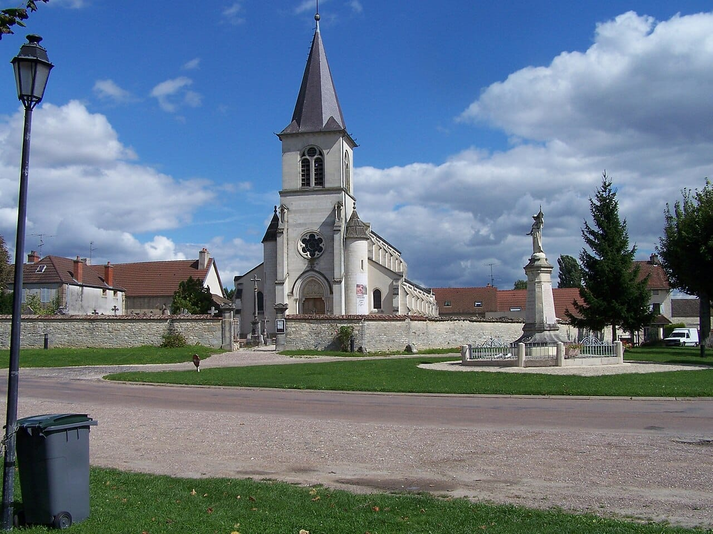

# Saint-Julien

Saint-Julien is a red-wine appellation on the left bank of the Gironde between Pauillac and Margaux, recognised as an AOC on 14 November 1936. Its vineyard area is modest, yet it contains 11 classified growths from 1855, 5 of them second growths, and the commune has no first growth at all; this dense structure without a summit is what most clearly separates it from Pauillac and Margaux.

Figure: Saint-Julien. Image: Christian LAFORET, CC0, via Wikimedia Commons ([source page](https://commons.wikimedia.org/wiki/File:EGLISE_DE_SAINT_jULIEN-20-11-2010.jpg)).

## Definition and scope

Saint-Julien applies only to still [red wines](ref:red-wine) from demarcated parcels that are fermented and aged within the area. The geographical area is based on the commune of Saint-Julien-Beychevelle, bordering Pauillac to the north, Margaux to the south and the Gironde estuary to the east. The name Beychevelle inside the commune name is also a place name and part of the appellation's history, and it is easily confused with an estate name.

The appellation is small and its parcels are relatively concentrated, so the word Saint-Julien on a label tends to carry a clear stylistic expectation: complete structure, fine tannin and a balance of fruit and cedar. It does not rely on three first growths as Pauillac does, nor on perfume as Margaux does; its reputation rests on overall consistency.

Among the four great Médoc communes, Saint-Julien is often placed in the “most consistent” position: it has no extreme body and seldom shows a break in style, which makes it a good entry point for understanding left-bank structure. Both its output and its number of estates are limited, so wines bearing the name are not abundant, which also helps explain its relatively moderate prices and recognisable character.

## An almost continuous gravel ridge

The vineyards follow an almost continuous gravel ridge that runs from Beychevelle in the north to the southern end of the commune. Gravel covers clay and limestone, drains freely, and forces roots downward in search of water, which helps the vines remain steady in dry years.

Compared with the three groups of rises in Pauillac, the Saint-Julien gravel band is narrower and more continuous, so parcel-to-parcel differences are less extreme. This geological continuity is often used to explain why the classified growths here share a broadly similar style: they enjoy comparable drainage, aspect and ripening rhythms.

Beneath the gravel lie sandy clay and limestone, with some parcels also carrying gravelly sand; the mix guarantees drainage while still supplying a little water to the roots in summer. Hollows near the estuary are cooler and inland slopes warmer, so ripening differences are compressed into a narrower range.

## The 1855 classification with no first growth

The Médoc classification drawn up for the 1855 Paris world fair listed 11 classified growths in Saint-Julien: 5 second growths, 2 third growths and 4 fourth growths, with no first growth and no fifth growth. It is the only one of the four great Médoc communes without a first growth, and that structure has directly shaped how the market sees the appellation.

No first growth means no single estate can stand for the whole commune, and prices are more dispersed. For buyers this is both an opportunity and a trap: it is possible to buy wines with a structure close to first-growth level at lower prices, but it is also easier to be misled by the words cru classé while ignoring the particular estate and vintage.

## Five second growths and three tiers

The five second growths are Léoville-Las Cases, Léoville-Poyferré, Léoville-Barton, Ducru-Beaucaillou and Gruaud-Larose. The three Léoville estates share an origin but split into separate properties with different parcel positions and styles; Ducru-Beaucaillou sits close to the estuary, while Gruaud-Larose spreads further inland.

The two third growths are Lagrange and Langoa-Barton, and the four fourth growths are Beychevelle, Branaire-Ducru, Talbot and Saint-Pierre. This 5 plus 2 plus 4 hierarchy makes Saint-Julien a useful sample of the internal structure of the 1855 list: within one commune, rank, parcel and price interlock.

The three Léoville estates split through inheritance, which is why the name divided; their parcels still sit next to one another today, while their prices have drifted apart. Reading only “second growth” misses the differences created by that history.

## Varieties and style

The permitted varieties match the left bank of Bordeaux: [Cabernet Sauvignon](ref:cabernet-sauvignon), [Merlot](ref:merlot), Cabernet Franc, Petit Verdot, Malbec and Carmenère. Cabernet Sauvignon usually dominates and provides the frame and ageing potential; Merlot softens the middle, while Cabernet Franc and Petit Verdot add aroma and colour.

The minimum natural alcohol is 11%. Saint-Julien is often described as combining the firmness of Pauillac with the finesse of Margaux: tannin is evident when young but not coarse, and with age the wines show cedar, cassis, tobacco and graphite. It is slightly lighter than Pauillac and more tightly structured than Margaux.

## Winemaking and ageing

After fermentation the wine is aged in [oak](ref:oak-ageing), with barrel time varying by estate, commonly between eighteen months and two years. The share of new barrels, the barrel size and whether the wine stays on its lees all change tannin texture and the speed at which aroma opens.

Because Cabernet Sauvignon dominates, the tannin needs time to integrate; good vintages enter their drinking window at around ten years, and firmer vintages can last much longer. Young wines suit red meat and hard cheese, while mature bottles work better with poultry, mushrooms and dishes of moderate intensity.

Saint-Julien is often more closed than Margaux in youth and needs a longer decant; with age, the Cabernet frame and the roundness of Merlot combine into a medium-bodied wine with fine tannin and cedar aroma.

## Labels and buying

The word Saint-Julien on the label must match the appellation; check the vintage, alcohol, volume, bottler and estate name. A cru classé label reflects the 1855 list and later individual adjustments, not current quality. It also helps to distinguish Saint-Julien from Saint-Julien-Beychevelle: the first is the appellation, the second the commune name, and labels use them differently.

In the same vintage, prices among classified growths can differ widely; checking the estate, parcel and vintage is more useful than reading only the words second growth.

Read Saint-Julien through the appellation and its permitted varieties, then the vintage and the producer, and finally how the wine is labelled. The sequence matters.

[France](ref:france) and [Cabernet Sauvignon](ref:cabernet-sauvignon) are the nearest useful comparisons: one clarifies geographic boundary, the other tests climate and soil.

## References

- [France](ref:france): the AOC system and the national appellation framework.
- [Bordeaux](ref:bordeaux): the structure of left-bank communal appellations.
- [Cabernet Sauvignon](ref:cabernet-sauvignon): the leading variety in Saint-Julien blends.
- [Merlot](ref:merlot): softening the middle and adding earlier fruit.
- [Red wine](ref:red-wine): an overview of still red wine and winemaking.
- [Oak ageing](ref:oak-ageing): how barrel ageing shapes tannin and aroma.

## Related images

Image: Moët & Chandon vineyards in Verzenay, Champagne, France. Credit: Mustang Joe, CC0, via Flickr / Openverse.. Credit: Mustang Joe, CC0, via Wikimedia Commons ([source page](https://www.flickr.com/photos/63234672@N04/13180177073)). Related image for Saint-Julien.

Image: Thematic illustration for Red wine. Project-made bilingual editorial figure, not an on-site photograph. Related image for Saint-Julien.
