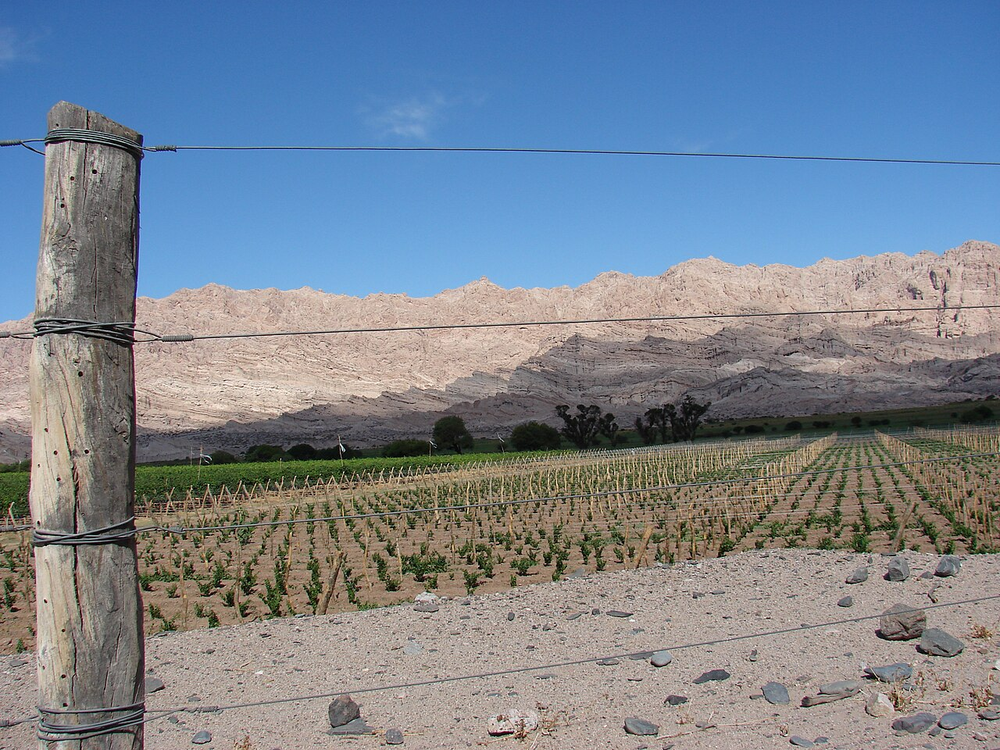

# Salta

A high-altitude wine region in northwest Argentina, centred on the Cafayate Valley in Salta; at 1,700–3,000 metres with intense sun and a wide diurnal range, it is known for Torrontés whites and high-altitude Malbec.

Figure: Salta: Angastaco Salta (Wikimedia Commons). Image: CarlosA.Barrio, CC BY-SA 4.0, via Wikimedia Commons ([source page](https://commons.wikimedia.org/wiki/File:Angastaco_Salta.JPG)).

## Definition and boundaries

Salta lies in northwest [Argentina](ref:argentina), about 1,500 km north of Buenos Aires, with vineyards along the Calchaquí Valleys (Valles Calchaquíes), a high-altitude valley chain roughly 520 km from north to south near 26°S, just south of the Tropic of Capricorn. Five geographical indications are registered within the province: Cafayate, Cachi, Molinos, San Carlos and Salta; the cross-provincial Calchaquí Valleys GI also extends into Catamarca and Tucumán.

Vineyards range from 1,500 to 3,111 m above sea level, among the highest commercial vineyard belts on Earth. The core town of Cafayate sits at 1,683 m, with surrounding vineyards around 1,650 to over 2,000 m. The province borders Chile to the west and Bolivia to the north, but the vineyards sit in the eastern high valleys rather than the western Andean spine. The province has about 3,600 ha under vine, of which Cafayate accounts for roughly 75%; Salta produces just over 1% of national wine but earns an outsized share of international awards.

Argentina has no French-style AOC hierarchy; a GI on the label marks only the production area, and parcel, altitude and producer indicate style more reliably than the broad regional name.

## History and naming

Vines reached the northwest valleys in the Spanish colonial period. On record, Bodega Colomé was founded in 1831 in Molinos by Nicolás Severo de Isasmendi y Echalar, the last Spanish governor of Salta, and is Argentina’s oldest continuously operating winery. In 1854 his daughter Ascensión brought pre-phylloxera French Malbec and Cabernet Sauvignon vines in, some of which still bear fruit today.

In 1892 the Michel brothers, from France, founded El Esteco in Cafayate, where Criolla and Torrontés vines over 70 years old remain; the Torrontés vineyard planted by Etchart in 1862 is among the oldest still producing in Argentina. The modern fine-wine era began in 1988 with San Pedro de Yacochuya, an Etchart–Rolland partnership; Donald Hess toured South America in 1998 and acquired Colomé in 2001, pushing high-altitude wine as a distinct category. Colomé has been led by winemaker Thibaut Delmotte since 2005, and the estate’s James Turrell museum opened in 2009.

The town of Cafayate takes its name from the Cafayates, an indigenous group of the Diaguita-Calchaquí peoples; the settlement grew from mission sites around 1840 and was formally established as a department in 1863.

## Geography and terroir

The climate is a high-altitude desert, semi-continental: annual rainfall runs 150–250 mm, concentrated in a short summer; there are more than 300 sunshine days a year, diurnal temperature swings often reach 15–20°C, and UV radiation is 30%–40% stronger than at sea level. Summer days climb to around 35°C while nights drop to 10–15°C; the Andes to the west and the Sierra del Cajón block moisture, leaving the valley in a rain shadow. Days are warm and nights cold, so grapes ripen sugar while keeping acidity; dry air keeps disease pressure low, and summer hail is the main weather risk.

Soils vary along the valley: Cafayate has alluvial gravel and sandy loam, free-draining and low in nutrients; the Molinos side leans to volcanic soils; San Carlos is a sandy-loam mix. Poor, fast-draining soils force roots deep, giving small crops and concentrated flavour.

Rainfall is scarce, so irrigation relies entirely on Andean snowmelt and valley groundwater: older vineyards use overhead pergolas (parral) and channel flood irrigation, while newer plantings mostly use vertical trellising with drip irrigation. Altitude, aspect and snowmelt water split the valley into several microclimate units.

## Raw materials and styles

The flagship white is Torrontés Riojano, a natural cross of Muscat of Alexandria and Criolla Chica; it is dry, with rose and citrus perfume, more mineral and acidic than Mendoza versions. Other whites include [Chardonnay](ref:chardonnay) and Sauvignon Blanc. Among reds, [Malbec](ref:malbec) covers about 60% of red plantings, alongside Cabernet Sauvignon, Syrah, Merlot, Cabernet Franc, Tannat and Pinot Noir.

High-altitude Malbec is tighter and more floral than lowland versions, with red fruit and violet, firm tannins and bright acidity; Cabernet Sauvignon and Syrah carry more structure. [White wines](ref:white) lead with fresh aroma, while [red wines](ref:red) build colour and polyphenols from thick skins and strong sun.

The overall style is bright, high-acid and direct in fruit; old and new vines, pergola and trellis, traditional blends and single varieties coexist. Traditional Criolla varieties remain in old vineyards, mostly for local everyday wines and blends; some vines dating to around a century ago are grown on overhead pergolas, with open canopies and low yields.

## Representative producers and wines

Bodega Colomé holds four estate vineyards at 2,300–3,111 m in Molinos and surroundings: the El Arenal site at 2,600 m, the Colomé estate vineyard at 2,300 m, and the Altura Máxima site at 3,111 m, among the world’s highest commercial vineyards. Its ranges include Estate, Auténtico, Lote Especial, Reserva and Altura Máxima.

Bodega El Esteco was founded in Cafayate in 1892 at about 1,700 m, one of the region’s largest estates; its signature wines include the Altimus blend and Don David Reserva. Piattelli makes Torrontés and high-altitude Malbec from gravelly, snowmelt-irrigated Cafayate vineyards; San Pedro de Yacochuya, at about 2,035 m, is the landmark estate that opened the modern fine-wine era in 1988.

These names are a market consensus rather than an official classification. Long-established estates hold 19th-century old vines and colonial buildings, while newer houses push altitude limits and variety trials; before buying, check altitude, variety and whether the wine was estate-bottled.

## How to drink and pair

Dry Torrontés is served at 10–12°C, with seafood, white meat, light cheese and aperitif snacks, its rose perfume matching citrus and spiced dishes; high-altitude Malbec sits at 16–18°C, young wines decanted briefly, with grilled red meat, stews and game.

Local cooking leans on northwest highland dishes: roast lamb, empanadas, humita corn tamales, locro bean stew, cheese and spicy sausage, which pair with both full-bodied reds and aromatic whites. A wide glass opens the aromas; young fruity wines do not need long decanting.

## Labels, buying and misreadings

Read the label by confirming the GI site first (Cafayate, Molinos, Cachi, San Carlos or Salta), then altitude, variety and producer. Argentine GIs carry no internal tier, and altitude often says more about tautness and acidity than the regional name.

Two common misreadings: first, assuming Torrontés is sweet — the flagship wine is dry, its perfume coming from the variety itself; second, expecting high-altitude reds to be heavy, since the cool nights give high-altitude Malbec a lighter, floral edge. For storage, cool stability comes first; after opening, whites and light reds usually last 1–3 days, structured reds longer.

## Around and routes

Cafayate is the central wine-tourism town, with dozens of estates nearby; it lies about 190 km south of Salta city along National Route 68. Valley scenery includes the Quebrada de las Conchas, a gateway gorge of red layered cliffs, other red-rock formations and the mountain villages of Molinos and Cachi; Route 40 runs through the region. Most visitors base themselves in Cafayate town and reach the estates along the valley roads, so lodging need not change daily; restaurants and accommodation cluster in town and fill up on festival weekends and at harvest.

Estates are spread along both sides of the valley: a tasting lasts 60–90 minutes and drives between villages 30–60 minutes, so two or three stops in a day is comfortable. At altitude, allow for acclimatisation and changing weather. Harvest runs in the Southern Hemisphere summer, February to March; confirm bookings and opening hours through official websites or the tourism board beforehand. Stay out of working parcels, and do not drink and drive.

- Related: [argentina](ref:argentina), [malbec](ref:malbec), [chardonnay](ref:chardonnay), [white-wine](ref:white), [red-wine](ref:red).

**In brief:** A high-altitude wine region in northwest Argentina, centred on the Cafayate Valley in Salta; at 1,500–3,100 metres with intense sun and a wide diurnal range, it is known for Torrontés whites and high-altitude Malbec.

Read Salta through the appellation and its permitted varieties, then the vintage and the producer, and finally how the wine is labelled. The sequence matters.
