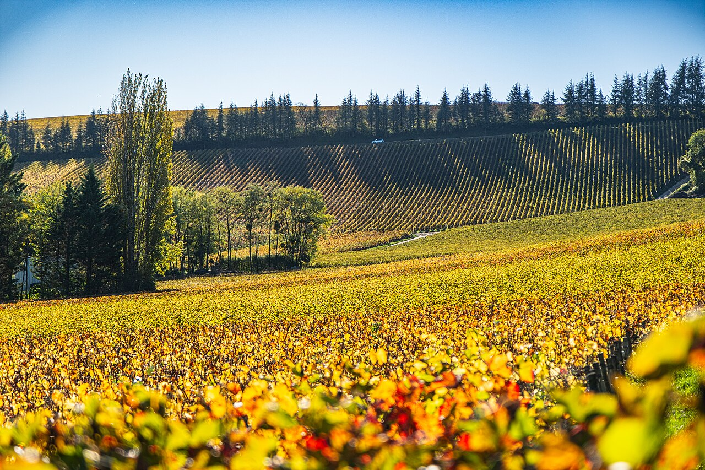

# Sancerre

Sancerre is a hill district in the eastern Loire, on the left bank of the Cher, known for Sauvignon Blanc whites and Pinot Noir reds and rosés. Limestone and flint soils, a cool continental climate and the 1936 white-wine AOC (reds and rosés added in 1959) make it the most cited source of "mineral" Sauvignon Blanc.

Figure: Sancerre: Sancerre grape vines leading to a tree-lined ridge (54092669721) (Wikimedia Commons). Image: Winniepix, CC BY 2.0, via Wikimedia Commons ([source page](https://commons.wikimedia.org/wiki/File:Sancerre_grape_vines_leading_to_a_tree-lined_ridge_(54092669721).jpg)).

## Definition and boundaries

The district lies east of Bourges on the left bank of the Loire, spanning 14 communes of the Cher département. Vineyards sit on hills at 180–350 metres, with local slopes over 50% gradient; south and southeast aspects ripen best.

White Sancerre must be Sauvignon Blanc; red and rosé are Pinot Noir. The AOC constrains variety and yield, not soil parcel, and within one label flint slopes and limestone ground produce clearly different wines.

Across the river lies Pouilly-Fumé, another Sauvignon district. The two are often tasted side by side, but their soils, producer base and rules are separate; do not merge the two appellations when buying.

## History and naming

Before the twentieth century, Sancerre was better known for Pinot Noir; Sauvignon became the district's defining grape only in the 1900s. Replanting after phylloxera and rising demand for white wine gradually shifted the variety structure toward today's Sauvignon-led planting.

The AOC covered white wines from 1936 and added reds and rosés in 1959. The rules fixed long-standing slope boundaries and variety provisions; later revisions adjusted clauses, but the core slope area has stayed stable.

The name comes from the town of Sancerre, linked to the medieval Counts of Sancerre. Nearby communes such as Chavignol, Bué, Ménétréol-sous-Sancerre and Saint-Satur appear regularly in parcel descriptions and wine labels. The district holds about 366 holdings, from small family plots to mid-size family estates, with whites dominant in both volume and export share.

## Geography and terroir

Sancerre has a cool continental climate: warm summers, cold winters and large diurnal swings that preserve acidity and aromatic precision. Annual rainfall is about 69 cm, and slopes drain fast. Main risks are spring frost, flowering rain and harvest humidity, and the balance of fruit and herbal notes shifts between vintages.

Soils run west to east in three types: Kimmeridgian marls (terres blanches, giving more powerful wines), dry stony limestone (caillottes, fruity and fresh), and siliceous flint soils (silex or chailloux, floral with flint notes). Flint covers about 15% of the vineyard, formed between 56 and 33.9 million years ago; the stones store heat by day and release it slowly at night.

Aspect and altitude decide sun exposure: high sites are windy and ripen slowly, while low valley floors collect cold fog. Flint parcels give tight, mineral wines; limestone parcels are rounder; marl parcels carry the fullest structure. Within one commune, slope height and stone content still separate the wines.

## Raw materials and styles

Sauvignon Blanc leads, with whites about 84% of production; Pinot Noir makes the reds and rosés, about 11% red and 5% rosé. Whites show lemon, white flowers, flint and herb, with grapefruit and passionfruit in some vintages; most stay in stainless steel for a crisp style, with a little oak use among a few estates.

Pinot Noir is small in volume: reds are light to medium bodied and high in acidity, with red cherry and spice, not heavy Burgundy-style wines. Rosés are dry and fresh in fruit, suited to aperitif time.

Winemaking uses cool fermentation to preserve aroma, and Sauvignon rarely sees new oak, so variety and site stay forward. Cooler vintages emphasize herb and mineral, warmer vintages riper fruit; the producer's picking-date choice shapes the glass more than the variety itself.

## Representative producers and wines

Henri Bourgeois is a large family estate with a complete range of whites and Pinot Noir. Domaine Vacheron is known for parcel-driven Sauvignon; Domaine Cotat (François and Pascal Cotat) and Claude Riffault are common references for flint and marl sites, and growers such as Crochet appear on retail shelves.

These names are not an official classification; they are market reference points. Flagship parcel wines and aged vintages are expensive and scarce, while entry Sauvignon is easier to find in restaurants and retail.

Compare by soil type first (flint, limestone, marl), then producer and vintage. Within one producer's range, different parcels can differ more in aroma and structure than same-soil wines across producers.

## How to drink and pair

Serve by variety: Sauvignon at 8–10°C, rosé at 10–12°C, Pinot Noir red at 14–16°C. A medium-bowl white glass works well; there is no need for a narrow specialist shape.

For food, Sauvignon matches Loire freshwater fish, asparagus, goat cheese (the Chavignol small goat cheese is the local classic), oysters and seafood salads. Pinot Noir goes with cold cuts, sausages, poultry and mushrooms; rosé suits appetisers and light dishes.

Home cooking in the Cher and central Loire centres on river fish, goat cheese, pork and seasonal vegetables, seasoned lightly to match high-acid whites. Choose the wine around the salt and fat of the dish, then decide between fresh Sauvignon, fruity rosé or a light-bodied Pinot Noir.

## Labels, buying and misreadings

Below the AOC name, commune or parcel names hint at soil; the variety (Sauvignon or Pinot Noir) and colour (blanc, rouge, rosé) predict the wine better than the appellation alone. Sancerre is not "only Sauvignon", but Pinot volumes are small and whites dominate the market.

One misreading is treating "mineral" as a legal flavour guarantee: the gunflint note of flint sites comes from soil and variety, and not every Sancerre shows it. Another is assuming Sancerre whites are always lean and acid; good vintages and sites can offer a round mid-palate and length.

For storage, Sauvignon is best young and mostly not built for cellaring; good parcel wines keep three to five years. Keep away from light, at a steady temperature, on the side; check storage record and cork condition for aged bottles.

## Around and routes

The district is not far from Bourges, with the town of Sancerre perched on a hilltop; estates spread through Chavignol, Bué, Saint-Satur and other communes. Self-drive is easiest, and public transport is sparse.

A half-day fits two or three tasting rooms plus lunch. A full day can compare flint slopes with limestone ground, or cross the river to visit Pouilly-Fumé. Harvest runs in September, and some estates take bookings only; confirm opening times on winery websites first.

Grower estates are generally small: arrive on time for appointments and stay out of working areas. Slope dirt tracks can be wet and slippery, so wear grip soles; ask about step-free access and restrooms before bringing older relatives or children.

- Related: [loire](ref:loire), [sauvignon-blanc](ref:sauvignon), [pinot-noir](ref:pinot), [white-wine](ref:white), [red-wine](ref:red).

Read [Loire Valley](ref:loire) for the geographic boundary side of Sancerre, and [Pinot Noir](ref:pinot) for the climate and soil side. Together they locate it on a map.
