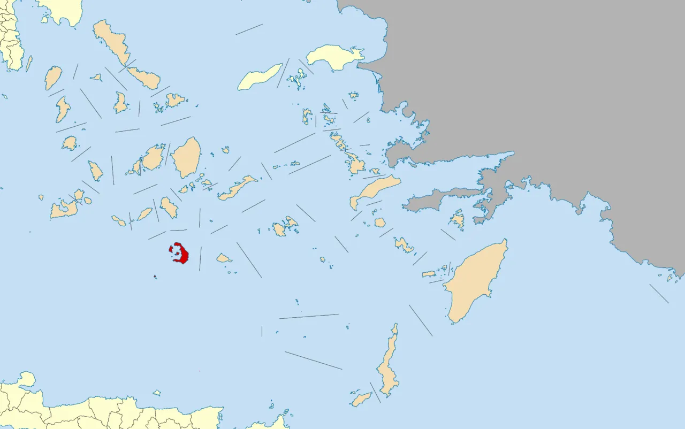

# Santorini

Santorini, or Thira, is a volcanic island in the Cyclades and Greece's most distinctive white-wine PDO. It is known for Assyrtiko, volcanic soils and the kouloura basket system, and it maintains an almost hand-made form of viticulture under extreme drought and wind.

Figure: Santorini. Image: Pitichinaccio, CC BY 3.0, via Wikimedia Commons ([source page](https://commons.wikimedia.org/wiki/File:2011_Dimos_Thiras.png)).

## A legal appellation on a volcanic island

Santorini lies in the southern Aegean, among the southernmost of the Cyclades. The appellation covers the island's volcanic plateaus and slopes, and the legal name Santorini sits alongside the ancient name Thira. There are no plains here: soils are pumice, ash and volcanic debris, water-holding capacity is poor, wind is strong and rain is scarce.

Start with the appellation and its permitted varieties. From there, consider the vintage and the producer, then how the wine is labelled. That is how a practical judgment about Santorini is built.

## 1971 and the creation of the PDO

Santorini's PDO status was established in 1971, making it one of Greece's earlier protected wine regions. In 2002 a Greek ministerial decision approved traditional terms such as Vinsanto and Nykteri for Santorini PDO labels, giving these historic wine types a legal place.

The heart of the PDO rules is the variety share: dry white and sparkling wines must contain at least 85% Assyrtiko, with the remaining 15% limited to Athiri and Aidani. That share was raised at EU level from 75% to 85%, on the argument that more Assyrtiko gives a more concentrated, more mineral wine. Vinsanto, made from sun-dried grapes, represents the island's sweet tradition.

## Volcanic soil, drought and the meltemia

Santorini's soils come almost entirely from volcanic activity: pumice, ash, basaltic debris and a little sediment. They drain extremely fast and offer limited nutrients, especially little bioavailable potassium, which is held to help Assyrtiko retain very high tartaric acid and razor-sharp acidity. Volcanic soils are also rich in calcium, magnesium and iron.

The climate is equally extreme. Summer rain is minimal, sun is intense and sea winds are strong; the summer wind known locally as meltemia blows through the season. It tears leaves, knocks off fruit and drives evaporation, so vineyards cannot use conventional tall trellising and must stay close to the ground.

## Kouloura: the basket system

Kouloura is Santorini's own pruning and training method: the vine is shaped into a low circular basket, with canes woven in a ring about 10 to 20 centimetres above the ground and the fruit ripening inside. The basket acts as a barrier against wind and some sun, while keeping humidity and shade inside.

The structure makes almost all work manual. Pruning, tying and picking take far longer than with a normal trellis, and mechanisation is nearly impossible. Research puts kouloura density at about 1,800 to 2,200 vines per hectare, with average yields around 2,080 kg per hectare, below the legal ceiling, which shows that real production relies on low yields and quality rather than volume.

## The style range of Assyrtiko

Assyrtiko behaves differently here than elsewhere in Greece: high acidity, low pH, clear citrus and lime aromas, often a saline and wet-stone note, yet the body is not thin. With greater ripeness come beeswax, white peach and smoky mineral layers, and the wine takes well to lees contact and short oak ageing.

Beyond dry white, Assyrtiko also feeds Nykteri and Vinsanto. Nykteri is a traditional dry or near-dry wine, historically based on night harvesting and higher ripeness; Vinsanto uses sun-dried grapes and is amber, with honey, fig and oxidative aromas. The raw material is [grape](ref:grape), and the variety share decides the label type.

Vinsanto depends on the island's abundant sun: grapes are spread out after picking, losing water and concentrating sugar before a long fermentation and oxidative ageing. The finished wine often shows caramel, nuts and dried fruit while keeping clear acidity, which sets it apart from many sweet wines. Nykteri instead emphasises ripe fruit and oak-derived texture, and suits saltier dishes.

## Yields, vineyards and rules

EU documents put the Santorini PDO vineyard at about 12,000 stremmata, roughly 1,200 hectares, running from sea level up to about 300 metres. Maximum yields have been cut from 8,000 to 6,500 kg per hectare to restrain volume and improve ripeness.

Plots are mostly family-owned and fragmented, and many vines are very old. Because of the volcanic soil and island isolation, Santorini's vines escaped phylloxera for a long time, and many old vines remain on their own roots. Labels should be checked for the PDO name, variety, [alcohol](ref:abv) and vintage, and the use of Vinsanto and Nykteri must follow the traditional-term rules.

Tourism is changing the vineyard's economic standing. Land used for hotels and resorts earns far more than wine, so some plots are abandoned or converted. Cooperatives, the producers' association and wine-tourism estates link vineyards to visitors, trying to keep growing inside the tourism economy, though water and labour shortages remain long-term constraints.

## Drinking, ageing and misconceptions

Santorini dry whites are best at about 9 to 11 degrees Celsius, with seafood, tomato, lemon and Mediterranean herbs. High acidity and minerality suit salty and acidic food and cut through oily seafood. Wines given [lees](ref:lees-ageing) contact are fuller in texture and keep for several years; some Assyrtiko can age for more than a decade.

Four misconceptions recur. First, treating Santorini as a sweet-wine region: Vinsanto is sweet, but the appellation is mainly [dry](ref:dry) white wine. Second, assuming volcanic soil automatically creates "minerality": the term describes a mix of acidity, saltiness and reductive aroma. Third, seeing kouloura as scenery: it is a working structure for wind protection and water retention. Fourth, assuming island wines are expensive only because of marketing: low yields, manual work and island logistics are genuine costs.

**Short definition:** PDO on the volcanic island of Santorini (Thira) in the Cyclades, Greece, established in 1971. Its dry white must contain at least 85% Assyrtiko, with the remaining 15% limited to Athiri and Aidani. Vineyards cover about 1,200 hectares (12,000 stremmata), from sea level to about 300 metres. Volcanic ash and pumice, extreme drought and the meltemia winds force the kouloura basket system. Maximum yields have been cut from 8,000 to 6,500 kg per hectare; Vinsanto and Nykteri are protected traditional terms.

**Key facts.**

| Item | Detail |
| --- | --- |
| In one line | PDO on the volcanic island of Santorini (Thira) in the Cyclades, Greece, established in 1971. Its dry white must contain at least 85% Assyrtiko, with the remaining 15% limited to Athiri and Aidani. Vineyards cover about … |
| Level | other |
| Country code | GR |

## References

- [Wine](ref:wine): the broad categories and origin rules.
- [White wine](ref:white-wine): the framework for white winemaking and style.
- [Assyrtiko](ref:assyrtiko): the island's core variety.
- [Fermentation](ref:fermentation): cool fermentation and aroma retention.
- [Acidity](ref:acidity): volcanic soil and high acidity.
- [Terroir](ref:terroir): volcanic soil, drought and sea wind.
- [Dry](ref:dry): dry styles versus sweet Vinsanto.
- [Lees ageing](ref:lees-ageing): how lees contact affects texture and ageing.
- [Grape](ref:grape): ripeness measures for wine grapes.
- [Alcohol by volume](ref:abv): what % vol means on a label.
