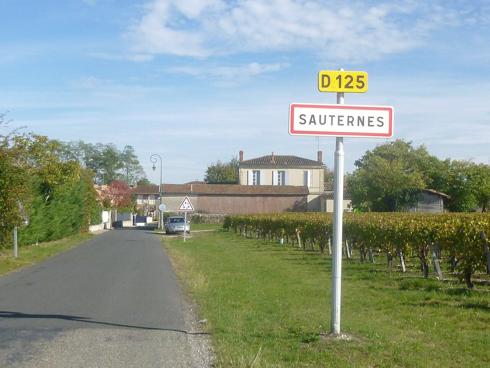

# Sauternes

Sauternes is the botrytised [sweet white](ref:sauternes-style) appellation of southern [Bordeaux](ref:bordeaux), in the Gironde, covering the villages of Sauternes, Barsac, Bommes, Fargues and Preignac. It is not one uniform tract of land but a set of terraces, gravel slopes and clay hollows along the Ciron and the Garonne. Fog, rivers and a fungus made it a sweet-wine region; the 1855 classification wrote it into market memory. It is part of Bordeaux, yet it belongs to a different family, the [dessert wines](ref:dessert-wine) of France.

Figure: Sauternes. Photograph: File:Vineyard in Sauternes.jpg. Credit: davitydave, CC BY 2.0, via Wikimedia Commons ([source](https://commons.wikimedia.org/w/index.php?curid=25673556)).

## The legal edge of five villages

The Sauternes AOC covers five villages: Sauternes, Bommes, Fargues, Preignac and Barsac. The first four may label only as Sauternes, while Barsac may choose between the Sauternes and Barsac appellations. This arrangement makes Barsac a special case inside the region: geographically part of the Sauternes system, legally in possession of its own name.

The five villages lie on both banks of the Ciron, with the land rising from the valley to the terraces. Their boundaries do not follow a single soil but the long accumulation of history, parishes and ownership.

The appellation covers about 1,550 hectares, with Sauternes and Bommes holding much of the best gravel slopes; Preignac sits lower near the Garonne, and Fargues faces Barsac across the river.

## An autumn made by the Ciron

The climate of Sauternes turns on autumn fog. The Ciron rises in the Landes forest and runs colder than the Garonne; on autumn mornings the cold stream meets the warm river and fog fills the valley. The fog lets [noble rot](ref:noble-rot) enter the grape skins, and afternoon sun clears it, drying the fruit and suppressing grey rot.

That wet-dry alternation repeats daily for weeks. Too little fog and the fungus never develops; too much fog or rain and the fruit rots. Vintages therefore vary enormously, and one estate can taste very different from one year to the next.

The geography of fog also explains differences within the appellation. Parcels near the Ciron see thicker fog and earlier botrytis, while higher, more distant sites stay drier and may not be infected for weeks. Within one village, picking dates can differ by two or three weeks.

## Gravel terraces and red soil

On the right bank of the Ciron, Sauternes, Bommes, Fargues and Preignac sit on east-facing terraces over Tertiary shell limestone, marl and sandy clay, capped with gravel carried by the Garonne in glacial periods. The gravel drains well, stores daytime heat and releases it at night, helping ripening and reducing frost risk.

Barsac, on the left bank, has a different structure: fissured limestone below and a thin red sandy soil with a little coarse gravel above. Drainage and root penetration differ, and that geology is the reason Barsac can claim its own AOC. Both sides suit botrytis, but the wines diverge: Sauternes is fuller, Barsac lighter and more mineral. The main variety on both is [Sémillon](ref:semillon), supported by Sauvignon Blanc and a little Muscadelle.

## 1936, 1855 and the rules in between

The Sauternes AOC was formally established on 30 September 1936, the same day as Barsac. Its specification sets varieties, planting density, picking method, minimum sugar and yield; current rules require repeated hand-picking of botrytised berries only, with a natural must sugar of at least 221 g/L.

The earlier coordinate is 1855. During the Paris Universal Exhibition that year, the Bordeaux chamber of commerce classified 26 estates in Sauternes and Barsac, with d'Yquem alone as Premier Cru Supérieur. The list outlived its purpose and became the starting point for understanding [classification systems](ref:grading) in Sauternes.

## Barsac's double identity

Barsac's particularity is choice. It may label as Sauternes, borrowing the larger name, or as Barsac, asserting its own terroir. Historically, Barsac was often seen as lighter and higher in acidity, ready earlier, while Sauternes was fuller and longer-lived.

The double identity also creates confusion in the market. A Barsac belongs to the Sauternes system but has its own specification; a Sauternes may come from the village of Sauternes or from Bommes, Fargues, Preignac, or a Barsac that chose the larger name. The reliable guide is the AOC name and village information on the label, not the estate name alone.

## Yields, vintages and a changing climate

Yields in Sauternes are limited by botrytis, and vintage variation is much greater than for dry white. A wet autumn can let the fungus run too far, a dry one can prevent infection, and hail, rain or autumn heat can all cut the crop. The specification sets a ceiling, but actual yields often fall below it.

Climate change is altering the rhythm. Warmer temperatures advance the harvest and may shorten the window in which botrytis is active; at the same time, drought and heatwaves can stop ripening. The region is testing picking dates, variety proportions and canopy management, but sweet wine's dependence on weather cannot be removed.

## Visiting Sauternes

Sauternes lies about 40 kilometres south of Bordeaux, roughly an hour by car. The vineyards are at their most impressive in autumn, though estates rarely receive visitors during picking. Most require advance booking, and some accept only trade visitors. Many estates reopen after picking, making late October and November a good window.

If you are driving, use a spittoon and keep intake low. Excessive drinking is harmful, and minors should not drink. Check storage before buying, since sweet wine dislikes heat and light, and avoid a hot car boot on the journey home.

**In brief:** The botrytised sweet white appellation of southern Bordeaux, covering the villages of Sauternes, Barsac, Bommes, Fargues and Preignac; autumn fog on the Ciron, gravel terraces and the 1855 classification define its identity. 

Sauternes is best read by starting with the appellation and its permitted varieties, moving to the vintage and the producer, and ending with how the wine is labelled.

[Bordeaux](ref:bordeaux) explains geographic boundary; [Dessert Wine](ref:dessert-wine) adds climate and soil. Put Sauternes between them before deciding what it is.

Sauternes is a Bordeaux sweet-wine appellation on the Ciron river, where autumn fog drives noble rot.

**Key facts.**

| Item | Detail |
| --- | --- |
| In one line | The botrytised sweet white appellation of southern Bordeaux, covering the villages of Sauternes, Barsac, Bommes, Fargues and Preignac; autumn fog on the Ciron, gravel terraces and the 1855 classification define its ident… |
| Level | other |
| Parent | Bordeaux |
| Country code | FR |

**Sources and limits.** The key claims about Sauternes are checked against the following sources: Official Journal of the European Union, Conseil Interprofessionnel du Vin de Bordeaux (the wider Bordeaux regional and sweet-wine framework; no original text is reproduced), INAO (the French AOC/AOP system and product specifications; no original text is reproduced) and 4 sources in total. Prices, batches and status change; the body is project-written and does not reproduce source text.
