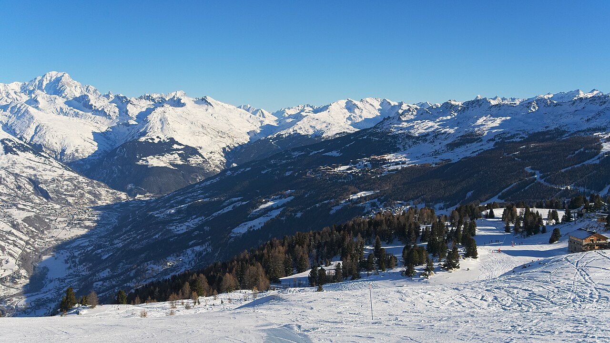
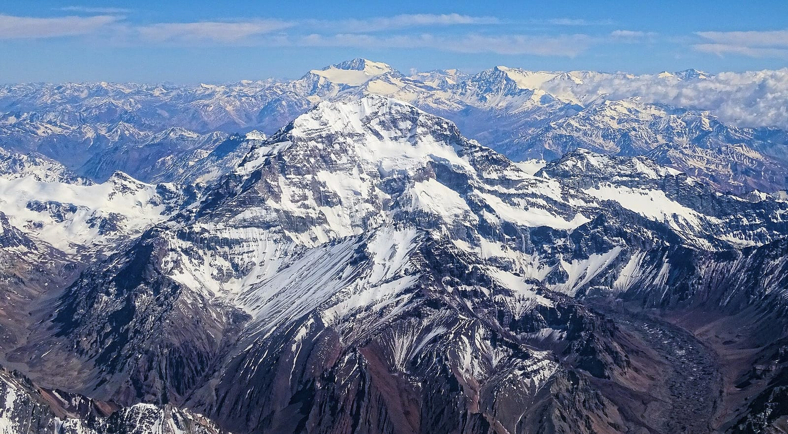

# Savoie

Savoie is not a region that can be summed up with an Alpine view. Its vineyards are scattered across valleys, slopes and glacial terraces in south-east France, from 250 metres up to more than 600 metres; two sides of the same mountain can differ completely in soil, aspect and ripening date. The region produces lean, crisp whites led by Jacquère, reds led by Mondeuse with pepper and violet notes, and a sparkling wine that only obtained AOC status in 2015. The useful way to understand Savoie is as a group of small mountain appellations rather than a single style.

Figure: Savoie. Image: Andreas Eichler, CC BY-SA 4.0, via Wikimedia Commons ([source page](https://commons.wikimedia.org/wiki/File:2017.01.21.-02-Paradiski-La_Plagne-Dos_Rond--Blick_Richtung_Les_Arcs.jpg)).

## Geography: valleys, slopes and lakes

Historic Savoie includes the present Savoie and Haute-Savoie departments and parts of Isère and Ain. Vineyards lie mainly in the valleys around Chambéry, Aix-les-Bains and Albertville, and on both shores of Lac du Bourget. Bugey, in the Ain department, belongs geographically to the upper Rhône but is often discussed with Savoie in regulation and in the market.

## Climate: mountain continental

The Alps give a mountain continental climate: cold winters, warm summers, large day-night temperature swings and a shorter growing season than Bordeaux. High parcels ripen slowly and keep acidity; south or south-east facing slopes get more sun and reach better ripeness. Frost and hail are the main risks, especially after spring budbreak and before the autumn harvest.

## Soils and slope

Savoie soils are mainly limestone, marl, glacial deposits and scree. Thin hillside soils drain well and send roots deep, naturally limiting yields; valley-floor soils are more fertile and usually give lighter wines. Chautagne, Jongieux and Arbin differ noticeably in soil, which helps explain style variation within one region.

## Legal framework: one region, several AOCs

The legal framework is a set of AOCs rather than one. Vin de Savoie, also written Savoie, is the regional AOC and covers red, white, rosé and sparkling; Roussette de Savoie is reserved for Altesse whites; Crémant de Savoie is the sparkling AOC, recognised on 11 September 2015; Bugey, Bugey-Cerdon and Seyssel are separate AOCs on the Ain side. They share a mountain climate but have their own varieties and production rules.

## 16 crus: place names beat the word Savoie

Vin de Savoie allows 16 geographical names, or crus, on the label: Abymes, Apremont, Arbin, Ayze, Chautagne, Chignin, Chignin-Bergeron, Crépy, Cruet, Jongieux, Marignan, Marin, Montmélian, Ripaille, Saint-Jean-de-la-Porte and Saint-Jeoire-Prieuré. Roussette de Savoie has its own crus, including Frangy, Marestel, Monterminod and Monthoux.

## Varieties: Jacquère, Altesse and Mondeuse

Jacquère is the most widely planted white variety. It gives light, high-acid wines with white flowers, green apple, lemon and wet-stone notes, best drunk young. Altesse, called Roussette locally, is fuller, with beeswax, nuts and yellow plum, and ages better. Chardonnay, Aligoté and Molette are also planted. Mondeuse leads the reds, with red cherry, black pepper, violet and earth, and moderate tannin; Gamay and Pinot Noir make lighter reds and sparkling base wines.

## Sparkling: Crémant and Bugey-Cerdon

Crémant de Savoie is made by the traditional method, with permitted varieties including Jacquère, Altesse and Chardonnay, and tends towards citrus and white flowers. Bugey-Cerdon follows another logic: mainly Gamay and Poulsard, finished by méthode ancestrale in the bottle, with low alcohol, sweetness and strawberry aroma. Both are sparkling, but their sweetness, strength and rules differ and they are not interchangeable.

## Producers and villages

Domaine Belluard in Ayze is known for Gringet; Domaine des Ardoisières in Cevins replanted abandoned steep slopes; Domaine Dupasquier in Jongieux is a reference for Mondeuse and Altesse; Domaine Jean-François Quénard in Chignin, Domaine Jean Vullien in Montmélian, Domaine Louis Magnin in Arbin and Domaine de l'Idylle in Apremont are all important names for understanding Savoie style.

## Vintages and market

Savoie has about 2000 hectares of vines and produces small volumes, long centred on local consumption, ski resorts and the Lake Geneva market. Vintage variation comes mainly from frost, hail and harvest rain: 2017, 2019 and 2020 performed well in some villages, but the mountain climate makes a region-wide "great vintage" hard to claim. Export markets are led by Japan, the United States and northern Europe, with prices from 10-20 euros for everyday wines to more than 30 euros for leading estates.

## Drinking and pairing

Jacquère suits lake fish, mountain cheeses such as Beaufort and Tomme, tartiflette and light starters; Altesse suits poultry, cream sauces and mushrooms; Mondeuse suits grilled meat, game and hard cheese. Serve whites at about 10-12℃ and reds slightly below room temperature. Once opened, refrigerate and drink soon.

## Common misconceptions

First, treating Savoie as a Swiss region; it is French, with a different regulatory and labelling system. Second, assuming mountain wines must be tart; variety, ripeness and winemaking vary widely. Third, conflating Savoie with Bugey; they are neighbours but have different AOCs. Fourth, thinking Savoie makes only white wine; Mondeuse and Gamay matter too. Fifth, reading only "Savoie" and ignoring the cru; a village name often says more about style.

**At a glance:** A wine region in the French Alps of south-east France, with vineyards on valleys and slopes at 250-600 metres; known for white varieties such as Jacquère and Altesse and the red Mondeuse, with appellations including Vin de Savoie, Roussette de Savoie, Crémant de Savoie and Bugey.

Start with the appellation and its permitted varieties. From there, consider the vintage and the producer, then how the wine is labelled. That is how a practical judgment about Savoie is built.

It is tempting to treat Savoie as an administrative place name. Its identity and use are separate questions.

Savoie's wines are alpine and high-acid, with Jacquère, Altesse and Mondeuse as local varieties.

**Key facts.**

| Item | Detail |
| --- | --- |
| In one line | A wine region in the French Alps of south-east France, with vineyards on valleys and slopes at 250-600 metres; known for white varieties such as Jacquère and Altesse and the red Mondeuse, with appellations including Vin … |
| Level | other |
| Parent | France |
| Country code | FR |

**Sources and limits.** The key claims about Savoie are checked against the following sources: INAO (the areas and rules of the Savoie and Bugey appellations), European Union (EU wine categories, geographical indications and labelling rules), Oxford University Press (Consulted for entries on Savoie, Jacquère and Mondeuse; Migrated from the former reference list at the end of the article; access date not re-verified) and 7 sources in total. Prices, batches and status change; the body is project-written and does not reproduce source text.

## Further reading

- [France](ref:france): French wine regulation and the appellation system.
- [White wine](ref:white-wine) and [red wine](ref:red-wine): the two basic categories of Savoie.
- [Grape](ref:grape): the basic structure and ripeness indicators of wine grapes.

Further reading: [Aconcagua Valley](ref:c-extra-1).

## Related images

Image: Related photograph of Aconcagua Valley. Credit: Bjørn Christian Tørrissen, CC BY-SA 4.0, via Wikimedia Commons ([source page](https://commons.wikimedia.org/wiki/File:Aconcagua2016.jpg)). Related image for Savoie.

Image: Grape. Credit: Vyacheslav Argenberg, CC BY 4.0, via Wikimedia Commons ([source page](https://commons.wikimedia.org/wiki/File:Grapes,_Rostov-on-Don,_Russia.jpg)). Related image for Savoie.
