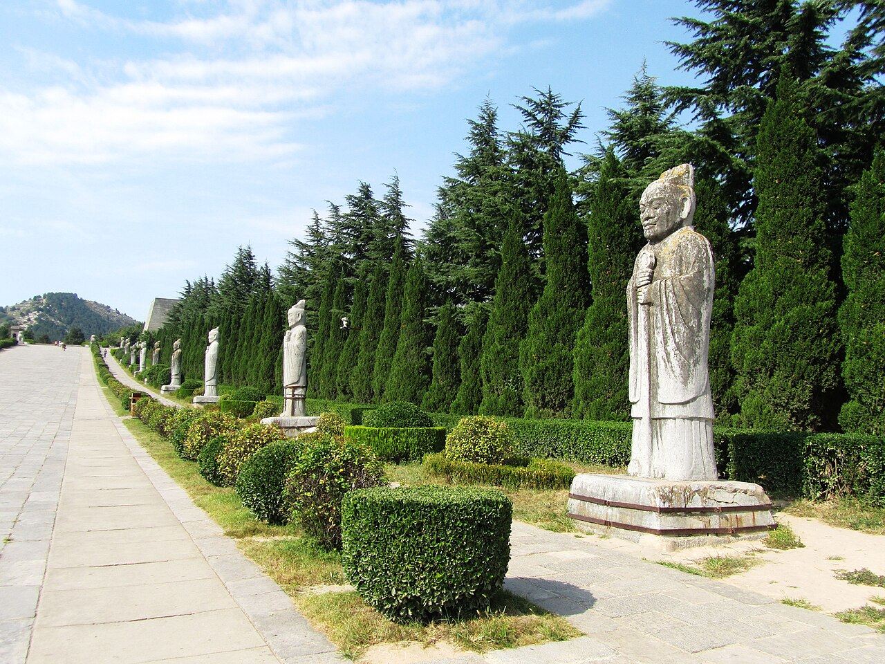
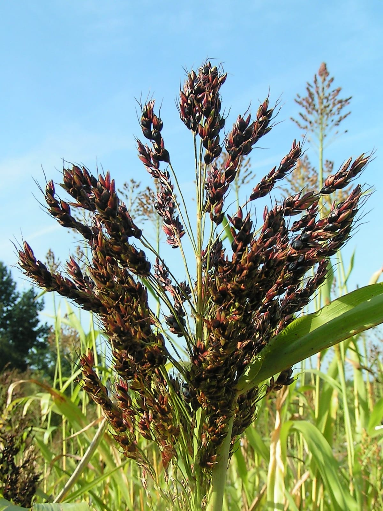

# Shaanxi

Shaanxi is a core region for feng-aroma baijiu in China, with its industrial centre at Liulin Town in Fengxiang District, Baoji. Feng aroma is often described as sitting “between light and strong”: it has the cleanliness and fruit of light aroma and the pit aroma and weight of strong aroma, yet belongs to neither end. This middle position is not a blend but the result of sorghum, barley, peas and wheat, medium-high-temperature daqu, loess mud pits, mixed steaming and distillation, and jiuhai storage.

Figure: Shaanxi. Image: Cat's diary (Maomao), CC BY-SA 3.0, via Wikimedia Commons ([source page](https://commons.wikimedia.org/wiki/File:Qianling_Mausoleum_25_2013-08.JPG)).

## Origin and legal scope of feng aroma

Shaanxi is a province-level node under [China](ref:china). Feng aroma is one of the aroma types of [baijiu](ref:baijiu), and Xifeng liquor is its representative product; [feng aroma](ref:feng-aroma) is both a process type and a flavour type. The core region is Fengxiang, with Liulin Town as the historical and industrial centre, and related production also exists around Baoji. Region name, aroma name and company brand must not be conflated.

The legal definition of feng aroma is written into the national standard: it uses sorghum, barley, peas and wheat, uses daqu as the saccharifying and fermenting agent, uses loess mud pits as fermentation vessels, applies mixed steaming and distillation, and is made through solid-state fermentation, solid-state distillation, jiuhai and other storage, and blending, without directly or indirectly adding edible alcohol or colour, aroma or flavour substances not produced by its own fermentation. The definition writes raw material, qu, pit, distillation and storage into one sentence.

## Fengxiang and Liulin Town

Fengxiang lies in the western Guanzhong Plain, higher in the north and lower in the south, where loess terraces and river valleys alternate. The climate is mild with four distinct seasons and suits sorghum and grain for qu. Liulin Town is Fengxiang's historic brewing centre, where workshops once clustered and the jiuhai making and storage tradition took shape. Xifeng company material states that groundwater in the Liulin area comes from the Liupan Mountain system, recharged through deep loess and karst channels, and that brewing water has a pH of about 6.8–7.2, with hardness and mineral composition suited to qu making and fermentation.

Geography is not the only reason. Fengxiang's loess mud pits, qu rooms, jiuhai and workshop tradition together form regional capability; with the same sorghum and water, a different set of pits and storage vessels changes the aroma. Equating “Fengxiang” with “Xifeng” is also inaccurate: Fengxiang is the origin, Xifeng is the brand, and feng aroma is the category.

## The craft between light and strong

Feng aroma is led by ethyl acetate with ethyl hexanoate as a supporting note, so it has both the fruit and freshness of light aroma and the pit aroma and weight of strong aroma. The entry is mellow, the finish clean, and the aftertaste carries a little woody aged note from jiuhai. It is not a simple sum of light plus strong, but a composite aroma formed by one set of fermentation and storage processes.

Technically, feng aroma uses loess mud pits and mixed steaming and distillation: raw grain and fermented grain are steamed and distilled together, liquor is drawn during the process, and the grain returns to the pit for fermentation. The loess pit resembles the mud pit of strong aroma, but the pit mud microbiology, pit structure and operating rhythm differ; mixed steaming and distillation brings grain aroma and liquor aroma closer and raises the demands on moisture, acidity and temperature control. Fermentation is a form of [solid-state fermentation](ref:solid-state), while [distillation](ref:distillation) and the cut determine aroma concentration and cleanliness.

## Jiuhai storage

Jiuhai is the most distinctive storage vessel of feng aroma. Xifeng company material states that jiuhai making can be traced to the Tang dynasty: wild vitex from the Qinling Mountains is woven into a basket in early spring, sealed with a paste of tofu, egg white, rapeseed oil and beeswax, then lined layer by layer with hemp paper and white cotton cloth and dried; making one jiuhai takes about half a year. The finished vessel is rectangular with a round mouth, curved shoulder, deep straight belly and flat base, fixed in a wooden frame; it leaks when filled with water but perfumes liquor and grows fragrant with age.

Jiuhai is not an ordinary wooden barrel or ceramic jar. The inner wall formed by vitex, paper, protein and oil lets liquor oxidise and esterify slowly during storage, giving a distinctive aged aroma and mellowing effect. Company material also records that among the old jiuhai from the Qing and Republican periods, 2 are national second-class artefacts, 5 are national third-class artefacts and 5 are general artefacts. Jiuhai is a vessel and also part of the region's craft memory.

## Raw materials and qu

Feng aroma uses [sorghum](ref:sorghum), [barley](ref:barley), [wheat](ref:wheat) and peas. Sorghum provides starch and tannin and forms the backbone; barley and peas support qu making, with pea protein and fat contributing qu aroma; wheat adds cohesion and nutrition. The multi-grain combination gives aromatic layers, but proportions and grinding are still controlled by the distillery.

The qu is medium-high-temperature daqu. Its peak temperature is higher than low-temperature daqu and lower than high-temperature daqu, so it can enrich moulds and yeasts while retaining some bacterial community. Xifeng company material states that its daqu uses wheat, barley and peas, that culturing follows a “slow start, firm middle, slow fall” curve, that finished qu has three styles — huairang, qingcha and red heart — and that it is stored for six months before blending. [Qu making](ref:qu-making) determines saccharifying power and qu aroma and sets the starting point for pit fermentation.

## Standards and geographical indication

The geographical indication product standard is GB/T 19508-2007 Product of geographical indication: Xifeng liquor, published on 19 September 2007 and implemented on 1 May 2008, replacing GB 19508-2004; its review on 4 August 2025 concluded that it remains valid, and the main drafting unit is Shaanxi Xifeng Liquor Co., Ltd. The current quality standard is GB/T 10781.6-2025 Quality requirements for baijiu, Part 6: Feng-aroma baijiu, published on 1 August 2025 and implemented on 1 August 2026, fully replacing GB/T 14867-2007.

The two standards solve different problems: the geographical indication standard defines the origin scope, raw materials, process and quality character of the protected product, while the quality standard brings feng aroma into the unified “quality requirements for baijiu” numbering system and updates terminology and physicochemical requirements. The definition of feng aroma stresses solid-state fermentation, solid-state distillation and jiuhai storage, and prohibits direct or indirect addition of edible alcohol or colour, aroma and flavour substances not produced by the product's own fermentation. When reading a label, check the standard number, origin, aroma type, alcohol content and producer, not just the word “Xifeng”.

## Five misunderstandings about feng aroma and jiuhai

First, that feng aroma is light plus strong. It is an independent aroma type with its own raw materials, pit, distillation and storage definition.

Second, that feng aroma means Xifeng liquor. Xifeng is the representative brand, and other distilleries may also make feng-aroma baijiu to the standard.

Third, that jiuhai is just an old container. Its inner wall and micro-oxygen environment take part in ageing and change aroma and texture.

Fourth, that the loess mud pit is identical to a strong-aroma mud pit. Both use mud pits, but pit-mud microbiology, pit structure and process route differ.

Fifth, that a geographical indication standard can replace a quality standard. They sit at different levels and have different scopes, so both should be checked.

## References

- [China](ref:china): the national-level region node that contains Shaanxi.
- [Baijiu](ref:baijiu): definitions, aroma types and process.
- [Feng aroma](ref:feng-aroma): the most representative baijiu aroma type in Shaanxi.
- [Sorghum](ref:sorghum): the main raw material for feng-aroma baijiu.
- [Barley](ref:barley) and [wheat](ref:wheat): important materials for qu and the multi-grain recipe.
- [Qu making](ref:qu-making): medium-high-temperature daqu and the three finished qu styles.
- [Solid-state fermentation](ref:solid-state): the process category of feng-aroma fermentation.
- [Fermentation](ref:fermentation): how loess pits and mixed steaming control fermentation.
- [Distillation](ref:distillation): how mixed steaming and head/tail cuts affect the body.
- [Xifeng Group](ref:xifeng): the representative producer of feng aroma.

## Related images

Image: Thematic illustration for Feng-aroma baijiu. Project-made bilingual editorial figure, not an on-site photograph. Related image for Shaanxi.

Image: Sorghum. Credit: No machine-readable author provided. Pethan assumed (based on copyright claims)., CC BY-SA 3.0, via Wikimedia Commons ([source page](https://commons.wikimedia.org/wiki/File:Sorghum_bicolor03.jpg)). Related image for Shaanxi.
