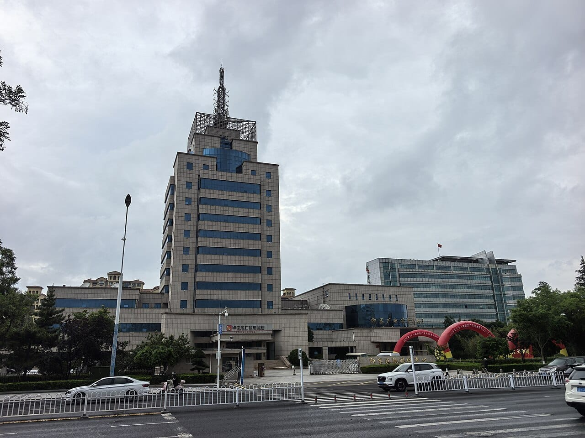

# Shandong Province

Shandong lies on China's east coast along the lower Yellow River. In the map of alcoholic drinks it is both a major baijiu producer and one of the leading northern yellow wine regions: Jimo laojiu uses broomcorn millet, wheat qu for saccharification and fermentation, and a scorched-mash step. This region focuses on yellow wine and mentions baijiu only where necessary.

Figure: Shandong Province. Image: Chrishcn, CC BY 2.0, via Wikimedia Commons ([source page](https://commons.wikimedia.org/wiki/File:PenglaiPavilion.jpg)).

## Geography and climate

Shandong is high in the centre and lower towards the coast, with hills and plains interleaved and a long coastline. The climate is warm temperate monsoon, with four distinct seasons, hot and humid summers, and cold, dry winters with rain concentrated in summer.

Climate acts directly on yellow wine: summer heat helps [fermentation](ref:fermentation) but brings souring risk, while winter cold slows fermentation and calls for temperature control and insulation. Water quality and millet quality are the base variables of Shandong yellow wine style.

## History

The yellow wine tradition of Shandong is tied to millet farming, canal transport and urban consumption. Workshops already existed around Jimo in the Ming and Qing periods, and Jimo laojiu gradually became a local famous wine. In the twentieth century, nationalisation and industrialisation merged some workshops and widened output.

After reform and opening, shifts in the low-alcohol and sweet-wine markets brought new competition, while local famous wines regained attention through tourism and the gift market. Sorting and standardising traditional practice also advanced during this period.

## Yellow wine regions

Jimo is the most representative area, see [Jimo](ref:jimo). Jimo laojiu uses broomcorn millet as its main material and is the classic northern millet yellow wine; other parts of Shandong have small workshops and brands, but the industry is less concentrated than in Jimo.

For Shandong Province, place names describe tradition and process origin, not quality grades. Within one area, producers differ clearly in material ratios, qu and ageing time; taking a place name as a quality guarantee ignores those differences.

## Raw materials and process

Jimo laojiu uses broomcorn millet, locally called large yellow millet, as its main material, wheat qu made from [wheat](ref:wheat) as the saccharifying and fermenting agent, and [water](ref:water). See the general principles of [qu making](ref:qu-making). Millet starch is mostly branched and very sticky after steaming, giving a full mouthfeel after saccharification.

The scorched-mash step is the gelatinisation stage of Jimo laojiu: millet is boiled to a mash and heated so that part of the starch caramelises, bringing colour and a roasted note. The mash is then mixed with qu, fermented in jars, pressed, pasteurised and stored. Temperatures and times belong to the producer.

## Style and types

Jimo laojiu is mostly semi-sweet or sweet, deep brown, with aromas of roast, rice and qu and a full palate. Compared with southern glutinous-rice yellow wines, the millet brings more stickiness and roasted character, and sweetness is often higher.

For Shandong Province, under GB/T 13662-2018, Yellow wine, the category is divided by sugar content and process, and labels state the type and alcohol content. Sweetness is a style description, not a quality ranking; treating sweet as inferior, or dry as superior, misreads the category.

## Representative products and producers

Jimo laojiu is the representative yellow wine of Shandong, made from millet, wheat qu and water with scorched-mash gelatinisation and storage. For specific brands and products see the drink pages; this region page describes geography, materials and the regulatory frame and does not rate individual brands.

Tradition often summarises Jimo laojiu through the six ancient methods, covering millet, qu, water, vessels, cleanliness and fire control. This is a later summary of traditional practice, not a legal grade, and it does not replace current standards.

## Regulation and regional protection

Production and labelling of Shandong yellow wine fall under food safety rules and national standards. GB/T 13662-2018, Yellow wine, sets terminology, classification, technical requirements and labelling; GB/T 17204-2021, Terminology and classification of alcoholic beverages, governs beverage classification. The current texts govern in detail.

For Shandong Province, geographical indications and protection of local famous wines involve origin range, process and material requirements. On a label, distinguish origin, type, alcohol content and producer; the use of a local famous name also follows the relevant rules.

## Market and drinking

Shandong yellow wine is sold mainly locally and also reaches outside markets through e-commerce and restaurants. Semi-sweet and sweet types suit Shandong cuisine, braised foods and home cooking, and can serve as after-dinner drinks. Cooking wine and drinking wine have different quality requirements and are not interchangeable.

Semi-sweet types can be served at room temperature or gently warmed, sweet types slightly chilled. After opening, keep the bottle chilled and drink it soon to avoid oxidation. Excessive drinking is harmful to health, and minors should not drink.

## Common misconceptions

First, assuming Shandong only makes baijiu. It also has yellow wine traditions such as Jimo laojiu.
Second, treating the six ancient methods as a legal grade or certification. They summarise traditional practice, not a standard classification.
Third, treating millet yellow wine as glutinous-rice yellow wine. Different materials give clearly different flavour and texture.
Fourth, believing darker colour means older wine. Colour depends on the scorched-mash step and ageing, and cannot stand alone as evidence.
Fifth, assuming sweet yellow wine is always low in alcohol. Sweetness and alcohol content are separate, and the label is the reference.

To read Shandong Province, start with the appellation and its permitted varieties, then the vintage and the producer, then how the wine is labelled; no single check settles it.

**Short definition:** A coastal province in eastern China and a leading northern yellow wine region; Jimo laojiu uses broomcorn millet, wheat qu and a scorched-mash step, while the six ancient methods are a traditional summary, not a legal grade.

**Key facts.**

| Item | Detail |
| --- | --- |
| In one line | A coastal province in eastern China and a leading northern yellow wine region; Jimo laojiu uses broomcorn millet, wheat qu and a scorched-mash step, while the six ancient methods are a traditional summary, not a legal gr… |
| Level | province or region |
| Parent | China |
| Country code | CN |

**Sources and limits.** The key claims about Shandong Province are checked against the following sources: People's Government of Shandong Province (administrative divisions and public provincial information; no original text is reproduced), State Administration for Market Regulation, Standardization Administration of China (terminology, classification and labelling requirements for yellow wine; no standard text is reproduced; classification and terminology of alcoholic beverages; no standard text is reproduced), Shandong Provincial Department of Agriculture and Rural Affairs (Used to check agricultural production and local specialty industries in Shandong) and 5 sources in total. Prices, batches and status change; the body is project-written and does not reproduce source text.

## Further reading

- [China](ref:china): the geographic and regulatory frame for Chinese drinks.
- [Yellow wine](ref:yellow-wine): definition, classification and process.
- [Jimo](ref:jimo): the core yellow wine area of Shandong.
- [Wheat](ref:wheat) and [water](ref:water): how wheat qu and water shape style.
- [Qu making](ref:qu-making) and [fermentation](ref:fermentation): wheat qu and jar fermentation.

## Related images

Image: Jimo District Converged Media Center in Qingdao, Shandong, China 20260607. Credit: 4084470 0.smil, CC BY 4.0, via Wikimedia Commons.. Credit: 4084470 0.smil, CC BY 4.0, via Wikimedia Commons ([source page](https://commons.wikimedia.org/w/index.php?curid=194207475)). Related image for Shandong Province.

Image: Yellow wine. Credit: udono, CC BY-SA 2.0, via Wikimedia Commons ([source page](https://commons.wikimedia.org/wiki/File:Shaoxing_wine_in_a_glass_by_udono_in_Tokyo.jpg)). Related image for Shandong Province.
