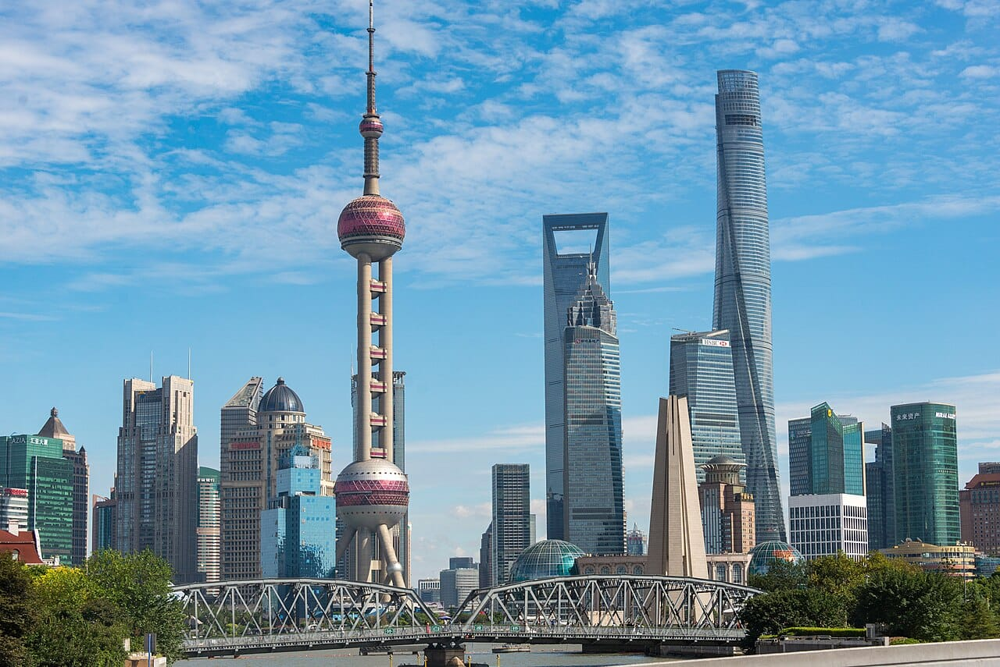

# Shanghai

Shanghai sits on China's east coast at the mouth of the Yangtze and is a municipality. In the map of alcoholic drinks it is both a huge consumer market and a yellow wine producer in its own right: Fengjing in Jinshan is the production core, and Shanghai laojiu is the most recognisable product name of the area.

Figure: Shanghai. Image: xiquinhosilva, CC BY 2.0, via Wikimedia Commons ([source page](https://commons.wikimedia.org/wiki/File:Huangpu_Park_20124-Shanghai_(32208802494).jpg)).

## Geography and climate

Shanghai lies on the Yangtze delta plain, low and densely covered with waterways, with the Huangpu and Suzhou rivers cutting through the city. The climate is subtropical monsoon, with four distinct seasons, hot and humid summers, mild winters and a very damp plum rain season.

The hot, damp climate acts on [fermentation](ref:fermentation): fermentation starts quickly and sours more easily, so workshops and factories need temperature control, staged loading and strict hygiene. Water quality and rice variety are the base variables of Shanghai yellow wine style.

## History

The yellow wine tradition of Shanghai is tied to Jiangnan rice farming, urban commerce and migrant consumers. Workshops already existed around Fengjing in the Ming and Qing periods, and in the twentieth century industrialisation and branding brought Shanghai yellow wine to a wider market.

After reform and opening, the industry adjusted towards lower alcohol, younger drinkers and the gift market, and Shanghai laojiu gradually became a product-category name. Urban drinking habits also shaped the range: semi-dry for meals, sweet for meals and after dinner.

## Yellow wine regions

The producing area centres on Fengjing in Jinshan. Dense waterways and a good glutinous-rice base supply materials and water, and other districts have small workshops and brands, though the industry is fairly concentrated.

Place names describe tradition and process origin, not quality grades. Within one area, producers differ clearly in material ratios, qu and ageing time; treating Shanghai laojiu as a single style ignores product tiers.

## Raw materials and process

Shanghai yellow wine uses [glutinous rice](ref:glutinous-rice) as its main material, wheat qu made from [wheat](ref:wheat) as the saccharifying and fermenting agent, and [water](ref:water). See the general principles of [qu making](ref:qu-making). The process covers steeping, steaming, cooling, mixing with qu, jar [fermentation](ref:fermentation), pressing, clarification, pasteurisation and storage.

Compared with [Shaoxing](ref:shaoxing) yellow wine, Shanghai manages the wheat qu share and fermentation temperature with its own leaning, and finished products often stress softness and sweetness. Parameters belong to the producer, and public sources usually describe principles.

## Style and types

Shanghai yellow wine is mainly semi-dry and sweet. Semi-dry types are fresher and suit meals; sweet types carry more sugar and a fuller body and are better as dessert or after-dinner drinks. Shanghai laojiu ranges from amber to deep brown, with aromas of rice, qu and light caramel.

For Shanghai, under GB/T 13662-2018, Yellow wine, the category is divided by sugar content and process, and labels state the type and alcohol content. Sweetness is a style description, not a quality ranking; treating sweet as inferior, or dry as superior, misreads the category.

## Representative products and producers

Shanghai laojiu is the representative category, usually made from glutinous rice, wheat qu and water and split into semi-dry and sweet types by sugar content. For specific brands and products see the drink pages; this region page describes geography, materials and the regulatory frame and does not rate individual brands.

Company scale, vintage and bottling batch decide more about a bottle than a place name does. Treating a category name as a quality guarantee is a common misreading.

## Regulation and regional protection

Production and labelling of Shanghai yellow wine fall under food safety rules and national standards. GB/T 13662-2018, Yellow wine, sets terminology, classification, technical requirements and labelling; GB/T 17204-2021, Terminology and classification of alcoholic beverages, governs beverage classification. The current texts govern in detail.

Geographical indications and protection of local famous wines involve origin range, process and material requirements. On a label, distinguish origin, type, alcohol content and producer.

## Market and drinking

Shanghai yellow wine is sold mainly locally and also reaches outside markets through e-commerce and restaurants. Semi-dry types suit Shanghai home cooking, river fish and everyday dishes; sweet types suit desserts or after-dinner drinking. Cooking wine and drinking wine have different quality requirements and are not interchangeable.

For Shanghai, semi-dry types can be served at room temperature or gently warmed, sweet types slightly chilled. After opening, keep the bottle chilled and drink it soon to avoid oxidation. Excessive drinking is harmful to health, and minors should not drink.

## Common misconceptions

First, assuming Shanghai makes no yellow wine. It has producing areas and traditions such as Fengjing.
Second, treating Shanghai laojiu as one fixed brand. It is a category name, and products differ clearly between companies.
Third, believing darker colour means older wine. Colour depends on materials, qu and ageing, and cannot stand alone as evidence.
Fourth, treating sweet as low-end. Sweetness is a style direction, not a quality grade.
Fifth, believing yellow wine must be drunk warm. Temperature is a matter of matching style, not a fixed rule.

**Short definition:** A municipality on China's east coast and one of the country's key yellow wine markets and producers; Fengjing in Jinshan is the production core, and Shanghai laojiu uses glutinous rice and wheat qu, mostly semi-dry or sweet.

Begin with the appellation and its permitted varieties, move on to the vintage and the producer, and finish with how the wine is labelled. That order keeps the reading of Shanghai practical.

The comparison with [China](ref:china) and [Shaoxing](ref:shaoxing) runs through geographic boundary and climate and soil. Each answers a different question.

Shanghai is a drinks market rather than a grape region; its bars and restaurants drive imported wine, craft beer and baijiu consumption.

Shanghai has no protected wine region; its drinks scene is driven by imported wine, craft beer and baijiu.

**Key facts.**

| Item | Detail |
| --- | --- |
| In one line | A municipality on China's east coast and one of the country's key yellow wine markets and producers; Fengjing in Jinshan is the production core, and Shanghai laojiu uses glutinous rice and wheat qu, mostly semi-dry or sw… |
| Level | province or region |
| Parent | China |
| Country code | CN |

**Sources and limits.** The key claims about Shanghai are checked against the following sources: Shanghai Municipal People's Government (administrative divisions and public city information; no original text is reproduced), State Administration for Market Regulation, Standardization Administration of China (terminology, classification and labelling requirements for yellow wine; no standard text is reproduced; classification and terminology of alcoholic beverages; no standard text is reproduced), Shanghai Municipal Commission of Agriculture and Rural Affairs (Used to check agriculture and local food industries in Shanghai) and 5 sources in total. Prices, batches and status change; the body is project-written and does not reproduce source text.

## Further reading

- [China](ref:china): the geographic and regulatory frame for Chinese drinks.
- [Yellow wine](ref:yellow-wine): definition, classification and process.
- [Shaoxing](ref:shaoxing): a wheat-qu yellow wine region for comparison.
- [Glutinous rice](ref:glutinous-rice) and [wheat](ref:wheat): the base material and the qu material.
- [Water](ref:water), [qu making](ref:qu-making) and [fermentation](ref:fermentation): the key stages of yellow wine production.
