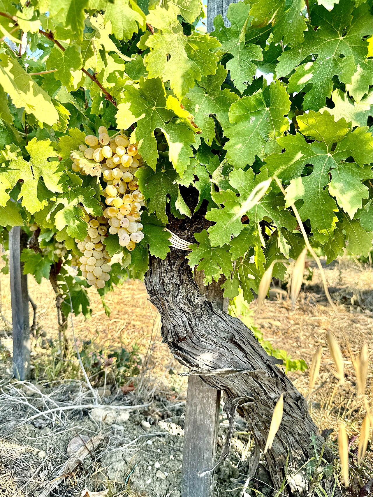

# Sicily

The largest Mediterranean island and one of Italy’s most productive wine regions; from Marsala fortified wine in the west to Mount Etna in the east, its range is huge, with Nero d’Avola, Catarratto, Grillo and Frappato at the core.

Figure: Sicily: Old Inzolia vine in vineyard Dietro le Case, Menfi, Sicily (Wikimedia Commons). Image: Marilena.CantineBarbera, CC BY 4.0, via Wikimedia Commons ([source page](https://commons.wikimedia.org/wiki/File:Old_Inzolia_vine_in_vineyard_Dietro_le_Case,_Menfi,_Sicily.jpg)).

## Definition and boundaries

Sicily is the largest Mediterranean island with a hot, sunny climate, but altitude and sea breezes can cool sites markedly; west and east, coast and volcano differ greatly.

In an official geographical indication, the boundaries of Sicily are not a decorative line but a legal and historical construction made of place names, parcels and maps. It may be a county, a group of villages, or a narrow strip along a river or mountain; the more specific the name, the less freely it can be used on a label.

Sicily is an island of distinct appellations, not one wine. Etna’s volcanic slopes, Vittoria’s red limestone, Marsala’s coastal zone, Noto’s southeast and Pantelleria’s island have different soils and climates. The sub-region on the label is the first clue to variety and style.

## History and naming

Nero d’Avola is the best-known red, deep in colour with medium-high tannin, often blended with Frappato; Catarratto and Grillo are the main whites, the latter common in Marsala.

The name Sicily usually appears first in local archives, church records or tax rolls, and only later in modern regulations. The name often stabilises later than the boundary, which is why the same place can carry different spellings across languages and periods.

Greek colonists planted vines in the eighth century BC, and Marsala became a major export in the eighteenth and nineteenth centuries. In the late twentieth century, COS, Occhipinti, Tasca d’Almerita and Planeta shifted the image from bulk wine to boutique production. The island’s layers of Greek, Arab, Norman and Spanish rule shaped its agriculture.

## Geography and terroir

Mount Etna is the island’s most distinctive sub-region: high altitude, volcanic ash and lava soils, large diurnal range, with Nerello Mascalese and Carricante as the core.

The vineyards of Sicily sit at particular elevations, aspects and soil parent materials. Distance to the sea, mountain direction, diurnal range and harvest rain all change ripening and acidity; these conditions explain more about style than the name alone.

Etna is a high volcano with lava, ash and mineral soils; altitude and diurnal range keep Nerello Mascalese fresh. Vittoria’s red limestone and sea influence give Nero d’Avola fullness and spice. The western and southern coasts are hotter and drier, while Pantelleria’s wind and volcanic soil concentrate Zibibbo for sweet wine.

## Raw materials and styles

Marsala is the western fortified wine, made from white grapes with added alcohol, in dry, semi-dry and sweet styles; it ranges from aperitif to dessert wine.

The vines of Sicily determine what can be made. The leading varieties or raw materials, permitted blends, minimum ripeness and maximum yields are usually written into rules; but rules are a floor, and the real style comes from picking dates, fermentation vessels and ageing.

Etna picks late, often into October, to ripen Nerello Mascalese; Vittoria picks Nero d’Avola earlier; Zibibbo for Pantelleria passito is left until sugar is high. The harvest is long and varied across altitudes, and heat or rain can change the sequence. Picking date is a style decision as much as a ripeness one.

## Representative producers and wines

Representative producers include Donnafugata, CO.S, Tasca d’Almerita, Planeta, Benanti and Pietradolce; Etna volcanic wines are the most discussed recent style.

The representative wineries of Sicily usually show the two poles of a region: long-established families or cooperatives with concentrated holdings, and newer arrivals working parcel by parcel. Tasting both explains the region better than a list of famous names.

Large cooperatives, historic estates and small natural wineries coexist. COS and Occhipinti work organically and with low intervention; Tasca d’Almerita and Planeta combine estates with hospitality and broad distribution. Some brands buy fruit from multiple zones, so the sub-region and variety remain the best guide.

## How to drink and pair

To drink Sicily, start with alcohol, acidity and tannin or bitterness, then choose temperature and food. High acidity suits fat and salt, high tannin needs protein and fat, and high alcohol clashes with sweet or very spicy dishes; warmth pushes alcohol over aroma.

Serve Nero d’Avola at 16–18°C, Nerello Mascalese at 14–16°C, whites at 8–10°C and Marsala at 14–16°C. Tomato sauces, aubergine, roast meat and hard cheese suit Nero; mushrooms, poultry and light cheese suit Nerello; seafood, salads and fried food suit the whites; dried fruit and chocolate suit sweet Marsala.

## Labels, buying and misreadings

Read Sicily through the appellation and its permitted varieties, then the vintage and the producer, and finally how the wine is labelled. The sequence matters.

Heat and drought dominate the coast, while Etna’s altitude can preserve acidity even in a warm year. Vintage variation is large for Nero d’Avola and Nerello Mascalese; Marsala is a blended, oxidative product rather than a single-vintage wine. Ask for the sub-region and harvest year.

### Key dates and figures

- 1980s: in the 1980s–90s, COS, Occhipinti and other estates re-emphasised local varieties and low yields.

## Around and routes

Putting Sicily into an itinerary means separating the regional centre from specific wineries: the first is for landscape, markets and food, the second needs bookings, tastings and travel time. Too many stops in one day exhaust both palate and attention.

Palermo and Catania are the main airports; Etna and Vittoria are on opposite sides of the island, so combining them in one day is unrealistic. Three wineries plus lunch is a full day, and travel times are longer than the map suggests. Book estate visits and check harvest-season closures.

- Related: [italy](ref:italy), [barbera](ref:barbera), [red-wine](ref:red), [white-wine](ref:white), [fortified-wine](ref:fortified).
- This page provides no map, prices or opening hours; confirm before travelling.

**Short definition:** The largest Mediterranean island and one of Italy’s most productive wine regions; from Marsala fortified wine in the west to Mount Etna in the east, its range is huge, with Nero d’Avola, Catarratto, Grillo and Frappato at the core.

Sicily ranges from Marsala in the west to Mount Etna in the east, with Nero d'Avola, Catarratto and Grillo as core varieties.

**Key facts.**

| Item | Detail |
| --- | --- |
| In one line | The largest Mediterranean island and one of Italy’s most productive wine regions; from Marsala fortified wine in the west to Mount Etna in the east, its range is huge, with Nero d’Avola, Catarratto, Grillo and Frappato a… |
| Level | province or region |
| Parent | Italy |
| Country code | IT |
